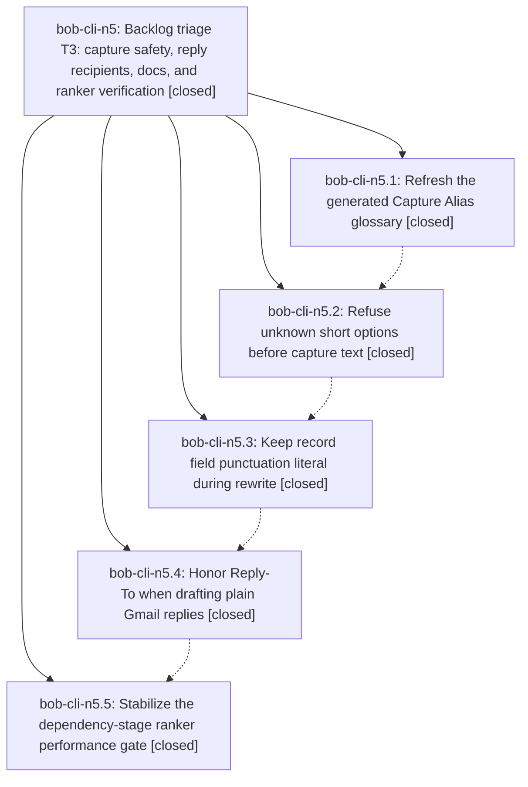

# Bead: bob-cli-n5 — Backlog triage T3: capture safety, reply recipients, docs, and ranker verification

[Bead Pages](../README.md) / bob-cli-n5

**Status:** ✓ closed · **Resolution:** done · **Type:** ▸ plan · **Tier:** epic
**Owner:** `bryanbugyi34@gmail.com` · **Created by:** [bbugyi200.athena.bob-cli-my.land](https://github.com/bobs-org/bob-cli--agents/blob/main/sessions/bbugyi200.athena.bob-cli-my.land.md) · **Assignee:** `bob-cli-n5.land`
**Created:** 2026-11-17 22:21:55 EST · **Closed:** 2026-11-18 01:41:38 EST
**Plan:** [202611/backlog\_triage\_t3.md](https://github.com/bobs-org/bob-cli--plans/blob/main/202611/backlog_triage_t3.md)

<!-- sase:links:start -->

## Links

| Relation | Artifact | Why |
| --- | --- | --- |
| implemented-by | [plan:202611/backlog_triage_t3.md][1] | derived from the plan's `bead_id:` frontmatter field |

_Plus 2 automatic references — see [Referenced By](#referenced-by)._

[1]: https://github.com/bobs-org/bob-cli--plans/blob/main/202611/backlog_triage_t3.md

<!-- sase:links:end -->

## Description

Resolve five existing defects without changing capture grammar or writing to live services, then continue the five-task backlog chain.

## Notes

[2026-11-18T06:41:38Z · bob-cli-n5.land] Landing verified on bob-cli master f1d98b7f and bob-plugins 87c7b72. Phases: n5.1 found mz already fixed by 03ab2b3d (glossary regen; just docs-gen clean); n5.2 f2a61792 refuses unknown alphabetic short options before TEXT in all capture-style commands; n5.3 612d1342 keeps spaced ./; literal inside first-level record key:: values via record::in_record_field_value (rewrite/capture-complete parity); n5.4 f1d98b7f honors usable Reply-To for plain Gmail replies with account filtering, self-sent To fallback, and malformed-header validation; n5.5 87c7b72 gates the 1,000-task stage ranker on warmed min CPU work with a sleep-vs-spin seam test, unchanged 16 ms budget/workload. Lander reproduced with a fresh debug build: capture -o and capture-parse -b now exit 2 with unexpected-argument JSON, -- keeps -o literal, record-value ; and . rewrite is a no-op while ordinary ';' still aliases. Targeted suites green (flag_guard unit 12, cli flag_guard 11, rewrite 96, capture_complete records 44, gmail_draft 13), ranker file 27/27 standalone at loadavg ~26-40, sase tool run check succeeded, just docs-check all gates passed. Closed tasks mz (earlier), 8a, ja, ia, 3w. Integration: post-start non-epic commits 03ab2b3d (mz's fix), 4f801ee2 and 71176f47 (bob-cli-mx walks/docs) and bob-plugins 9ad471d (record titles) neither use nor conflict with this epic; Bob Mac Capture, bob-mail and command-mode catalog callers all pass -- or non-alphabetic fixed args, so the short-flag refusal breaks no client; no edits needed. Follow-ups: n5.1 #1 / n5.2 #1 docs contract registry 52-vs-51 drift declined as already fixed by 71176f47 (docs-check passes); n5.5 #1 keep-moving-marks surface 1072.6 ms miss +1'd on existing bob-cli-ki; n5.5 #2 stage-performance 400-task 268.1 ms miss +1'd on existing bob-cli-m1. epic-symbols: none. bob plugins sync: test-only change, no bundle changed.

[2026-11-18T06:54:16Z · bob-cli-n5.land] BACKLOG CONTINUATION TRIAGE (bob-cli-n5.land): re-swept the 232 active task rows (10 snoozed; 6q/aa/ah/cp/e3/i8 past wake but data-review work, lf/jd/ku/kv not yet due) and 13 in-progress plan scopes, 3 h after bob-cli-my.land's full sweep. No further bead is verifiably obsolete or duplicate on the post-T2 commits (03ab2b3d, 4f801ee2, 71176f47, f2a61792, 612d1342, f1d98b7f, bob-plugins 87c7b72/9ad471d). New finding: master test (macos-latest) has failed or been cancelled on every completed run since ~2026-11-14 and no release has shipped since v0.5.0 (2026-11-07); run 44227364061 (2f14eef5) fails 12 macOS-only nodes. +1'd l9 (4 nodes plus 3 same-class scan_interleave clash.pdf/clash.PDF nodes), noted kl's deterministic macOS facet (no setsid(1)), and created ci task bob-cli-n6 (medium; note_catalog xlib tier x2 + note_goto vault_root under the /var->/private/var symlink) after title/regex searches, the 1-week ci sweep, and confirming its source epics ly/mb are closed. Noted ks: the picker runtime file exits after ~30 s (lingering timer), not a hang. Selected for T4 (plan backlog_triage_t4): l9, n6, kl (deterministic red gate on master), then ju and ki (+20 each, single-sample Live Preview wall-clock gates fixable with 87c7b72's CPU-work convention). Deferred: io/km/ej (same pattern, five-bead cap), it (+6, stale reused-workspace output only), jp (daily pain, refused transfer), ks, cd (needs Bryan-gated three-host untrack), mv/mq (design), f8/fz.

## Phases

| Bead | Title | Status | Size | Created | Agents | Commits |
|---|---|---|---|---|---:|---:|
| [bob-cli-n5.1](bob-cli-n5.1.md) | Refresh the generated Capture Alias glossary | ✓ closed | small | 2026-11-17 | 1 | 0 |
| [bob-cli-n5.2](bob-cli-n5.2.md) | Refuse unknown short options before capture text | ✓ closed | medium | 2026-11-17 | 1 | 1 |
| [bob-cli-n5.3](bob-cli-n5.3.md) | Keep record field punctuation literal during rewrite | ✓ closed | medium | 2026-11-17 | 1 | 1 |
| [bob-cli-n5.4](bob-cli-n5.4.md) | Honor Reply-To when drafting plain Gmail replies | ✓ closed | medium | 2026-11-17 | 1 | 1 |
| [bob-cli-n5.5](bob-cli-n5.5.md) | Stabilize the dependency-stage ranker performance gate | ✓ closed | medium | 2026-11-17 | 1 | 1 |

## Lineage

## Agents

| Agent | Bead | Commits |
|---|---|---:|
| [bbugyi200.athena.bob-cli-n5.1](https://github.com/bobs-org/bob-cli--agents/blob/main/agents/bbugyi200.athena.bob-cli-n5.1/README.md) | [bob-cli-n5.1](bob-cli-n5.1.md) | 0 |
| [bbugyi200.athena.bob-cli-n5.2](https://github.com/bobs-org/bob-cli--agents/blob/main/sessions/bbugyi200.athena.bob-cli-n5.2.md) | [bob-cli-n5.2](bob-cli-n5.2.md) | 1 |
| [bbugyi200.athena.bob-cli-n5.3](https://github.com/bobs-org/bob-cli--agents/blob/main/agents/bbugyi200.athena.bob-cli-n5.3/README.md) | [bob-cli-n5.3](bob-cli-n5.3.md) | 1 |
| [bbugyi200.athena.bob-cli-n5.4](https://github.com/bobs-org/bob-cli--agents/blob/main/agents/bbugyi200.athena.bob-cli-n5.4/README.md) | [bob-cli-n5.4](bob-cli-n5.4.md) | 1 |
| [bbugyi200.athena.bob-cli-n5.5](https://github.com/bobs-org/bob-cli--agents/blob/main/agents/bbugyi200.athena.bob-cli-n5.5/README.md) | [bob-cli-n5.5](bob-cli-n5.5.md) | 1 |
| [bbugyi200.athena.bob-cli-n5.land](https://github.com/bobs-org/bob-cli--agents/blob/main/agents/bbugyi200.athena.bob-cli-n5.land/README.md) | [bob-cli-n5](README.md) | 1 |

## Commits

| Repo | Commit | Subject | Bead | Committed |
|---|---|---|---|---|
| bob-cli | [`f2a6179`](https://github.com/bobs-org/bob-cli/commit/f2a61792ad1c1cae50d9fd0cbc6ba97994c689ec) | fix(capture): guard unknown short options | [bob-cli-n5.2](bob-cli-n5.2.md) | 2026-11-18 00:03:48 EST |
| bob-cli | [`612d134`](https://github.com/bobs-org/bob-cli/commit/612d134278173c650dadfe5f63b14e9690c78b6e) | fix(capture): keep record field punctuation literal during rewrite | [bob-cli-n5.3](bob-cli-n5.3.md) | 2026-11-18 00:46:18 EST |
| bob-cli | [`f1d98b7`](https://github.com/bobs-org/bob-cli/commit/f1d98b7fc1f79a42759573ca6fa748d6a473d243) | fix(gmail): honor Reply-To for plain replies | [bob-cli-n5.4](bob-cli-n5.4.md) | 2026-11-18 01:13:24 EST |
| bob-plugins | [`bob-plugins@87c7b72`](https://github.com/bobs-org/bob-plugins/commit/87c7b721ca38ae2380b8c1b446b060bf7e2ff729) | test(nav): gate stage-ranker budget on CPU work, not wall time | [bob-cli-n5.5](bob-cli-n5.5.md) | 2026-11-18 01:22:30 EST |
| bob-cli--plans | [`bob-cli--plans@c68b24b`](https://github.com/bobs-org/bob-cli--plans/commit/c68b24b1eb6c10e54e6c0f5c3ab9ddbe26013507) | chore(plans): mark backlog\_triage\_t3 done | [bob-cli-n5](README.md) | 2026-11-18 01:55:04 EST |

<!-- sase:referenced-by:start -->

## Referenced By

| Relation | Artifact | Why | Uses |
| --- | --- | --- | ---: |
| read-by | [agent:bob-cli-n5.3][1] | need epic decisions and context | 1 |
| read-by | [agent:bob-cli-n5.4][2] | Need phase attachments and parent epic decisions for implementation | 1 |

[1]: https://github.com/bobs-org/bob-cli--agents/blob/main/agents/bbugyi200.athena.bob-cli-n5.3/README.md
[2]: https://github.com/bobs-org/bob-cli--agents/blob/main/agents/bbugyi200.athena.bob-cli-n5.4/README.md

<!-- sase:referenced-by:end -->
