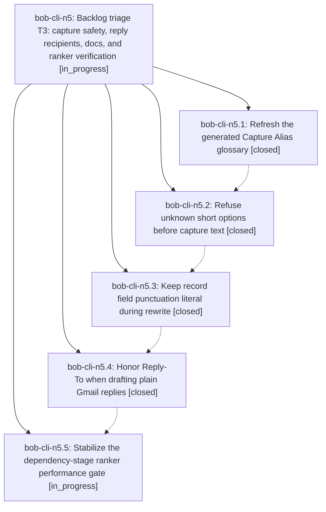

# Bead: bob-cli-n5 — Backlog triage T3: capture safety, reply recipients, docs, and ranker verification

[Bead Pages](../README.md) / bob-cli-n5

**Status:** ◐ in_progress · **Type:** ▸ plan · **Tier:** epic
**Owner:** `bryanbugyi34@gmail.com` · **Created by:** [bbugyi200.athena.bob-cli-my.land](https://github.com/bobs-org/bob-cli--agents/blob/main/sessions/bbugyi200.athena.bob-cli-my.land.md) · **Assignee:** `bob-cli-n5.land`
**Created:** 2026-11-17 22:21:55 EST
**Plan:** [202611/backlog\_triage\_t3.md](https://github.com/bobs-org/bob-cli--plans/blob/main/202611/backlog_triage_t3.md)

<!-- sase:links:start -->

## Links

| Relation | Artifact | Why |
| --- | --- | --- |
| implemented-by | [plan:202611/backlog_triage_t3.md][1] | derived from the plan's `bead_id:` frontmatter field |

_Plus 1 automatic references — see [Referenced By](#referenced-by)._

[1]: https://github.com/bobs-org/bob-cli--plans/blob/main/202611/backlog_triage_t3.md

<!-- sase:links:end -->

## Description

Resolve five existing defects without changing capture grammar or writing to live services, then continue the five-task backlog chain.

## Phases

| Bead | Title | Status | Size | Created | Agents | Commits |
|---|---|---|---|---|---:|---:|
| [bob-cli-n5.1](bob-cli-n5.1.md) | Refresh the generated Capture Alias glossary | ✓ closed | small | 2026-11-17 | 1 | 0 |
| [bob-cli-n5.2](bob-cli-n5.2.md) | Refuse unknown short options before capture text | ✓ closed | medium | 2026-11-17 | 1 | 1 |
| [bob-cli-n5.3](bob-cli-n5.3.md) | Keep record field punctuation literal during rewrite | ✓ closed | medium | 2026-11-17 | 1 | 1 |
| [bob-cli-n5.4](bob-cli-n5.4.md) | Honor Reply-To when drafting plain Gmail replies | ✓ closed | medium | 2026-11-17 | 1 | 1 |
| [bob-cli-n5.5](bob-cli-n5.5.md) | Stabilize the dependency-stage ranker performance gate | ◐ in_progress | medium | 2026-11-17 | 1 | 0 |

## Lineage

## Agents

| Agent | Bead | Commits |
|---|---|---:|
| [bbugyi200.athena.bob-cli-n5.1](https://github.com/bobs-org/bob-cli--agents/blob/main/agents/bbugyi200.athena.bob-cli-n5.1/README.md) | [bob-cli-n5.1](bob-cli-n5.1.md) | 0 |
| [bbugyi200.athena.bob-cli-n5.2](https://github.com/bobs-org/bob-cli--agents/blob/main/sessions/bbugyi200.athena.bob-cli-n5.2.md) | [bob-cli-n5.2](bob-cli-n5.2.md) | 1 |
| [bbugyi200.athena.bob-cli-n5.3](https://github.com/bobs-org/bob-cli--agents/blob/main/agents/bbugyi200.athena.bob-cli-n5.3/README.md) | [bob-cli-n5.3](bob-cli-n5.3.md) | 1 |
| [bbugyi200.athena.bob-cli-n5.4](https://github.com/bobs-org/bob-cli--agents/blob/main/agents/bbugyi200.athena.bob-cli-n5.4/README.md) | [bob-cli-n5.4](bob-cli-n5.4.md) | 1 |
| [bbugyi200.athena.bob-cli-n5.5](https://github.com/bobs-org/bob-cli--agents/blob/main/agents/bbugyi200.athena.bob-cli-n5.5/README.md) | [bob-cli-n5.5](bob-cli-n5.5.md) | 0 |
| [bbugyi200.athena.bob-cli-n5.land](https://github.com/bobs-org/bob-cli--agents/blob/main/agents/bbugyi200.athena.bob-cli-n5.land/README.md) | [bob-cli-n5](README.md) | 0 |

## Commits

| Repo | Commit | Subject | Bead | Committed |
|---|---|---|---|---|
| bob-cli | [`f2a6179`](https://github.com/bobs-org/bob-cli/commit/f2a61792ad1c1cae50d9fd0cbc6ba97994c689ec) | fix(capture): guard unknown short options | [bob-cli-n5.2](bob-cli-n5.2.md) | 2026-11-18 00:03:48 EST |
| bob-cli | [`612d134`](https://github.com/bobs-org/bob-cli/commit/612d134278173c650dadfe5f63b14e9690c78b6e) | fix(capture): keep record field punctuation literal during rewrite | [bob-cli-n5.3](bob-cli-n5.3.md) | 2026-11-18 00:46:18 EST |
| bob-cli | [`f1d98b7`](https://github.com/bobs-org/bob-cli/commit/f1d98b7fc1f79a42759573ca6fa748d6a473d243) | fix(gmail): honor Reply-To for plain replies | [bob-cli-n5.4](bob-cli-n5.4.md) | 2026-11-18 01:13:24 EST |

<!-- sase:referenced-by:start -->

## Referenced By

| Relation | Artifact | Why | Uses |
| --- | --- | --- | ---: |
| read-by | [agent:bob-cli-n5.3][1] | need epic decisions and context | 1 |

[1]: https://github.com/bobs-org/bob-cli--agents/blob/main/agents/bbugyi200.athena.bob-cli-n5.3/README.md

<!-- sase:referenced-by:end -->
