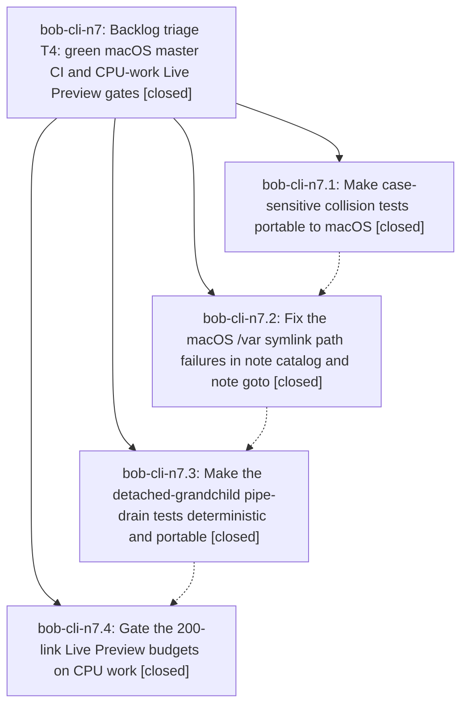

# Bead: bob-cli-n7 — Backlog triage T4: green macOS master CI and CPU-work Live Preview gates

[Bead Pages](../README.md) / bob-cli-n7

**Status:** ✓ closed · **Resolution:** done · **Type:** ▸ plan · **Tier:** epic
**Owner:** `bryanbugyi34@gmail.com` · **Created by:** [bbugyi200.athena.bob-cli-n5.land](https://github.com/bobs-org/bob-cli--agents/blob/main/sessions/bbugyi200.athena.bob-cli-n5.land.md) · **Assignee:** `bob-cli-n7.land`
**Created:** 2026-11-18 01:55:52 EST · **Closed:** 2026-11-18 18:11:31 EST
**Plan:** [202611/backlog\_triage\_t4.md](https://github.com/bobs-org/bob-cli--plans/blob/main/202611/backlog_triage_t4.md)

<!-- sase:links:start -->

## Links

| Relation | Artifact | Why |
| --- | --- | --- |
| implemented-by | [plan:202611/backlog_triage_t4.md][1] | derived from the plan's `bead_id:` frontmatter field |

_Plus 1 automatic references — see [Referenced By](#referenced-by)._

[1]: https://github.com/bobs-org/bob-cli--plans/blob/main/202611/backlog_triage_t4.md

<!-- sase:links:end -->

## Description

Make bob-cli's macos-latest master test job green so the release train can ship again, then stop the two most-corroborated bob-plugins wall-clock flakes, and continue the five-task backlog chain.

## Notes

[2026-11-18T15:53:42Z · bob-cli-n7.land] LANDING AUDIT AND FOLLOW-UP TRIAGE (2026-11-18): Read all four phases and every note, the original five task beads, plan:202611/backlog_triage_t4.md, bob-cli commits 509d8572/1f6cc7be/f0857be8 and plugin b2a6d2b. No DECISIONS or parent_bead. Collision repair preserves safety and passed all seven exact nodes in macOS run 44273496460 job 134695683540 plus current-master Ubuntu run 44335332552 job 134910729425; closed l9 with this evidence. Symlink product fix and Linux alias regression are present; macOS evidence remains missing for n6/kl. CPU helper keeps warmups/min-of-7, 35/250 ms budgets, workloads and functional assertions; independent focused run on plugin b2a6d2b passed 71/71 including sleep-vs-spin seam, best CPU off-clock 4.48ms, keep-moving 54.74ms, load 14.0/18.7/27.9 on 64 CPUs. Phase full-suite evidence/deployment accepted. Reopened n7.3 for test cleanup defect: stdout is empty when receive_before times out, so PID-from-stdout guard is never armed; holder still sleeps 8s rather than waiting for test release. Integration since first epic commit: bob-cli ce6425f5 headlines, 2f80442b H1-less records, aea85529 walk attention; plugin 04ef18f headlines and c7e6d3e attention. No feature consumers conflict; H1-less assertion in 2f80442b creates the one-line rustfmt failure reproduced on clean f0857be8. Latest master CI 44335332552 has Ubuntu/package green, lint red for that line, macOS canceled. All proposed follow-ups triaged via sase_new_task search, 68-task weekly sweep and active epic check: n7.1 #1 n6/kl are already this epic scope, declined as duplicate follow-ups; n7.2 #3 compile timeout is new ready CI task bob-cli-n9 (large, diagnosis needed), evidence file:explicit:5633c7224fa64f51f01da38a, distinct from mj closed-epic note; n7.3 #1/#5 are the same fmt defect, attached as DISCOVERED ISSUE to causal active epic ms.8 and explicitly included as n7 integration repair, no new task; n7.4 #1 corroborated io (+16) and m1 (+2), no new tasks or broader perf work. No --epic-symbol entries for n7; no just symvision recipe. Remaining medium tale must fix fixture cleanup and fmt, obtain just check and real macOS verdict, close n6/kl and reopened phase, then close n7 and mark its linked plan done. Do not treat phase closure or compile cancellation as verification; no check-full run.

[2026-11-18T23:11:31Z · bob-cli-n7.land--a] T4 landed with complete evidence on exact snapshot 2dfbcb85d861f5f73ef6da8b059f7e6b25651ade, CI run 44408541155, macOS job 135170175416, and Linux job 135170175253. Both full test jobs, lint, package, macOS-only lint, and the macOS archive-move presenter passed; the macOS job finished in 41m55s within its 45m deadline. Both platforms pass the seven l9 collision nodes, three n6 symlink nodes plus the Linux symlink-alias regression, both kl pipe-drain nodes, and all six record regressions. macOS also passes pipe_drain_fixture_cleans_up_during_assertion_unwind and pipe_drain_fixture_cleans_up_when_runner_fails_early. The H1-less assertion rustfmt repair is covered by lint job 135170174879 and recorded on ms.8. Code audit confirms the portable Python os.fork/os.setsid holder, explicit release sentinel, verified reaping, Drop cleanup, and preserved 4s/output assertions; ToolRun 8f15360328bae95b3bd7f3c22554a77f just check exited 0 in 8m33s. Prior n7.4 CPU evidence remains: 4.48ms off-clock, 54.74ms keep-moving, load 14.0/18.7/27.9 on 64 CPUs. Follow-ups: n7.1's remaining nodes were n6/kl and are now closed; n7.2's compile-timeout blocker is resolved by CARGO_PROFILE_TEST_DEBUG=0 and CARGO_PROFILE_DEV_DEBUG=0 on macOS; n7.3's rustfmt issue is repaired and logged on ms.8; n7.4's unrelated timing misses remain tracked by bob-cli-io and bob-cli-m1, both left open. Rechecked epic symbols: none. Origin was refreshed to 2f1dca1c, six commits beyond base 3b5490c1; it adds a 90m macOS timeout and term_grace/interrupt fields to subprocess_runner.rs and has overlapping album-walk edits. The tested snapshot predates those changes; no force push or rebase was used.

[2026-11-18T23:11:54Z · bob-cli-n7.land--a] Ran just symvision after close; the current and origin Justfiles contain no symvision recipe, so the requested check is unavailable.

[2026-11-19T09:51:55Z · bob-cli-n7.land] CLOSED-BEAD LAUNCH: agent bob-cli-n7.land launched against this closed bead; status left closed.
Launch submitted 2026-11-19T09:50:51.541638Z; run 20261119045053.
Prior close: 2026-11-18T23:11:31Z · done.

[2026-11-19T09:56:39Z · bob-cli-n7.land] CLOSED-BEAD RELAUNCH VERIFICATION (2026-11-19): Earlier landing is complete. Commits 509d8572, 1f6cc7be, f0857be8, b73f4aad are on master; all four phases and source tasks l9/n6/kl/n9 are closed; io/m1 stay open as tracked timing flakes. Post-landing commits 3617c2ea..e07a26bf touch no epic file (subprocess_runner.rs, note_catalog, ci.yml, record_note.rs, albums_create.rs), so no integration work is needed. Latest master run 44493916247 (e07a26bf): macOS job 135456164557 finished in about 28m, inside the 45m deadline, and passes golden_listed_set_and_canonical_order, shared_path_tiers_agree_with_the_living_walk, symlinked_vault_root_keeps_library_tiers_hidden, note_goto shape, both pipe_drain bound tests and both fixture-cleanup tests, plus the record collision nodes. Lint and package are green. Both test jobs are red only on 12 tick:: CLI tests. The cause is the bob tick (nb) readiness gate: it reads the host's real-day note while the fixture pins 2026-11-18. That is not caused by n7, so I filed new ready ci task bob-cli-nf (small) linked to nb. Earlier follow-up triage stands: n7.1 and n7.3 follow-ups were resolved in scope, n7.2 became n9 (now closed), and n7.4 was corroborated onto io/m1. Epic symbols: none. No symvision recipe exists. The prior lander missed one step, so the plan file plan:202611/backlog_triage_t4.md now has status: done. No parent bead.

## Phases

| Bead | Title | Status | Size | Created | Agents | Commits |
|---|---|---|---|---|---:|---:|
| [bob-cli-n7.1](bob-cli-n7.1.md) | Make case-sensitive collision tests portable to macOS | ✓ closed | medium | 2026-11-18 | 1 | 1 |
| [bob-cli-n7.2](bob-cli-n7.2.md) | Fix the macOS /var symlink path failures in note catalog and note goto | ✓ closed | medium | 2026-11-18 | 1 | 1 |
| [bob-cli-n7.3](bob-cli-n7.3.md) | Make the detached-grandchild pipe-drain tests deterministic and portable | ✓ closed | medium | 2026-11-18 | 1 | 1 |
| [bob-cli-n7.4](bob-cli-n7.4.md) | Gate the 200-link Live Preview budgets on CPU work | ✓ closed | medium | 2026-11-18 | 1 | 0 |

## Lineage

## Agents

| Agent | Bead | Commits |
|---|---|---:|
| [bbugyi200.athena.bob-cli-n7.1](https://github.com/bobs-org/bob-cli--agents/blob/main/sessions/bbugyi200.athena.bob-cli-n7.1.md) | [bob-cli-n7.1](bob-cli-n7.1.md) | 1 |
| [bbugyi200.athena.bob-cli-n7.2](https://github.com/bobs-org/bob-cli--agents/blob/main/sessions/bbugyi200.athena.bob-cli-n7.2.md) | [bob-cli-n7.2](bob-cli-n7.2.md) | 1 |
| [bbugyi200.athena.bob-cli-n7.3](https://github.com/bobs-org/bob-cli--agents/blob/main/sessions/bbugyi200.athena.bob-cli-n7.3.md) | [bob-cli-n7.3](bob-cli-n7.3.md) | 1 |
| [bbugyi200.athena.bob-cli-n7.4](https://github.com/bobs-org/bob-cli--agents/blob/main/sessions/bbugyi200.athena.bob-cli-n7.4.md) | [bob-cli-n7.4](bob-cli-n7.4.md) | 0 |
| [bbugyi200.athena.bob-cli-n7.land](https://github.com/bobs-org/bob-cli--agents/blob/main/agents/bbugyi200.athena.bob-cli-n7.land/README.md) | [bob-cli-n7](README.md) | 2 |

## Commits

| Repo | Commit | Subject | Bead | Committed |
|---|---|---|---|---|
| bob-cli | [`509d857`](https://github.com/bobs-org/bob-cli/commit/509d8572b50c753743ee5082d566e7c9adf342e5) | test(collision): normalize filesystem-sensitive cases for macOS | [bob-cli-n7.1](bob-cli-n7.1.md) | 2026-11-18 04:10:47 EST |
| bob-cli | [`1f6cc7b`](https://github.com/bobs-org/bob-cli/commit/1f6cc7bedbeb6786202d9e003dad3b1cbccd4911) | fix(note-catalog): canonicalize library roots for symlinked vaults | [bob-cli-n7.2](bob-cli-n7.2.md) | 2026-11-18 07:55:27 EST |
| bob-cli | [`f0857be`](https://github.com/bobs-org/bob-cli/commit/f0857be8a6d084b9e9548919b27178c1b3bb2511) | fix(subprocess): make detached-grandchild pipe-drain tests deterministic and portable | [bob-cli-n7.3](bob-cli-n7.3.md) | 2026-11-18 10:24:41 EST |
| bob-cli | [`b73f4aa`](https://github.com/bobs-org/bob-cli/commit/b73f4aad53c2190f96224eb68483343fd901d4d0) | fix(n7): complete T4 exact macOS verification | [bob-cli-n7](README.md) | 2026-11-18 18:46:12 EST |
| bob-cli--plans | [`bob-cli--plans@2f12bf1`](https://github.com/bobs-org/bob-cli--plans/commit/2f12bf1ee86357eb8c182cc1c5a7981e8654ea5a) | chore(plans): mark backlog\_triage\_t4 epic plan done | [bob-cli-n7](README.md) | 2026-11-19 04:57:29 EST |

<!-- sase:referenced-by:start -->

## Referenced By

| Relation | Artifact | Why | Uses |
| --- | --- | --- | ---: |
| read-by | [agent:bob-cli-n7.land--a][1] | Re-read the completed T4 epic and confirm it has no parent | 4 |

[1]: https://github.com/bobs-org/bob-cli--agents/blob/main/sessions/bbugyi200.athena.bob-cli-n7.land.md

<!-- sase:referenced-by:end -->
