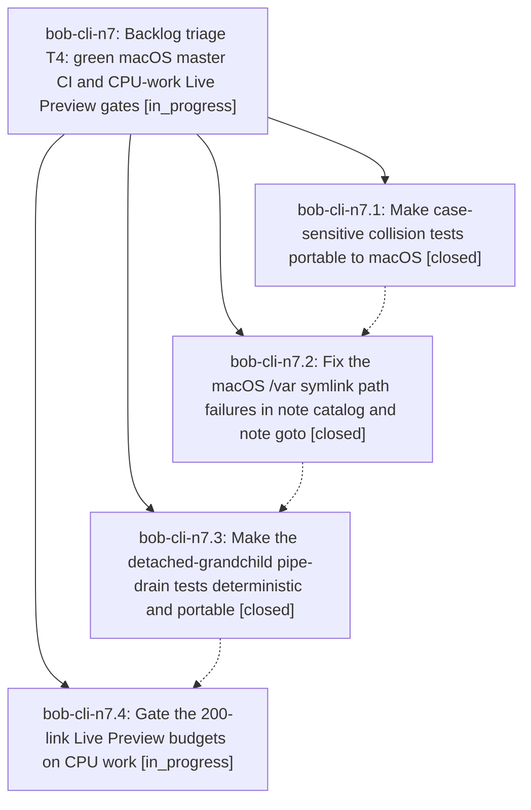

# Bead: bob-cli-n7 — Backlog triage T4: green macOS master CI and CPU-work Live Preview gates

[Bead Pages](../README.md) / bob-cli-n7

**Status:** ◐ in_progress · **Type:** ▸ plan · **Tier:** epic
**Owner:** `bryanbugyi34@gmail.com` · **Created by:** [bbugyi200.athena.bob-cli-n5.land](https://github.com/bobs-org/bob-cli--agents/blob/main/sessions/bbugyi200.athena.bob-cli-n5.land.md) · **Assignee:** `bob-cli-n7.land`
**Created:** 2026-11-18 01:55:52 EST
**Plan:** [202611/backlog\_triage\_t4.md](https://github.com/bobs-org/bob-cli--plans/blob/main/202611/backlog_triage_t4.md)

<!-- sase:links:start -->

## Links

| Relation | Artifact | Why |
| --- | --- | --- |
| implemented-by | [plan:202611/backlog_triage_t4.md][1] | derived from the plan's `bead_id:` frontmatter field |

[1]: https://github.com/bobs-org/bob-cli--plans/blob/main/202611/backlog_triage_t4.md

<!-- sase:links:end -->

## Description

Make bob-cli's macos-latest master test job green so the release train can ship again, then stop the two most-corroborated bob-plugins wall-clock flakes, and continue the five-task backlog chain.

## Phases

| Bead | Title | Status | Size | Created | Agents | Commits |
|---|---|---|---|---|---:|---:|
| [bob-cli-n7.1](bob-cli-n7.1.md) | Make case-sensitive collision tests portable to macOS | ✓ closed | medium | 2026-11-18 | 1 | 1 |
| [bob-cli-n7.2](bob-cli-n7.2.md) | Fix the macOS /var symlink path failures in note catalog and note goto | ✓ closed | medium | 2026-11-18 | 1 | 1 |
| [bob-cli-n7.3](bob-cli-n7.3.md) | Make the detached-grandchild pipe-drain tests deterministic and portable | ✓ closed | medium | 2026-11-18 | 1 | 1 |
| [bob-cli-n7.4](bob-cli-n7.4.md) | Gate the 200-link Live Preview budgets on CPU work | ◐ in_progress | medium | 2026-11-18 | 1 | 0 |

## Lineage

## Agents

| Agent | Bead | Commits |
|---|---|---:|
| [bbugyi200.athena.bob-cli-n7.1](https://github.com/bobs-org/bob-cli--agents/blob/main/sessions/bbugyi200.athena.bob-cli-n7.1.md) | [bob-cli-n7.1](bob-cli-n7.1.md) | 1 |
| [bbugyi200.athena.bob-cli-n7.2](https://github.com/bobs-org/bob-cli--agents/blob/main/sessions/bbugyi200.athena.bob-cli-n7.2.md) | [bob-cli-n7.2](bob-cli-n7.2.md) | 1 |
| [bbugyi200.athena.bob-cli-n7.3](https://github.com/bobs-org/bob-cli--agents/blob/main/sessions/bbugyi200.athena.bob-cli-n7.3.md) | [bob-cli-n7.3](bob-cli-n7.3.md) | 1 |
| [bbugyi200.athena.bob-cli-n7.4](https://github.com/bobs-org/bob-cli--agents/blob/main/agents/bbugyi200.athena.bob-cli-n7.4/README.md) | [bob-cli-n7.4](bob-cli-n7.4.md) | 0 |
| [bbugyi200.athena.bob-cli-n7.land](https://github.com/bobs-org/bob-cli--agents/blob/main/agents/bbugyi200.athena.bob-cli-n7.land/README.md) | [bob-cli-n7](README.md) | 0 |

## Commits

| Repo | Commit | Subject | Bead | Committed |
|---|---|---|---|---|
| bob-cli | [`509d857`](https://github.com/bobs-org/bob-cli/commit/509d8572b50c753743ee5082d566e7c9adf342e5) | test(collision): normalize filesystem-sensitive cases for macOS | [bob-cli-n7.1](bob-cli-n7.1.md) | 2026-11-18 04:10:47 EST |
| bob-cli | [`1f6cc7b`](https://github.com/bobs-org/bob-cli/commit/1f6cc7bedbeb6786202d9e003dad3b1cbccd4911) | fix(note-catalog): canonicalize library roots for symlinked vaults | [bob-cli-n7.2](bob-cli-n7.2.md) | 2026-11-18 07:55:27 EST |
| bob-cli | [`f0857be`](https://github.com/bobs-org/bob-cli/commit/f0857be8a6d084b9e9548919b27178c1b3bb2511) | fix(subprocess): make detached-grandchild pipe-drain tests deterministic and portable | [bob-cli-n7.3](bob-cli-n7.3.md) | 2026-11-18 10:24:41 EST |
