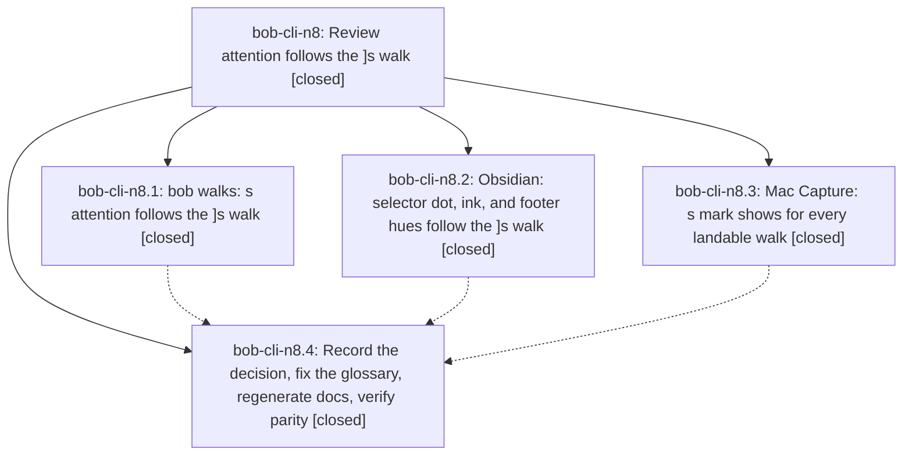

# Bead: bob-cli-n8 — Review attention follows the \]s walk

[Bead Pages](../README.md) / bob-cli-n8

**Status:** ✓ closed · **Resolution:** done · **Type:** ▸ plan · **Tier:** epic
**Owner:** `bryanbugyi34@gmail.com` · **Created by:** [bbugyi200.athena.1dx](https://github.com/bobs-org/bob-cli--agents/blob/main/sessions/bbugyi200.athena.1dx.md) · **Assignee:** `bob-cli-n8.land`
**Created:** 2026-11-18 09:48:01 EST · **Closed:** 2026-11-18 12:35:49 EST
**Plan:** [202611/review\_attention\_follows\_walk.md](https://github.com/bobs-org/bob-cli--plans/blob/main/202611/review_attention_follows_walk.md)

<!-- sase:links:start -->

## Links

| Relation | Artifact | Why |
| --- | --- | --- |
| implemented-by | [plan:202611/review_attention_follows_walk.md][1] | derived from the plan's `bead_id:` frontmatter field |

_Plus 1 automatic references — see [Referenced By](#referenced-by)._

[1]: https://github.com/bobs-org/bob-cli--plans/blob/main/202611/review_attention_follows_walk.md

<!-- sase:links:end -->

## Description

The s selector dot, the selected-s ink, Bob Mac Capture's s mark, and bob walks all light exactly when ]s has a row to land on, ROTTEN and POST included, wearing the hue of the group ]s enters first, with POST finally given a color.

## Notes

[2026-11-18T16:31:19Z · bob-cli-n8.land] LAND AUDIT AND FOLLOW-UP TRIAGE (2026-11-18): Read epic, all four phases and every note, approved plan, relevant decisions/glossary, bob-cli aea85529/91ff49f8, plugin c7e6d3e, Mac 1e20997e. Product code implements all-nine-tier attention, three label forms, PRE/POST cyan, ROTTEN orange, and Mac counts.walk with commitments fallback. n8.4 memory edits stay within authorized strands plus regenerated indexes/docs. Independent plugin attention/footer/selector run: 98/98 pass. GitHub confirms precommit macOS run 44337649084 succeeded on dc39311; current landed Mac SHA is 1e20997e and master run 44344402326 was still running when inspected, so do not confuse the precommit SHA with master. No live Obsidian/Mac interaction claimed. Post-start drift reviewed: bob-cli f0857be8 only subprocess test fixtures; plugin b2a6d2b only CPU timing tests; Mac 504531ef/c6e53611 adds the separate Daily Headline row and media, leaving title-row attention intact. No feature consumer rewrite needed; add a regression proving headline and upkeep-only marks coexist. Remaining epic work: plugin parity test hand-builds queue and counts from the same fixture, so its walk==queue.length assertion is tautological and omits projects/pending/next/recurring single-tier cases; Mac lacks the planned POST-only/ROTTEN-only JSON-to-presentation regressions; CaptureAgendaWalkMark still documents commitments and idle-agenda docs omit explicit upkeep inclusion. These will be a medium closeout tale, which must finish this landing. just check via ToolRun f85981b1d68a198f26b7c0dc3ccf4fe4 failed at the pre-existing albums_create.rs:1149 rustfmt-only closure; n7 landing already owns that integration repair. No check-full run. No epic-symbol entries; no symvision recipe presently. No parent_bead. All n8.2 #1 proposals triaged through sase_new_task, all-status flake search, weekly flake sweep, and all active epic scopes: frees-marks corroborated bob-cli-io (+17); the 1000-task growth wording matches the dependency-stage node, corroborated bob-cli-m1 (+3). Keep-moving surface/off-clock reports predate b2a6d2b and the ki/ju closes; added explanatory notes to bob-cli-ki and bob-cli-ju, declined new tasks/reopening because n7.4 repaired and verified those gates and no post-fix failure was reproduced. No causal active epic introduced the outstanding io/m1 nodes. No new task beads created.

[2026-11-18T17:35:49Z · bob-cli-n8.land--1] Review-attention closeout complete on bob-cli 91ff49f8, plugins b2a6d2b, and Mac 1e20997e. Added production-memo nine-tier/S1-S7 parity, selected/off-s labels, unavailable-Tasks hidden state, and Mac POST-only/ROTTEN-only marks, walk counts, tones, accessibility, headline coexistence, and docs. Plugin bundle 1.135.1 synced. Independent pre-closeout attention/footer/selector baseline: 98/98. Full npm test remained red on the unchanged event-link-times single-sample wall-clock assertion (1067.2 ms vs 25 ms); it maps to existing bob-cli-km, and isolated control passed 23/23 at 6.3 ms. No threshold changed and npm test was not rerun. npm run test:perf passed 5/5; bob-cli just check ToolRun 288eccd2d5fad62897d0a0b6bc3d4f5d passed (exit 0) after the one-line albums_create.rs formatting repair, preserving the no-H1 assertion. IO/M1 remain the known READY trackers; KI/JU were fixed and closed by n7.4, with no new task or reopen. Neither Obsidian nor Mac UI was checked live; Mac portable/docs gates and precommit exact-SHA CI 44337649084 passed. Current Mac CI verification is staged separately.

[2026-11-18T18:07:27Z · bob-cli-n8.land--2] MACOS EXACT-SHA CI (2026-11-18): Scripts/macos-ci-check completed successfully (exit 0) for snapshot SHA c48316a7b30e097ece3f618e0212300752006110, based on 1e20997e84022cbcd45ffe48e67c6ef317609924. GitHub Actions run 44360959431 passed the selected workflow's required macOS checks: formatting lint, build, tests, bundle, plist/signature verification, launch smoke test, and install/reinstall. No failed step; no repair required. Monitor 3an5mq0p2gfj.

## Phases

| Bead | Title | Status | Size | Created | Agents | Commits |
|---|---|---|---|---|---:|---:|
| [bob-cli-n8.1](bob-cli-n8.1.md) | bob walks: s attention follows the \]s walk | ✓ closed | medium | 2026-11-18 | 1 | 1 |
| [bob-cli-n8.2](bob-cli-n8.2.md) | Obsidian: selector dot, ink, and footer hues follow the \]s walk | ✓ closed | medium | 2026-11-18 | 1 | 1 |
| [bob-cli-n8.3](bob-cli-n8.3.md) | Mac Capture: s mark shows for every landable walk | ✓ closed | medium | 2026-11-18 | 1 | 1 |
| [bob-cli-n8.4](bob-cli-n8.4.md) | Record the decision, fix the glossary, regenerate docs, verify parity | ✓ closed | small | 2026-11-18 | 1 | 1 |

## Lineage

## Agents

| Agent | Bead | Commits |
|---|---|---:|
| [bbugyi200.athena.bob-cli-n8.1](https://github.com/bobs-org/bob-cli--agents/blob/main/agents/bbugyi200.athena.bob-cli-n8.1/README.md) | [bob-cli-n8.1](bob-cli-n8.1.md) | 1 |
| [bbugyi200.athena.bob-cli-n8.2](https://github.com/bobs-org/bob-cli--agents/blob/main/sessions/bbugyi200.athena.bob-cli-n8.2.md) | [bob-cli-n8.2](bob-cli-n8.2.md) | 1 |
| [bbugyi200.athena.bob-cli-n8.3](https://github.com/bobs-org/bob-cli--agents/blob/main/sessions/bbugyi200.athena.bob-cli-n8.3.md) | [bob-cli-n8.3](bob-cli-n8.3.md) | 1 |
| [bbugyi200.athena.bob-cli-n8.4](https://github.com/bobs-org/bob-cli--agents/blob/main/agents/bbugyi200.athena.bob-cli-n8.4/README.md) | [bob-cli-n8.4](bob-cli-n8.4.md) | 1 |
| [bbugyi200.athena.bob-cli-n8.land](https://github.com/bobs-org/bob-cli--agents/blob/main/sessions/bbugyi200.athena.bob-cli-n8.land.md) | [bob-cli-n8](README.md) | 1 |

## Commits

| Repo | Commit | Subject | Bead | Committed |
|---|---|---|---|---|
| bob-cli | [`aea8552`](https://github.com/bobs-org/bob-cli/commit/aea85529246146658515ef85ad3ecc8950112762) | feat(walks): light footer s across all nine review tiers with counts | [bob-cli-n8.1](bob-cli-n8.1.md) | 2026-11-18 10:07:42 EST |
| bob-plugins | [`bob-plugins@c7e6d3e`](https://github.com/bobs-org/bob-plugins/commit/c7e6d3e8906b440e897a96042d74514ddb4c4512) | feat(walks): align Obsidian attention with review walk | [bob-cli-n8.2](bob-cli-n8.2.md) | 2026-11-18 10:31:56 EST |
| bob-mac-capture | [`bob-mac-capture@1e20997`](https://github.com/bobs-org/bob-mac-capture/commit/1e20997e84022cbcd45ffe48e67c6ef317609924) | feat(mac-capture): mirror Bob walk attention marks | [bob-cli-n8.3](bob-cli-n8.3.md) | 2026-11-18 11:11:56 EST |
| bob-cli | [`91ff49f`](https://github.com/bobs-org/bob-cli/commit/91ff49f832f8739af90e33800e7ff1c4daf2ef19) | docs(memory): record review attention follows the \]s walk decision | [bob-cli-n8.4](bob-cli-n8.4.md) | 2026-11-18 11:23:50 EST |
| bob-mac-capture | [`bob-mac-capture@d0e0a61`](https://github.com/bobs-org/bob-mac-capture/commit/d0e0a61b221f3120cf252c22eebf2adbbdac177d) | test(review): cover upkeep-only walk attention | [bob-cli-n8](README.md) | 2026-11-18 13:10:45 EST |

<!-- sase:referenced-by:start -->

## Referenced By

| Relation | Artifact | Why | Uses |
| --- | --- | --- | ---: |
| read-by | [agent:bob-cli-n8.1][1] | Need epic scope for phase n8.1 | 1 |

[1]: https://github.com/bobs-org/bob-cli--agents/blob/main/agents/bbugyi200.athena.bob-cli-n8.1/README.md

<!-- sase:referenced-by:end -->
