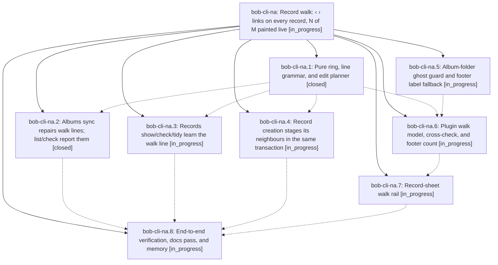

# Bead: bob-cli-na — Record walk: ‹ › links on every record, N of M painted live

[Bead Pages](../README.md) / bob-cli-na

**Status:** ◐ in_progress · **Type:** ▸ plan · **Tier:** epic
**Owner:** `bryanbugyi34@gmail.com` · **Created by:** [bbugyi200.apollo.research.5b.linker.w0](https://github.com/bobs-org/bob-cli--agents/blob/main/sessions/bbugyi200.apollo.research.5b.linker.w0.md) · **Assignee:** `bob-cli-na.land`
**Created:** 2026-11-18 11:07:18 EST
**Plan:** [202611/record\_walk\_ring.md](https://github.com/bobs-org/bob-cli--plans/blob/main/202611/record_walk_ring.md)

<!-- sase:links:start -->

## Links

| Relation | Artifact | Why |
| --- | --- | --- |
| implemented-by | [plan:202611/record_walk_ring.md][1] | derived from the plan's `bead_id:` frontmatter field |

[1]: https://github.com/bobs-org/bob-cli--plans/blob/main/202611/record_walk_ring.md

<!-- sase:links:end -->

## Description

Every record note carries one bob-maintained `‹ prev · ↑ album · next ›` line that forms a cycling alphabetical ring per album, `[n` / `]n` follow it with no key changes, and Obsidian paints `N of M` beside it on a record-sheet rail and in the `n` links footer, without ever writing a count into Markdown.

## Phases

| Bead | Title | Status | Size | Created | Agents | Commits |
|---|---|---|---|---|---:|---:|
| [bob-cli-na.1](bob-cli-na.1.md) | Pure ring, line grammar, and edit planner | ✓ closed | medium | 2026-11-18 | 1 | 1 |
| [bob-cli-na.2](bob-cli-na.2.md) | Albums sync repairs walk lines; list/check report them | ✓ closed | medium | 2026-11-18 | 1 | 1 |
| [bob-cli-na.3](bob-cli-na.3.md) | Records show/check/tidy learn the walk line | ◐ in_progress | small | 2026-11-18 | 1 | 0 |
| [bob-cli-na.4](bob-cli-na.4.md) | Record creation stages its neighbours in the same transaction | ◐ in_progress | medium | 2026-11-18 | 1 | 0 |
| [bob-cli-na.5](bob-cli-na.5.md) | Album-folder ghost guard and footer label fallback | ◐ in_progress | small | 2026-11-18 | 1 | 0 |
| [bob-cli-na.6](bob-cli-na.6.md) | Plugin walk model, cross-check, and footer count | ◐ in_progress | medium | 2026-11-18 | 1 | 0 |
| [bob-cli-na.7](bob-cli-na.7.md) | Record-sheet walk rail | ◐ in_progress | medium | 2026-11-18 | 1 | 0 |
| [bob-cli-na.8](bob-cli-na.8.md) | End-to-end verification, docs pass, and memory | ◐ in_progress | small | 2026-11-18 | 1 | 0 |

## Lineage

## Agents

| Agent | Bead | Commits |
|---|---|---:|
| [bbugyi200.apollo.bob-cli-na.1](https://github.com/bobs-org/bob-cli--agents/blob/main/agents/bbugyi200.apollo.bob-cli-na.1/README.md) | [bob-cli-na.1](bob-cli-na.1.md) | 1 |
| [bbugyi200.apollo.bob-cli-na.2](https://github.com/bobs-org/bob-cli--agents/blob/main/agents/bbugyi200.apollo.bob-cli-na.2/README.md) | [bob-cli-na.2](bob-cli-na.2.md) | 1 |
| [bbugyi200.apollo.bob-cli-na.3](https://github.com/bobs-org/bob-cli--agents/blob/main/agents/bbugyi200.apollo.bob-cli-na.3/README.md) | [bob-cli-na.3](bob-cli-na.3.md) | 0 |
| [bbugyi200.apollo.bob-cli-na.4](https://github.com/bobs-org/bob-cli--agents/blob/main/sessions/bbugyi200.apollo.bob-cli-na.4.md) | [bob-cli-na.4](bob-cli-na.4.md) | 0 |
| [bbugyi200.apollo.bob-cli-na.5](https://github.com/bobs-org/bob-cli--agents/blob/main/sessions/bbugyi200.apollo.bob-cli-na.5.md) | [bob-cli-na.5](bob-cli-na.5.md) | 0 |
| [bbugyi200.apollo.bob-cli-na.6](https://github.com/bobs-org/bob-cli--agents/blob/main/agents/bbugyi200.apollo.bob-cli-na.6/README.md) | [bob-cli-na.6](bob-cli-na.6.md) | 0 |
| [bbugyi200.apollo.bob-cli-na.7](https://github.com/bobs-org/bob-cli--agents/blob/main/agents/bbugyi200.apollo.bob-cli-na.7/README.md) | [bob-cli-na.7](bob-cli-na.7.md) | 0 |
| [bbugyi200.apollo.bob-cli-na.8](https://github.com/bobs-org/bob-cli--agents/blob/main/agents/bbugyi200.apollo.bob-cli-na.8/README.md) | [bob-cli-na.8](bob-cli-na.8.md) | 0 |
| [bbugyi200.apollo.bob-cli-na.land](https://github.com/bobs-org/bob-cli--agents/blob/main/agents/bbugyi200.apollo.bob-cli-na.land/README.md) | [bob-cli-na](README.md) | 0 |

## Commits

| Repo | Commit | Subject | Bead | Committed |
|---|---|---|---|---|
| bob-cli | [`41b1dab`](https://github.com/bobs-org/bob-cli/commit/41b1dab3fc95fd0617392e91bed8637834640bf1) | feat(albums): add pure record walk planner | [bob-cli-na.1](bob-cli-na.1.md) | 2026-11-18 11:39:47 EST |
| bob-cli | [`da68e6b`](https://github.com/bobs-org/bob-cli/commit/da68e6bf20c589989867e07d451875d7c9ac974d) | feat(albums): sync repairs record walk lines and reports walk health | [bob-cli-na.2](bob-cli-na.2.md) | 2026-11-18 12:40:41 EST |
