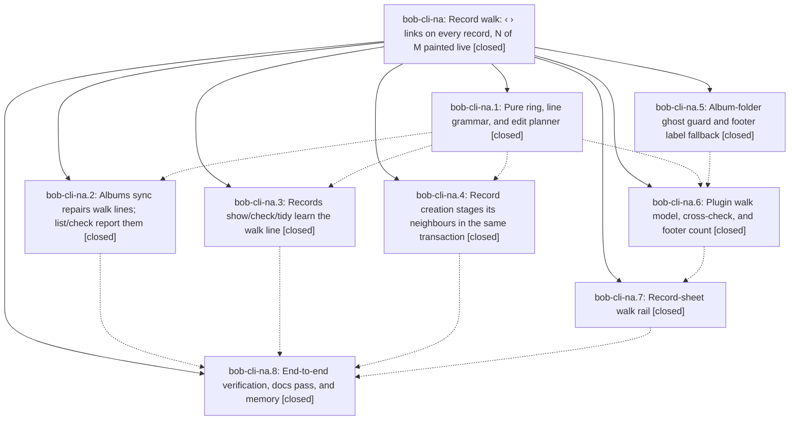

# Bead: bob-cli-na — Record walk: ‹ › links on every record, N of M painted live

[Bead Pages](../README.md) / bob-cli-na

**Status:** ✓ closed · **Resolution:** done · **Type:** ▸ plan · **Tier:** epic
**Owner:** `bryanbugyi34@gmail.com` · **Created by:** [bbugyi200.apollo.research.5b.linker.w0](https://github.com/bobs-org/bob-cli--agents/blob/main/sessions/bbugyi200.apollo.research.5b.linker.w0.md) · **Assignee:** `bob-cli-na.land`
**Created:** 2026-11-18 11:07:18 EST · **Closed:** 2026-11-18 18:24:17 EST
**Plan:** [202611/record\_walk\_ring.md](https://github.com/bobs-org/bob-cli--plans/blob/main/202611/record_walk_ring.md)

<!-- sase:links:start -->

## Links

| Relation | Artifact | Why |
| --- | --- | --- |
| implemented-by | [plan:202611/record_walk_ring.md][1] | derived from the plan's `bead_id:` frontmatter field |

_Plus 3 automatic references — see [Referenced By](#referenced-by)._

[1]: https://github.com/bobs-org/bob-cli--plans/blob/main/202611/record_walk_ring.md

<!-- sase:links:end -->

## Description

Every record note carries one bob-maintained `‹ prev · ↑ album · next ›` line that forms a cycling alphabetical ring per album, `[n` / `]n` follow it with no key changes, and Obsidian paints `N of M` beside it on a record-sheet rail and in the `n` links footer, without ever writing a count into Markdown.

## Notes

[2026-11-18T22:16:58Z · bob-cli-na.land] LAND (bob-cli-na.land) verification + follow-up triage. Verified all 8 phases against plan:202611/record_walk_ring.md and commits 41b1dab3, da68e6bf, c02d405d, 3b5490c1, b96bbe7d (bob-cli) plus a4710c4, 281ee8a, e7d82af (bob-plugins). Decisions honored: footer reads bare 'Links N/M' (124-links-walker-footer.js); only glossary:record-note memory was edited; no decision record created. Plugin vectors equal bob-cli tests/fixtures/record_walk/vectors.json. just check green on b96bbe7d (7379 lib, 3814 cli). Integration: bb864f88 (tick) already updated album/record test assertions for walk lines; 6cb387bc and 91ff49f8 are unrelated; tick does not run albums sync. Lander cleanup: removed the phase-scaffolding #[allow(dead_code)] on mod walk and the dead insert_walk_line_for_test wrapper (clippy -D unused clean). Remaining epic work (acceptance tests left manual: sync M>=2/retitle/delete/damaged/held/race/nightly, capture neighbour race, show held; and the double walk plan in albums sync) proposed as a tale that ends with this epic's closeout. Follow-up outcomes: na.1 #1 (rustfmt drift tests/cli/albums_create.rs:1149) declined, already fixed in-epic and cargo fmt --check passes; na.4 #1 (four clippy denies in walk.rs) declined, epic-caused and fixed in 3b5490c1, clippy passes; na.3 #1 (docs-check mount collision) +1'd as duplicate of bob-cli-it; na.6 #1 and na.7 #1 (event-link-times / frees-marks 25 ms flakes) +1'd on bob-cli-km and bob-cli-io; na.7 #1 KT1-KT8 keep-moving-marks timing failure +1'd on bob-cli-ki (closed; lander did not reproduce it).

[2026-11-18T23:24:17Z · bob-cli-na.land--2] LAND closeout (bob-cli-na.land). Preserves lander verification from note #1: verified all 8 phases against plan:202611/record_walk_ring.md and commits 41b1dab3, da68e6bf, c02d405d, 3b5490c1, b96bbe7d (bob-cli) plus a4710c4, 281ee8a, e7d82af (bob-plugins). Decisions honored: footer_copy = bare (Links N/M in 124-links-walker-footer.js); memory_glossary_record_note = yes (glossary:record-note only); memory_decision_record = no. Plugin vectors equal bob-cli tests/fixtures/record_walk/vectors.json. just check green on b96bbe7d (7379 lib, 3814 cli). Lander cleanup: removed phase-scaffolding #[allow(dead_code)] on mod walk and the dead insert_walk_line_for_test wrapper.

Follow-up (plan:202611/record_walk_landing_tests.md): single-plan albums sync refactor (projection.walk_edits reused; second plan_album_walk in plan_indexes removed); held-album handling (known unreadable members hold that album and let others repair); acceptance tests for M=2/M>=3 rings, retitle/delete radius, damaged lines, held albums, nightly walk-line parity, sync/capture neighbour races, and records show null walk when held. cargo test --lib albums passed (145 tests); cargo test --lib capture passed (2,147 passed, 1 ignored). CLI suites: albums_sync (13), records (101), nightly (9). just check passed (monitor 38cvxxgdm219, exit 0, KNOWN 0, FLAKY 0). justfile has no symvision recipe. epic-symbols: none. Plans 202611/record_walk_ring.md and 202611/record_walk_landing_tests.md set status: done.

## Phases

| Bead | Title | Status | Size | Created | Agents | Commits |
|---|---|---|---|---|---:|---:|
| [bob-cli-na.1](bob-cli-na.1.md) | Pure ring, line grammar, and edit planner | ✓ closed | medium | 2026-11-18 | 1 | 1 |
| [bob-cli-na.2](bob-cli-na.2.md) | Albums sync repairs walk lines; list/check report them | ✓ closed | medium | 2026-11-18 | 1 | 1 |
| [bob-cli-na.3](bob-cli-na.3.md) | Records show/check/tidy learn the walk line | ✓ closed | small | 2026-11-18 | 1 | 1 |
| [bob-cli-na.4](bob-cli-na.4.md) | Record creation stages its neighbours in the same transaction | ✓ closed | medium | 2026-11-18 | 1 | 1 |
| [bob-cli-na.5](bob-cli-na.5.md) | Album-folder ghost guard and footer label fallback | ✓ closed | small | 2026-11-18 | 1 | 1 |
| [bob-cli-na.6](bob-cli-na.6.md) | Plugin walk model, cross-check, and footer count | ✓ closed | medium | 2026-11-18 | 1 | 1 |
| [bob-cli-na.7](bob-cli-na.7.md) | Record-sheet walk rail | ✓ closed | medium | 2026-11-18 | 1 | 1 |
| [bob-cli-na.8](bob-cli-na.8.md) | End-to-end verification, docs pass, and memory | ✓ closed | small | 2026-11-18 | 1 | 1 |

## Lineage

## Agents

| Agent | Bead | Commits |
|---|---|---:|
| [bbugyi200.apollo.bob-cli-na.1](https://github.com/bobs-org/bob-cli--agents/blob/main/agents/bbugyi200.apollo.bob-cli-na.1/README.md) | [bob-cli-na.1](bob-cli-na.1.md) | 1 |
| [bbugyi200.apollo.bob-cli-na.2](https://github.com/bobs-org/bob-cli--agents/blob/main/agents/bbugyi200.apollo.bob-cli-na.2/README.md) | [bob-cli-na.2](bob-cli-na.2.md) | 1 |
| [bbugyi200.apollo.bob-cli-na.3](https://github.com/bobs-org/bob-cli--agents/blob/main/agents/bbugyi200.apollo.bob-cli-na.3/README.md) | [bob-cli-na.3](bob-cli-na.3.md) | 1 |
| [bbugyi200.apollo.bob-cli-na.4](https://github.com/bobs-org/bob-cli--agents/blob/main/sessions/bbugyi200.apollo.bob-cli-na.4.md) | [bob-cli-na.4](bob-cli-na.4.md) | 1 |
| [bbugyi200.apollo.bob-cli-na.5](https://github.com/bobs-org/bob-cli--agents/blob/main/sessions/bbugyi200.apollo.bob-cli-na.5.md) | [bob-cli-na.5](bob-cli-na.5.md) | 1 |
| [bbugyi200.apollo.bob-cli-na.6](https://github.com/bobs-org/bob-cli--agents/blob/main/agents/bbugyi200.apollo.bob-cli-na.6/README.md) | [bob-cli-na.6](bob-cli-na.6.md) | 1 |
| [bbugyi200.apollo.bob-cli-na.7](https://github.com/bobs-org/bob-cli--agents/blob/main/agents/bbugyi200.apollo.bob-cli-na.7/README.md) | [bob-cli-na.7](bob-cli-na.7.md) | 1 |
| [bbugyi200.apollo.bob-cli-na.8](https://github.com/bobs-org/bob-cli--agents/blob/main/agents/bbugyi200.apollo.bob-cli-na.8/README.md) | [bob-cli-na.8](bob-cli-na.8.md) | 1 |
| [bbugyi200.apollo.bob-cli-na.land](https://github.com/bobs-org/bob-cli--agents/blob/main/sessions/bbugyi200.apollo.bob-cli-na.land.md) | [bob-cli-na](README.md) | 2 |

## Commits

| Repo | Commit | Subject | Bead | Committed |
|---|---|---|---|---|
| bob-cli | [`41b1dab`](https://github.com/bobs-org/bob-cli/commit/41b1dab3fc95fd0617392e91bed8637834640bf1) | feat(albums): add pure record walk planner | [bob-cli-na.1](bob-cli-na.1.md) | 2026-11-18 11:39:47 EST |
| bob-cli | [`da68e6b`](https://github.com/bobs-org/bob-cli/commit/da68e6bf20c589989867e07d451875d7c9ac974d) | feat(albums): sync repairs record walk lines and reports walk health | [bob-cli-na.2](bob-cli-na.2.md) | 2026-11-18 12:40:41 EST |
| bob-cli | [`c02d405`](https://github.com/bobs-org/bob-cli/commit/c02d405da9126dadddf623014447e8a309ff7660) | feat(records): stage record walk neighbours atomically | [bob-cli-na.4](bob-cli-na.4.md) | 2026-11-18 12:49:59 EST |
| bob-cli | [`3b5490c`](https://github.com/bobs-org/bob-cli/commit/3b5490c1ad415f61b710f3fe4eea500378c1210d) | feat(records): show, check, and tidy learn the record walk line | [bob-cli-na.3](bob-cli-na.3.md) | 2026-11-18 13:45:59 EST |
| bob-plugins | [`bob-plugins@a4710c4`](https://github.com/bobs-org/bob-plugins/commit/a4710c4c1db93f2e038208aad48c12007d8ad6e1) | feat(plugins): guard album record walks and labels | [bob-cli-na.5](bob-cli-na.5.md) | 2026-11-18 14:30:34 EST |
| bob-plugins | [`bob-plugins@281ee8a`](https://github.com/bobs-org/bob-plugins/commit/281ee8a3e08898c383305e4b81f85af3ae49b7bc) | feat(plugins): add album record walk footer status | [bob-cli-na.6](bob-cli-na.6.md) | 2026-11-18 15:39:29 EST |
| bob-plugins | [`bob-plugins@e7d82af`](https://github.com/bobs-org/bob-plugins/commit/e7d82afe0c5fb6b9e5424803dc3bcf26fd456a28) | feat(records): dock the record walk rail under record sheets | [bob-cli-na.7](bob-cli-na.7.md) | 2026-11-18 16:32:28 EST |
| bob-cli | [`b96bbe7`](https://github.com/bobs-org/bob-cli/commit/b96bbe7da6fb54a9f089c0d0d9d3d91bbafd39c0) | docs(records): link record walk plugin references | [bob-cli-na.8](bob-cli-na.8.md) | 2026-11-18 16:46:37 EST |
| bob-cli | [`f5939f9`](https://github.com/bobs-org/bob-cli/commit/f5939f9a8e6049c1ffd0be6aa08ec7de3fb093e0) | refactor(albums): drop record walk phase dead-code scaffolding | [bob-cli-na](README.md) | 2026-11-18 17:17:54 EST |
| bob-cli | [`28eec33`](https://github.com/bobs-org/bob-cli/commit/28eec33520d8f67668fca2ce435d23885a3bb8ba) | feat(albums): plan each album walk once and pin landing tests | [bob-cli-na](README.md) | 2026-11-18 18:26:05 EST |

<!-- sase:referenced-by:start -->

## Referenced By

| Relation | Artifact | Why | Uses |
| --- | --- | --- | ---: |
| read-by | [agent:bob-cli-na.3][1] | Need epic status | 1 |
| read-by | [agent:bob-cli-na.5--7][2] | Check parent epic state and remaining phase scope before closing assigned phase | 2 |
| read-by | [agent:bob-cli-na.land][3] | Need the epic scope, children, and linked plan file | 1 |

[1]: https://github.com/bobs-org/bob-cli--agents/blob/main/agents/bbugyi200.apollo.bob-cli-na.3/README.md
[2]: https://github.com/bobs-org/bob-cli--agents/blob/main/sessions/bbugyi200.apollo.bob-cli-na.5.md
[3]: https://github.com/bobs-org/bob-cli--agents/blob/main/sessions/bbugyi200.apollo.bob-cli-na.land.md

<!-- sase:referenced-by:end -->
