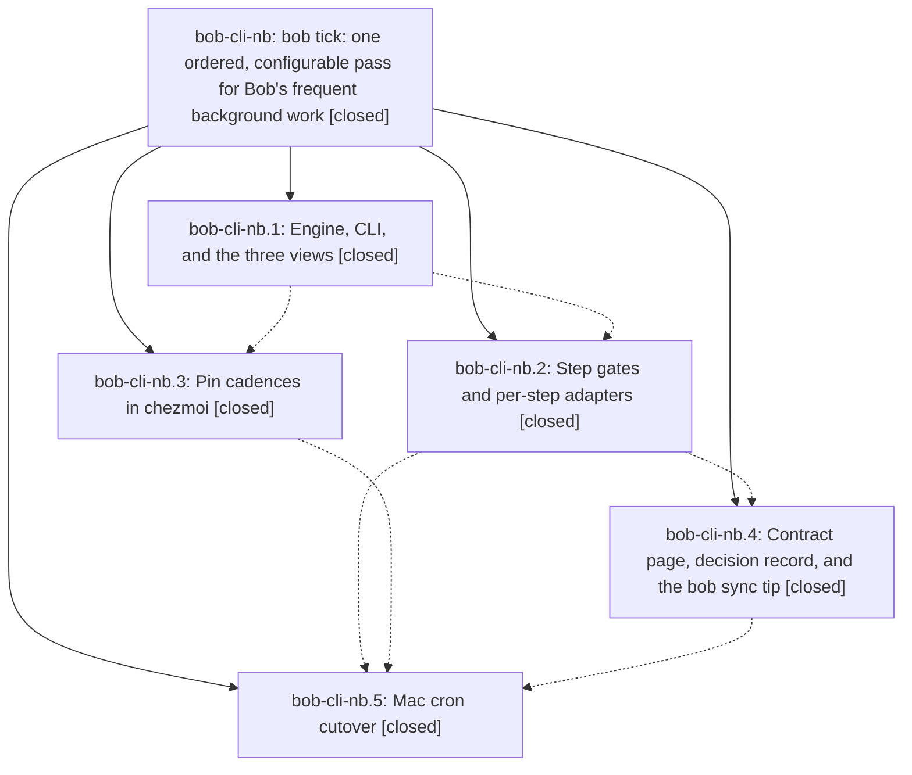

# Bead: bob-cli-nb — bob tick: one ordered, configurable pass for Bob's frequent background work

[Bead Pages](../README.md) / bob-cli-nb

**Status:** ✓ closed · **Resolution:** done · **Type:** ▸ plan · **Tier:** epic
**Owner:** `bryanbugyi34@gmail.com` · **Created by:** [bbugyi200.athena.1e2](https://github.com/bobs-org/bob-cli--agents/blob/main/sessions/bbugyi200.athena.1e2.md) · **Assignee:** `bob-cli-nb.land`
**Created:** 2026-11-18 13:06:50 EST · **Closed:** 2026-11-18 18:57:29 EST
**Plan:** [202611/bob\_tick.md](https://github.com/bobs-org/bob-cli--plans/blob/main/202611/bob_tick.md)

<!-- sase:links:start -->

## Links

| Relation | Artifact | Why |
| --- | --- | --- |
| implemented-by | [plan:202611/bob_tick.md][1] | derived from the plan's `bead_id:` frontmatter field |

_Plus 1 automatic references — see [Referenced By](#referenced-by)._

[1]: https://github.com/bobs-org/bob-cli--plans/blob/main/202611/bob_tick.md

<!-- sase:links:end -->

## Description

One `bob tick` command runs Bob's more-than-daily background work (gcal, gmail, gkeep, refs, projects, tasks) in a fixed order. Each step has its own cadence, set in chezmoi's Bob config. The Mac's four staggered cron jobs become one 5-minute `bob-tick` job. Automated `bob gcal sync` runs stay at least an hour apart, and the command's output, status board, and receipt explain what ran, what waited, and why.

## Notes

[2026-11-18T23:57:29Z · bob-cli-nb.land] Landing verified. Read all five phase beads and their notes, the plan, and commits bb864f88, 75de001f, 2f1dca1c, a1e876cc against the source: engine (config, pure planner, state, run lock, supervision/signals, receipt + Darwin notify), gates (readiness, gcal -n 2 + host-status cooldown, refs fingerprint/hook/6h gate, gmail busy key, adapters), chezmoi tick block, docs/tick.md + sync hint, and Mac cutover all present; decisions honored (command named tick; no decisions-web record, no memory edits). Fixed in landing: refs adapter labelled summary.pdfs (every PDF a full scan visits) as 'PDFs changed' and now counts pdfs - unchanged - failures - held, with a realistic fixture asserting the exact summary; refs -d detail said 'lib/ changed since never' on first scan; bob tick --help step blurbs for gcal/gmail/gkeep/refs restored to the plan text now that gates landed (docs-gen regenerated docs/reference/cli/tick.md); added the missing test that only retired 'bob sync' prints the vault-sync/tick hint; docs/gmail.md now documents the additive busy JSON key; docs/tick.md gained the reason codes, run-lock behavior, receipt fields, and troubleshooting the plan's docs phase required. Integration: the only non-epic commits since the epic started (6cb387bc, 3b5490c1, b96bbe7d, f5939f9a, 28eec335: walks/records/albums) touch none of tick's inputs; no leftover references to the four retired Mac jobs. Mac: phase-5 convergence was still pending (Mac source 5c68b1f1, four old jobs live); ran the approved cronctl apply mac -> in_sync at chezmoi f8acd58c with one */5 bob-tick job; ~/.config/bob/config.yml on the Mac shows the tick: block (gcal: 1h); installed bob 0.5.0 runs bob tick -d cleanly with the refs gate. Verification: just check passed (12009 tests, 0 failed, fmt+clippy clean); just docs-check passed; epic-symbols empty. Follow-ups from bob-cli-nb.5: #1 gtd_daily chore -> bob tick -a filed as bob-cli-nc (small, snoozed to 2026-11-26 for the soak week); #2 tick.writer/gcal.writer pin is the remediation of open bob-cli-ew, so +1'd there with the new tick.writer impact instead of a duplicate task; #3 Mac Capture health badge filed as bob-cli-nd (large); #4 per-PDF unchanged-skip cache in bob ref scan filed as bob-cli-ne (large, related to bob-cli-mo). Note: the Mac still has the now-unused deployed ~/bin/maybe_bob_highlights_sync (chezmoi does not remove targets whose source was deleted); harmless, nothing calls it.

## Phases

| Bead | Title | Status | Size | Created | Agents | Commits |
|---|---|---|---|---|---:|---:|
| [bob-cli-nb.1](bob-cli-nb.1.md) | Engine, CLI, and the three views | ✓ closed | medium | 2026-11-18 | 1 | 1 |
| [bob-cli-nb.2](bob-cli-nb.2.md) | Step gates and per-step adapters | ✓ closed | medium | 2026-11-18 | 1 | 1 |
| [bob-cli-nb.3](bob-cli-nb.3.md) | Pin cadences in chezmoi | ✓ closed | xsmall | 2026-11-18 | 1 | 1 |
| [bob-cli-nb.4](bob-cli-nb.4.md) | Contract page, decision record, and the bob sync tip | ✓ closed | small | 2026-11-18 | 1 | 1 |
| [bob-cli-nb.5](bob-cli-nb.5.md) | Mac cron cutover | ✓ closed | small | 2026-11-18 | 1 | 2 |

## Lineage

## Agents

| Agent | Bead | Commits |
|---|---|---:|
| [bbugyi200.athena.bob-cli-nb.1](https://github.com/bobs-org/bob-cli--agents/blob/main/sessions/bbugyi200.athena.bob-cli-nb.1.md) | [bob-cli-nb.1](bob-cli-nb.1.md) | 1 |
| [bbugyi200.athena.bob-cli-nb.2](https://github.com/bobs-org/bob-cli--agents/blob/main/agents/bbugyi200.athena.bob-cli-nb.2/README.md) | [bob-cli-nb.2](bob-cli-nb.2.md) | 1 |
| [bbugyi200.athena.bob-cli-nb.3](https://github.com/bobs-org/bob-cli--agents/blob/main/agents/bbugyi200.athena.bob-cli-nb.3/README.md) | [bob-cli-nb.3](bob-cli-nb.3.md) | 1 |
| [bbugyi200.athena.bob-cli-nb.4](https://github.com/bobs-org/bob-cli--agents/blob/main/agents/bbugyi200.athena.bob-cli-nb.4/README.md) | [bob-cli-nb.4](bob-cli-nb.4.md) | 1 |
| [bbugyi200.athena.bob-cli-nb.5](https://github.com/bobs-org/bob-cli--agents/blob/main/sessions/bbugyi200.athena.bob-cli-nb.5.md) | [bob-cli-nb.5](bob-cli-nb.5.md) | 2 |
| [bbugyi200.athena.bob-cli-nb.land](https://github.com/bobs-org/bob-cli--agents/blob/main/agents/bbugyi200.athena.bob-cli-nb.land/README.md) | [bob-cli-nb](README.md) | 1 |

## Commits

| Repo | Commit | Subject | Bead | Committed |
|---|---|---|---|---|
| bob-cli | [`bb864f8`](https://github.com/bobs-org/bob-cli/commit/bb864f88f72f82c954b745b4ea14e0e5d724c0df) | feat(tick): add the ordered background work engine and CLI views | [bob-cli-nb.1](bob-cli-nb.1.md) | 2026-11-18 16:10:50 EST |
| chezmoi | [`chezmoi@5c68b1f`](https://github.com/bbugyi200/dotfiles/commit/5c68b1f1ac303fc26d2dd816043e7aef7b3941d2) | feat(bob): pin bob tick cadences in chezmoi | [bob-cli-nb.3](bob-cli-nb.3.md) | 2026-11-18 16:17:02 EST |
| bob-cli | [`75de001`](https://github.com/bobs-org/bob-cli/commit/75de001f8c3202241ee9b2f3f65936f9f0db7147) | feat(tick): add step gates and per-step adapters | [bob-cli-nb.2](bob-cli-nb.2.md) | 2026-11-18 17:05:09 EST |
| bob-cli | [`2f1dca1`](https://github.com/bobs-org/bob-cli/commit/2f1dca1ce1e29383f52957dfb01e1e8c983d8f99) | docs(tick): document ordered background scheduler | [bob-cli-nb.4](bob-cli-nb.4.md) | 2026-11-18 17:18:44 EST |
| bob-cli | [`a1e876c`](https://github.com/bobs-org/bob-cli/commit/a1e876cc80368d973f05a8c6c00cdab8743654dc) | docs(mac): describe bob-tick schedule replacing four cron jobs | [bob-cli-nb.5](bob-cli-nb.5.md) | 2026-11-18 18:30:40 EST |
| chezmoi | [`chezmoi@f8acd58`](https://github.com/bbugyi200/dotfiles/commit/f8acd58c49879066883aff1c04161c49e525c6d9) | feat(cron): replace four mac bob jobs with one bob-tick job | [bob-cli-nb.5](bob-cli-nb.5.md) | 2026-11-18 18:31:04 EST |
| bob-cli | [`3617c2e`](https://github.com/bobs-org/bob-cli/commit/3617c2eaaae080131522a1d7e317072c0292ce79) | fix(tick): count changed PDFs in refs summaries and finish the tick landing | [bob-cli-nb](README.md) | 2026-11-18 18:58:34 EST |

<!-- sase:referenced-by:start -->

## Referenced By

| Relation | Artifact | Why | Uses |
| --- | --- | --- | ---: |
| read-by | [agent:bob-cli-nb.2][1] | Need parent epic scope and decisions | 1 |

[1]: https://github.com/bobs-org/bob-cli--agents/blob/main/agents/bbugyi200.athena.bob-cli-nb.2/README.md

<!-- sase:referenced-by:end -->
