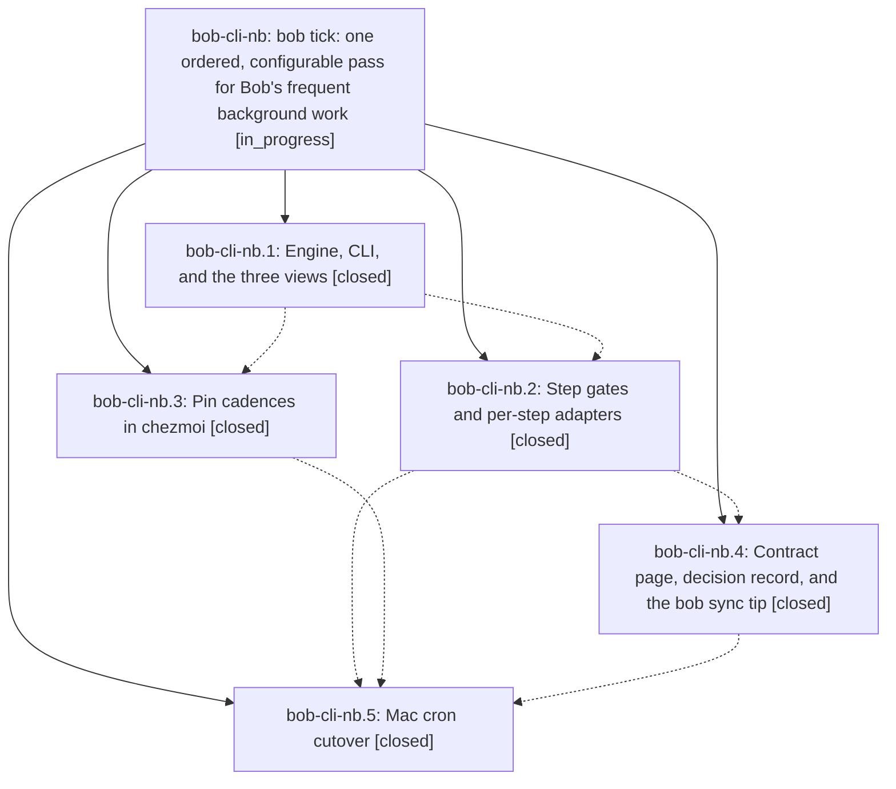

# Bead: bob-cli-nb — bob tick: one ordered, configurable pass for Bob's frequent background work

[Bead Pages](../README.md) / bob-cli-nb

**Status:** ◐ in_progress · **Type:** ▸ plan · **Tier:** epic
**Owner:** `bryanbugyi34@gmail.com` · **Created by:** [bbugyi200.athena.1e2](https://github.com/bobs-org/bob-cli--agents/blob/main/sessions/bbugyi200.athena.1e2.md) · **Assignee:** `bob-cli-nb.land`
**Created:** 2026-11-18 13:06:50 EST
**Plan:** [202611/bob\_tick.md](https://github.com/bobs-org/bob-cli--plans/blob/main/202611/bob_tick.md)

<!-- sase:links:start -->

## Links

| Relation | Artifact | Why |
| --- | --- | --- |
| implemented-by | [plan:202611/bob_tick.md][1] | derived from the plan's `bead_id:` frontmatter field |

_Plus 1 automatic references — see [Referenced By](#referenced-by)._

[1]: https://github.com/bobs-org/bob-cli--plans/blob/main/202611/bob_tick.md

<!-- sase:links:end -->

## Description

One `bob tick` command runs Bob's more-than-daily background work (gcal, gmail, gkeep, refs, projects, tasks) in a fixed order. Each step has its own cadence, set in chezmoi's Bob config. The Mac's four staggered cron jobs become one 5-minute `bob-tick` job. Automated `bob gcal sync` runs stay at least an hour apart, and the command's output, status board, and receipt explain what ran, what waited, and why.

## Phases

| Bead | Title | Status | Size | Created | Agents | Commits |
|---|---|---|---|---|---:|---:|
| [bob-cli-nb.1](bob-cli-nb.1.md) | Engine, CLI, and the three views | ✓ closed | medium | 2026-11-18 | 1 | 1 |
| [bob-cli-nb.2](bob-cli-nb.2.md) | Step gates and per-step adapters | ✓ closed | medium | 2026-11-18 | 1 | 1 |
| [bob-cli-nb.3](bob-cli-nb.3.md) | Pin cadences in chezmoi | ✓ closed | xsmall | 2026-11-18 | 1 | 1 |
| [bob-cli-nb.4](bob-cli-nb.4.md) | Contract page, decision record, and the bob sync tip | ✓ closed | small | 2026-11-18 | 1 | 1 |
| [bob-cli-nb.5](bob-cli-nb.5.md) | Mac cron cutover | ✓ closed | small | 2026-11-18 | 1 | 1 |

## Lineage

## Agents

| Agent | Bead | Commits |
|---|---|---:|
| [bbugyi200.athena.bob-cli-nb.1](https://github.com/bobs-org/bob-cli--agents/blob/main/sessions/bbugyi200.athena.bob-cli-nb.1.md) | [bob-cli-nb.1](bob-cli-nb.1.md) | 1 |
| [bbugyi200.athena.bob-cli-nb.2](https://github.com/bobs-org/bob-cli--agents/blob/main/agents/bbugyi200.athena.bob-cli-nb.2/README.md) | [bob-cli-nb.2](bob-cli-nb.2.md) | 1 |
| [bbugyi200.athena.bob-cli-nb.3](https://github.com/bobs-org/bob-cli--agents/blob/main/agents/bbugyi200.athena.bob-cli-nb.3/README.md) | [bob-cli-nb.3](bob-cli-nb.3.md) | 1 |
| [bbugyi200.athena.bob-cli-nb.4](https://github.com/bobs-org/bob-cli--agents/blob/main/agents/bbugyi200.athena.bob-cli-nb.4/README.md) | [bob-cli-nb.4](bob-cli-nb.4.md) | 1 |
| [bbugyi200.athena.bob-cli-nb.5](https://github.com/bobs-org/bob-cli--agents/blob/main/sessions/bbugyi200.athena.bob-cli-nb.5.md) | [bob-cli-nb.5](bob-cli-nb.5.md) | 1 |
| [bbugyi200.athena.bob-cli-nb.land](https://github.com/bobs-org/bob-cli--agents/blob/main/agents/bbugyi200.athena.bob-cli-nb.land/README.md) | [bob-cli-nb](README.md) | 0 |

## Commits

| Repo | Commit | Subject | Bead | Committed |
|---|---|---|---|---|
| bob-cli | [`bb864f8`](https://github.com/bobs-org/bob-cli/commit/bb864f88f72f82c954b745b4ea14e0e5d724c0df) | feat(tick): add the ordered background work engine and CLI views | [bob-cli-nb.1](bob-cli-nb.1.md) | 2026-11-18 16:10:50 EST |
| chezmoi | [`chezmoi@5c68b1f`](https://github.com/bbugyi200/dotfiles/commit/5c68b1f1ac303fc26d2dd816043e7aef7b3941d2) | feat(bob): pin bob tick cadences in chezmoi | [bob-cli-nb.3](bob-cli-nb.3.md) | 2026-11-18 16:17:02 EST |
| bob-cli | [`75de001`](https://github.com/bobs-org/bob-cli/commit/75de001f8c3202241ee9b2f3f65936f9f0db7147) | feat(tick): add step gates and per-step adapters | [bob-cli-nb.2](bob-cli-nb.2.md) | 2026-11-18 17:05:09 EST |
| bob-cli | [`2f1dca1`](https://github.com/bobs-org/bob-cli/commit/2f1dca1ce1e29383f52957dfb01e1e8c983d8f99) | docs(tick): document ordered background scheduler | [bob-cli-nb.4](bob-cli-nb.4.md) | 2026-11-18 17:18:44 EST |
| bob-cli | [`a1e876c`](https://github.com/bobs-org/bob-cli/commit/a1e876cc80368d973f05a8c6c00cdab8743654dc) | docs(mac): describe bob-tick schedule replacing four cron jobs | [bob-cli-nb.5](bob-cli-nb.5.md) | 2026-11-18 18:30:40 EST |

<!-- sase:referenced-by:start -->

## Referenced By

| Relation | Artifact | Why | Uses |
| --- | --- | --- | ---: |
| read-by | [agent:bob-cli-nb.2][1] | Need parent epic scope and decisions | 1 |

[1]: https://github.com/bobs-org/bob-cli--agents/blob/main/agents/bbugyi200.athena.bob-cli-nb.2/README.md

<!-- sase:referenced-by:end -->
