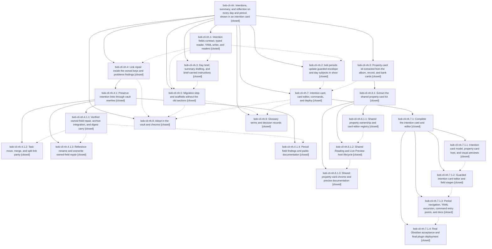

# Bead: bob-cli-nh — Intentions, summary, and reflection on every day and period, shown in an intention card

[Bead Pages](../README.md) / bob-cli-nh

**Status:** ✓ closed · **Resolution:** done · **Type:** ▸ plan · **Tier:** epic
**Owner:** `bryanbugyi34@gmail.com` · **Created by:** [bbugyi200.athena.1ef](https://github.com/bobs-org/bob-cli--agents/blob/main/sessions/bbugyi200.athena.1ef.md) · **Assignee:** `bob-cli-nh.land`
**Created:** 2026-11-19 09:35:21 EST · **Closed:** 2026-11-20 11:31:12 EST
**Plan:** [202611/period\_intentions.md](https://github.com/bobs-org/bob-cli--plans/blob/main/202611/period_intentions.md)

<!-- sase:links:start -->

## Links

| Relation | Artifact | Why |
| --- | --- | --- |
| implemented-by | [plan:202611/period_intentions.md][1] | derived from the plan's `bead_id:` frontmatter field |

_Plus 17 automatic references — see [Referenced By](#referenced-by)._

[1]: https://github.com/bobs-org/bob-cli--plans/blob/main/202611/period_intentions.md

<!-- sase:links:end -->

## Description

Every canonical daily note and every week, quarter, and year note carries the same three hidden frontmatter fields: `intentions` (Bryan's list), `summary` (an agent's short account of what happened), and `reflection` (Bryan's account of what it meant). bob is the only writer. A new intention card in the property-card family (album, record, and bank cards) shows the fields at the top of the note, and `==` edits them. The daily Headline, week Intentions, quarter Outcomes, and year Theme are migrated and retired. The morning ritual gains a PRE row that launches a summary agent and a POST row that reflects on yesterday. The agent finds the summary instructions through bob, never through note text.

## Notes

[2026-11-19T14:58:47Z · research.5g.linker.w0] COPY CHIP FOR THE GTD ROW (Bryan's request, 2026-11-19). When phase adopt (bob-cli-nh.8) adds the `#pre #periods` **Summarize yesterday** row to ~/bob/gtd_daily.md, put its agent prompt in a copy chip instead of double quotes. A copy chip is an inline code span with a `copy[label]:` prefix. The prompt contains backticks, so the span uses a double-backtick run. Write the row's prompt clause exactly like this; the rest of the row stays as planned:

launch an agent with ``copy[summary prompt]: Summarize yesterday's daily note (`bob periods brief yesterday` prints the instructions and evidence)`` · done once the agent runs, or when yesterday's summary is already drafted or edited.

Rules:
- The chip payload (after `copy[summary prompt]: `) must be byte-identical to the plan's prompt. Drop the surrounding double quotes.
- When rewording the Weekly, Quarterly, and Yearly review rows or the weekly PRE row, keep any existing ``copy[...]: ...`` chips intact and edit only around them. A separate epic converts the existing last-week, last-quarter, and last-year prompts into chips with the labels `last-week prompt`, `last-quarter prompt`, and `last-year prompt`.
- Write the chip even if the bob-copy-chips Obsidian plugin has not deployed yet. Until then the span reads as inline code, so do not wait for the plugin.
- The design is the proposed epic plan "Copy chips: click-to-copy text authored in Obsidian notes" (research: research:202611/obsidian_copy_chips/obsidian_copy_chips.md). Its adopt phase converts any Summarize yesterday prompt that landed quoted, and appends a correcting note here if the shipped syntax changes.

Lander: before closing the epic, confirm that the open Summarize yesterday row in gtd_daily.md carries this chip. If it does not, fix it.

[2026-11-19T22:34:21Z · bob-cli-nh.4.1.land] DISCOVERED ISSUE: Landing child bob-cli-nh.4.1 triaged PROPOSED FOLLOW-UP reports from .4.1.2 #1, .4.1.3 #1, and .4.1.4 #2. Three clean-base library failures belong to nh.2 a0b91a8d, not link repair: catalog::tests::public_leaves_are_entries_or_excluded (periods update missing from catalog/table.rs), completion::kinds::tests::every_value_arg_has_a_decision (periods update lacks kinds decisions), and periods::update::tests::planning_applies_ordered_intention_ops_and_reports_bad_indexes. The latter starts [one,two], inserts middle at 1, moves 2 to 0, replaces 1: final should be [two,two again,middle], but the assertion expects trailing one. Child agents reproduced failures identically on clean 749efc28/ddf28f64; lander inspected source and history, not a fresh test run. No matching task after all-status search and last-week sweep; remediation stays with this active parent epic and its land agent, no new task.

[2026-11-19T22:36:25Z · bob-cli-no.land] DISCOVERED ISSUE: bob-cli-no.1 note #2 proposes clean-base library failures in public-leaf catalog coverage, periods update completion coverage, and planning_applies_ordered_intention_ops_and_reports_bad_indexes; no.2 note #1 repeats the catalog failure. Current CLI 992fd33d still has no periods-update row/exclusion in catalog/table.rs nor periods/update entry in completion/kinds.rs, although nh.2 a0b91a8d added the command. Please verify/fix these registrations and the ordered-op test before your landing. Those phase observations belong to nh, not bank import; no new task and no fresh full Rust suite claimed by this lander.

[2026-11-20T13:06:03Z · bob-cli-nh.7.1.land] DISCOVERED ISSUE: Proposed by bob-cli-nh.7.1.4 note #7. The nh.2 periods update empty-op dry read can return ok:true with frontmatter_invalid or intentions_* diagnostics and empty/partial fields on malformed frontmatter; clients must not treat that as valid emptiness. The intention editor and YAML Done now reject blocking warnings (297ca helper); docs/periods.md guarded-update contract does not document this distinction. Please document the existing read contract and advisory intentions_over_soft_cap exception with an example in parent landing. This API/doc gap belongs to nh.2/nh, not a standalone follow-up or a reason to redesign the already-guarded card. A behavior change to fail all dry reads closed needs deliberate contract review; do not silently adopt the alternative. All-status search found no duplicate.

[2026-11-20T14:24:25Z · bob-cli-nh.7.1.land] DISCOVERED ISSUE (bob-cli-nh.7.1.land, 2026-11-20): `just check` fails on the unmodified bob-cli tree at e5f51081 (= origin/master; this landing changed no bob-cli files): 12148 passed, 3 failed, all in -p bob-obsidian --lib and all introduced with nh.2's `bob periods update` (a0b91a8d). Reproduced deterministically with a filtered cargo test rerun. (1) native::catalog::tests::public_leaves_are_entries_or_excluded: 'public leaf ["periods", "update"] is neither an entry nor excluded'. (2) native::completion::kinds::tests::every_value_arg_has_a_decision: 'value-taking args without a kinds decision: ["periods update:input", "periods update:subject"]'. (3) native::periods::update::tests::planning_applies_ordered_intention_ops_and_reports_bad_indexes expects [two, two again, one] but insert(1,middle), move(2->0), replace(1) on [one, two] correctly yields [two, two again, middle]; the test expectation is wrong, not the planner (the plugin's writer simulator and real bob agree). Owner: nh.2's periods-update contract work; fix the catalog entry/exclusion, completion kinds decisions, and the test expectation. Log: /tmp/bob-cli-just-check.log on athena.

[2026-11-20T15:59:23Z · bob-cli-nh.land] LAND AUDIT + FOLLOW-UP TRIAGE (bob-cli-nh.land, 2026-11-20). Read the epic, all 9 phases, nested child epics nh.4.1/nh.6.1/nh.7.1 and all their notes, plan:202611/period_intentions.md, and the epic commits (e7aa392d, a0b91a8d, a29a64f6, 749efc28, ea538f78, 992fd33d, 8bbb3041, eaa52d06, f811397d, b7007011, 46bb654a). DECISIONS honored: sixty-word day summary cap; only the authorized glossary strands written; decision records untouched.

VERIFIED: open gtd_daily.md Summarize yesterday row carries ``copy[summary prompt]: ...`` with the plan's payload (epic note #1 satisfied; bob-chips now deployed on athena, stamp 2026-11-20T15:37:33Z). Live vault: `bob periods list -p` has 0 legacy_period_text/dangling_period_link (only pre-existing 2024/2025 unscaffolded); `periods show yesterday` reads frontmatter intentions; template Headline gone; types.json, day.md, vault AGENTS.md pointers and chezmoi post_stages [periods, intentions] present; old #post #headline row closed.

REMAINING EPIC WORK (tale): (1) the three nh.2 failures still reproduce on 46bb654a (filtered cargo test): catalog has no periods update entry/exclusion, completion kinds lack periods update:input/subject, planning test expects [two, two again, one] but the planner correctly yields [two, two again, middle] (epic notes #2/#3/#5). (2) docs/periods.md lacks the malformed-frontmatter empty-op dry-read contract (epic note #4). (3) nh.8 #8 is epic-caused text loss: legacy::sections() drops fenced lines from section bodies, while migrate removes Reflection/legacy sections whole and rewrites the Review body from the fence-stripped text.

LANDER INTEGRATION EDITS: regenerated docs/reference/glossary.md (stale since nh.9's b7007011 memory commit); removed the three --epic-symbol entries (Patch, apply, read_existing are all used by periods update/report/note/migrate). Non-epic commits since start (bank 5b547f13/c94a718d/3acbc1a3, log recall 382963db/ddf28f64/d15432aa, chips e5f51081/2a5bc1f8/f0e59e82, install ab341446, glossary d84956cc) touch no intention surface and need no further integration.

FOLLOW-UP OUTCOMES: nh.8 #2 -> new bob-cli-ny (feature, large; snoozed to 2026-11-27 for a release soak). nh.8 #3 -> new bob-cli-nz (feature, large). nh.8 #4 -> new bob-cli-o0 (feature, large; related bob-cli-66). nh.8 #5 -> new bob-cli-o1. nh.8 #6 -> new bob-cli-o2. nh.8 #7 -> new bob-cli-o3 (medium). nh.8 #10 -> new bob-cli-o4 (bug, small; sample_diff predates the epic, 5a1ccf59). nh.8 #8 -> remaining epic work (tale), no task. nh.8 #9 declined: the four 2027 notes were Mac-created on 2026-11-10 before the epic, nh.8 migrated them, and new scaffolds (eaa52d06) emit no legacy slots, so no live or recurring instance. nh.8 #11: (1) epic work above; (2) +1 bob-cli-gz; (3) +1 bob-cli-nv. nh.8 #12 declined: resolved, bob-chips deployed on athena 15:37Z. nh.2 #1 declined: re-key landed, entries now removed. nh.2 #2 / nh.3 #1 / nh.5 #3 Mac word budgets declined: jz/h9 closed and nh.8's docs-check showed only the nv URL failure. nh.5 #1/#2 capture failures declined: owned by nj (closed) and absent from nh.7.1.land's e5f51081 just check (only the 3 nh.2 failures). nh.9's missing decision-record follow-up declined: the reviewer chose memory_decision_records=no. Child-epic dispositions (np/nq/nr/ns/nw/nx, m1/m6/m7/km/io/n0, ms.8, no) were recorded by their landers and stand.

[2026-11-20T16:01:02Z · bob-cli-nh.land] Remaining-work tale sase_plan_period_intentions_landing.md (size small) validated with zero warnings: fixes the three nh.2 failures (catalog exclusion for periods update, completion kinds for periods update:subject/input, corrected planning expectation), documents the malformed-frontmatter empty-op dry-read contract in docs/periods.md, fixes fenced-line loss in legacy::sections()/replace_review_body with regression tests, runs just fmt/docs-gen/check/docs-check, then closes bob-cli-nh, checks symvision availability, and marks period_intentions.md done in the same coding turn. No just check or docs-check pass is claimed by this lander.

[2026-11-20T16:31:12Z · bob-cli-nh.land] Verified remaining epic work: catalog exclusion for `bob periods update`, completion kinds for `periods update:subject`/`input`, and the planning test now expects `[two, two again, middle]`. Documented the empty-ops dry-read contract in docs/periods.md (`ok: true` with `frontmatter_invalid` / field-shape warnings, plus

… and 626 more characters

## Phases

| Bead | Title | Status | Size | Created | Agents | Commits |
|---|---|---|---|---|---:|---:|
| [bob-cli-nh.1](bob-cli-nh.1.md) | Intention fields contract, typed reader, YAML writer, and readers | ✓ closed | large | 2026-11-19 | 1 | 1 |
| [bob-cli-nh.2](bob-cli-nh.2.md) | bob periods update guarded envelope and day subjects in show | ✓ closed | medium | 2026-11-19 | 1 | 2 |
| [bob-cli-nh.3](bob-cli-nh.3.md) | Day brief, summary drafting, and brief-carried instructions | ✓ closed | large | 2026-11-19 | 1 | 1 |
| [bob-cli-nh.4](bob-cli-nh.4.md) | Link repair inside the owned keys and problems findings | ✓ closed | large | 2026-11-19 | 1 | 0 |
| [bob-cli-nh.5](bob-cli-nh.5.md) | Migration step and scaffolds without the old sections | ✓ closed | medium | 2026-11-19 | 1 | 1 |
| [bob-cli-nh.6](bob-cli-nh.6.md) | Property-card kit extracted from the album, record, and bank cards | ✓ closed | large | 2026-11-19 | 1 | 0 |
| [bob-cli-nh.7](bob-cli-nh.7.md) | Intention card, card editor, commands, and deploy | ✓ closed | large | 2026-11-19 | 1 | 0 |
| [bob-cli-nh.8](bob-cli-nh.8.md) | Adopt in the vault and chezmoi | ✓ closed | medium | 2026-11-19 | 1 | 1 |
| [bob-cli-nh.9](bob-cli-nh.9.md) | Glossary terms and decision records | ✓ closed | small | 2026-11-19 | 1 | 1 |

## Lineage

## Agents

| Agent | Bead | Commits |
|---|---|---:|
| [bbugyi200.athena.bob-cli-nh.1](https://github.com/bobs-org/bob-cli--agents/blob/main/sessions/bbugyi200.athena.bob-cli-nh.1.md) | [bob-cli-nh.1](bob-cli-nh.1.md) | 1 |
| [bbugyi200.athena.bob-cli-nh.2](https://github.com/bobs-org/bob-cli--agents/blob/main/agents/bbugyi200.athena.bob-cli-nh.2/README.md) | [bob-cli-nh.2](bob-cli-nh.2.md) | 2 |
| [bbugyi200.athena.bob-cli-nh.3](https://github.com/bobs-org/bob-cli--agents/blob/main/sessions/bbugyi200.athena.bob-cli-nh.3.md) | [bob-cli-nh.3](bob-cli-nh.3.md) | 1 |
| [bbugyi200.athena.bob-cli-nh.4](https://github.com/bobs-org/bob-cli--agents/blob/main/sessions/bbugyi200.athena.bob-cli-nh.4.md) | [bob-cli-nh.4](bob-cli-nh.4.md) | 0 |
| [bbugyi200.athena.bob-cli-nh.4.1.1](https://github.com/bobs-org/bob-cli--agents/blob/main/sessions/bbugyi200.athena.bob-cli-nh.4.1.1.md) | [bob-cli-nh.4.1.1](bob-cli-nh.4.1.1.md) | 1 |
| [bbugyi200.athena.bob-cli-nh.4.1.2](https://github.com/bobs-org/bob-cli--agents/blob/main/agents/bbugyi200.athena.bob-cli-nh.4.1.2/README.md) | [bob-cli-nh.4.1.2](bob-cli-nh.4.1.2.md) | 0 |
| [bbugyi200.athena.bob-cli-nh.4.1.3](https://github.com/bobs-org/bob-cli--agents/blob/main/agents/bbugyi200.athena.bob-cli-nh.4.1.3/README.md) | [bob-cli-nh.4.1.3](bob-cli-nh.4.1.3.md) | 1 |
| [bbugyi200.athena.bob-cli-nh.4.1.4](https://github.com/bobs-org/bob-cli--agents/blob/main/sessions/bbugyi200.athena.bob-cli-nh.4.1.4.md) | [bob-cli-nh.4.1.4](bob-cli-nh.4.1.4.md) | 1 |
| [bbugyi200.athena.bob-cli-nh.4.1.land](https://github.com/bobs-org/bob-cli--agents/blob/main/sessions/bbugyi200.athena.bob-cli-nh.4.1.land.md) | [bob-cli-nh.4.1](bob-cli-nh.4.1.md) | 3 |
| [bbugyi200.athena.bob-cli-nh.5](https://github.com/bobs-org/bob-cli--agents/blob/main/agents/bbugyi200.athena.bob-cli-nh.5/README.md) | [bob-cli-nh.5](bob-cli-nh.5.md) | 1 |
| [bbugyi200.athena.bob-cli-nh.6](https://github.com/bobs-org/bob-cli--agents/blob/main/sessions/bbugyi200.athena.bob-cli-nh.6.md) | [bob-cli-nh.6](bob-cli-nh.6.md) | 0 |
| [bbugyi200.athena.bob-cli-nh.6.1.1](https://github.com/bobs-org/bob-cli--agents/blob/main/sessions/bbugyi200.athena.bob-cli-nh.6.1.1.md) | [bob-cli-nh.6.1.1](bob-cli-nh.6.1.1.md) | 0 |
| [bbugyi200.athena.bob-cli-nh.6.1.2](https://github.com/bobs-org/bob-cli--agents/blob/main/sessions/bbugyi200.athena.bob-cli-nh.6.1.2.md) | [bob-cli-nh.6.1.2](bob-cli-nh.6.1.2.md) | 0 |
| [bbugyi200.athena.bob-cli-nh.6.1.3](https://github.com/bobs-org/bob-cli--agents/blob/main/sessions/bbugyi200.athena.bob-cli-nh.6.1.3.md) | [bob-cli-nh.6.1.3](bob-cli-nh.6.1.3.md) | 0 |
| [bbugyi200.athena.bob-cli-nh.6.1.land](https://github.com/bobs-org/bob-cli--agents/blob/main/sessions/bbugyi200.athena.bob-cli-nh.6.1.land.md) | [bob-cli-nh.6.1](bob-cli-nh.6.1.md) | 1 |
| [bbugyi200.athena.bob-cli-nh.7](https://github.com/bobs-org/bob-cli--agents/blob/main/sessions/bbugyi200.athena.bob-cli-nh.7.md) | [bob-cli-nh.7](bob-cli-nh.7.md) | 0 |
| [bbugyi200.athena.bob-cli-nh.7.1.1](https://github.com/bobs-org/bob-cli--agents/blob/main/sessions/bbugyi200.athena.bob-cli-nh.7.1.1.md) | [bob-cli-nh.7.1.1](bob-cli-nh.7.1.1.md) | 0 |
| [bbugyi200.athena.bob-cli-nh.7.1.2](https://github.com/bobs-org/bob-cli--agents/blob/main/agents/bbugyi200.athena.bob-cli-nh.7.1.2/README.md) | [bob-cli-nh.7.1.2](bob-cli-nh.7.1.2.md) | 0 |
| [bbugyi200.athena.bob-cli-nh.7.1.3](https://github.com/bobs-org/bob-cli--agents/blob/main/agents/bbugyi200.athena.bob-cli-nh.7.1.3/README.md) | [bob-cli-nh.7.1.3](bob-cli-nh.7.1.3.md) | 0 |
| [bbugyi200.athena.bob-cli-nh.7.1.4](https://github.com/bobs-org/bob-cli--agents/blob/main/agents/bbugyi200.athena.bob-cli-nh.7.1.4/README.md) | [bob-cli-nh.7.1.4](bob-cli-nh.7.1.4.md) | 0 |
| [bbugyi200.athena.bob-cli-nh.7.1.land](https://github.com/bobs-org/bob-cli--agents/blob/main/sessions/bbugyi200.athena.bob-cli-nh.7.1.land.md) | [bob-cli-nh.7.1](bob-cli-nh.7.1.md) | 1 |
| [bbugyi200.athena.bob-cli-nh.8](https://github.com/bobs-org/bob-cli--agents/blob/main/agents/bbugyi200.athena.bob-cli-nh.8/README.md) | [bob-cli-nh.8](bob-cli-nh.8.md) | 1 |
| [bbugyi200.athena.bob-cli-nh.9](https://github.com/bobs-org/bob-cli--agents/blob/main/agents/bbugyi200.athena.bob-cli-nh.9/README.md) | [bob-cli-nh.9](bob-cli-nh.9.md) | 1 |
| [bbugyi200.athena.bob-cli-nh.land](https://github.com/bobs-org/bob-cli--agents/blob/main/sessions/bbugyi200.athena.bob-cli-nh.land.md) | [bob-cli-nh](README.md) | 2 |

## Commits

| Repo | Commit | Subject | Bead | Committed |
|---|---|---|---|---|
| bob-cli | [`e7aa392`](https://github.com/bobs-org/bob-cli/commit/e7aa392d688ea250ada1a6d732e3f27ed0e67c9c) | feat(intentions): add unified fields contract and readers | [bob-cli-nh.1](bob-cli-nh.1.md) | 2026-11-19 12:52:40 EST |
| bob-cli | [`a0b91a8`](https://github.com/bobs-org/bob-cli/commit/a0b91a8dfcc27a24d35a6c13989559d7fc594450) | feat(periods): add guarded intention updates | [bob-cli-nh.2](bob-cli-nh.2.md) | 2026-11-19 14:12:26 EST |
| bob-cli | [`d84956c`](https://github.com/bobs-org/bob-cli/commit/d84956cc99792d370eaebe98466c677671a3bf1f) | docs(glossary): regenerate reference glossary | [bob-cli-nh.2](bob-cli-nh.2.md) | 2026-11-19 15:09:12 EST |
| bob-cli | [`749efc2`](https://github.com/bobs-org/bob-cli/commit/749efc28358f0c9b8eb0314cf3d81615a66bb3b9) | feat(intentions): repair owned links during vault rewrites | [bob-cli-nh.4.1.1](bob-cli-nh.4.1.1.md) | 2026-11-19 15:35:22 EST |
| bob-cli | [`a29a64f`](https://github.com/bobs-org/bob-cli/commit/a29a64f63884c9cfa960928c7a2d3c6b48693f36) | feat(periods): add day brief, summary drafting, and brief-carried instructions | [bob-cli-nh.3](bob-cli-nh.3.md) | 2026-11-19 16:33:50 EST |
| bob-cli | [`ea538f7`](https://github.com/bobs-org/bob-cli/commit/ea538f78edb857c34a2a1e14ddbe5d50a68ed4b4) | feat(intentions): repair owned fields in reference link rewrites | [bob-cli-nh.4.1.3](bob-cli-nh.4.1.3.md) | 2026-11-19 17:07:03 EST |
| bob-cli | [`992fd33`](https://github.com/bobs-org/bob-cli/commit/992fd33d72dcb0d0b80382666a73da94559322c1) | feat(periods): report legacy and malformed intention findings | [bob-cli-nh.4.1.4](bob-cli-nh.4.1.4.md) | 2026-11-19 17:19:17 EST |
| bob-cli | [`8bbb304`](https://github.com/bobs-org/bob-cli/commit/8bbb3041cd33412e67f297c0e481534e927b0b3f) | feat(intentions): recover task rewrite integration | [bob-cli-nh.4.1](bob-cli-nh.4.1.md) | 2026-11-19 17:38:16 EST |
| bob-cli | [`eaa52d0`](https://github.com/bobs-org/bob-cli/commit/eaa52d06c8f99c1f08b6068e10d3a10b0b47cca0) | feat(periods): add intentions step to migrate and new scaffolds | [bob-cli-nh.5](bob-cli-nh.5.md) | 2026-11-19 18:10:58 EST |
| bob-cli--plans | [`bob-cli--plans@54eebe7`](https://github.com/bobs-org/bob-cli--plans/commit/54eebe7a0474c4087fb16cbb75eecb991b8fc26c) | chore(plans): mark property\_card\_kit status done | [bob-cli-nh.6.1](bob-cli-nh.6.1.md) | 2026-11-19 18:27:36 EST |
| bob-cli | [`f811397`](https://github.com/bobs-org/bob-cli/commit/f811397d5a98c56490adc68bd3e6b88d4be4b547) | fix(intentions): preserve links through vault rewrites | [bob-cli-nh.4.1](bob-cli-nh.4.1.md) | 2026-11-19 18:54:20 EST |
| bob-cli--plans | [`bob-cli--plans@70390ef`](https://github.com/bobs-org/bob-cli--plans/commit/70390efb2bb11228c50f62676b31a2ad1301535e) | docs(plan): mark intention link repair done | [bob-cli-nh.4.1](bob-cli-nh.4.1.md) | 2026-11-19 18:54:57 EST |
| bob-cli--plans | [`bob-cli--plans@7af61f1`](https://github.com/bobs-org/bob-cli--plans/commit/7af61f19c464221863830232533af21be976bec7) | chore(plans): mark intention\_card epic plan done | [bob-cli-nh.7.1](bob-cli-nh.7.1.md) | 2026-11-20 09:38:20 EST |
| bob-cli | [`b700701`](https://github.com/bobs-org/bob-cli/commit/b70070114fa5861c8552dd5fc3285da265e8fe52) | docs(memory): add intention and property-card glossary family | [bob-cli-nh.9](bob-cli-nh.9.md) | 2026-11-20 09:45:44 EST |
| bob-cli | [`46bb654`](https://github.com/bobs-org/bob-cli/commit/46bb654a8eb9cf30c358a4ea4ed8031c18751d9e) | fix(periods): remove empty legacy slots during intentions migrate | [bob-cli-nh.8](bob-cli-nh.8.md) | 2026-11-20 10:36:33 EST |
| bob-cli | [`c91fbee`](https://github.com/bobs-org/bob-cli/commit/c91fbee63e3d9e838fbf9f4dec4c0f52b9797d66) | chore(intentions): retire epic symbols and regenerate glossary reference | [bob-cli-nh](README.md) | 2026-11-20 11:01:55 EST |
| bob-cli | [`1fa1b4e`](https://github.com/bobs-org/bob-cli/commit/1fa1b4e711fc9e6ffd51746e936616d3c02af7f6) | fix(periods): register update, keep fenced migrate bodies | [bob-cli-nh](README.md) | 2026-11-20 11:32:43 EST |

<!-- sase:referenced-by:start -->

## Referenced By

| Relation | Artifact | Why | Uses |
| --- | --- | --- | ---: |
| read-by | [agent:1el--code][1] | Check whether the epic already records the periods update lib test failures | 1 |
| read-by | [agent:bob-cli-nh.4.1.land][2] | Need the active parent epic scope before attaching sibling update failures | 1 |
| read-by | [agent:bob-cli-nh.4.1.land--1][2] | Verify the containing epic remains untouched and open after phase closeout | 1 |
| read-by | [agent:bob-cli-nh.8][3] | Need the COPY CHIP note and epic context for phase 8 | 1 |
| read-by | [agent:bob-cli-nh.land][4] | Need the epic scope, children, and linked plan file | 2 |
| read-by | [agent:bob-cli-ni.6][5] | Need COPY CHIP coordination for Summarize yesterday GTD row | 1 |
| read-by | [agent:research.5i.cdx][6] | Research the daily and note property-card context requested by Bryan | 1 |
| read-by | [agent:research.5i.cld][7] | Context for property card unification research | 1 |
| read-by | [agent:research.5i.final][8] | Confirm property-card kit and intention-card phase status for consolidated property-card identity research | 1 |
| read-by | [agent:research.5i.gem][9] | Context on property cards / schema card epic requested by user | 2 |
| read-by | [agent:research.5i.grk][10] | Need property-card kit epic context for unifying schema-card appearance | 1 |
| read-by | [agent:research.5i.mus][11] | Need epic context for property-card unification research | 1 |
| read-by | [agent:research.5l.cdx][12] | Understand the property-card epic constraints for proposed group navigation | 1 |
| read-by | [agent:research.5l.cld][13] | Context on property cards (nh epic) to design how <</>> group links render at the bottom of property cards | 1 |
| read-by | [agent:research.5l.gem][14] | Inspect bob-cli-nh epic bead for property card context | 1 |
| read-by | [agent:research.5l.grk][15] | Need epic context for property cards, walker footer, and [N/]N keymap design | 1 |
| read-by | [agent:research.5l.mus][16] | Need nh epic context for [N/]N property card bottom links design | 1 |

[1]: https://github.com/bobs-org/bob-cli--agents/blob/main/sessions/bbugyi200.athena.1el.md
[2]: https://github.com/bobs-org/bob-cli--agents/blob/main/sessions/bbugyi200.athena.bob-cli-nh.4.1.land.md
[3]: https://github.com/bobs-org/bob-cli--agents/blob/main/agents/bbugyi200.athena.bob-cli-nh.8/README.md
[4]: https://github.com/bobs-org/bob-cli--agents/blob/main/sessions/bbugyi200.athena.bob-cli-nh.land.md
[5]: https://github.com/bobs-org/bob-cli--agents/blob/main/agents/bbugyi200.athena.bob-cli-ni.6/README.md
[6]: https://github.com/bobs-org/bob-cli--agents/blob/main/agents/bbugyi200.athena.research.5i.cdx/README.md
[7]: https://github.com/bobs-org/bob-cli--agents/blob/main/agents/bbugyi200.athena.research.5i.cld/README.md
[8]: https://github.com/bobs-org/bob-cli--agents/blob/main/agents/bbugyi200.athena.research.5i.final/README.md
[9]: https://github.com/bobs-org/bob-cli--agents/blob/main/agents/bbugyi200.athena.research.5i.gem/README.md
[10]: https://github.com/bobs-org/bob-cli--agents/blob/main/agents/bbugyi200.athena.research.5i.grk/README.md
[11]: https://github.com/bobs-org/bob-cli--agents/blob/main/agents/bbugyi200.athena.research.5i.mus/README.md
[12]: https://github.com/bobs-org/bob-cli--agents/blob/main/agents/bbugyi200.athena.research.5l.cdx/README.md
[13]: https://github.com/bobs-org/bob-cli--agents/blob/main/agents/bbugyi200.athena.research.5l.cld/README.md
[14]: https://github.com/bobs-org/bob-cli--agents/blob/main/agents/bbugyi200.athena.research.5l.gem/README.md
[15]: https://github.com/bobs-org/bob-cli--agents/blob/main/agents/bbugyi200.athena.research.5l.grk/README.md
[16]: https://github.com/bobs-org/bob-cli--agents/blob/main/agents/bbugyi200.athena.research.5l.mus/README.md

<!-- sase:referenced-by:end -->
