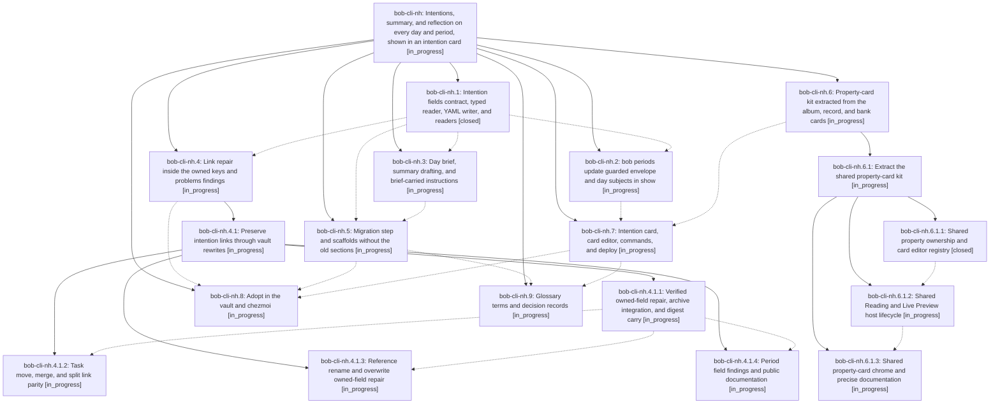

# Bead: bob-cli-nh — Intentions, summary, and reflection on every day and period, shown in an intention card

[Bead Pages](../README.md) / bob-cli-nh

**Status:** ◐ in_progress · **Type:** ▸ plan · **Tier:** epic
**Owner:** `bryanbugyi34@gmail.com` · **Created by:** [bbugyi200.athena.1ef](https://github.com/bobs-org/bob-cli--agents/blob/main/sessions/bbugyi200.athena.1ef.md) · **Assignee:** `bob-cli-nh.land`
**Created:** 2026-11-19 09:35:21 EST
**Plan:** [202611/period\_intentions.md](https://github.com/bobs-org/bob-cli--plans/blob/main/202611/period_intentions.md)

<!-- sase:links:start -->

## Links

| Relation | Artifact | Why |
| --- | --- | --- |
| implemented-by | [plan:202611/period_intentions.md][1] | derived from the plan's `bead_id:` frontmatter field |

_Plus 6 automatic references — see [Referenced By](#referenced-by)._

[1]: https://github.com/bobs-org/bob-cli--plans/blob/main/202611/period_intentions.md

<!-- sase:links:end -->

## Description

Every canonical daily note and every week, quarter, and year note carries the same three hidden frontmatter fields: `intentions` (Bryan's list), `summary` (an agent's short account of what happened), and `reflection` (Bryan's account of what it meant). bob is the only writer. A new intention card in the property-card family (album, record, and bank cards) shows the fields at the top of the note, and `==` edits them. The daily Headline, week Intentions, quarter Outcomes, and year Theme are migrated and retired. The morning ritual gains a PRE row that launches a summary agent and a POST row that reflects on yesterday. The agent finds the summary instructions through bob, never through note text.

## Notes

[2026-11-19T14:58:47Z · research.5g.linker.w0] COPY CHIP FOR THE GTD ROW (Bryan's request, 2026-11-19). When phase adopt (bob-cli-nh.8) adds the `#pre #periods` **Summarize yesterday** row to ~/bob/gtd_daily.md, put its agent prompt in a copy chip instead of double quotes. A copy chip is an inline code span with a `copy[label]:` prefix. The prompt contains backticks, so the span uses a double-backtick run. Write the row's prompt clause exactly like this; the rest of the row stays as planned:

launch an agent with ``copy[summary prompt]: Summarize yesterday's daily note (`bob periods brief yesterday` prints the instructions and evidence)`` · done once the agent runs, or when yesterday's summary is already drafted or edited.

Rules:
- The chip payload (after `copy[summary prompt]: `) must be byte-identical to the plan's prompt. Drop the surrounding double quotes.
- When rewording the Weekly, Quarterly, and Yearly review rows or the weekly PRE row, keep any existing ``copy[...]: ...`` chips intact and edit only around them. A separate epic converts the existing last-week, last-quarter, and last-year prompts into chips with the labels `last-week prompt`, `last-quarter prompt`, and `last-year prompt`.
- Write the chip even if the bob-copy-chips Obsidian plugin has not deployed yet. Until then the span reads as inline code, so do not wait for the plugin.
- The design is the proposed epic plan "Copy chips: click-to-copy text authored in Obsidian notes" (research: research:202611/obsidian_copy_chips/obsidian_copy_chips.md). Its adopt phase converts any Summarize yesterday prompt that landed quoted, and appends a correcting note here if the shipped syntax changes.

Lander: before closing the epic, confirm that the open Summarize yesterday row in gtd_daily.md carries this chip. If it does not, fix it.

## Phases

| Bead | Title | Status | Size | Created | Agents | Commits |
|---|---|---|---|---|---:|---:|
| [bob-cli-nh.1](bob-cli-nh.1.md) | Intention fields contract, typed reader, YAML writer, and readers | ✓ closed | large | 2026-11-19 | 1 | 1 |
| [bob-cli-nh.2](bob-cli-nh.2.md) | bob periods update guarded envelope and day subjects in show | ◐ in_progress | medium | 2026-11-19 | 1 | 1 |
| [bob-cli-nh.3](bob-cli-nh.3.md) | Day brief, summary drafting, and brief-carried instructions | ◐ in_progress | large | 2026-11-19 | 1 | 0 |
| [bob-cli-nh.4](bob-cli-nh.4.md) | Link repair inside the owned keys and problems findings | ◐ in_progress | large | 2026-11-19 | 1 | 0 |
| [bob-cli-nh.5](bob-cli-nh.5.md) | Migration step and scaffolds without the old sections | ◐ in_progress | medium | 2026-11-19 | 1 | 0 |
| [bob-cli-nh.6](bob-cli-nh.6.md) | Property-card kit extracted from the album, record, and bank cards | ◐ in_progress | large | 2026-11-19 | 1 | 0 |
| [bob-cli-nh.7](bob-cli-nh.7.md) | Intention card, card editor, commands, and deploy | ◐ in_progress | large | 2026-11-19 | 1 | 0 |
| [bob-cli-nh.8](bob-cli-nh.8.md) | Adopt in the vault and chezmoi | ◐ in_progress | medium | 2026-11-19 | 1 | 0 |
| [bob-cli-nh.9](bob-cli-nh.9.md) | Glossary terms and decision records | ◐ in_progress | small | 2026-11-19 | 1 | 0 |

## Lineage

## Agents

| Agent | Bead | Commits |
|---|---|---:|
| [bbugyi200.athena.bob-cli-nh.1](https://github.com/bobs-org/bob-cli--agents/blob/main/sessions/bbugyi200.athena.bob-cli-nh.1.md) | [bob-cli-nh.1](bob-cli-nh.1.md) | 1 |
| [bbugyi200.athena.bob-cli-nh.2](https://github.com/bobs-org/bob-cli--agents/blob/main/sessions/bbugyi200.athena.bob-cli-nh.2.md) | [bob-cli-nh.2](bob-cli-nh.2.md) | 1 |
| [bbugyi200.athena.bob-cli-nh.3](https://github.com/bobs-org/bob-cli--agents/blob/main/sessions/bbugyi200.athena.bob-cli-nh.3.md) | [bob-cli-nh.3](bob-cli-nh.3.md) | 0 |
| [bbugyi200.athena.bob-cli-nh.4](https://github.com/bobs-org/bob-cli--agents/blob/main/sessions/bbugyi200.athena.bob-cli-nh.4.md) | [bob-cli-nh.4](bob-cli-nh.4.md) | 0 |
| [bbugyi200.athena.bob-cli-nh.4.1.1](https://github.com/bobs-org/bob-cli--agents/blob/main/sessions/bbugyi200.athena.bob-cli-nh.4.1.1.md) | [bob-cli-nh.4.1.1](bob-cli-nh.4.1.1.md) | 0 |
| [bbugyi200.athena.bob-cli-nh.4.1.2](https://github.com/bobs-org/bob-cli--agents/blob/main/agents/bbugyi200.athena.bob-cli-nh.4.1.2/README.md) | [bob-cli-nh.4.1.2](bob-cli-nh.4.1.2.md) | 0 |
| [bbugyi200.athena.bob-cli-nh.4.1.3](https://github.com/bobs-org/bob-cli--agents/blob/main/agents/bbugyi200.athena.bob-cli-nh.4.1.3/README.md) | [bob-cli-nh.4.1.3](bob-cli-nh.4.1.3.md) | 0 |
| [bbugyi200.athena.bob-cli-nh.4.1.4](https://github.com/bobs-org/bob-cli--agents/blob/main/agents/bbugyi200.athena.bob-cli-nh.4.1.4/README.md) | [bob-cli-nh.4.1.4](bob-cli-nh.4.1.4.md) | 0 |
| [bbugyi200.athena.bob-cli-nh.4.1.land](https://github.com/bobs-org/bob-cli--agents/blob/main/agents/bbugyi200.athena.bob-cli-nh.4.1.land/README.md) | [bob-cli-nh.4.1](bob-cli-nh.4.1.md) | 0 |
| [bbugyi200.athena.bob-cli-nh.5](https://github.com/bobs-org/bob-cli--agents/blob/main/agents/bbugyi200.athena.bob-cli-nh.5/README.md) | [bob-cli-nh.5](bob-cli-nh.5.md) | 0 |
| [bbugyi200.athena.bob-cli-nh.6](https://github.com/bobs-org/bob-cli--agents/blob/main/sessions/bbugyi200.athena.bob-cli-nh.6.md) | [bob-cli-nh.6](bob-cli-nh.6.md) | 0 |
| [bbugyi200.athena.bob-cli-nh.6.1.1](https://github.com/bobs-org/bob-cli--agents/blob/main/sessions/bbugyi200.athena.bob-cli-nh.6.1.1.md) | [bob-cli-nh.6.1.1](bob-cli-nh.6.1.1.md) | 0 |
| [bbugyi200.athena.bob-cli-nh.6.1.2](https://github.com/bobs-org/bob-cli--agents/blob/main/sessions/bbugyi200.athena.bob-cli-nh.6.1.2.md) | [bob-cli-nh.6.1.2](bob-cli-nh.6.1.2.md) | 0 |
| [bbugyi200.athena.bob-cli-nh.6.1.3](https://github.com/bobs-org/bob-cli--agents/blob/main/agents/bbugyi200.athena.bob-cli-nh.6.1.3/README.md) | [bob-cli-nh.6.1.3](bob-cli-nh.6.1.3.md) | 0 |
| [bbugyi200.athena.bob-cli-nh.6.1.land](https://github.com/bobs-org/bob-cli--agents/blob/main/agents/bbugyi200.athena.bob-cli-nh.6.1.land/README.md) | [bob-cli-nh.6.1](bob-cli-nh.6.1.md) | 0 |
| [bbugyi200.athena.bob-cli-nh.7](https://github.com/bobs-org/bob-cli--agents/blob/main/agents/bbugyi200.athena.bob-cli-nh.7/README.md) | [bob-cli-nh.7](bob-cli-nh.7.md) | 0 |
| [bbugyi200.athena.bob-cli-nh.8](https://github.com/bobs-org/bob-cli--agents/blob/main/agents/bbugyi200.athena.bob-cli-nh.8/README.md) | [bob-cli-nh.8](bob-cli-nh.8.md) | 0 |
| [bbugyi200.athena.bob-cli-nh.9](https://github.com/bobs-org/bob-cli--agents/blob/main/agents/bbugyi200.athena.bob-cli-nh.9/README.md) | [bob-cli-nh.9](bob-cli-nh.9.md) | 0 |
| [bbugyi200.athena.bob-cli-nh.land](https://github.com/bobs-org/bob-cli--agents/blob/main/agents/bbugyi200.athena.bob-cli-nh.land/README.md) | [bob-cli-nh](README.md) | 0 |

## Commits

| Repo | Commit | Subject | Bead | Committed |
|---|---|---|---|---|
| bob-cli | [`e7aa392`](https://github.com/bobs-org/bob-cli/commit/e7aa392d688ea250ada1a6d732e3f27ed0e67c9c) | feat(intentions): add unified fields contract and readers | [bob-cli-nh.1](bob-cli-nh.1.md) | 2026-11-19 12:52:40 EST |
| bob-cli | [`a0b91a8`](https://github.com/bobs-org/bob-cli/commit/a0b91a8dfcc27a24d35a6c13989559d7fc594450) | feat(periods): add guarded intention updates | [bob-cli-nh.2](bob-cli-nh.2.md) | 2026-11-19 14:12:26 EST |

<!-- sase:referenced-by:start -->

## Referenced By

| Relation | Artifact | Why | Uses |
| --- | --- | --- | ---: |
| read-by | [agent:research.5i.cdx][1] | Research the daily and note property-card context requested by Bryan | 1 |
| read-by | [agent:research.5i.cld][2] | Context for property card unification research | 1 |
| read-by | [agent:research.5i.final][3] | Confirm property-card kit and intention-card phase status for consolidated property-card identity research | 1 |
| read-by | [agent:research.5i.gem][4] | Context on property cards / schema card epic requested by user | 2 |
| read-by | [agent:research.5i.grk][5] | Need property-card kit epic context for unifying schema-card appearance | 1 |
| read-by | [agent:research.5i.mus][6] | Need epic context for property-card unification research | 1 |

[1]: https://github.com/bobs-org/bob-cli--agents/blob/main/agents/bbugyi200.athena.research.5i.cdx/README.md
[2]: https://github.com/bobs-org/bob-cli--agents/blob/main/agents/bbugyi200.athena.research.5i.cld/README.md
[3]: https://github.com/bobs-org/bob-cli--agents/blob/main/agents/bbugyi200.athena.research.5i.final/README.md
[4]: https://github.com/bobs-org/bob-cli--agents/blob/main/agents/bbugyi200.athena.research.5i.gem/README.md
[5]: https://github.com/bobs-org/bob-cli--agents/blob/main/agents/bbugyi200.athena.research.5i.grk/README.md
[6]: https://github.com/bobs-org/bob-cli--agents/blob/main/agents/bbugyi200.athena.research.5i.mus/README.md

<!-- sase:referenced-by:end -->
