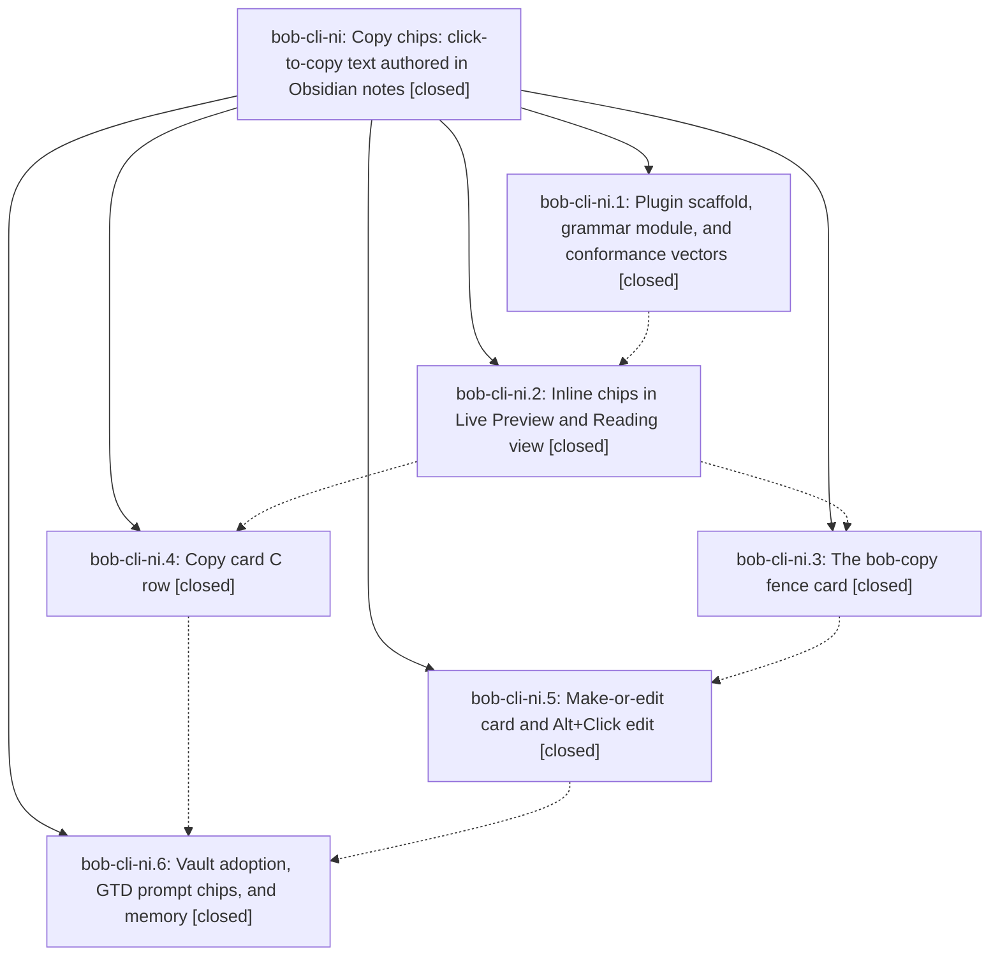

# Bead: bob-cli-ni — Copy chips: click-to-copy text authored in Obsidian notes

[Bead Pages](../README.md) / bob-cli-ni

**Status:** ✓ closed · **Resolution:** done · **Type:** ▸ plan · **Tier:** epic
**Owner:** `bryanbugyi34@gmail.com` · **Created by:** [bbugyi200.apollo.research.5g.linker.w0](https://github.com/bobs-org/bob-cli--agents/blob/main/sessions/bbugyi200.apollo.research.5g.linker.w0.md) · **Assignee:** `bob-cli-ni.land`
**Created:** 2026-11-19 10:05:33 EST · **Closed:** 2026-11-19 15:07:12 EST
**Plan:** [202611/copy\_chips.md](https://github.com/bobs-org/bob-cli--plans/blob/main/202611/copy_chips.md)

<!-- sase:links:start -->

## Links

| Relation | Artifact | Why |
| --- | --- | --- |
| implemented-by | [plan:202611/copy_chips.md][1] | derived from the plan's `bead_id:` frontmatter field |

_Plus 1 automatic references — see [Referenced By](#referenced-by)._

[1]: https://github.com/bobs-org/bob-cli--plans/blob/main/202611/copy_chips.md

<!-- sase:links:end -->

## Description

Typing an inline code span that starts with `copy:` (or a `bob-copy` fence) gives a quiet, theme-native chip that copies exactly the authored text with one click or one key, in every Obsidian view. Mod+Shift+Y makes or edits a chip without hand-escaping. The GTD agent prompts in gtd_daily.md are the first chips.

## Notes

[2026-11-19T18:54:20Z · bob-cli-ms.8.land--1] DISCOVERED ISSUE: bob-cli-ms.8 landing independently found a deterministic stale assertion caused by ni.4 commit 0a4a91f (feat(navigation): add copy-chip row to Copy card). On clean bob-plugins febfc6bacd3ef9895aa1a0c24bff3781ecbb95de, npm test fails scripts/test-navigation-copy-card-model.cjs:547 (assertion at 558): actual row IDs include copy-chip after note, but the expected list omits it. The same file fails in a serial isolated rerun. Please update the expected row ordering while preserving checks for the intended C row and disabled behavior. Source and isolated evidence establish this belongs to active copy-chip epic ni, not Record Card. Used sase_new_task: same-type/all-type searches and all 59 last-week tasks found no duplicate; no new task. Exact full gate and isolated logs: file:explicit:99f77573d0f7c4cc8d5ac10c.

[2026-11-19T19:27:04Z · bob-cli-ni.land] LANDING TRIAGE (bob-cli-ni.land): Verified ni.1, ni.2, ni.3, ni.5, ni.6 against plan:202611/copy_chips.md (api.copyChips v1 frozen and never-throwing; copy-on-cursor-line and make-or-edit with Mod+Shift+Y; q types only in the author fields; bob-copy-chips 0.4.0 synced and enabled; chezmoi allowlist, vault .gitignore, and community-plugins entries; six gtd_daily.md chips plus the gy nnoremap in bc60835f3; glossary:copy-chip matches the shipped behavior; no epic-symbol entries). Remaining epic work is in ni.4 (0a4a91f), which drifted from the plan's copycard phase: the row always shows, even with no chip or the plugin absent; it sits in the file group, not a chip group after TASK; its label is 'Copy chip', not 'Chip · <face>'; it bypasses copyCardRow and suppresses the card Notice instead of copying and then calling flash; it requires version===1 and copyChip; no manifest bump; no e2e; docs/copy-card.md untouched; and the scripts/test-navigation-copy-card-model.cjs:547 row-order test is stale. That fix goes to a lander tale. Follow-up outcomes: (1) the ni.5 #1 stale test, the epic note #1 DISCOVERED ISSUE from ms.8, and the ni.6 #5 copy-card docs gap were caused by this epic, so they are folded into the tale; no task. (2) The ni.5 #2 ledger-tools 25 ms perf flakes reproduced in the landing npm test and passed in isolation; they are duplicates, +1'd on bob-cli-km (event-link-times) and bob-cli-io (frees-marks). (3) The ni.6 #2 research phase 3 (snippet picker, masked copy*, rich-text copy, per-note opt-out) was filed as bob-cli-nm (feature, large, ready). (4) The ni.6 #3 plain-text surfaces showing raw chip source was filed as bob-cli-nn (feature, large, ready, related to nm). (5) The ni.6 #4 bob-emoji tracked in vault git is a duplicate of bob-cli-cd (already reopened by a bob-emoji +1) and was +1'd with a fresh 2026-11-19 reproduction. (6) The ni.1 collision census found no user-facing hit, so no follow-up.

[2026-11-19T20:07:12Z · bob-cli-ni.land] Land copy-chip C row per plan:202611/copy_card_chip_row_land.md. Landing verification ni.1-ni.6 per LANDING TRIAGE note on bob-cli-ni (api.copyChips v1 frozen never-throwing, copy-on-cursor-line and make-or-edit Mod+Shift+Y, vault adoption, glossary:copy-chip accurate, no epic-symbols). C-row fixes in bob-plugins: builtin id copy-chip to chip label Chip, buildCopyCardChipRow returns null unless ready non-whitespace or ambiguous (ready group chip value byte-exact, label Chip-Face truncated 40 with ⏎, preview ⏎; ambiguous dimmed 2-chips reason), model appends chip last after TASK, feature-detect version>=1 and chipAt, resolveCopyCardChip returns null for absent/multi/invalid/throw/none and passes ready/ambiguous, copyCardRow copies value via clipboard then flash with throw-safe, modal CHIP divider is-chip with TASK probe on :not(.is-chip), manifest 2.89.0 to 2.90.0. Tests: model 59 pass, view 22 pass (chip last, ready/ambiguous/no-row/collision/default cases); build and build:check pass; validate passes; docs inventory regenerated; npm test 7497/7502 with only known km event-link-times and io frees-marks failing under load, both pass in isolation (23/23, 17/17), perf 8/8; e2e extended (chip fixture, probe fix, 7 chip cases) self-test passes offline, real Obsidian e2e not run on apollo (no Obsidian/xvfb-run) and not run on athena this turn; docs copy-card and bob-copy-chips updated per plan; sync deployed 2.90.0 to vault (list shows HEAD 2.89.0 drift until host commits). Follow-ups: nm and nn created, km/io/cd corroborated, stale row-order test and copy-card docs folded, no new beads.

## Phases

| Bead | Title | Status | Size | Created | Agents | Commits |
|---|---|---|---|---|---:|---:|
| [bob-cli-ni.1](bob-cli-ni.1.md) | Plugin scaffold, grammar module, and conformance vectors | ✓ closed | medium | 2026-11-19 | 1 | 1 |
| [bob-cli-ni.2](bob-cli-ni.2.md) | Inline chips in Live Preview and Reading view | ✓ closed | large | 2026-11-19 | 1 | 1 |
| [bob-cli-ni.3](bob-cli-ni.3.md) | The bob-copy fence card | ✓ closed | medium | 2026-11-19 | 1 | 0 |
| [bob-cli-ni.4](bob-cli-ni.4.md) | Copy card C row | ✓ closed | medium | 2026-11-19 | 1 | 1 |
| [bob-cli-ni.5](bob-cli-ni.5.md) | Make-or-edit card and Alt+Click edit | ✓ closed | large | 2026-11-19 | 1 | 1 |
| [bob-cli-ni.6](bob-cli-ni.6.md) | Vault adoption, GTD prompt chips, and memory | ✓ closed | medium | 2026-11-19 | 1 | 1 |

## Lineage

## Agents

| Agent | Bead | Commits |
|---|---|---:|
| [bbugyi200.apollo.bob-cli-ni.1](https://github.com/bobs-org/bob-cli--agents/blob/main/agents/bbugyi200.apollo.bob-cli-ni.1/README.md) | [bob-cli-ni.1](bob-cli-ni.1.md) | 1 |
| [bbugyi200.apollo.bob-cli-ni.2](https://github.com/bobs-org/bob-cli--agents/blob/main/sessions/bbugyi200.apollo.bob-cli-ni.2.md) | [bob-cli-ni.2](bob-cli-ni.2.md) | 1 |
| [bbugyi200.apollo.bob-cli-ni.3](https://github.com/bobs-org/bob-cli--agents/blob/main/agents/bbugyi200.apollo.bob-cli-ni.3/README.md) | [bob-cli-ni.3](bob-cli-ni.3.md) | 0 |
| [bbugyi200.apollo.bob-cli-ni.4](https://github.com/bobs-org/bob-cli--agents/blob/main/agents/bbugyi200.apollo.bob-cli-ni.4/README.md) | [bob-cli-ni.4](bob-cli-ni.4.md) | 1 |
| [bbugyi200.apollo.bob-cli-ni.5](https://github.com/bobs-org/bob-cli--agents/blob/main/sessions/bbugyi200.apollo.bob-cli-ni.5.md) | [bob-cli-ni.5](bob-cli-ni.5.md) | 1 |
| [bbugyi200.apollo.bob-cli-ni.6](https://github.com/bobs-org/bob-cli--agents/blob/main/agents/bbugyi200.apollo.bob-cli-ni.6/README.md) | [bob-cli-ni.6](bob-cli-ni.6.md) | 1 |
| [bbugyi200.apollo.bob-cli-ni.land](https://github.com/bobs-org/bob-cli--agents/blob/main/sessions/bbugyi200.apollo.bob-cli-ni.land.md) | [bob-cli-ni](README.md) | 2 |

## Commits

| Repo | Commit | Subject | Bead | Committed |
|---|---|---|---|---|
| bob-plugins | [`bob-plugins@0b38f84`](https://github.com/bobs-org/bob-plugins/commit/0b38f84abee32d5c8b99de85de53b7fac4683ed7) | feat(bob-copy-chips): add plugin scaffold, grammar, and conformance vectors | [bob-cli-ni.1](bob-cli-ni.1.md) | 2026-11-19 11:02:38 EST |
| bob-plugins | [`bob-plugins@76fa3f9`](https://github.com/bobs-org/bob-plugins/commit/76fa3f92a7db0131fdb99dbd8d899e54f330e160) | feat(bob-copy-chips): inline copy chips in Live Preview and Reading view | [bob-cli-ni.2](bob-cli-ni.2.md) | 2026-11-19 12:11:47 EST |
| bob-plugins | [`bob-plugins@0a4a91f`](https://github.com/bobs-org/bob-plugins/commit/0a4a91f81227999524e6bcb4760d30f47eaa94a6) | feat(navigation): add copy-chip row to Copy card | [bob-cli-ni.4](bob-cli-ni.4.md) | 2026-11-19 12:34:54 EST |
| bob-plugins | [`bob-plugins@ccc0f72`](https://github.com/bobs-org/bob-plugins/commit/ccc0f724a1a9f0c41f411eca96f898243ca5a845) | feat(bob-copy-chips): add make-or-edit card and Alt+Click edit | [bob-cli-ni.5](bob-cli-ni.5.md) | 2026-11-19 13:57:28 EST |
| bob-cli | [`f0e59e8`](https://github.com/bobs-org/bob-cli/commit/f0e59e8297dedb0180dd0a29bd5d5a6c46c67a2d) | docs(memory): add Copy Chip glossary strand | [bob-cli-ni.6](bob-cli-ni.6.md) | 2026-11-19 14:10:05 EST |
| bob-plugins | [`bob-plugins@d6d2c33`](https://github.com/bobs-org/bob-plugins/commit/d6d2c334228cb2647ba7c40667858061bb9714f7) | feat(navigation): land copy-chip C row per plan 202611/copy\_card\_chip\_row\_land | [bob-cli-ni](README.md) | 2026-11-19 15:09:15 EST |
| bob-cli--plans | [`bob-cli--plans@b91b549`](https://github.com/bobs-org/bob-cli--plans/commit/b91b5495aa121d6456e1f4917de77eb9b934a78a) | chore(plans): mark copy\_chips epic plan done after C-row landing | [bob-cli-ni](README.md) | 2026-11-19 15:13:28 EST |

<!-- sase:referenced-by:start -->

## Referenced By

| Relation | Artifact | Why | Uses |
| --- | --- | --- | ---: |
| read-by | [agent:bob-cli-ni.6][1] | Need epic notes and COPY CHIP coordination with bob-cli-nh | 1 |

[1]: https://github.com/bobs-org/bob-cli--agents/blob/main/agents/bbugyi200.apollo.bob-cli-ni.6/README.md

<!-- sase:referenced-by:end -->
