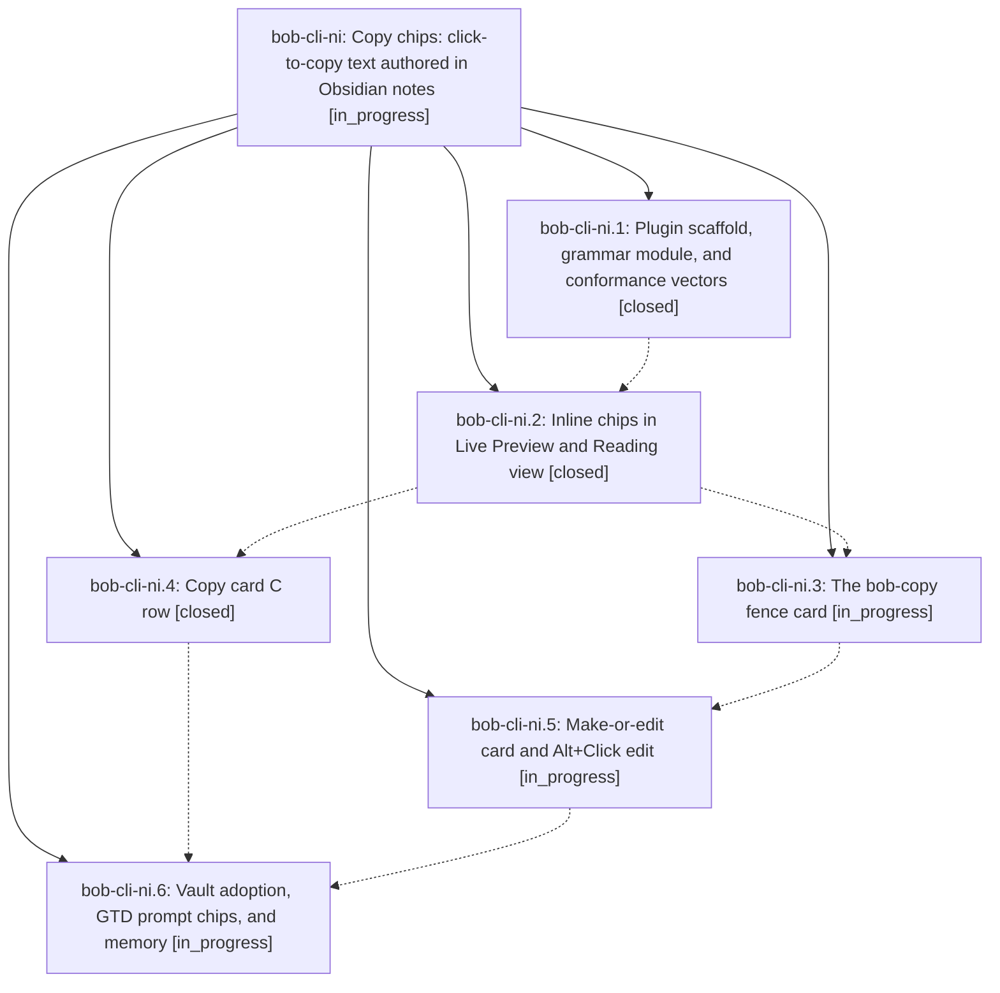

# Bead: bob-cli-ni — Copy chips: click-to-copy text authored in Obsidian notes

[Bead Pages](../README.md) / bob-cli-ni

**Status:** ◐ in_progress · **Type:** ▸ plan · **Tier:** epic
**Owner:** `bryanbugyi34@gmail.com` · **Created by:** [bbugyi200.apollo.research.5g.linker.w0](https://github.com/bobs-org/bob-cli--agents/blob/main/sessions/bbugyi200.apollo.research.5g.linker.w0.md) · **Assignee:** `bob-cli-ni.land`
**Created:** 2026-11-19 10:05:33 EST
**Plan:** [202611/copy\_chips.md](https://github.com/bobs-org/bob-cli--plans/blob/main/202611/copy_chips.md)

<!-- sase:links:start -->

## Links

| Relation | Artifact | Why |
| --- | --- | --- |
| implemented-by | [plan:202611/copy_chips.md][1] | derived from the plan's `bead_id:` frontmatter field |

[1]: https://github.com/bobs-org/bob-cli--plans/blob/main/202611/copy_chips.md

<!-- sase:links:end -->

## Description

Typing an inline code span that starts with `copy:` (or a `bob-copy` fence) gives a quiet, theme-native chip that copies exactly the authored text with one click or one key, in every Obsidian view. Mod+Shift+Y makes or edits a chip without hand-escaping. The GTD agent prompts in gtd_daily.md are the first chips.

## Phases

| Bead | Title | Status | Size | Created | Agents | Commits |
|---|---|---|---|---|---:|---:|
| [bob-cli-ni.1](bob-cli-ni.1.md) | Plugin scaffold, grammar module, and conformance vectors | ✓ closed | medium | 2026-11-19 | 1 | 1 |
| [bob-cli-ni.2](bob-cli-ni.2.md) | Inline chips in Live Preview and Reading view | ✓ closed | large | 2026-11-19 | 1 | 1 |
| [bob-cli-ni.3](bob-cli-ni.3.md) | The bob-copy fence card | ◐ in_progress | medium | 2026-11-19 | 1 | 0 |
| [bob-cli-ni.4](bob-cli-ni.4.md) | Copy card C row | ✓ closed | medium | 2026-11-19 | 1 | 1 |
| [bob-cli-ni.5](bob-cli-ni.5.md) | Make-or-edit card and Alt+Click edit | ◐ in_progress | large | 2026-11-19 | 1 | 0 |
| [bob-cli-ni.6](bob-cli-ni.6.md) | Vault adoption, GTD prompt chips, and memory | ◐ in_progress | medium | 2026-11-19 | 1 | 0 |

## Lineage

## Agents

| Agent | Bead | Commits |
|---|---|---:|
| [bbugyi200.apollo.bob-cli-ni.1](https://github.com/bobs-org/bob-cli--agents/blob/main/agents/bbugyi200.apollo.bob-cli-ni.1/README.md) | [bob-cli-ni.1](bob-cli-ni.1.md) | 1 |
| [bbugyi200.apollo.bob-cli-ni.2](https://github.com/bobs-org/bob-cli--agents/blob/main/sessions/bbugyi200.apollo.bob-cli-ni.2.md) | [bob-cli-ni.2](bob-cli-ni.2.md) | 1 |
| [bbugyi200.apollo.bob-cli-ni.3](https://github.com/bobs-org/bob-cli--agents/blob/main/agents/bbugyi200.apollo.bob-cli-ni.3/README.md) | [bob-cli-ni.3](bob-cli-ni.3.md) | 0 |
| [bbugyi200.apollo.bob-cli-ni.4](https://github.com/bobs-org/bob-cli--agents/blob/main/agents/bbugyi200.apollo.bob-cli-ni.4/README.md) | [bob-cli-ni.4](bob-cli-ni.4.md) | 1 |
| [bbugyi200.apollo.bob-cli-ni.5](https://github.com/bobs-org/bob-cli--agents/blob/main/agents/bbugyi200.apollo.bob-cli-ni.5/README.md) | [bob-cli-ni.5](bob-cli-ni.5.md) | 0 |
| [bbugyi200.apollo.bob-cli-ni.6](https://github.com/bobs-org/bob-cli--agents/blob/main/agents/bbugyi200.apollo.bob-cli-ni.6/README.md) | [bob-cli-ni.6](bob-cli-ni.6.md) | 0 |
| [bbugyi200.apollo.bob-cli-ni.land](https://github.com/bobs-org/bob-cli--agents/blob/main/agents/bbugyi200.apollo.bob-cli-ni.land/README.md) | [bob-cli-ni](README.md) | 0 |

## Commits

| Repo | Commit | Subject | Bead | Committed |
|---|---|---|---|---|
| bob-plugins | [`bob-plugins@0b38f84`](https://github.com/bobs-org/bob-plugins/commit/0b38f84abee32d5c8b99de85de53b7fac4683ed7) | feat(bob-copy-chips): add plugin scaffold, grammar, and conformance vectors | [bob-cli-ni.1](bob-cli-ni.1.md) | 2026-11-19 11:02:38 EST |
| bob-plugins | [`bob-plugins@76fa3f9`](https://github.com/bobs-org/bob-plugins/commit/76fa3f92a7db0131fdb99dbd8d899e54f330e160) | feat(bob-copy-chips): inline copy chips in Live Preview and Reading view | [bob-cli-ni.2](bob-cli-ni.2.md) | 2026-11-19 12:11:47 EST |
| bob-plugins | [`bob-plugins@0a4a91f`](https://github.com/bobs-org/bob-plugins/commit/0a4a91f81227999524e6bcb4760d30f47eaa94a6) | feat(navigation): add copy-chip row to Copy card | [bob-cli-ni.4](bob-cli-ni.4.md) | 2026-11-19 12:34:54 EST |
