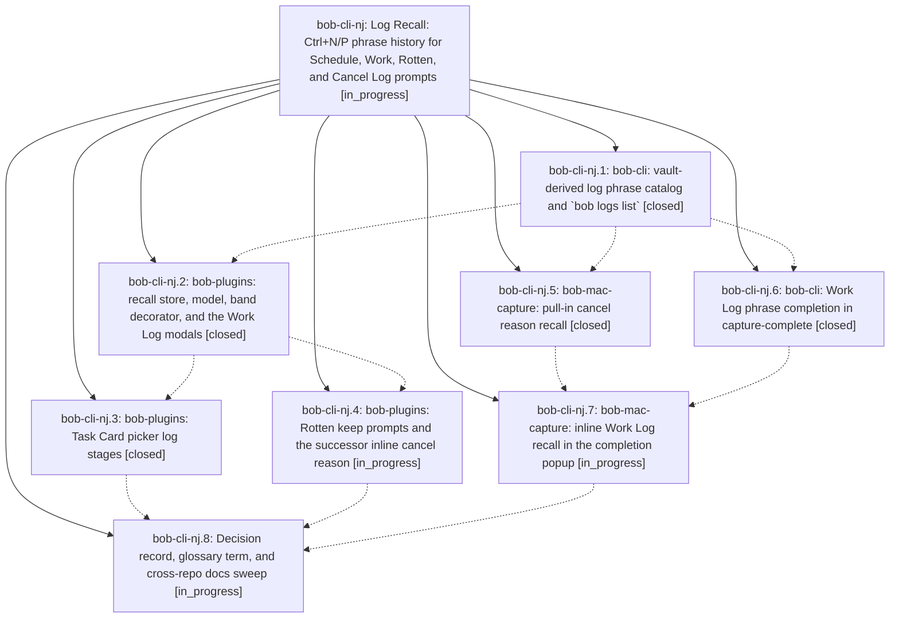

# Bead: bob-cli-nj — Log Recall: Ctrl+N/P phrase history for Schedule, Work, Rotten, and Cancel Log prompts

[Bead Pages](../README.md) / bob-cli-nj

**Status:** ◐ in_progress · **Type:** ▸ plan · **Tier:** epic
**Owner:** `bryanbugyi34@gmail.com` · **Created by:** [bbugyi200.apollo.f3](https://github.com/bobs-org/bob-cli--agents/blob/main/sessions/bbugyi200.apollo.f3.md) · **Assignee:** `bob-cli-nj.land`
**Created:** 2026-11-19 12:14:02 EST
**Plan:** [202611/log\_reason\_recall.md](https://github.com/bobs-org/bob-cli--plans/blob/main/202611/log_reason_recall.md)

<!-- sase:links:start -->

## Links

| Relation | Artifact | Why |
| --- | --- | --- |
| implemented-by | [plan:202611/log_reason_recall.md][1] | derived from the plan's `bead_id:` frontmatter field |

[1]: https://github.com/bobs-org/bob-cli--plans/blob/main/202611/log_reason_recall.md

<!-- sase:links:end -->

## Description

Every free-text prompt in Obsidian and Bob Mac Capture that writes a Schedule, Work, Rotten, or Cancel Log entry can reuse a reason typed earlier for any task in two keystrokes. Ctrl+N/P move through a visible "USED BEFORE" band that is filtered by the draft and ranked by recent and frequent use. The band fills the field, and Enter still writes exactly the text the field shows. The four histories are derived read-only from the vault by `bob logs list`, so they need no new store, have no cold start, and pick up note edits and deletions on their own.

## Phases

| Bead | Title | Status | Size | Created | Agents | Commits |
|---|---|---|---|---|---:|---:|
| [bob-cli-nj.1](bob-cli-nj.1.md) | bob-cli: vault-derived log phrase catalog and \`bob logs list\` | ✓ closed | medium | 2026-11-19 | 1 | 1 |
| [bob-cli-nj.2](bob-cli-nj.2.md) | bob-plugins: recall store, model, band decorator, and the Work Log modals | ✓ closed | medium | 2026-11-19 | 1 | 1 |
| [bob-cli-nj.3](bob-cli-nj.3.md) | bob-plugins: Task Card picker log stages | ✓ closed | medium | 2026-11-19 | 1 | 1 |
| [bob-cli-nj.4](bob-cli-nj.4.md) | bob-plugins: Rotten keep prompts and the successor inline cancel reason | ◐ in_progress | medium | 2026-11-19 | 1 | 0 |
| [bob-cli-nj.5](bob-cli-nj.5.md) | bob-mac-capture: pull-in cancel reason recall | ✓ closed | medium | 2026-11-19 | 1 | 0 |
| [bob-cli-nj.6](bob-cli-nj.6.md) | bob-cli: Work Log phrase completion in capture-complete | ✓ closed | medium | 2026-11-19 | 1 | 1 |
| [bob-cli-nj.7](bob-cli-nj.7.md) | bob-mac-capture: inline Work Log recall in the completion popup | ◐ in_progress | medium | 2026-11-19 | 1 | 0 |
| [bob-cli-nj.8](bob-cli-nj.8.md) | Decision record, glossary term, and cross-repo docs sweep | ◐ in_progress | small | 2026-11-19 | 1 | 0 |

## Lineage

## Agents

| Agent | Bead | Commits |
|---|---|---:|
| [bbugyi200.apollo.bob-cli-nj.1](https://github.com/bobs-org/bob-cli--agents/blob/main/agents/bbugyi200.apollo.bob-cli-nj.1/README.md) | [bob-cli-nj.1](bob-cli-nj.1.md) | 1 |
| [bbugyi200.apollo.bob-cli-nj.2](https://github.com/bobs-org/bob-cli--agents/blob/main/agents/bbugyi200.apollo.bob-cli-nj.2/README.md) | [bob-cli-nj.2](bob-cli-nj.2.md) | 1 |
| [bbugyi200.apollo.bob-cli-nj.3](https://github.com/bobs-org/bob-cli--agents/blob/main/agents/bbugyi200.apollo.bob-cli-nj.3/README.md) | [bob-cli-nj.3](bob-cli-nj.3.md) | 1 |
| [bbugyi200.apollo.bob-cli-nj.4](https://github.com/bobs-org/bob-cli--agents/blob/main/sessions/bbugyi200.apollo.bob-cli-nj.4.md) | [bob-cli-nj.4](bob-cli-nj.4.md) | 0 |
| [bbugyi200.apollo.bob-cli-nj.5](https://github.com/bobs-org/bob-cli--agents/blob/main/agents/bbugyi200.apollo.bob-cli-nj.5/README.md) | [bob-cli-nj.5](bob-cli-nj.5.md) | 0 |
| [bbugyi200.apollo.bob-cli-nj.6](https://github.com/bobs-org/bob-cli--agents/blob/main/agents/bbugyi200.apollo.bob-cli-nj.6/README.md) | [bob-cli-nj.6](bob-cli-nj.6.md) | 1 |
| [bbugyi200.apollo.bob-cli-nj.7](https://github.com/bobs-org/bob-cli--agents/blob/main/sessions/bbugyi200.apollo.bob-cli-nj.7.md) | [bob-cli-nj.7](bob-cli-nj.7.md) | 0 |
| [bbugyi200.apollo.bob-cli-nj.8](https://github.com/bobs-org/bob-cli--agents/blob/main/agents/bbugyi200.apollo.bob-cli-nj.8/README.md) | [bob-cli-nj.8](bob-cli-nj.8.md) | 0 |
| [bbugyi200.apollo.bob-cli-nj.land](https://github.com/bobs-org/bob-cli--agents/blob/main/agents/bbugyi200.apollo.bob-cli-nj.land/README.md) | [bob-cli-nj](README.md) | 0 |

## Commits

| Repo | Commit | Subject | Bead | Committed |
|---|---|---|---|---|
| bob-cli | [`382963d`](https://github.com/bobs-org/bob-cli/commit/382963dbae5ee9a11c5492c1bf9ddb192abd3199) | feat(logs): add vault-derived phrase recall | [bob-cli-nj.1](bob-cli-nj.1.md) | 2026-11-19 14:30:15 EST |
| bob-cli | [`ddf28f6`](https://github.com/bobs-org/bob-cli/commit/ddf28f64fbe831671b4c0dc438f2a9b85c7255b5) | feat(capture): add work log phrase completion | [bob-cli-nj.6](bob-cli-nj.6.md) | 2026-11-19 15:22:18 EST |
| bob-plugins | [`bob-plugins@795fad3`](https://github.com/bobs-org/bob-plugins/commit/795fad3d924de86eb3e3f5890ba4d467833d80bb) | feat(log-recall): add Work Log phrase recall to Obsidian prompts | [bob-cli-nj.2](bob-cli-nj.2.md) | 2026-11-19 15:33:44 EST |
| bob-plugins | [`bob-plugins@3968f0d`](https://github.com/bobs-org/bob-plugins/commit/3968f0d70e8d45a1c225a6bb111df3f1805a956e) | feat(log-recall): attach recall to Task Card picker log stages | [bob-cli-nj.3](bob-cli-nj.3.md) | 2026-11-19 16:01:14 EST |
