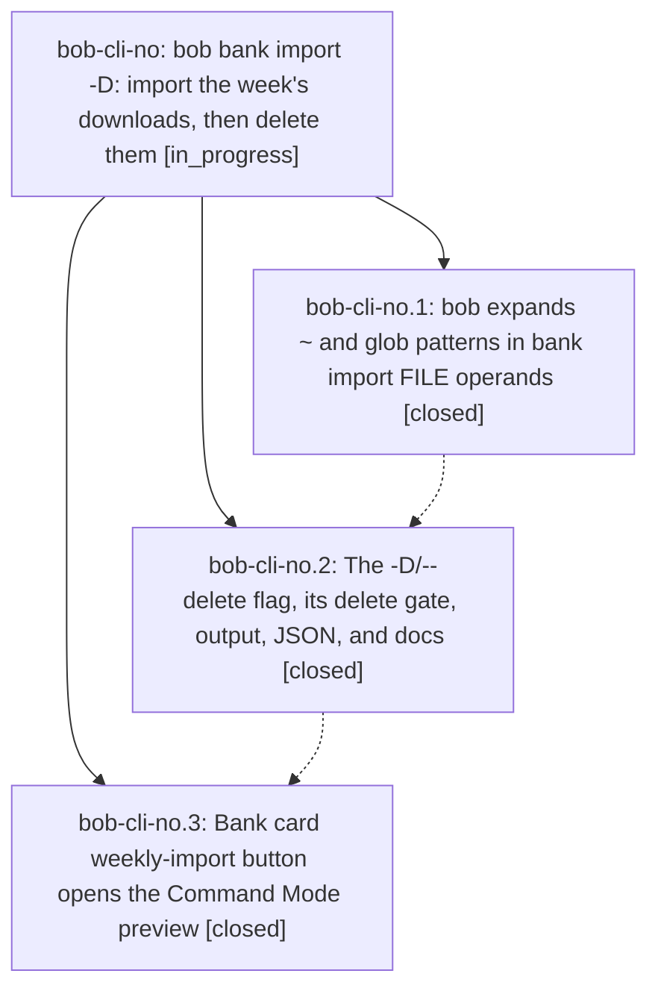

# Bead: bob-cli-no — bob bank import -D: import the week's downloads, then delete them

[Bead Pages](../README.md) / bob-cli-no

**Status:** ◐ in_progress · **Type:** ▸ plan · **Tier:** epic
**Owner:** `bryanbugyi34@gmail.com` · **Created by:** [bbugyi200.apollo.research.5j.linker.w0](https://github.com/bobs-org/bob-cli--agents/blob/main/sessions/bbugyi200.apollo.research.5j.linker.w0.md) · **Assignee:** `bob-cli-no.land`
**Created:** 2026-11-19 14:47:06 EST
**Plan:** [202611/bank\_import\_delete.md](https://github.com/bobs-org/bob-cli--plans/blob/main/202611/bank_import_delete.md)

<!-- sase:links:start -->

## Links

| Relation | Artifact | Why |
| --- | --- | --- |
| implemented-by | [plan:202611/bank_import_delete.md][1] | derived from the plan's `bead_id:` frontmatter field |

_Plus 2 automatic references — see [Referenced By](#referenced-by)._

[1]: https://github.com/bobs-org/bob-cli--plans/blob/main/202611/bank_import_delete.md

<!-- sase:links:end -->

## Description

`bank import -D ~/Downloads/*.qfx`, typed into Bob Command Mode or a shell, previews the import and the planned deletions. Ctrl+Enter imports the batch, then permanently deletes exactly the source files bob parsed. It deletes them only if the whole batch was recorded and each file is unchanged since bob read it. A refused or failed import keeps every file, and the output says so.

## Phases

| Bead | Title | Status | Size | Created | Agents | Commits |
|---|---|---|---|---|---:|---:|
| [bob-cli-no.1](bob-cli-no.1.md) | bob expands ~ and glob patterns in bank import FILE operands | ✓ closed | medium | 2026-11-19 | 1 | 1 |
| [bob-cli-no.2](bob-cli-no.2.md) | The -D/--delete flag, its delete gate, output, JSON, and docs | ✓ closed | medium | 2026-11-19 | 1 | 1 |
| [bob-cli-no.3](bob-cli-no.3.md) | Bank card weekly-import button opens the Command Mode preview | ✓ closed | small | 2026-11-19 | 1 | 1 |

## Lineage

## Agents

| Agent | Bead | Commits |
|---|---|---:|
| [bbugyi200.apollo.bob-cli-no.1](https://github.com/bobs-org/bob-cli--agents/blob/main/agents/bbugyi200.apollo.bob-cli-no.1/README.md) | [bob-cli-no.1](bob-cli-no.1.md) | 1 |
| [bbugyi200.apollo.bob-cli-no.2](https://github.com/bobs-org/bob-cli--agents/blob/main/agents/bbugyi200.apollo.bob-cli-no.2/README.md) | [bob-cli-no.2](bob-cli-no.2.md) | 1 |
| [bbugyi200.apollo.bob-cli-no.3](https://github.com/bobs-org/bob-cli--agents/blob/main/agents/bbugyi200.apollo.bob-cli-no.3/README.md) | [bob-cli-no.3](bob-cli-no.3.md) | 1 |
| [bbugyi200.apollo.bob-cli-no.land](https://github.com/bobs-org/bob-cli--agents/blob/main/agents/bbugyi200.apollo.bob-cli-no.land/README.md) | [bob-cli-no](README.md) | 0 |

## Commits

| Repo | Commit | Subject | Bead | Committed |
|---|---|---|---|---|
| bob-cli | [`5b547f1`](https://github.com/bobs-org/bob-cli/commit/5b547f13c87a93b56271aecc159c164642eab7ce) | feat(bank): expand import file operands | [bob-cli-no.1](bob-cli-no.1.md) | 2026-11-19 15:49:47 EST |
| bob-cli | [`c94a718`](https://github.com/bobs-org/bob-cli/commit/c94a718d3ca186696b872a5878b8176090b03460) | feat(bank): add import -D/--delete with digest-gated cleanup | [bob-cli-no.2](bob-cli-no.2.md) | 2026-11-19 17:01:15 EST |
| bob-plugins | [`bob-plugins@c3ca244`](https://github.com/bobs-org/bob-plugins/commit/c3ca2445a204923de58b38c5b8facec2a23f96af) | feat(bank): queue card weekly-import chip opens Command Mode preview | [bob-cli-no.3](bob-cli-no.3.md) | 2026-11-19 17:28:02 EST |

<!-- sase:referenced-by:start -->

## Referenced By

| Relation | Artifact | Why | Uses |
| --- | --- | --- | ---: |
| read-by | [agent:bob-cli-no.2][1] | need epic plan scope and decisions for phase no.2 | 1 |
| read-by | [agent:research.5k.cld][2] | Check whether bank import delete/glob epic makes the GTD bank command chip runnable | 1 |

[1]: https://github.com/bobs-org/bob-cli--agents/blob/main/agents/bbugyi200.apollo.bob-cli-no.2/README.md
[2]: https://github.com/bobs-org/bob-cli--agents/blob/main/agents/bbugyi200.apollo.research.5k.cld/README.md

<!-- sase:referenced-by:end -->
