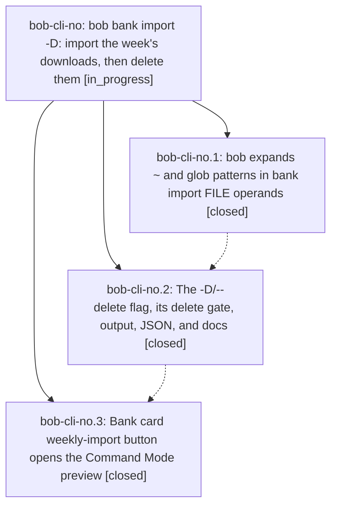

# Bead: bob-cli-no — bob bank import -D: import the week's downloads, then delete them

[Bead Pages](../README.md) / bob-cli-no

**Status:** ◐ in_progress · **Type:** ▸ plan · **Tier:** epic
**Owner:** `bryanbugyi34@gmail.com` · **Created by:** [bbugyi200.apollo.research.5j.linker.w0](https://github.com/bobs-org/bob-cli--agents/blob/main/sessions/bbugyi200.apollo.research.5j.linker.w0.md) · **Assignee:** `bob-cli-no.land`
**Created:** 2026-11-19 14:47:06 EST
**Plan:** [202611/bank\_import\_delete.md](https://github.com/bobs-org/bob-cli--plans/blob/main/202611/bank_import_delete.md)

<!-- sase:links:start -->

## Links

| Relation | Artifact | Why |
| --- | --- | --- |
| implemented-by | [plan:202611/bank_import_delete.md][1] | derived from the plan's `bead_id:` frontmatter field |
| related | file:explicit:a98fd800433efd364c6531af | attached via sase artifact create --bead |

_Plus 3 automatic references — see [Referenced By](#referenced-by)._

[1]: https://github.com/bobs-org/bob-cli--plans/blob/main/202611/bank_import_delete.md

<!-- sase:links:end -->

## Description

`bank import -D ~/Downloads/*.qfx`, typed into Bob Command Mode or a shell, previews the import and the planned deletions. Ctrl+Enter imports the batch, then permanently deletes exactly the source files bob parsed. It deletes them only if the whole batch was recorded and each file is unchanged since bob read it. A refused or failed import keeps every file, and the output says so.

## Notes

[2026-11-19T22:39:37Z · bob-cli-no.land] LAND AUDIT / REMAINING TALE: Read epic and all 11 notes across no.1/no.2/no.3, approved plan and DECISIONS; inspected CLI commits 5b547f13/c94a718d and plugin c3ca244, source helper/import preflight+transaction+cleanup/reporting, catalog/completion/docs, Bank chip preview/fallback and invalidation. No memory, release version or changelog edits; declined memory_record honored. Later CLI a29a64f6, ea538f78, 992fd33d and plugin copy-chip d6d2c33, Log Recall 795fad3/3968f0d, property chrome 2f1e016 coexist with the feature; no extra production integration patch found. Current-source scratch Rust probe confirms epic-owned bug: *.qfx -> Ok([a.qfx]), but ./*.qfx and ././*.qfx -> NoMatch with the same existing file, because collect_files rechecks the glob iterator's normalized path against the unnormalized pattern. Installed phase-1 bob independently reproduces it; no claim of testing -D through that older binary. Approved tests also omit FIFO refusal, continuing after a middle unlink failure (current injected failure is last), and valid-plus-malformed batch byte preservation (current malformed case has only one source). A small tale will fix these bounded gaps and perform this epic's own closeout; no child epic or future-commit dependency. Fresh plugins: focused Bank/Keep/command-refresh 65/65, timing controls 55/55, build:check current. No fresh full just check/docs-check in this audit turn. No epic symbols; no symvision recipe. Parent-link reread confirms no parent. Epic stays open until tale implements, verifies and closes it normally.

[2026-11-19T22:39:45Z · bob-cli-no.land] FOLLOW-UP TRIAGE COMPLETE (before repair-tale proposal): no.1 #1 -> new feature task bob-cli-nt, size large because attachments and ref-create route contracts require planning; ready and dependent on no. All-status semantic searches, last-week sweep and all 17 active epic scopes found no duplicate/causal owner. Tilde already works for attachments; task scopes safe shared glob adoption. no.1 #2 + no.2 #1 -> DISCOVERED ISSUE on active bob-cli-nh (phase nh.2 periods update owns missing catalog/completion registration and ordered-op test reports); no new task, source persistence inspected, historical failures attributed. no.1 #3 -> existing bob-cli-it corroboration note (stale ignored mount collision source persists; no fresh collision run). no.2 #2 + no.3 #1 -> existing reopened bob-cli-jz corroboration note (6171/6027 Mac word-budget reports, no new docs run). no.3 #2 -> existing km event-link, io frees, ki KT1-KT8 resident count, m1 dependency stage; each received an attributed corroboration note, current isolated four-file control passed 55/55. ki's surface gate is fixed but its reopening evidence already names this resident-count node, so no duplicate. no.3 #3 -> DISCOVERED ISSUE on active bob-cli-nj; nj.4 owns protected uncommitted cycler deployment; do not force, no new task or lander deployment attempt. None declined without a destination; duplicate proposals were consolidated, outside-epic baseline work stays with its owner. Adjacent nk guide-output drift and nl missing bank invalidation are now closed normally: existing bank commits resolve them, source/sample and current catalog verified, focused refresh tests green. Include these dispositions in the eventual epic close note.

[2026-11-19T22:44:02Z · bob-cli-no.land] POST-AUDIT DRIFT / EVIDENCE: Final fetch found CLI 8bbb3041 (intention task rewrite recovery), 2a5bc1f8 (copy-chip glossary), plugin db89aec (task-scoped chip lookup). Inspected their changed-file sets and relevant implementations; no bank operand/delete/preview/invalidation change or new integration gap. Earlier focused results remain explicitly on CLI 992fd33d/plugins c3ca244. Audit artifact file:explicit:a98fd800433efd364c6531af retains current-source glob repro and all focused plugin/control output. Duplicate dispositions it/jz/km/io/ki/m1 now also have one +1 each with precise attributed evidence, alongside the detailed notes; no new timing or docs failure was claimed. Repair tale validates without warnings and includes this epic closeout, no parent ancestor, all triage outcomes and no own-commit prerequisite.

[2026-11-19T23:33:03Z · bob-cli-no.land--3] Canonical verification on the current tale tree: focused host_paths, bank import deletion, and relative ./ glob regressions passed, but just check exited 101. The three periods failures (public_leaves_are_entries_or_excluded, every_value_arg_has_a_decision, planning_applies_ordered_intention_ops_and_reports_bad_indexes) match the previously attributed clean-base periods/update issue on bob-cli-no.1 #2 and bob-cli-no.2 #1, owned by active bob-cli-nh phase nh.2. Three capture-completion failures also appeared (bullet_starts_that_cannot_name_a_drawer_is_empty_successes in lib and CLI, plus close_items_and_suffixes_request_no_completion and close_bullet_lines_suppress_wikilink_block_but_keep_note in lib); these are outside the tale's changed files, with no cause established here. No unrelated failure was changed. Epic and plans remain open pending green canonical verification and complete closeout review.

## Phases

| Bead | Title | Status | Size | Created | Agents | Commits |
|---|---|---|---|---|---:|---:|
| [bob-cli-no.1](bob-cli-no.1.md) | bob expands ~ and glob patterns in bank import FILE operands | ✓ closed | medium | 2026-11-19 | 1 | 1 |
| [bob-cli-no.2](bob-cli-no.2.md) | The -D/--delete flag, its delete gate, output, JSON, and docs | ✓ closed | medium | 2026-11-19 | 1 | 1 |
| [bob-cli-no.3](bob-cli-no.3.md) | Bank card weekly-import button opens the Command Mode preview | ✓ closed | small | 2026-11-19 | 1 | 1 |

## Lineage

## Dependencies

- **Blocks:** [bob-cli-nt](../bob-cli-nt/README.md) ◇ · ⧖ 2026-11-19

## Agents

| Agent | Bead | Commits |
|---|---|---:|
| [bbugyi200.apollo.bob-cli-no.1](https://github.com/bobs-org/bob-cli--agents/blob/main/agents/bbugyi200.apollo.bob-cli-no.1/README.md) | [bob-cli-no.1](bob-cli-no.1.md) | 1 |
| [bbugyi200.apollo.bob-cli-no.2](https://github.com/bobs-org/bob-cli--agents/blob/main/agents/bbugyi200.apollo.bob-cli-no.2/README.md) | [bob-cli-no.2](bob-cli-no.2.md) | 1 |
| [bbugyi200.apollo.bob-cli-no.3](https://github.com/bobs-org/bob-cli--agents/blob/main/agents/bbugyi200.apollo.bob-cli-no.3/README.md) | [bob-cli-no.3](bob-cli-no.3.md) | 1 |
| [bbugyi200.apollo.bob-cli-no.land](https://github.com/bobs-org/bob-cli--agents/blob/main/sessions/bbugyi200.apollo.bob-cli-no.land.md) | [bob-cli-no](README.md) | 1 |

## Commits

| Repo | Commit | Subject | Bead | Committed |
|---|---|---|---|---|
| bob-cli | [`5b547f1`](https://github.com/bobs-org/bob-cli/commit/5b547f13c87a93b56271aecc159c164642eab7ce) | feat(bank): expand import file operands | [bob-cli-no.1](bob-cli-no.1.md) | 2026-11-19 15:49:47 EST |
| bob-cli | [`c94a718`](https://github.com/bobs-org/bob-cli/commit/c94a718d3ca186696b872a5878b8176090b03460) | feat(bank): add import -D/--delete with digest-gated cleanup | [bob-cli-no.2](bob-cli-no.2.md) | 2026-11-19 17:01:15 EST |
| bob-plugins | [`bob-plugins@c3ca244`](https://github.com/bobs-org/bob-plugins/commit/c3ca2445a204923de58b38c5b8facec2a23f96af) | feat(bank): queue card weekly-import chip opens Command Mode preview | [bob-cli-no.3](bob-cli-no.3.md) | 2026-11-19 17:28:02 EST |
| bob-cli | [`3acbc1a`](https://github.com/bobs-org/bob-cli/commit/3acbc1a321f422da6adb3a29f775534f1aa9a3f3) | fix(bank): match relative glob operands consistently | [bob-cli-no](README.md) | 2026-11-19 18:33:41 EST |

<!-- sase:referenced-by:start -->

## Referenced By

| Relation | Artifact | Why | Uses |
| --- | --- | --- | ---: |
| read-by | [agent:bob-cli-no.2][1] | need epic plan scope and decisions for phase no.2 | 1 |
| read-by | [agent:bob-cli-no.3][2] | Need parent epic scope and design | 1 |
| read-by | [agent:research.5k.cld][3] | Check whether bank import delete/glob epic makes the GTD bank command chip runnable | 1 |

[1]: https://github.com/bobs-org/bob-cli--agents/blob/main/agents/bbugyi200.apollo.bob-cli-no.2/README.md
[2]: https://github.com/bobs-org/bob-cli--agents/blob/main/agents/bbugyi200.apollo.bob-cli-no.3/README.md
[3]: https://github.com/bobs-org/bob-cli--agents/blob/main/agents/bbugyi200.apollo.research.5k.cld/README.md

<!-- sase:referenced-by:end -->
