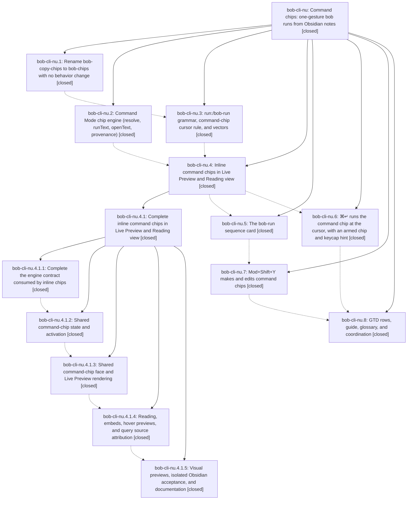

# Bead: bob-cli-nu — Command chips: one-gesture bob runs from Obsidian notes

[Bead Pages](../README.md) / bob-cli-nu

**Status:** ✓ closed · **Resolution:** done · **Type:** ▸ plan · **Tier:** epic
**Owner:** `bryanbugyi34@gmail.com` · **Created by:** [bbugyi200.apollo.research.5k.linker.w0](https://github.com/bobs-org/bob-cli--agents/blob/main/sessions/bbugyi200.apollo.research.5k.linker.w0.md) · **Assignee:** `bob-cli-nu.land`
**Created:** 2026-11-20 05:59:33 EST · **Closed:** 2026-11-20 14:33:28 EST
**Plan:** [202611/command\_chips.md](https://github.com/bobs-org/bob-cli--plans/blob/main/202611/command_chips.md)

<!-- sase:links:start -->

## Links

| Relation | Artifact | Why |
| --- | --- | --- |
| implemented-by | [plan:202611/command_chips.md][1] | derived from the plan's `bead_id:` frontmatter field |
| related | [bead:bob-cli-od][2] | The command chips epic added the author preview that borrows the palette missing the copy-well variables |

_Plus 6 automatic references — see [Referenced By](#referenced-by)._

[1]: https://github.com/bobs-org/bob-cli--plans/blob/main/202611/command_chips.md
[2]: https://github.com/bobs-org/bob-cli--beads/blob/main/pages/bob-cli-od/README.md

<!-- sase:links:end -->

## Description

Typing `run: bob …` in an inline code span, or a `bob-run` fence, gives a quiet ▶ chip. One click or ⌘↵ runs it through Bob Command Mode the way the sheet's Ctrl+Enter would. A chip holds one command or a whole `&&` sequence, and its run state shows in place. The copy-chip plugin becomes `bob-chips` and owns both kinds, and the GTD rows that hold bob commands become command chips.

## Notes

[2026-11-20T12:59:07Z · bob-cli-nh.7.1.4] DISCOVERED ISSUE: (from the bob-plugins conflict-repair turn that rebased the intention-card commit onto c8da83f, 2026-11-20) On athena, 'bob plugins sync' from bob-plugins b1a655a exits 1: ~/.config/bob/config.yml plugins.sync still lists bob-copy-chips (line ~235), but after bf13f43 (bob-cli-nu.1 rename) the repo has no plugin with that id, and bob-chips is reported 'not in plugins.sync; skipped'. 'chezmoi diff ~/.config/bob/config.yml' is empty, so this host's applied chezmoi source does not yet carry the bob-chips allowlist entry. All other configured plugins synced (31 unchanged). This continues nu.1 notes #1 and #4 (deploy and retire the old id); the land agent should make sure the chezmoi allowlist change lands and is applied on every host before bob-chips can deploy. Also filed bob-cli-nv for the pre-existing docs-check URL failure that nu.1 note #3 proposed.

[2026-11-20T14:14:19Z · bob-cli-nh.7.1.land] BROAD DEPLOY GATE LIMITATION (observed by bob-cli-nh.7.1.land, 2026-11-20 14:13Z, bob-plugins checkout at origin/master e902351 + intention-card changes): (1) `bob plugins sync --repo $PWD --no-pull --dry-run` reports 1 error: 'plugins.sync in ~/.config/bob/config.yml lists bob-copy-chips, but .../plugins has no plugin with that id', and bob-chips is 'not in plugins.sync; skipped'; it would also copy bob-command-mode 0.3.0 -> 0.4.0 (landed 52b7c31, still undeployed). (2) `xvfb-run -a npm run smoke:obsidian -- --deployed-vault /home/bryan/bob` fails its pre-check: 'deployed vault plugin bob-chips sync is "missing"' and 'bob-command-mode sync is "drift"'. Both follow from the bf13f43 rename not yet reflected in the host plugins.sync allowlist (chezmoi-managed config). The intention landing deployed only its changed plugin with `-p bob-ledger-tools` (hashes match source/stamp) and ran the isolated startup smoke (pass, layout 335 ms, 0 exceptions); it did not force, deploy bob-command-mode, or edit the allowlist.

[2026-11-20T15:58:26Z · bob-cli-nu.4.1.land] DISCOVERED ISSUE: docs word budget. bob-plugins docs/develop/plugin-apis.md is at 7,980 words (wc) against the 8,000-word develop/ warning cap after bob-cli-nu.4.1 added the Command-chip members, runtime, face, and Reading contracts (proposed by bob-cli-nu.4.1.2 #3, .3 #3, .4 #3). docs:check still passes. The keymap phase (bob-cli-nu.6, parent plan step 'Docs ... plugin-apis.md') and possibly fence (bob-cli-nu.5) add contracts there and will cross the cap. Moving the '### Command-chip members' (Bob Command Mode) and '### Command chips' / '### Command-chip runtime (internal)' (Bob Chips) sections to their own develop page is an information-architecture move: per docs memory it needs an approved plan and preserved published URLs (develop/plugins/plugin-apis/ is in bob-cli docs/_meta/url_contract.txt; anchors like #command-chip-members are cited from bob-command-mode.md). The nu.4.1 land agent left this to the phase that needs the headroom rather than moving pages unplanned.

[2026-11-20T18:58:14Z · bob-cli-nu.land] LAND TRIAGE (bob-cli-nu land agent, 2026-11-20). Every PROPOSED FOLLOW-UP and DISCOVERED ISSUE from nu.1-nu.8 and the epic notes (nu.4.1 was already triaged by its own lander):
- Retire the dual-listed bob-copy-chips id (nu.1 #1): created bob-cli-o9 (feature, small). The chezmoi allowlist (b19c116c) is applied on apollo, athena, and the Mac, and bob-chips is deployed on all three (apollo 0.14.0, Mac 0.14.0, athena 0.10.0 until its next sync).
- Ledger-tools 25 ms perf flakes (nu.1 #2, nu.2 #2, nu.3 #3, nu.5, nu.6, nu.7 #2): +1 on bob-cli-km and bob-cli-io. The orphaned headless Chromium from test-task-link-marks-motion (nu.7 #2): +1 on bob-cli-fz.
- docs-check URL architecture.md:74 (nu.1 #3, nu.2 #1, nu.3 #3): declined, already reported on bob-cli-nv (+4), and nu.4.1.land recorded that 3956368 fixed the gate.
- copyChipSerialize indented-closer bug (nu.3 #1, pre-existing copy-chip code kept byte-stable by C11): created bob-cli-o8 (bug, small).
- commandChipAt ignores multi-line %% / <!-- --> / $$ blocks (nu.3 #2): EPIC WORK, not a task. Reproduced on master ee941a1: a run chip inside a multi-line comment resolves ready via cursor, and a task whose only run chip is commented out resolves ready via task. Planned as this landing's tale.
- e2e Live Preview copy-card press is diagnostic only (nu.5 #1): EPIC WORK (the epic's own e2e), folded into the same tale.
- Docs word budgets (epic #3, nu.5 #2, nu.6 #6, nu.7 #3): plugin-apis.md is 7,832/8,000 lint words and bob-navigation-hotkeys.md is 5,995/6,000, both under cap. Created bob-cli-ob (feature, medium) for the IA move, which needs its own approved plan.
- Nested-bullet chips never render in Live Preview (nu.6 #3, pre-existing from bob-cli-ni): created bob-cli-o7 (bug, small).
- copy-chips e2e api.copyChips v1 assertion (nu.6 #4): declined, fixed in ee941a1 (scripts/obsidian-copy-chips-e2e.cjs:528 now asserts v2).
- bob-chips 0.13.0 undeployed (nu.6 #5): declined, resolved. bob plugins list on apollo shows bob-chips 0.14.0 and bob-command-mode 0.4.0 synced and enabled, and the Mac has 0.14.0.
- Bank row gate (nu.8 #1): declined, done by Bryan. He converted the open row on the Mac (vault 030a6aa5c) to `run: bob bank import -D ~/Downloads/*.qfx`, and the Mac's bob lists -D, --delete. In 64ab85a39 he also dropped the #sync label, so the row is now `run: bob gcal sync -n 2 && bob gkeep pull && bob gmail sync`. User edits win.
- Catalog TTY metadata (nu.8 #2): created bob-cli-oa (feature, large; a bob CLI catalog change is out of the epic's scope).
- vault-format.md 6016/6000 docs-check failure (nu.8 #3): DISCOVERED ISSUE note on active epic bob-cli-o6, caused by bb91c370 (bob-cli-o6.3).
- Stale vimrc "Mod+Shift+Y makes or edits a copy chip" comment (nu.8 #4): epic-caused and fixed by this lander (vault 46c02b4db: "...a copy or command chip in any mode.").
- athena plugins.sync still listing bob-copy-chips (epic #1, #2; nu.1 #4): resolved. athena's ~/.config/bob/config.yml now lists bob-chips.

[2026-11-20T19:33:28Z · bob-cli-nu.land] LANDED. (1) Land verification (epic note #4): all 8 phases verified against the shipped code (bob-plugins bf13f43..ee941a1; bob-chips 0.14.0, bob-command-mode 0.4.0, bob-navigation-hotkeys 2.92.0, bob-ledger-tools 1.143.0+; chip unit suites 310/310). Every follow-up was triaged: bob-cli-o7, o8, o9, ob filed (plus oa), and km/io/fz got +1s. (2) Vault vimrc fix 46c02b4db (Mod+Shift+Y makes or edits copy and command chips). (3) Land tale, bob-plugins 3a116b4 (rebased onto 9b3c339's copy-well 0.15.0), deployed as bob-chips 0.15.1. commandChipAt now honors multi-line %%, HTML-comment, and $$ blocks through chipBlockShieldState. Hidden cursor-line run chips never count, arm, or go ambiguous. A bob-run fence whose opening line starts inside a block is none. The run-kind task-scope scan skips hidden chips and fences. copyChipAt and the copy vectors stay byte-stable (C11 sha pin unchanged). Added 12 chip_at vectors: the 5 plan-table rows, a chip below a closed comment, an unclosed %%, a bob-run fence in %% (cursor and task scope), %% in a code span and in a fence, and a visible task chip beside a commented one. Also a chipBlockShieldState unit test and a keymap targetAt/hint case; the new tests fail on the pre-fix code. The e2e now asserts the Live Preview bob-copy card press copies 'card body', clearing covering toasts like clickFence. Gates: focused suites 324/324 on the merged tree. Full npm test 7893/7900 pre-rebase; only the known ledger-tools 25 ms perf flakes failed (bob-cli-km/io), and they pass alone (40/40). test:perf 11/11; validate 12/12. docs:check fails only at the known bob-cli-o6 lint (vault-format.md 6016/6000); bob-docs build, offline links with fragments (0 errors), and urls (244 pages) pass. Real Obsidian on athena (xvfb, scratch vault, stub bob) at 3a116b4: command-chips e2e 32/32, including livePreviewCardCopy 'card body'. Keymap e2e 14/14, including the new commented-task case: no keycap, the chain runs, 0 stub invocations. Deployed with bob plugins sync (no -F): bob-chips 0.15.1 synced and enabled on apollo. athena keeps bob-chips 0.10.0 until its next sync.

## Phases

| Bead | Title | Status | Size | Created | Agents | Commits |
|---|---|---|---|---|---:|---:|
| [bob-cli-nu.1](bob-cli-nu.1.md) | Rename bob-copy-chips to bob-chips with no behavior change | ✓ closed | medium | 2026-11-20 | 1 | 3 |
| [bob-cli-nu.2](bob-cli-nu.2.md) | Command Mode chip engine (resolve, runText, openText, provenance) | ✓ closed | medium | 2026-11-20 | 1 | 1 |
| [bob-cli-nu.3](bob-cli-nu.3.md) | run:/bob-run grammar, command-chip cursor rule, and vectors | ✓ closed | medium | 2026-11-20 | 1 | 1 |
| [bob-cli-nu.4](bob-cli-nu.4.md) | Inline command chips in Live Preview and Reading view | ✓ closed | large | 2026-11-20 | 1 | 0 |
| [bob-cli-nu.5](bob-cli-nu.5.md) | The bob-run sequence card | ✓ closed | medium | 2026-11-20 | 1 | 1 |
| [bob-cli-nu.6](bob-cli-nu.6.md) | ⌘↵ runs the command chip at the cursor, with an armed chip and keycap hint | ✓ closed | medium | 2026-11-20 | 1 | 1 |
| [bob-cli-nu.7](bob-cli-nu.7.md) | Mod+Shift+Y makes and edits command chips | ✓ closed | medium | 2026-11-20 | 1 | 1 |
| [bob-cli-nu.8](bob-cli-nu.8.md) | GTD rows, guide, glossary, and coordination | ✓ closed | medium | 2026-11-20 | 1 | 1 |

## Lineage

## Agents

| Agent | Bead | Commits |
|---|---|---:|
| [bbugyi200.apollo.bob-cli-nu.1](https://github.com/bobs-org/bob-cli--agents/blob/main/agents/bbugyi200.apollo.bob-cli-nu.1/README.md) | [bob-cli-nu.1](bob-cli-nu.1.md) | 3 |
| [bbugyi200.apollo.bob-cli-nu.2](https://github.com/bobs-org/bob-cli--agents/blob/main/sessions/bbugyi200.apollo.bob-cli-nu.2.md) | [bob-cli-nu.2](bob-cli-nu.2.md) | 1 |
| [bbugyi200.apollo.bob-cli-nu.3](https://github.com/bobs-org/bob-cli--agents/blob/main/agents/bbugyi200.apollo.bob-cli-nu.3/README.md) | [bob-cli-nu.3](bob-cli-nu.3.md) | 1 |
| [bbugyi200.apollo.bob-cli-nu.4](https://github.com/bobs-org/bob-cli--agents/blob/main/sessions/bbugyi200.apollo.bob-cli-nu.4.md) | [bob-cli-nu.4](bob-cli-nu.4.md) | 0 |
| [bbugyi200.apollo.bob-cli-nu.4.1.1](https://github.com/bobs-org/bob-cli--agents/blob/main/agents/bbugyi200.apollo.bob-cli-nu.4.1.1/README.md) | [bob-cli-nu.4.1.1](bob-cli-nu.4.1.1.md) | 1 |
| [bbugyi200.apollo.bob-cli-nu.4.1.2](https://github.com/bobs-org/bob-cli--agents/blob/main/agents/bbugyi200.apollo.bob-cli-nu.4.1.2/README.md) | [bob-cli-nu.4.1.2](bob-cli-nu.4.1.2.md) | 1 |
| [bbugyi200.apollo.bob-cli-nu.4.1.3](https://github.com/bobs-org/bob-cli--agents/blob/main/agents/bbugyi200.apollo.bob-cli-nu.4.1.3/README.md) | [bob-cli-nu.4.1.3](bob-cli-nu.4.1.3.md) | 1 |
| [bbugyi200.apollo.bob-cli-nu.4.1.4](https://github.com/bobs-org/bob-cli--agents/blob/main/agents/bbugyi200.apollo.bob-cli-nu.4.1.4/README.md) | [bob-cli-nu.4.1.4](bob-cli-nu.4.1.4.md) | 1 |
| [bbugyi200.apollo.bob-cli-nu.4.1.5](https://github.com/bobs-org/bob-cli--agents/blob/main/agents/bbugyi200.apollo.bob-cli-nu.4.1.5/README.md) | [bob-cli-nu.4.1.5](bob-cli-nu.4.1.5.md) | 1 |
| [bbugyi200.apollo.bob-cli-nu.4.1.land](https://github.com/bobs-org/bob-cli--agents/blob/main/agents/bbugyi200.apollo.bob-cli-nu.4.1.land/README.md) | [bob-cli-nu.4.1](bob-cli-nu.4.1.md) | 1 |
| [bbugyi200.apollo.bob-cli-nu.5](https://github.com/bobs-org/bob-cli--agents/blob/main/agents/bbugyi200.apollo.bob-cli-nu.5/README.md) | [bob-cli-nu.5](bob-cli-nu.5.md) | 1 |
| [bbugyi200.apollo.bob-cli-nu.6](https://github.com/bobs-org/bob-cli--agents/blob/main/agents/bbugyi200.apollo.bob-cli-nu.6/README.md) | [bob-cli-nu.6](bob-cli-nu.6.md) | 1 |
| [bbugyi200.apollo.bob-cli-nu.7](https://github.com/bobs-org/bob-cli--agents/blob/main/agents/bbugyi200.apollo.bob-cli-nu.7/README.md) | [bob-cli-nu.7](bob-cli-nu.7.md) | 1 |
| [bbugyi200.apollo.bob-cli-nu.8](https://github.com/bobs-org/bob-cli--agents/blob/main/agents/bbugyi200.apollo.bob-cli-nu.8/README.md) | [bob-cli-nu.8](bob-cli-nu.8.md) | 1 |
| [bbugyi200.apollo.bob-cli-nu.land](https://github.com/bobs-org/bob-cli--agents/blob/main/sessions/bbugyi200.apollo.bob-cli-nu.land.md) | [bob-cli-nu](README.md) | 2 |

## Commits

| Repo | Commit | Subject | Bead | Committed |
|---|---|---|---|---|
| bob-cli | [`e5f5108`](https://github.com/bobs-org/bob-cli/commit/e5f510818a9dae38d4a9a64d418c826840f17d06) | feat(chips): add bob-chips docs redirect | [bob-cli-nu.1](bob-cli-nu.1.md) | 2026-11-20 06:48:00 EST |
| bob-plugins | [`bob-plugins@bf13f43`](https://github.com/bobs-org/bob-plugins/commit/bf13f430fade45369de709523c321b72d3761ce3) | feat(plugins): rename bob-copy-chips to bob-chips | [bob-cli-nu.1](bob-cli-nu.1.md) | 2026-11-20 06:50:46 EST |
| chezmoi | [`chezmoi@b19c116`](https://github.com/bbugyi200/dotfiles/commit/b19c116c2c6a89bf7b65ea6963d8167791186915) | chore(config): switch plugin allowlist to bob-chips | [bob-cli-nu.1](bob-cli-nu.1.md) | 2026-11-20 06:51:37 EST |
| bob-plugins | [`bob-plugins@591998e`](https://github.com/bobs-org/bob-plugins/commit/591998e36b0f41e61c3871d24a48478b541e52b5) | feat(bob-command-mode): add chip execution engine and provenance | [bob-cli-nu.2](bob-cli-nu.2.md) | 2026-11-20 07:12:03 EST |
| bob-plugins | [`bob-plugins@c8da83f`](https://github.com/bobs-org/bob-plugins/commit/c8da83fda53b966c1b6e2eb6127efc3da9658bb2) | feat(bob-chips): add run:/bob-run grammar and command-chip cursor rule | [bob-cli-nu.3](bob-cli-nu.3.md) | 2026-11-20 07:26:44 EST |
| bob-plugins | [`bob-plugins@52b7c31`](https://github.com/bobs-org/bob-plugins/commit/52b7c31486f3594cc0fe663e7ad0487e4d82c10d) | feat(bob-command-mode): complete the command-chip engine contract | [bob-cli-nu.4.1.1](bob-cli-nu.4.1.1.md) | 2026-11-20 08:16:21 EST |
| bob-plugins | [`bob-plugins@e902351`](https://github.com/bobs-org/bob-plugins/commit/e902351ee65cdacfecc63349854fe00af57241a4) | feat(bob-chips): add shared command-chip runtime and activation | [bob-cli-nu.4.1.2](bob-cli-nu.4.1.2.md) | 2026-11-20 08:44:26 EST |
| bob-plugins | [`bob-plugins@fa28ece`](https://github.com/bobs-org/bob-plugins/commit/fa28ece28aeca2d492ac9f67ac7d3c95d58a7697) | feat(bob-chips): render and run command chips in Live Preview | [bob-cli-nu.4.1.3](bob-cli-nu.4.1.3.md) | 2026-11-20 09:11:40 EST |
| bob-plugins | [`bob-plugins@f381abc`](https://github.com/bobs-org/bob-plugins/commit/f381abc5640a86c29a8e332d0b52482e55afd3dc) | feat(bob-chips): render and run command chips in Reading view | [bob-cli-nu.4.1.4](bob-cli-nu.4.1.4.md) | 2026-11-20 10:00:06 EST |
| bob-plugins | [`bob-plugins@b52dd3f`](https://github.com/bobs-org/bob-plugins/commit/b52dd3fcba720bbf4c799d163572f36a2cca9e9b) | feat(bob-chips): add command-chip previews, stub-bob Obsidian e2e, and print fix | [bob-cli-nu.4.1.5](bob-cli-nu.4.1.5.md) | 2026-11-20 10:43:46 EST |
| bob-cli--plans | [`bob-cli--plans@7639a5b`](https://github.com/bobs-org/bob-cli--plans/commit/7639a5b218d9ef71f187e8a71ea92bdffae30fbe) | chore(plans): mark command\_chips\_inline epic plan done after bob-cli-nu.4.1 landing | [bob-cli-nu.4.1](bob-cli-nu.4.1.md) | 2026-11-20 11:00:55 EST |
| bob-plugins | [`bob-plugins@59f3783`](https://github.com/bobs-org/bob-plugins/commit/59f3783d047a35484647b46c04940592a30d32d8) | feat(bob-chips): render bob-run fences as sequence cards | [bob-cli-nu.5](bob-cli-nu.5.md) | 2026-11-20 11:43:09 EST |
| bob-plugins | [`bob-plugins@36dcf7c`](https://github.com/bobs-org/bob-plugins/commit/36dcf7cf4b6ed7c0f11144135646da87f7a65cb5) | feat(bob-chips): ⌘↵ runs the command chip at the cursor, with an armed chip and keycap | [bob-cli-nu.6](bob-cli-nu.6.md) | 2026-11-20 12:20:01 EST |
| bob-plugins | [`bob-plugins@ee941a1`](https://github.com/bobs-org/bob-plugins/commit/ee941a1cdb26b96d16f47bd7eae18d488d09de21) | feat(bob-chips): Mod+Shift+Y makes and edits command chips | [bob-cli-nu.7](bob-cli-nu.7.md) | 2026-11-20 13:17:08 EST |
| bob-cli | [`2443e0a`](https://github.com/bobs-org/bob-cli/commit/2443e0a4e1580f1ce956ef8a576caa1ba2d8ac66) | docs(chips): add the command-chip guide section and glossary term | [bob-cli-nu.8](bob-cli-nu.8.md) | 2026-11-20 13:36:33 EST |
| bob-plugins | [`bob-plugins@3a116b4`](https://github.com/bobs-org/bob-plugins/commit/3a116b4355bc27a953390c0638bb95655b62e9fe) | fix(bob-chips): ⌘↵ never runs a chip hidden in a multi-line comment or math block | [bob-cli-nu](README.md) | 2026-11-20 14:29:14 EST |
| bob-cli--plans | [`bob-cli--plans@74ee2aa`](https://github.com/bobs-org/bob-cli--plans/commit/74ee2aa268d5cc28ef4490b48ab8b9c6787510d1) | docs(plans): mark the command chips epic plan done | [bob-cli-nu](README.md) | 2026-11-20 14:35:38 EST |

<!-- sase:referenced-by:start -->

## Referenced By

| Relation | Artifact | Why | Uses |
| --- | --- | --- | ---: |
| read-by | [agent:bob-cli-nh.land][1] | Check status for follow-up triage routing | 2 |
| read-by | [agent:bob-cli-nu.5][2] | Need sibling phase status | 3 |
| read-by | [agent:bob-cli-nu.6][3] | Check epic notes for keymap-relevant discoveries | 1 |
| read-by | [agent:bob-cli-nu.7][4] | Need epic context and sibling phases | 1 |
| read-by | [agent:bob-cli-nu.8][5] | Need parent epic notes and context | 2 |
| read-by | [agent:fa--code][6] | Decide whether the command-chip preview palette gap belongs on the command chips epic | 1 |

[1]: https://github.com/bobs-org/bob-cli--agents/blob/main/agents/bbugyi200.apollo.bob-cli-nh.land/README.md
[2]: https://github.com/bobs-org/bob-cli--agents/blob/main/agents/bbugyi200.apollo.bob-cli-nu.5/README.md
[3]: https://github.com/bobs-org/bob-cli--agents/blob/main/agents/bbugyi200.apollo.bob-cli-nu.6/README.md
[4]: https://github.com/bobs-org/bob-cli--agents/blob/main/agents/bbugyi200.apollo.bob-cli-nu.7/README.md
[5]: https://github.com/bobs-org/bob-cli--agents/blob/main/agents/bbugyi200.apollo.bob-cli-nu.8/README.md
[6]: https://github.com/bobs-org/bob-cli--agents/blob/main/sessions/bbugyi200.apollo.fa.md

<!-- sase:referenced-by:end -->
