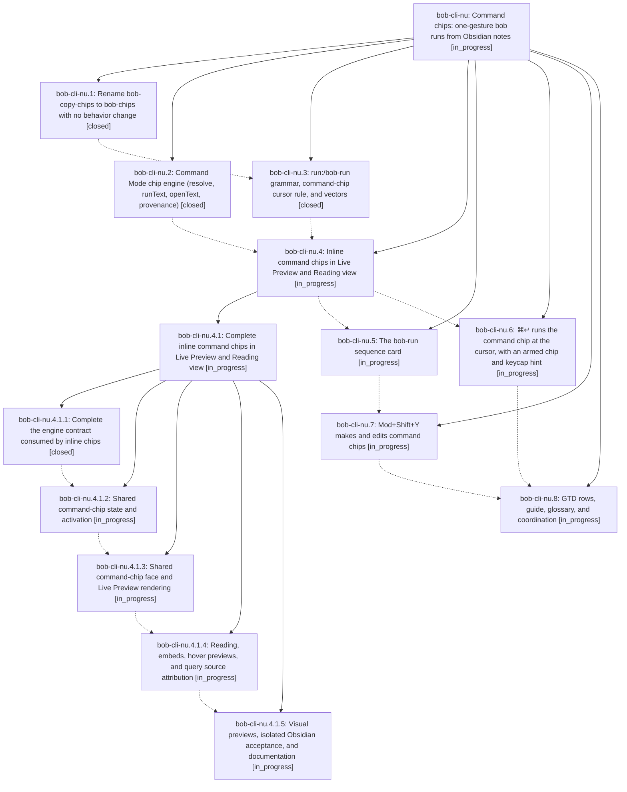

# Bead: bob-cli-nu — Command chips: one-gesture bob runs from Obsidian notes

[Bead Pages](../README.md) / bob-cli-nu

**Status:** ◐ in_progress · **Type:** ▸ plan · **Tier:** epic
**Owner:** `bryanbugyi34@gmail.com` · **Created by:** [bbugyi200.apollo.research.5k.linker.w0](https://github.com/bobs-org/bob-cli--agents/blob/main/sessions/bbugyi200.apollo.research.5k.linker.w0.md) · **Assignee:** `bob-cli-nu.land`
**Created:** 2026-11-20 05:59:33 EST
**Plan:** [202611/command\_chips.md](https://github.com/bobs-org/bob-cli--plans/blob/main/202611/command_chips.md)

<!-- sase:links:start -->

## Links

| Relation | Artifact | Why |
| --- | --- | --- |
| implemented-by | [plan:202611/command_chips.md][1] | derived from the plan's `bead_id:` frontmatter field |

[1]: https://github.com/bobs-org/bob-cli--plans/blob/main/202611/command_chips.md

<!-- sase:links:end -->

## Description

Typing `run: bob …` in an inline code span, or a `bob-run` fence, gives a quiet ▶ chip. One click or ⌘↵ runs it through Bob Command Mode the way the sheet's Ctrl+Enter would. A chip holds one command or a whole `&&` sequence, and its run state shows in place. The copy-chip plugin becomes `bob-chips` and owns both kinds, and the GTD rows that hold bob commands become command chips.

## Notes

[2026-11-20T12:59:07Z · bob-cli-nh.7.1.4] DISCOVERED ISSUE: (from the bob-plugins conflict-repair turn that rebased the intention-card commit onto c8da83f, 2026-11-20) On athena, 'bob plugins sync' from bob-plugins b1a655a exits 1: ~/.config/bob/config.yml plugins.sync still lists bob-copy-chips (line ~235), but after bf13f43 (bob-cli-nu.1 rename) the repo has no plugin with that id, and bob-chips is reported 'not in plugins.sync; skipped'. 'chezmoi diff ~/.config/bob/config.yml' is empty, so this host's applied chezmoi source does not yet carry the bob-chips allowlist entry. All other configured plugins synced (31 unchanged). This continues nu.1 notes #1 and #4 (deploy and retire the old id); the land agent should make sure the chezmoi allowlist change lands and is applied on every host before bob-chips can deploy. Also filed bob-cli-nv for the pre-existing docs-check URL failure that nu.1 note #3 proposed.

## Phases

| Bead | Title | Status | Size | Created | Agents | Commits |
|---|---|---|---|---|---:|---:|
| [bob-cli-nu.1](bob-cli-nu.1.md) | Rename bob-copy-chips to bob-chips with no behavior change | ✓ closed | medium | 2026-11-20 | 1 | 2 |
| [bob-cli-nu.2](bob-cli-nu.2.md) | Command Mode chip engine (resolve, runText, openText, provenance) | ✓ closed | medium | 2026-11-20 | 1 | 1 |
| [bob-cli-nu.3](bob-cli-nu.3.md) | run:/bob-run grammar, command-chip cursor rule, and vectors | ✓ closed | medium | 2026-11-20 | 1 | 1 |
| [bob-cli-nu.4](bob-cli-nu.4.md) | Inline command chips in Live Preview and Reading view | ◐ in_progress | large | 2026-11-20 | 1 | 0 |
| [bob-cli-nu.5](bob-cli-nu.5.md) | The bob-run sequence card | ◐ in_progress | medium | 2026-11-20 | 1 | 0 |
| [bob-cli-nu.6](bob-cli-nu.6.md) | ⌘↵ runs the command chip at the cursor, with an armed chip and keycap hint | ◐ in_progress | medium | 2026-11-20 | 1 | 0 |
| [bob-cli-nu.7](bob-cli-nu.7.md) | Mod+Shift+Y makes and edits command chips | ◐ in_progress | medium | 2026-11-20 | 1 | 0 |
| [bob-cli-nu.8](bob-cli-nu.8.md) | GTD rows, guide, glossary, and coordination | ◐ in_progress | medium | 2026-11-20 | 1 | 0 |

## Lineage

## Agents

| Agent | Bead | Commits |
|---|---|---:|
| [bbugyi200.apollo.bob-cli-nu.1](https://github.com/bobs-org/bob-cli--agents/blob/main/agents/bbugyi200.apollo.bob-cli-nu.1/README.md) | [bob-cli-nu.1](bob-cli-nu.1.md) | 2 |
| [bbugyi200.apollo.bob-cli-nu.2](https://github.com/bobs-org/bob-cli--agents/blob/main/sessions/bbugyi200.apollo.bob-cli-nu.2.md) | [bob-cli-nu.2](bob-cli-nu.2.md) | 1 |
| [bbugyi200.apollo.bob-cli-nu.3](https://github.com/bobs-org/bob-cli--agents/blob/main/agents/bbugyi200.apollo.bob-cli-nu.3/README.md) | [bob-cli-nu.3](bob-cli-nu.3.md) | 1 |
| [bbugyi200.apollo.bob-cli-nu.4](https://github.com/bobs-org/bob-cli--agents/blob/main/sessions/bbugyi200.apollo.bob-cli-nu.4.md) | [bob-cli-nu.4](bob-cli-nu.4.md) | 0 |
| [bbugyi200.apollo.bob-cli-nu.4.1.1](https://github.com/bobs-org/bob-cli--agents/blob/main/agents/bbugyi200.apollo.bob-cli-nu.4.1.1/README.md) | [bob-cli-nu.4.1.1](bob-cli-nu.4.1.1.md) | 1 |
| [bbugyi200.apollo.bob-cli-nu.4.1.2](https://github.com/bobs-org/bob-cli--agents/blob/main/agents/bbugyi200.apollo.bob-cli-nu.4.1.2/README.md) | [bob-cli-nu.4.1.2](bob-cli-nu.4.1.2.md) | 0 |
| [bbugyi200.apollo.bob-cli-nu.4.1.3](https://github.com/bobs-org/bob-cli--agents/blob/main/agents/bbugyi200.apollo.bob-cli-nu.4.1.3/README.md) | [bob-cli-nu.4.1.3](bob-cli-nu.4.1.3.md) | 0 |
| [bbugyi200.apollo.bob-cli-nu.4.1.4](https://github.com/bobs-org/bob-cli--agents/blob/main/agents/bbugyi200.apollo.bob-cli-nu.4.1.4/README.md) | [bob-cli-nu.4.1.4](bob-cli-nu.4.1.4.md) | 0 |
| [bbugyi200.apollo.bob-cli-nu.4.1.5](https://github.com/bobs-org/bob-cli--agents/blob/main/agents/bbugyi200.apollo.bob-cli-nu.4.1.5/README.md) | [bob-cli-nu.4.1.5](bob-cli-nu.4.1.5.md) | 0 |
| [bbugyi200.apollo.bob-cli-nu.4.1.land](https://github.com/bobs-org/bob-cli--agents/blob/main/agents/bbugyi200.apollo.bob-cli-nu.4.1.land/README.md) | [bob-cli-nu.4.1](bob-cli-nu.4.1.md) | 0 |
| [bbugyi200.apollo.bob-cli-nu.5](https://github.com/bobs-org/bob-cli--agents/blob/main/agents/bbugyi200.apollo.bob-cli-nu.5/README.md) | [bob-cli-nu.5](bob-cli-nu.5.md) | 0 |
| [bbugyi200.apollo.bob-cli-nu.6](https://github.com/bobs-org/bob-cli--agents/blob/main/agents/bbugyi200.apollo.bob-cli-nu.6/README.md) | [bob-cli-nu.6](bob-cli-nu.6.md) | 0 |
| [bbugyi200.apollo.bob-cli-nu.7](https://github.com/bobs-org/bob-cli--agents/blob/main/agents/bbugyi200.apollo.bob-cli-nu.7/README.md) | [bob-cli-nu.7](bob-cli-nu.7.md) | 0 |
| [bbugyi200.apollo.bob-cli-nu.8](https://github.com/bobs-org/bob-cli--agents/blob/main/agents/bbugyi200.apollo.bob-cli-nu.8/README.md) | [bob-cli-nu.8](bob-cli-nu.8.md) | 0 |
| [bbugyi200.apollo.bob-cli-nu.land](https://github.com/bobs-org/bob-cli--agents/blob/main/agents/bbugyi200.apollo.bob-cli-nu.land/README.md) | [bob-cli-nu](README.md) | 0 |

## Commits

| Repo | Commit | Subject | Bead | Committed |
|---|---|---|---|---|
| bob-cli | [`e5f5108`](https://github.com/bobs-org/bob-cli/commit/e5f510818a9dae38d4a9a64d418c826840f17d06) | feat(chips): add bob-chips docs redirect | [bob-cli-nu.1](bob-cli-nu.1.md) | 2026-11-20 06:48:00 EST |
| bob-plugins | [`bob-plugins@bf13f43`](https://github.com/bobs-org/bob-plugins/commit/bf13f430fade45369de709523c321b72d3761ce3) | feat(plugins): rename bob-copy-chips to bob-chips | [bob-cli-nu.1](bob-cli-nu.1.md) | 2026-11-20 06:50:46 EST |
| bob-plugins | [`bob-plugins@591998e`](https://github.com/bobs-org/bob-plugins/commit/591998e36b0f41e61c3871d24a48478b541e52b5) | feat(bob-command-mode): add chip execution engine and provenance | [bob-cli-nu.2](bob-cli-nu.2.md) | 2026-11-20 07:12:03 EST |
| bob-plugins | [`bob-plugins@c8da83f`](https://github.com/bobs-org/bob-plugins/commit/c8da83fda53b966c1b6e2eb6127efc3da9658bb2) | feat(bob-chips): add run:/bob-run grammar and command-chip cursor rule | [bob-cli-nu.3](bob-cli-nu.3.md) | 2026-11-20 07:26:44 EST |
| bob-plugins | [`bob-plugins@52b7c31`](https://github.com/bobs-org/bob-plugins/commit/52b7c31486f3594cc0fe663e7ad0487e4d82c10d) | feat(bob-command-mode): complete the command-chip engine contract | [bob-cli-nu.4.1.1](bob-cli-nu.4.1.1.md) | 2026-11-20 08:16:21 EST |
