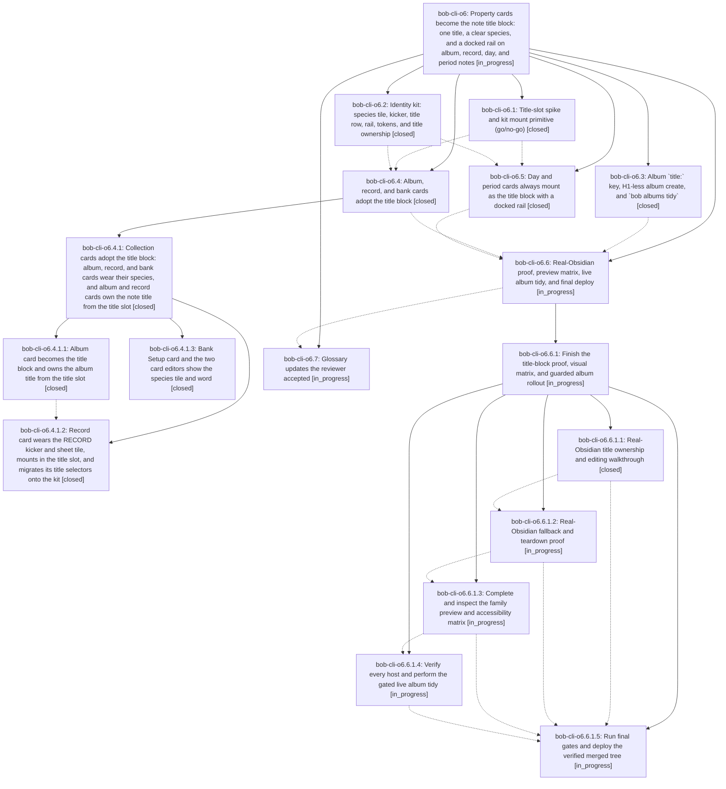

# Bead: bob-cli-o6 — Property cards become the note title block: one title, a clear species, and a docked rail on album, record, day, and period notes

[Bead Pages](../README.md) / bob-cli-o6

**Status:** ◐ in_progress · **Type:** ▸ plan · **Tier:** epic
**Owner:** `bryanbugyi34@gmail.com` · **Created by:** [bbugyi200.athena.1eh](https://github.com/bobs-org/bob-cli--agents/blob/main/sessions/bbugyi200.athena.1eh.md) · **Assignee:** `bob-cli-o6.land`
**Created:** 2026-11-20 11:49:16 EST
**Plan:** [202611/property\_card\_title\_block.md](https://github.com/bobs-org/bob-cli--plans/blob/main/202611/property_card_title_block.md)

<!-- sase:links:start -->

## Links

| Relation | Artifact | Why |
| --- | --- | --- |
| implemented-by | [plan:202611/property_card_title_block.md][1] | derived from the plan's `bead_id:` frontmatter field |

_Plus 3 automatic references — see [Referenced By](#referenced-by)._

[1]: https://github.com/bobs-org/bob-cli--plans/blob/main/202611/property_card_title_block.md

<!-- sase:links:end -->

## Description

On desktop Obsidian, every album note, record note, canonical daily note, and week, quarter, and year note opens on its property card, and that card is the note's only visible title. The card leads with a species glyph tile and a kicker word (ALBUM, RECORD, DAY, WEEK, QUARTER, YEAR), so an album, a record, and a day can never be mistaken for each other, even in grayscale. The redundant H1, inline title, and nav line are hidden at render time, never deleted (except album H1s, which move into a bob-owned `title:` key). Every failure restores native rendering.

## Notes

[2026-11-20T18:47:04Z · bob-cli-nu.land] DISCOVERED ISSUE: (routed by the bob-cli-nu land agent from bob-cli-nu.8 PROPOSED FOLLOW-UP #3) bob-cli just docs-check fails at lint on master 2443e0a4: 'docs/reference/vault-format.md:1: budget: over budget at 6016 words (cap 6000 for reference/)'. The overflow arrived with bb91c370 (SASE_BEAD=bob-cli-o6.3, album title key and bob albums tidy; +10/- lines in vault-format.md), so docs-check stops before its build/link/URL gates for every repo that runs it (bob-plugins npm run docs:check fails identically). Fix within this epic: trim at least 16 words from docs/reference/vault-format.md, or move the albums section to its own reference page under the approved plan with published URLs preserved. Reproduced 2026-11-20 by the bob-cli-nu lander with 'just docs-check' (bob-cli) and 'BOB_CLI_DIR=<bob-cli> npm run docs:check' (bob-plugins).

[2026-11-21T02:16:38Z · bob-cli-o6.4.1.land] DISCOVERED ISSUE corroboration from bob-cli-o6.4.1.land: collection phases o6.4.1.1 #3, o6.4.1.2 #2 and o6.4.1.3 #1 independently hit vault-format.md 6016/6000-word lint failure. Existing bob-cli-oc corroborated, and source/history tie the overflow to your album-title-cli phase bb91c370 (o6.3), matching your existing discovery. This remains outer-epic work rather than an unrelated collection-card task. The collection closeout will separately repair the shared title-range trailing-blank contract gap (o6.4.1.1 #4), which also covers the day/period adopters.

[2026-11-21T13:03:02Z · fe--code] DISCOVERED ISSUE: Independent reproduction on 2026-11-21: npm run docs:check in bob-plugins exits 1 on bob-cli HEAD d27041c at docs/reference/vault-format.md:1 (6016/6000 words). The file is untouched in this implementation. This confirms the existing bob-cli-oc failure still blocks the mounted plugin docs gate.

[2026-11-21T15:22:12Z · bob-cli-oj.3.1.land] DISCOVERED ISSUE corroboration from bob-cli-oj.3.1.land: proposing bead bob-cli-oj.3.1.4 note #1 reproduced clean-base docs-check vault-format.md 6016/6000. Current 020ad4e6 independently remains 6016 by bob_docs.markdown.count_words; bb91c370 / o6.3 caused the existing overflow. Added evidence to bob-cli-oc; no new task or work added to grouped-walk child epic.

## Phases

| Bead | Title | Status | Size | Created | Agents | Commits |
|---|---|---|---|---|---:|---:|
| [bob-cli-o6.1](bob-cli-o6.1.md) | Title-slot spike and kit mount primitive (go/no-go) | ✓ closed | large | 2026-11-20 | 1 | 1 |
| [bob-cli-o6.2](bob-cli-o6.2.md) | Identity kit: species tile, kicker, title row, rail, tokens, and title ownership | ✓ closed | large | 2026-11-20 | 1 | 1 |
| [bob-cli-o6.3](bob-cli-o6.3.md) | Album \`title:\` key, H1-less album create, and \`bob albums tidy\` | ✓ closed | large | 2026-11-20 | 1 | 1 |
| [bob-cli-o6.4](bob-cli-o6.4.md) | Album, record, and bank cards adopt the title block | ✓ closed | large | 2026-11-20 | 1 | 0 |
| [bob-cli-o6.5](bob-cli-o6.5.md) | Day and period cards always mount as the title block with a docked rail | ✓ closed | large | 2026-11-20 | 1 | 1 |
| [bob-cli-o6.6](bob-cli-o6.6.md) | Real-Obsidian proof, preview matrix, live album tidy, and final deploy | ◐ in_progress | large | 2026-11-20 | 1 | 0 |
| [bob-cli-o6.7](bob-cli-o6.7.md) | Glossary updates the reviewer accepted | ◐ in_progress | small | 2026-11-20 | 1 | 0 |

## Lineage

## Agents

| Agent | Bead | Commits |
|---|---|---:|
| [bbugyi200.athena.bob-cli-o6.1](https://github.com/bobs-org/bob-cli--agents/blob/main/sessions/bbugyi200.athena.bob-cli-o6.1.md) | [bob-cli-o6.1](bob-cli-o6.1.md) | 1 |
| [bbugyi200.athena.bob-cli-o6.2](https://github.com/bobs-org/bob-cli--agents/blob/main/sessions/bbugyi200.athena.bob-cli-o6.2.md) | [bob-cli-o6.2](bob-cli-o6.2.md) | 1 |
| [bbugyi200.athena.bob-cli-o6.3](https://github.com/bobs-org/bob-cli--agents/blob/main/sessions/bbugyi200.athena.bob-cli-o6.3.md) | [bob-cli-o6.3](bob-cli-o6.3.md) | 1 |
| [bbugyi200.athena.bob-cli-o6.4](https://github.com/bobs-org/bob-cli--agents/blob/main/sessions/bbugyi200.athena.bob-cli-o6.4.md) | [bob-cli-o6.4](bob-cli-o6.4.md) | 0 |
| [bbugyi200.athena.bob-cli-o6.4.1.1](https://github.com/bobs-org/bob-cli--agents/blob/main/sessions/bbugyi200.athena.bob-cli-o6.4.1.1.md) | [bob-cli-o6.4.1.1](bob-cli-o6.4.1.1.md) | 1 |
| [bbugyi200.athena.bob-cli-o6.4.1.2](https://github.com/bobs-org/bob-cli--agents/blob/main/sessions/bbugyi200.athena.bob-cli-o6.4.1.2.md) | [bob-cli-o6.4.1.2](bob-cli-o6.4.1.2.md) | 1 |
| [bbugyi200.athena.bob-cli-o6.4.1.3](https://github.com/bobs-org/bob-cli--agents/blob/main/sessions/bbugyi200.athena.bob-cli-o6.4.1.3.md) | [bob-cli-o6.4.1.3](bob-cli-o6.4.1.3.md) | 1 |
| [bbugyi200.athena.bob-cli-o6.4.1.land](https://github.com/bobs-org/bob-cli--agents/blob/main/agents/bbugyi200.athena.bob-cli-o6.4.1.land/README.md) | [bob-cli-o6.4.1](bob-cli-o6.4.1.md) | 2 |
| [bbugyi200.athena.bob-cli-o6.5](https://github.com/bobs-org/bob-cli--agents/blob/main/sessions/bbugyi200.athena.bob-cli-o6.5.md) | [bob-cli-o6.5](bob-cli-o6.5.md) | 1 |
| [bbugyi200.athena.bob-cli-o6.6](https://github.com/bobs-org/bob-cli--agents/blob/main/sessions/bbugyi200.athena.bob-cli-o6.6.md) | [bob-cli-o6.6](bob-cli-o6.6.md) | 0 |
| [bbugyi200.athena.bob-cli-o6.6.1.1](https://github.com/bobs-org/bob-cli--agents/blob/main/agents/bbugyi200.athena.bob-cli-o6.6.1.1/README.md) | [bob-cli-o6.6.1.1](bob-cli-o6.6.1.1.md) | 1 |
| [bbugyi200.athena.bob-cli-o6.6.1.2](https://github.com/bobs-org/bob-cli--agents/blob/main/sessions/bbugyi200.athena.bob-cli-o6.6.1.2.md) | [bob-cli-o6.6.1.2](bob-cli-o6.6.1.2.md) | 1 |
| [bbugyi200.athena.bob-cli-o6.6.1.3](https://github.com/bobs-org/bob-cli--agents/blob/main/agents/bbugyi200.athena.bob-cli-o6.6.1.3/README.md) | [bob-cli-o6.6.1.3](bob-cli-o6.6.1.3.md) | 0 |
| [bbugyi200.athena.bob-cli-o6.6.1.4](https://github.com/bobs-org/bob-cli--agents/blob/main/agents/bbugyi200.athena.bob-cli-o6.6.1.4/README.md) | [bob-cli-o6.6.1.4](bob-cli-o6.6.1.4.md) | 0 |
| [bbugyi200.athena.bob-cli-o6.6.1.5](https://github.com/bobs-org/bob-cli--agents/blob/main/agents/bbugyi200.athena.bob-cli-o6.6.1.5/README.md) | [bob-cli-o6.6.1.5](bob-cli-o6.6.1.5.md) | 0 |
| [bbugyi200.athena.bob-cli-o6.6.1.land](https://github.com/bobs-org/bob-cli--agents/blob/main/agents/bbugyi200.athena.bob-cli-o6.6.1.land/README.md) | [bob-cli-o6.6.1](bob-cli-o6.6.1.md) | 0 |
| [bbugyi200.athena.bob-cli-o6.7](https://github.com/bobs-org/bob-cli--agents/blob/main/agents/bbugyi200.athena.bob-cli-o6.7/README.md) | [bob-cli-o6.7](bob-cli-o6.7.md) | 0 |
| [bbugyi200.athena.bob-cli-o6.land](https://github.com/bobs-org/bob-cli--agents/blob/main/agents/bbugyi200.athena.bob-cli-o6.land/README.md) | [bob-cli-o6](README.md) | 0 |

## Commits

| Repo | Commit | Subject | Bead | Committed |
|---|---|---|---|---|
| bob-plugins | [`bob-plugins@6278b78`](https://github.com/bobs-org/bob-plugins/commit/6278b78c8f0987071d189245dd40eca426c55e12) | feat(ledger-tools): add property-card identity kit and title ownership | [bob-cli-o6.2](bob-cli-o6.2.md) | 2026-11-20 12:48:25 EST |
| bob-cli | [`bb91c37`](https://github.com/bobs-org/bob-cli/commit/bb91c370bac2c4dac6311ed543c30639f38afa84) | feat(albums): read frontmatter title first and add bob albums tidy | [bob-cli-o6.3](bob-cli-o6.3.md) | 2026-11-20 12:48:36 EST |
| bob-plugins | [`bob-plugins@c5f5a1b`](https://github.com/bobs-org/bob-plugins/commit/c5f5a1b5faf6a10a456dfa122cb26adb54bb16d9) | feat(ledger-tools): add title-slot mount primitive and real-Obsidian spike | [bob-cli-o6.1](bob-cli-o6.1.md) | 2026-11-20 13:26:11 EST |
| bob-plugins | [`bob-plugins@f16ddea`](https://github.com/bobs-org/bob-plugins/commit/f16ddeaad40616cad8133fbe6d93348c8b39e955) | feat(ledger-tools): show the species badge on the bank card and card editors | [bob-cli-o6.4.1.3](bob-cli-o6.4.1.3.md) | 2026-11-20 14:34:26 EST |
| bob-plugins | [`bob-plugins@eed318e`](https://github.com/bobs-org/bob-plugins/commit/eed318e0542a09d99278ff936763ab1666d6d3ee) | feat(ledger-tools): day and period cards own the title block | [bob-cli-o6.5](bob-cli-o6.5.md) | 2026-11-20 14:39:50 EST |
| bob-plugins | [`bob-plugins@a68e29b`](https://github.com/bobs-org/bob-plugins/commit/a68e29be2b0bb50aee47a19d65a3485c207b59bb) | feat(ledger-tools): album card owns the title block from the title slot | [bob-cli-o6.4.1.1](bob-cli-o6.4.1.1.md) | 2026-11-20 15:03:15 EST |
| bob-plugins | [`bob-plugins@b8b7baf`](https://github.com/bobs-org/bob-plugins/commit/b8b7baf440e888cd94c948f5339cd37527928079) | feat(ledger-tools): record card owns the title block from the title slot | [bob-cli-o6.4.1.2](bob-cli-o6.4.1.2.md) | 2026-11-20 21:08:59 EST |
| bob-plugins | [`bob-plugins@1a95b29`](https://github.com/bobs-org/bob-plugins/commit/1a95b292a96434d237aa6aa217c809ba17a282d8) | feat(ledger-tools): hide trailing title-block blanks and share the editor species badge | [bob-cli-o6.4.1](bob-cli-o6.4.1.md) | 2026-11-21 08:15:36 EST |
| bob-cli--plans | [`bob-cli--plans@8957bf8`](https://github.com/bobs-org/bob-cli--plans/commit/8957bf84c13c7856d7659ea5279ffbe8c5a619a2) | chore(plans): mark collection-cards title-block epic and closeout tale done | [bob-cli-o6.4.1](bob-cli-o6.4.1.md) | 2026-11-21 08:16:01 EST |
| bob-plugins | [`bob-plugins@3860513`](https://github.com/bobs-org/bob-plugins/commit/38605130263b3cc5c1145b7afda840f5f2d54ec9) | test: add isolated Obsidian title-block walkthrough | [bob-cli-o6.6.1.1](bob-cli-o6.6.1.1.md) | 2026-11-21 08:56:22 EST |
| bob-plugins | [`bob-plugins@c803a4e`](https://github.com/bobs-org/bob-plugins/commit/c803a4e82ff869db4619d02adee6e1e14401d7eb) | fix(plugins): preserve title fallback after repaint failures | [bob-cli-o6.6.1.2](bob-cli-o6.6.1.2.md) | 2026-11-21 11:25:12 EST |

<!-- sase:referenced-by:start -->

## Referenced By

| Relation | Artifact | Why | Uses |
| --- | --- | --- | ---: |
| read-by | [agent:bob-cli-o6.6.1.1][1] | Need parent DECISIONS, notes, and whether earlier title-walkthrough work already landed | 1 |
| read-by | [agent:bob-cli-oj.2][2] | Precondition: calendar-groups must not edit fragments an open o6 phase is changing | 2 |
| read-by | [agent:bob-cli-oj.3.1.1][3] | Check the title-block prerequisite and overlap | 1 |

[1]: https://github.com/bobs-org/bob-cli--agents/blob/main/agents/bbugyi200.athena.bob-cli-o6.6.1.1/README.md
[2]: https://github.com/bobs-org/bob-cli--agents/blob/main/agents/bbugyi200.athena.bob-cli-oj.2/README.md
[3]: https://github.com/bobs-org/bob-cli--agents/blob/main/agents/bbugyi200.athena.bob-cli-oj.3.1.1/README.md

<!-- sase:referenced-by:end -->
