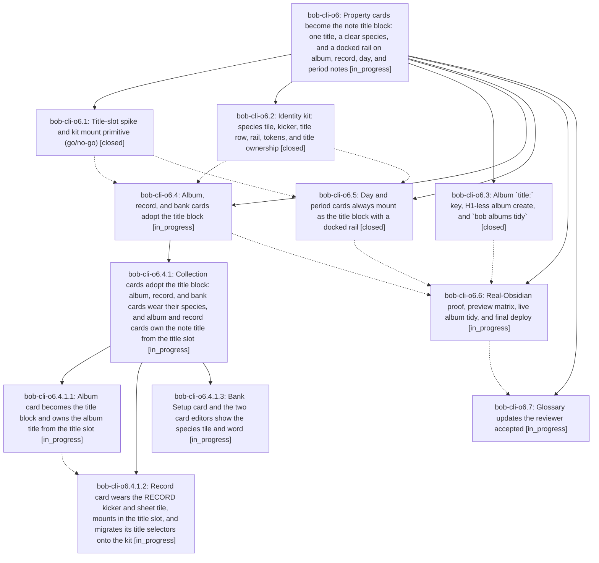

# Bead: bob-cli-o6 — Property cards become the note title block: one title, a clear species, and a docked rail on album, record, day, and period notes

[Bead Pages](../README.md) / bob-cli-o6

**Status:** ◐ in_progress · **Type:** ▸ plan · **Tier:** epic
**Owner:** `bryanbugyi34@gmail.com` · **Created by:** [bbugyi200.athena.1eh](https://github.com/bobs-org/bob-cli--agents/blob/main/sessions/bbugyi200.athena.1eh.md) · **Assignee:** `bob-cli-o6.land`
**Created:** 2026-11-20 11:49:16 EST
**Plan:** [202611/property\_card\_title\_block.md](https://github.com/bobs-org/bob-cli--plans/blob/main/202611/property_card_title_block.md)

<!-- sase:links:start -->

## Links

| Relation | Artifact | Why |
| --- | --- | --- |
| implemented-by | [plan:202611/property_card_title_block.md][1] | derived from the plan's `bead_id:` frontmatter field |

[1]: https://github.com/bobs-org/bob-cli--plans/blob/main/202611/property_card_title_block.md

<!-- sase:links:end -->

## Description

On desktop Obsidian, every album note, record note, canonical daily note, and week, quarter, and year note opens on its property card, and that card is the note's only visible title. The card leads with a species glyph tile and a kicker word (ALBUM, RECORD, DAY, WEEK, QUARTER, YEAR), so an album, a record, and a day can never be mistaken for each other, even in grayscale. The redundant H1, inline title, and nav line are hidden at render time, never deleted (except album H1s, which move into a bob-owned `title:` key). Every failure restores native rendering.

## Notes

[2026-11-20T18:47:04Z · bob-cli-nu.land] DISCOVERED ISSUE: (routed by the bob-cli-nu land agent from bob-cli-nu.8 PROPOSED FOLLOW-UP #3) bob-cli just docs-check fails at lint on master 2443e0a4: 'docs/reference/vault-format.md:1: budget: over budget at 6016 words (cap 6000 for reference/)'. The overflow arrived with bb91c370 (SASE_BEAD=bob-cli-o6.3, album title key and bob albums tidy; +10/- lines in vault-format.md), so docs-check stops before its build/link/URL gates for every repo that runs it (bob-plugins npm run docs:check fails identically). Fix within this epic: trim at least 16 words from docs/reference/vault-format.md, or move the albums section to its own reference page under the approved plan with published URLs preserved. Reproduced 2026-11-20 by the bob-cli-nu lander with 'just docs-check' (bob-cli) and 'BOB_CLI_DIR=<bob-cli> npm run docs:check' (bob-plugins).

## Phases

| Bead | Title | Status | Size | Created | Agents | Commits |
|---|---|---|---|---|---:|---:|
| [bob-cli-o6.1](bob-cli-o6.1.md) | Title-slot spike and kit mount primitive (go/no-go) | ✓ closed | large | 2026-11-20 | 1 | 1 |
| [bob-cli-o6.2](bob-cli-o6.2.md) | Identity kit: species tile, kicker, title row, rail, tokens, and title ownership | ✓ closed | large | 2026-11-20 | 1 | 1 |
| [bob-cli-o6.3](bob-cli-o6.3.md) | Album \`title:\` key, H1-less album create, and \`bob albums tidy\` | ✓ closed | large | 2026-11-20 | 1 | 1 |
| [bob-cli-o6.4](bob-cli-o6.4.md) | Album, record, and bank cards adopt the title block | ◐ in_progress | large | 2026-11-20 | 1 | 0 |
| [bob-cli-o6.5](bob-cli-o6.5.md) | Day and period cards always mount as the title block with a docked rail | ✓ closed | large | 2026-11-20 | 1 | 1 |
| [bob-cli-o6.6](bob-cli-o6.6.md) | Real-Obsidian proof, preview matrix, live album tidy, and final deploy | ◐ in_progress | large | 2026-11-20 | 1 | 0 |
| [bob-cli-o6.7](bob-cli-o6.7.md) | Glossary updates the reviewer accepted | ◐ in_progress | small | 2026-11-20 | 1 | 0 |

## Lineage

## Agents

| Agent | Bead | Commits |
|---|---|---:|
| [bbugyi200.athena.bob-cli-o6.1](https://github.com/bobs-org/bob-cli--agents/blob/main/sessions/bbugyi200.athena.bob-cli-o6.1.md) | [bob-cli-o6.1](bob-cli-o6.1.md) | 1 |
| [bbugyi200.athena.bob-cli-o6.2](https://github.com/bobs-org/bob-cli--agents/blob/main/sessions/bbugyi200.athena.bob-cli-o6.2.md) | [bob-cli-o6.2](bob-cli-o6.2.md) | 1 |
| [bbugyi200.athena.bob-cli-o6.3](https://github.com/bobs-org/bob-cli--agents/blob/main/sessions/bbugyi200.athena.bob-cli-o6.3.md) | [bob-cli-o6.3](bob-cli-o6.3.md) | 1 |
| [bbugyi200.athena.bob-cli-o6.4](https://github.com/bobs-org/bob-cli--agents/blob/main/sessions/bbugyi200.athena.bob-cli-o6.4.md) | [bob-cli-o6.4](bob-cli-o6.4.md) | 0 |
| [bbugyi200.athena.bob-cli-o6.4.1.1](https://github.com/bobs-org/bob-cli--agents/blob/main/sessions/bbugyi200.athena.bob-cli-o6.4.1.1.md) | [bob-cli-o6.4.1.1](bob-cli-o6.4.1.1.md) | 0 |
| [bbugyi200.athena.bob-cli-o6.4.1.2](https://github.com/bobs-org/bob-cli--agents/blob/main/agents/bbugyi200.athena.bob-cli-o6.4.1.2/README.md) | [bob-cli-o6.4.1.2](bob-cli-o6.4.1.2.md) | 0 |
| [bbugyi200.athena.bob-cli-o6.4.1.3](https://github.com/bobs-org/bob-cli--agents/blob/main/sessions/bbugyi200.athena.bob-cli-o6.4.1.3.md) | [bob-cli-o6.4.1.3](bob-cli-o6.4.1.3.md) | 1 |
| [bbugyi200.athena.bob-cli-o6.4.1.land](https://github.com/bobs-org/bob-cli--agents/blob/main/agents/bbugyi200.athena.bob-cli-o6.4.1.land/README.md) | [bob-cli-o6.4.1](bob-cli-o6.4.1.md) | 0 |
| [bbugyi200.athena.bob-cli-o6.5](https://github.com/bobs-org/bob-cli--agents/blob/main/sessions/bbugyi200.athena.bob-cli-o6.5.md) | [bob-cli-o6.5](bob-cli-o6.5.md) | 1 |
| [bbugyi200.athena.bob-cli-o6.6](https://github.com/bobs-org/bob-cli--agents/blob/main/agents/bbugyi200.athena.bob-cli-o6.6/README.md) | [bob-cli-o6.6](bob-cli-o6.6.md) | 0 |
| [bbugyi200.athena.bob-cli-o6.7](https://github.com/bobs-org/bob-cli--agents/blob/main/agents/bbugyi200.athena.bob-cli-o6.7/README.md) | [bob-cli-o6.7](bob-cli-o6.7.md) | 0 |
| [bbugyi200.athena.bob-cli-o6.land](https://github.com/bobs-org/bob-cli--agents/blob/main/agents/bbugyi200.athena.bob-cli-o6.land/README.md) | [bob-cli-o6](README.md) | 0 |

## Commits

| Repo | Commit | Subject | Bead | Committed |
|---|---|---|---|---|
| bob-plugins | [`bob-plugins@6278b78`](https://github.com/bobs-org/bob-plugins/commit/6278b78c8f0987071d189245dd40eca426c55e12) | feat(ledger-tools): add property-card identity kit and title ownership | [bob-cli-o6.2](bob-cli-o6.2.md) | 2026-11-20 12:48:25 EST |
| bob-cli | [`bb91c37`](https://github.com/bobs-org/bob-cli/commit/bb91c370bac2c4dac6311ed543c30639f38afa84) | feat(albums): read frontmatter title first and add bob albums tidy | [bob-cli-o6.3](bob-cli-o6.3.md) | 2026-11-20 12:48:36 EST |
| bob-plugins | [`bob-plugins@c5f5a1b`](https://github.com/bobs-org/bob-plugins/commit/c5f5a1b5faf6a10a456dfa122cb26adb54bb16d9) | feat(ledger-tools): add title-slot mount primitive and real-Obsidian spike | [bob-cli-o6.1](bob-cli-o6.1.md) | 2026-11-20 13:26:11 EST |
| bob-plugins | [`bob-plugins@f16ddea`](https://github.com/bobs-org/bob-plugins/commit/f16ddeaad40616cad8133fbe6d93348c8b39e955) | feat(ledger-tools): show the species badge on the bank card and card editors | [bob-cli-o6.4.1.3](bob-cli-o6.4.1.3.md) | 2026-11-20 14:34:26 EST |
| bob-plugins | [`bob-plugins@eed318e`](https://github.com/bobs-org/bob-plugins/commit/eed318e0542a09d99278ff936763ab1666d6d3ee) | feat(ledger-tools): day and period cards own the title block | [bob-cli-o6.5](bob-cli-o6.5.md) | 2026-11-20 14:39:50 EST |
