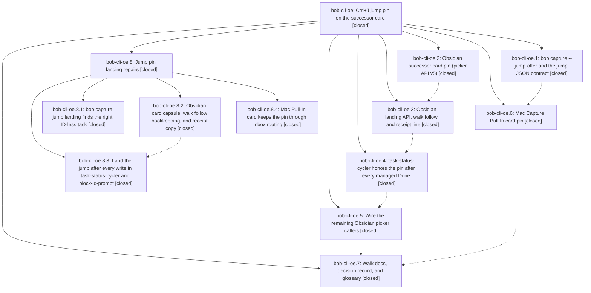

# Bead: bob-cli-oe — Ctrl+J jump pin on the successor card

[Bead Pages](../README.md) / bob-cli-oe

**Status:** ✓ closed · **Resolution:** done · **Type:** ▸ plan · **Tier:** epic
**Owner:** `bryanbugyi34@gmail.com` · **Created by:** [bbugyi200.apollo.research.5m.linker.w0](https://github.com/bobs-org/bob-cli--agents/blob/main/sessions/bbugyi200.apollo.research.5m.linker.w0.md) · **Assignee:** `bob-cli-oe.land`
**Created:** 2026-11-20 17:03:14 EST · **Closed:** 2026-11-21 09:53:59 EST
**Plan:** [202611/successor\_jump\_pin.md](https://github.com/bobs-org/bob-cli--plans/blob/main/202611/successor_jump_pin.md)

<!-- sase:links:start -->

## Links

| Relation | Artifact | Why |
| --- | --- | --- |
| implemented-by | [plan:202611/successor_jump_pin.md][1] | derived from the plan's `bead_id:` frontmatter field |
| related | [bead:bob-cli-oh][2] | Found during the bob-cli-oe landing review; the epic's JS4-style vectors for ID-less rows are blocked by this panic |

_Plus 3 automatic references — see [Referenced By](#referenced-by)._

[1]: https://github.com/bobs-org/bob-cli--plans/blob/main/202611/successor_jump_pin.md
[2]: https://github.com/bobs-org/bob-cli--beads/blob/main/pages/bob-cli-oh/README.md

<!-- sase:links:end -->

## Description

On the successor card in Obsidian and in Mac Capture, Ctrl+J pins one offer as the jump successor. The pinned offer can still be left open, pulled in, marked Done, or canceled. Once every write of the triggering close or capture has landed, Obsidian opens that task's note and focuses its line. The pin never writes to the vault, wins over the Cmd+Return open-notes landing, parks a ]s walk instead of advancing it, and never fails the close if the target can't be found.

## Notes

[2026-11-21T02:35:32Z · bob-cli-oe.land] LAND TRIAGE of PROPOSED FOLLOW-UPs: (1) vault-format.md 6016/6000 reference budget (oe.1 #1, oe.2 #1, oe.3 #1, oe.4 #2, oe.5 #2, oe.6 #1, oe.7 #1) — not caused by the epic (file untouched, wc 6630 before and after); duplicate of bob-cli-oc, +1 recorded. (2) ledger-tools perf flakes event-link-times / frees-marks (oe.3 #1, oe.4 #1, oe.5 #1) — not caused (ledger-tools byte-identical); duplicates of bob-cli-km and bob-cli-io, +1 recorded on each. (3) nav-hotkeys.md ~3 words headroom and plugin-apis.md 8044/8000 develop budget (oe.2 #2, oe.4 #2, oe.5 #2) — headroom is bob-cli-ob, +1 recorded; the epic's own ~212-word growth that pushed plugin-apis.md over its cap is epic work and goes in the remaining-work plan. (4) plugin-apis.md cites §12.22 for successors v5 instead of §12.24 (oe.7 #2) — epic-caused drift, in the remaining-work plan. Landing-review discoveries not caused by the epic: bob-cli-oh (new, large: debug_assert panic 'tracked task headline is not a task' at task_blocks.rs:587 on -X with two ID-less dependents, reproduces without -j) and bob-cli-oi (new, small: successorShakeRow's querySelector guard is inverted since 8a16ebea, so refusal shakes never play).

[2026-11-21T02:37:58Z · bob-cli-oe.land] LAND VERIFICATION (steps 1-2): all 7 phases' commits were reviewed against the plan: bob-cli 853246f0 and 8f703ccb, bob-plugins 63cd4ee5, 1a6ff799, 6e0d764a, and 570c3a10, and bob-mac-capture bf590f32. Targeted suites are green: successor_jump 10/10; bob-plugins 4257/4257 non-perf nav/cycler/block-id-prompt unit tests; build:check clean; mac exact-SHA CI green. Decisions were honored: the walk-park strand was written, the two strands were marked superseded-in-part, and no glossary strand was added. No epic symbols. Integration: nothing landed after the epic started touches the successor card, jump, or walk (bob-cli chips/glossary docs; bob-plugins bob-chips and ledger-tools; no other mac commits). Remaining epic-caused bugs, each confirmed by repro or source reading, are planned as a child epic (sase_plan_successor_jump_repairs). (a) bob-cli: the jump landing for ordinary ID-less dependents uses the key ordinal, so it lands on an unrelated twin or reports a findable task as lost. Reproduced: twin above gives line 1 instead of 2; two dups with -p 1 -j 2 give a null landing. (b) nav: the capsule uses the SF Symbol name arrow-up-forward on the text span and renders before the content div, not at the trailing edge. followReviewWalkAfter never calls addReviewAnsweredKeys/recordReviewAnswer and parks without a resolve check. The notice v5 arrow is doubled. 206e copies applySelection/settle wholesale. landOnTask can report lost and then land later. (c) cycler: the Task Link Ctrl+Enter close self-lands before strikeActiveSelectedTaskBlockLink, and unlink plus inbox route lands before the route move (and double-lands on a walk). (d) mac: submitInboxRouteAnswers re-dispatch drops --jump-offer, and the primary label counts a hidden highlight. (e) bob-plugins plugin-apis.md cites §12.22 instead of §12.24 and grew past its 8000-word develop cap (8044).

[2026-11-21T13:39:13Z · bob-cli-oe.8.land] LAND CONTINUATION via bob-cli-oe.8: the child repair audit found three remaining jump gaps (ID-less identity after bulk line shifts, missing receipts on deferred non-walk landings, and Mac note-pull-only Shift-Return/footer ignoring a pin). Evidence file:explicit:73581b2443f045fcd5a90e60. A medium tale will repair them and perform both oe.8 and oe closeout after full descendant/plan readiness checks. Parent remains open deliberately; no force or premature status:done. Follow-up triage completed on oe.8: oc/km/io corroborated, new small CI-harness flake ok.

[2026-11-21T14:53:59Z · bob-cli-oe.8.land] Parent epic close after child repair epic bob-cli-oe.8 closed.

Rechecked parent contract (one navigation-only pin, every commit key fires it, writes precede one landing, walk closes park, one receipt), final DECISIONS (walk_park_record=yes already recorded; jump_glossary_term=no, no glossary/memory edits this landing), phases oe.1–oe.7 closed, child epic oe.8 and its four phases closed, and plan:202611/successor_jump_pin.md.

This tale repaired the three remaining landing gaps found in the oe.8 land audit: ID-less identity after later insertions (JS16 + ordinal lookup), deferred non-walk receipt ownership, and Mac note-pull-only Shift-Return/footer pin. Verified with bob-cli just check, focused plugin suites 114/114 plus build:check, Mac typecheck-tests, and macos-ci-check run 44914092810.

Prior LAND TRIAGE dispositions stand: bob-cli-oc (docs budgets), bob-cli-km/io (ledger-tools 25ms), bob-cli-ok (macos-ci-check harness deadlines), bob-cli-oh (ID-less -X panic), bob-cli-oi (refusal shake). No new follow-up tasks. No epic-symbols. No just symvision recipe. Plan 202611/successor_jump_pin.md status:done. No parent plan ancestor above oe.

## Phases

| Bead | Title | Status | Size | Created | Agents | Commits |
|---|---|---|---|---|---:|---:|
| [bob-cli-oe.1](bob-cli-oe.1.md) | bob capture --jump-offer and the jump JSON contract | ✓ closed | medium | 2026-11-20 | 1 | 1 |
| [bob-cli-oe.2](bob-cli-oe.2.md) | Obsidian successor card pin (picker API v5) | ✓ closed | medium | 2026-11-20 | 1 | 1 |
| [bob-cli-oe.3](bob-cli-oe.3.md) | Obsidian landing API, walk follow, and receipt line | ✓ closed | medium | 2026-11-20 | 1 | 1 |
| [bob-cli-oe.4](bob-cli-oe.4.md) | task-status-cycler honors the pin after every managed Done | ✓ closed | medium | 2026-11-20 | 1 | 1 |
| [bob-cli-oe.5](bob-cli-oe.5.md) | Wire the remaining Obsidian picker callers | ✓ closed | medium | 2026-11-20 | 1 | 1 |
| [bob-cli-oe.6](bob-cli-oe.6.md) | Mac Capture Pull-In card pin | ✓ closed | medium | 2026-11-20 | 1 | 1 |
| [bob-cli-oe.7](bob-cli-oe.7.md) | Walk docs, decision record, and glossary | ✓ closed | small | 2026-11-20 | 1 | 1 |

## Lineage

## Agents

| Agent | Bead | Commits |
|---|---|---:|
| [bbugyi200.apollo.bob-cli-oe.1](https://github.com/bobs-org/bob-cli--agents/blob/main/agents/bbugyi200.apollo.bob-cli-oe.1/README.md) | [bob-cli-oe.1](bob-cli-oe.1.md) | 1 |
| [bbugyi200.apollo.bob-cli-oe.2](https://github.com/bobs-org/bob-cli--agents/blob/main/agents/bbugyi200.apollo.bob-cli-oe.2/README.md) | [bob-cli-oe.2](bob-cli-oe.2.md) | 1 |
| [bbugyi200.apollo.bob-cli-oe.3](https://github.com/bobs-org/bob-cli--agents/blob/main/agents/bbugyi200.apollo.bob-cli-oe.3/README.md) | [bob-cli-oe.3](bob-cli-oe.3.md) | 1 |
| [bbugyi200.apollo.bob-cli-oe.4](https://github.com/bobs-org/bob-cli--agents/blob/main/sessions/bbugyi200.apollo.bob-cli-oe.4.md) | [bob-cli-oe.4](bob-cli-oe.4.md) | 1 |
| [bbugyi200.apollo.bob-cli-oe.5](https://github.com/bobs-org/bob-cli--agents/blob/main/agents/bbugyi200.apollo.bob-cli-oe.5/README.md) | [bob-cli-oe.5](bob-cli-oe.5.md) | 1 |
| [bbugyi200.apollo.bob-cli-oe.6](https://github.com/bobs-org/bob-cli--agents/blob/main/sessions/bbugyi200.apollo.bob-cli-oe.6.md) | [bob-cli-oe.6](bob-cli-oe.6.md) | 1 |
| [bbugyi200.apollo.bob-cli-oe.7](https://github.com/bobs-org/bob-cli--agents/blob/main/agents/bbugyi200.apollo.bob-cli-oe.7/README.md) | [bob-cli-oe.7](bob-cli-oe.7.md) | 1 |
| [bbugyi200.apollo.bob-cli-oe.8.1](https://github.com/bobs-org/bob-cli--agents/blob/main/sessions/bbugyi200.apollo.bob-cli-oe.8.1.md) | [bob-cli-oe.8.1](bob-cli-oe.8.1.md) | 1 |
| [bbugyi200.apollo.bob-cli-oe.8.2](https://github.com/bobs-org/bob-cli--agents/blob/main/agents/bbugyi200.apollo.bob-cli-oe.8.2/README.md) | [bob-cli-oe.8.2](bob-cli-oe.8.2.md) | 2 |
| [bbugyi200.apollo.bob-cli-oe.8.3](https://github.com/bobs-org/bob-cli--agents/blob/main/agents/bbugyi200.apollo.bob-cli-oe.8.3/README.md) | [bob-cli-oe.8.3](bob-cli-oe.8.3.md) | 1 |
| [bbugyi200.apollo.bob-cli-oe.8.4](https://github.com/bobs-org/bob-cli--agents/blob/main/sessions/bbugyi200.apollo.bob-cli-oe.8.4.md) | [bob-cli-oe.8.4](bob-cli-oe.8.4.md) | 1 |
| [bbugyi200.apollo.bob-cli-oe.8.land](https://github.com/bobs-org/bob-cli--agents/blob/main/sessions/bbugyi200.apollo.bob-cli-oe.8.land.md) | [bob-cli-oe.8](bob-cli-oe.8.md) | 3 |
| [bbugyi200.apollo.bob-cli-oe.land](https://github.com/bobs-org/bob-cli--agents/blob/main/sessions/bbugyi200.apollo.bob-cli-oe.land.md) | [bob-cli-oe](README.md) | 0 |

## Commits

| Repo | Commit | Subject | Bead | Committed |
|---|---|---|---|---|
| bob-plugins | [`bob-plugins@63cd4ee`](https://github.com/bobs-org/bob-plugins/commit/63cd4ee5a4491db9005dec153265c1b59ffc7e7c) | feat(nav): add Ctrl+J jump pin to the successor card (picker API v5) | [bob-cli-oe.2](bob-cli-oe.2.md) | 2026-11-20 17:36:06 EST |
| bob-cli | [`853246f`](https://github.com/bobs-org/bob-cli/commit/853246f0ee582f4559767323c101dd2d2597cf91) | feat(capture): add successor jump offer contract | [bob-cli-oe.1](bob-cli-oe.1.md) | 2026-11-20 17:53:09 EST |
| bob-plugins | [`bob-plugins@1a6ff79`](https://github.com/bobs-org/bob-plugins/commit/1a6ff799afb94108c7cca87593b3d3e15cbb1bd8) | feat(nav): add landOnTask, reviewWalk v2 follow, and notice v5 jump receipt | [bob-cli-oe.3](bob-cli-oe.3.md) | 2026-11-20 18:07:09 EST |
| bob-plugins | [`bob-plugins@6e0d764`](https://github.com/bobs-org/bob-plugins/commit/6e0d764ad2aa4b6dd7e105960895333ed8a4aadb) | feat(task-status-cycler): honor the successor jump pin after every managed Done | [bob-cli-oe.4](bob-cli-oe.4.md) | 2026-11-20 18:52:27 EST |
| bob-plugins | [`bob-plugins@570c3a1`](https://github.com/bobs-org/bob-plugins/commit/570c3a10d5fb41ff4cdb470671a841bb4e5e258b) | feat(nav): land remaining picker callers on the Ctrl+J pin | [bob-cli-oe.5](bob-cli-oe.5.md) | 2026-11-20 19:19:45 EST |
| bob-mac-capture | [`bob-mac-capture@bf590f3`](https://github.com/bobs-org/bob-mac-capture/commit/bf590f324b88126823d55db701ba73feda77520c) | feat(capture): add successor jump pin to Pull-In card | [bob-cli-oe.6](bob-cli-oe.6.md) | 2026-11-20 19:58:18 EST |
| bob-cli | [`8f703cc`](https://github.com/bobs-org/bob-cli/commit/8f703ccbe4c5ee6a7b087be6ee5d5f6edac89b08) | docs(freshness): park the walk on a pinned successor close | [bob-cli-oe.7](bob-cli-oe.7.md) | 2026-11-20 21:03:21 EST |
| bob-mac-capture | [`bob-mac-capture@109c30d`](https://github.com/bobs-org/bob-mac-capture/commit/109c30db300df4a9a161ee2152e3b4676decdeaf) | fix(capture): keep Pull-In jump pin through inbox routing | [bob-cli-oe.8.4](bob-cli-oe.8.4.md) | 2026-11-20 22:07:07 EST |
| bob-plugins | [`bob-plugins@9c4b401`](https://github.com/bobs-org/bob-plugins/commit/9c4b401e5ca9ed833b03607fa04ef06b322d7516) | feat(navigation): complete successor jump and landing flow | [bob-cli-oe.8.2](bob-cli-oe.8.2.md) | 2026-11-20 22:20:55 EST |
| bob-cli | [`d27041c`](https://github.com/bobs-org/bob-cli/commit/d27041cd82437310afa818909363f5e0c66cdae6) | fix(capture): settle ID-less successor jump landings | [bob-cli-oe.8.1](bob-cli-oe.8.1.md) | 2026-11-20 22:42:31 EST |
| bob-plugins | [`bob-plugins@767a597`](https://github.com/bobs-org/bob-plugins/commit/767a59707c23c7dae9108891d5188eea19670805) | fix(navigation): park pinned checklist closes without duplicate answers | [bob-cli-oe.8.2](bob-cli-oe.8.2.md) | 2026-11-21 07:57:25 EST |
| bob-plugins | [`bob-plugins@6debb63`](https://github.com/bobs-org/bob-plugins/commit/6debb63b4c12caa600e58eb71b5044bb9b40a84a) | feat(task-status-cycler): implement cycler jump ordering | [bob-cli-oe.8.3](bob-cli-oe.8.3.md) | 2026-11-21 08:26:02 EST |
| bob-cli | [`05c1679`](https://github.com/bobs-org/bob-cli/commit/05c1679a0c2377822b27d6915273acd26fa70d0f) | fix(capture): preserve ID-less jump identity across later insertions | [bob-cli-oe.8](bob-cli-oe.8.md) | 2026-11-21 09:55:39 EST |
| bob-mac-capture | [`bob-mac-capture@f112622`](https://github.com/bobs-org/bob-mac-capture/commit/f11262242cd253bf32f07a5a2fa25c94efb0f1fc) | fix(capture): honor pinned Shift-Return on note-pull-only Pull-In | [bob-cli-oe.8](bob-cli-oe.8.md) | 2026-11-21 09:56:44 EST |
| bob-plugins | [`bob-plugins@4e0ff78`](https://github.com/bobs-org/bob-plugins/commit/4e0ff78b1534e62a55e86f8c94632bc76f3cc84b) | fix(successors): keep the jump receipt when deferred landing is not follow-owned | [bob-cli-oe.8](bob-cli-oe.8.md) | 2026-11-21 10:08:03 EST |

<!-- sase:referenced-by:start -->

## Referenced By

| Relation | Artifact | Why | Uses |
| --- | --- | --- | ---: |
| read-by | [agent:bob-cli-oe.1][1] | Need the epic design, phase notes, and prior-work status before implementation | 1 |
| read-by | [agent:bob-cli-oe.2][2] | Need parent epic scope and plan context | 1 |
| read-by | [agent:bob-cli-oe.8.2][3] | Need final DECISIONS governing jump behavior | 2 |

[1]: https://github.com/bobs-org/bob-cli--agents/blob/main/agents/bbugyi200.apollo.bob-cli-oe.1/README.md
[2]: https://github.com/bobs-org/bob-cli--agents/blob/main/agents/bbugyi200.apollo.bob-cli-oe.2/README.md
[3]: https://github.com/bobs-org/bob-cli--agents/blob/main/sessions/bbugyi200.apollo.bob-cli-oe.8.2.md

<!-- sase:referenced-by:end -->
