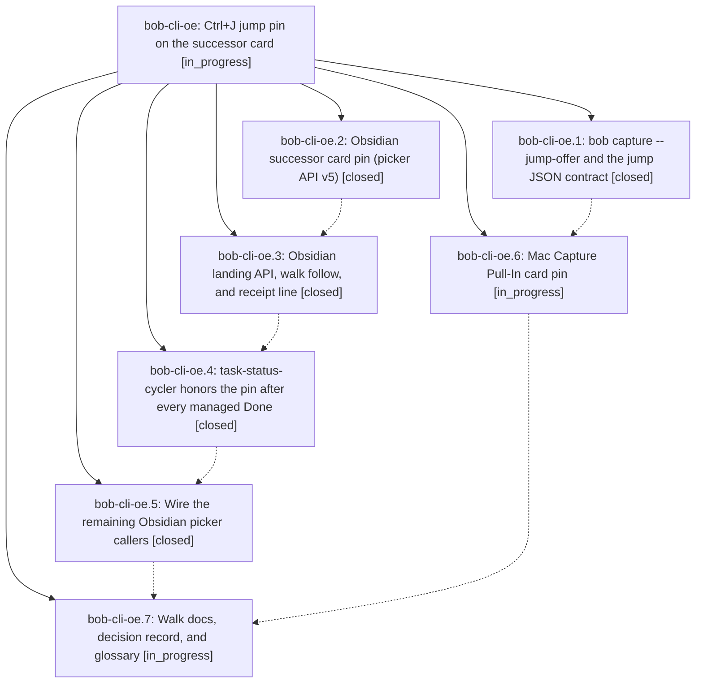

# Bead: bob-cli-oe — Ctrl+J jump pin on the successor card

[Bead Pages](../README.md) / bob-cli-oe

**Status:** ◐ in_progress · **Type:** ▸ plan · **Tier:** epic
**Owner:** `bryanbugyi34@gmail.com` · **Created by:** [bbugyi200.apollo.research.5m.linker.w0](https://github.com/bobs-org/bob-cli--agents/blob/main/sessions/bbugyi200.apollo.research.5m.linker.w0.md) · **Assignee:** `bob-cli-oe.land`
**Created:** 2026-11-20 17:03:14 EST
**Plan:** [202611/successor\_jump\_pin.md](https://github.com/bobs-org/bob-cli--plans/blob/main/202611/successor_jump_pin.md)

<!-- sase:links:start -->

## Links

| Relation | Artifact | Why |
| --- | --- | --- |
| implemented-by | [plan:202611/successor_jump_pin.md][1] | derived from the plan's `bead_id:` frontmatter field |

_Plus 2 automatic references — see [Referenced By](#referenced-by)._

[1]: https://github.com/bobs-org/bob-cli--plans/blob/main/202611/successor_jump_pin.md

<!-- sase:links:end -->

## Description

On the successor card in Obsidian and in Mac Capture, Ctrl+J pins one offer as the jump successor. The pinned offer can still be left open, pulled in, marked Done, or canceled. Once every write of the triggering close or capture has landed, Obsidian opens that task's note and focuses its line. The pin never writes to the vault, wins over the Cmd+Return open-notes landing, parks a ]s walk instead of advancing it, and never fails the close if the target can't be found.

## Phases

| Bead | Title | Status | Size | Created | Agents | Commits |
|---|---|---|---|---|---:|---:|
| [bob-cli-oe.1](bob-cli-oe.1.md) | bob capture --jump-offer and the jump JSON contract | ✓ closed | medium | 2026-11-20 | 1 | 1 |
| [bob-cli-oe.2](bob-cli-oe.2.md) | Obsidian successor card pin (picker API v5) | ✓ closed | medium | 2026-11-20 | 1 | 1 |
| [bob-cli-oe.3](bob-cli-oe.3.md) | Obsidian landing API, walk follow, and receipt line | ✓ closed | medium | 2026-11-20 | 1 | 1 |
| [bob-cli-oe.4](bob-cli-oe.4.md) | task-status-cycler honors the pin after every managed Done | ✓ closed | medium | 2026-11-20 | 1 | 1 |
| [bob-cli-oe.5](bob-cli-oe.5.md) | Wire the remaining Obsidian picker callers | ✓ closed | medium | 2026-11-20 | 1 | 1 |
| [bob-cli-oe.6](bob-cli-oe.6.md) | Mac Capture Pull-In card pin | ◐ in_progress | medium | 2026-11-20 | 1 | 0 |
| [bob-cli-oe.7](bob-cli-oe.7.md) | Walk docs, decision record, and glossary | ◐ in_progress | small | 2026-11-20 | 1 | 0 |

## Lineage

## Agents

| Agent | Bead | Commits |
|---|---|---:|
| [bbugyi200.apollo.bob-cli-oe.1](https://github.com/bobs-org/bob-cli--agents/blob/main/agents/bbugyi200.apollo.bob-cli-oe.1/README.md) | [bob-cli-oe.1](bob-cli-oe.1.md) | 1 |
| [bbugyi200.apollo.bob-cli-oe.2](https://github.com/bobs-org/bob-cli--agents/blob/main/agents/bbugyi200.apollo.bob-cli-oe.2/README.md) | [bob-cli-oe.2](bob-cli-oe.2.md) | 1 |
| [bbugyi200.apollo.bob-cli-oe.3](https://github.com/bobs-org/bob-cli--agents/blob/main/agents/bbugyi200.apollo.bob-cli-oe.3/README.md) | [bob-cli-oe.3](bob-cli-oe.3.md) | 1 |
| [bbugyi200.apollo.bob-cli-oe.4](https://github.com/bobs-org/bob-cli--agents/blob/main/sessions/bbugyi200.apollo.bob-cli-oe.4.md) | [bob-cli-oe.4](bob-cli-oe.4.md) | 1 |
| [bbugyi200.apollo.bob-cli-oe.5](https://github.com/bobs-org/bob-cli--agents/blob/main/agents/bbugyi200.apollo.bob-cli-oe.5/README.md) | [bob-cli-oe.5](bob-cli-oe.5.md) | 1 |
| [bbugyi200.apollo.bob-cli-oe.6](https://github.com/bobs-org/bob-cli--agents/blob/main/sessions/bbugyi200.apollo.bob-cli-oe.6.md) | [bob-cli-oe.6](bob-cli-oe.6.md) | 0 |
| [bbugyi200.apollo.bob-cli-oe.7](https://github.com/bobs-org/bob-cli--agents/blob/main/agents/bbugyi200.apollo.bob-cli-oe.7/README.md) | [bob-cli-oe.7](bob-cli-oe.7.md) | 0 |
| [bbugyi200.apollo.bob-cli-oe.land](https://github.com/bobs-org/bob-cli--agents/blob/main/agents/bbugyi200.apollo.bob-cli-oe.land/README.md) | [bob-cli-oe](README.md) | 0 |

## Commits

| Repo | Commit | Subject | Bead | Committed |
|---|---|---|---|---|
| bob-plugins | [`bob-plugins@63cd4ee`](https://github.com/bobs-org/bob-plugins/commit/63cd4ee5a4491db9005dec153265c1b59ffc7e7c) | feat(nav): add Ctrl+J jump pin to the successor card (picker API v5) | [bob-cli-oe.2](bob-cli-oe.2.md) | 2026-11-20 17:36:06 EST |
| bob-cli | [`853246f`](https://github.com/bobs-org/bob-cli/commit/853246f0ee582f4559767323c101dd2d2597cf91) | feat(capture): add successor jump offer contract | [bob-cli-oe.1](bob-cli-oe.1.md) | 2026-11-20 17:53:09 EST |
| bob-plugins | [`bob-plugins@1a6ff79`](https://github.com/bobs-org/bob-plugins/commit/1a6ff799afb94108c7cca87593b3d3e15cbb1bd8) | feat(nav): add landOnTask, reviewWalk v2 follow, and notice v5 jump receipt | [bob-cli-oe.3](bob-cli-oe.3.md) | 2026-11-20 18:07:09 EST |
| bob-plugins | [`bob-plugins@6e0d764`](https://github.com/bobs-org/bob-plugins/commit/6e0d764ad2aa4b6dd7e105960895333ed8a4aadb) | feat(task-status-cycler): honor the successor jump pin after every managed Done | [bob-cli-oe.4](bob-cli-oe.4.md) | 2026-11-20 18:52:27 EST |
| bob-plugins | [`bob-plugins@570c3a1`](https://github.com/bobs-org/bob-plugins/commit/570c3a10d5fb41ff4cdb470671a841bb4e5e258b) | feat(nav): land remaining picker callers on the Ctrl+J pin | [bob-cli-oe.5](bob-cli-oe.5.md) | 2026-11-20 19:19:45 EST |

<!-- sase:referenced-by:start -->

## Referenced By

| Relation | Artifact | Why | Uses |
| --- | --- | --- | ---: |
| read-by | [agent:bob-cli-oe.1][1] | Need the epic design, phase notes, and prior-work status before implementation | 1 |
| read-by | [agent:bob-cli-oe.2][2] | Need parent epic scope and plan context | 1 |

[1]: https://github.com/bobs-org/bob-cli--agents/blob/main/agents/bbugyi200.apollo.bob-cli-oe.1/README.md
[2]: https://github.com/bobs-org/bob-cli--agents/blob/main/agents/bbugyi200.apollo.bob-cli-oe.2/README.md

<!-- sase:referenced-by:end -->
