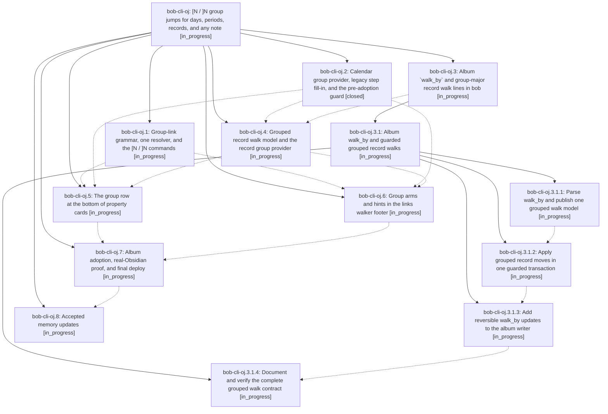

# Bead: bob-cli-oj — \[N / \]N group jumps for days, periods, records, and any note

[Bead Pages](../README.md) / bob-cli-oj

**Status:** ◐ in_progress · **Type:** ▸ plan · **Tier:** epic
**Owner:** `bryanbugyi34@gmail.com` · **Created by:** [bbugyi200.athena.1es](https://github.com/bobs-org/bob-cli--agents/blob/main/sessions/bbugyi200.athena.1es.md) · **Assignee:** `bob-cli-oj.land`
**Created:** 2026-11-21 07:41:34 EST
**Plan:** [202611/bracket\_n\_group\_jumps.md](https://github.com/bobs-org/bob-cli--plans/blob/main/202611/bracket_n_group_jumps.md)

## Description

`[N` / `]N` (and `[{` / `]}` after any `n` walk) open the first note of the previous / next group on every canonical daily, week, and quarter note, on records of albums that set `walk_by`, and on any note whose nav line carries `«` / `»` links. `[n` / `]n` walk a grouped album one group at a time. The property card's docked rail and the links walker footer show the same group stops, and a stop whose note does not exist yet looks clearly, calmly different from one that will never be created.

## Phases

| Bead | Title | Status | Size | Created | Agents | Commits |
|---|---|---|---|---|---:|---:|
| [bob-cli-oj.1](bob-cli-oj.1.md) | Group-link grammar, one resolver, and the \[N / \]N commands | ◐ in_progress | medium | 2026-11-21 | 1 | 0 |
| [bob-cli-oj.2](bob-cli-oj.2.md) | Calendar group provider, legacy step fill-in, and the pre-adoption guard | ✓ closed | medium | 2026-11-21 | 1 | 1 |
| [bob-cli-oj.3](bob-cli-oj.3.md) | Album \`walk\_by\` and group-major record walk lines in bob | ◐ in_progress | large | 2026-11-21 | 1 | 0 |
| [bob-cli-oj.4](bob-cli-oj.4.md) | Grouped record walk model and the record group provider | ◐ in_progress | medium | 2026-11-21 | 1 | 0 |
| [bob-cli-oj.5](bob-cli-oj.5.md) | The group row at the bottom of property cards | ◐ in_progress | large | 2026-11-21 | 1 | 0 |
| [bob-cli-oj.6](bob-cli-oj.6.md) | Group arms and hints in the links walker footer | ◐ in_progress | medium | 2026-11-21 | 1 | 0 |
| [bob-cli-oj.7](bob-cli-oj.7.md) | Album adoption, real-Obsidian proof, and final deploy | ◐ in_progress | medium | 2026-11-21 | 1 | 0 |
| [bob-cli-oj.8](bob-cli-oj.8.md) | Accepted memory updates | ◐ in_progress | small | 2026-11-21 | 1 | 0 |

## Lineage

## Agents

| Agent | Bead | Commits |
|---|---|---:|
| [bbugyi200.athena.bob-cli-oj.1](https://github.com/bobs-org/bob-cli--agents/blob/main/agents/bbugyi200.athena.bob-cli-oj.1/README.md) | [bob-cli-oj.1](bob-cli-oj.1.md) | 0 |
| [bbugyi200.athena.bob-cli-oj.2](https://github.com/bobs-org/bob-cli--agents/blob/main/agents/bbugyi200.athena.bob-cli-oj.2/README.md) | [bob-cli-oj.2](bob-cli-oj.2.md) | 1 |
| [bbugyi200.athena.bob-cli-oj.3](https://github.com/bobs-org/bob-cli--agents/blob/main/sessions/bbugyi200.athena.bob-cli-oj.3.md) | [bob-cli-oj.3](bob-cli-oj.3.md) | 0 |
| [bbugyi200.athena.bob-cli-oj.3.1.1](https://github.com/bobs-org/bob-cli--agents/blob/main/agents/bbugyi200.athena.bob-cli-oj.3.1.1/README.md) | [bob-cli-oj.3.1.1](bob-cli-oj.3.1.1.md) | 0 |
| [bbugyi200.athena.bob-cli-oj.3.1.2](https://github.com/bobs-org/bob-cli--agents/blob/main/agents/bbugyi200.athena.bob-cli-oj.3.1.2/README.md) | [bob-cli-oj.3.1.2](bob-cli-oj.3.1.2.md) | 0 |
| [bbugyi200.athena.bob-cli-oj.3.1.3](https://github.com/bobs-org/bob-cli--agents/blob/main/agents/bbugyi200.athena.bob-cli-oj.3.1.3/README.md) | [bob-cli-oj.3.1.3](bob-cli-oj.3.1.3.md) | 0 |
| [bbugyi200.athena.bob-cli-oj.3.1.4](https://github.com/bobs-org/bob-cli--agents/blob/main/agents/bbugyi200.athena.bob-cli-oj.3.1.4/README.md) | [bob-cli-oj.3.1.4](bob-cli-oj.3.1.4.md) | 0 |
| [bbugyi200.athena.bob-cli-oj.3.1.land](https://github.com/bobs-org/bob-cli--agents/blob/main/agents/bbugyi200.athena.bob-cli-oj.3.1.land/README.md) | [bob-cli-oj.3.1](bob-cli-oj.3.1.md) | 0 |
| [bbugyi200.athena.bob-cli-oj.4](https://github.com/bobs-org/bob-cli--agents/blob/main/agents/bbugyi200.athena.bob-cli-oj.4/README.md) | [bob-cli-oj.4](bob-cli-oj.4.md) | 0 |
| [bbugyi200.athena.bob-cli-oj.5](https://github.com/bobs-org/bob-cli--agents/blob/main/agents/bbugyi200.athena.bob-cli-oj.5/README.md) | [bob-cli-oj.5](bob-cli-oj.5.md) | 0 |
| [bbugyi200.athena.bob-cli-oj.6](https://github.com/bobs-org/bob-cli--agents/blob/main/agents/bbugyi200.athena.bob-cli-oj.6/README.md) | [bob-cli-oj.6](bob-cli-oj.6.md) | 0 |
| [bbugyi200.athena.bob-cli-oj.7](https://github.com/bobs-org/bob-cli--agents/blob/main/agents/bbugyi200.athena.bob-cli-oj.7/README.md) | [bob-cli-oj.7](bob-cli-oj.7.md) | 0 |
| [bbugyi200.athena.bob-cli-oj.8](https://github.com/bobs-org/bob-cli--agents/blob/main/agents/bbugyi200.athena.bob-cli-oj.8/README.md) | [bob-cli-oj.8](bob-cli-oj.8.md) | 0 |
| [bbugyi200.athena.bob-cli-oj.land](https://github.com/bobs-org/bob-cli--agents/blob/main/agents/bbugyi200.athena.bob-cli-oj.land/README.md) | [bob-cli-oj](README.md) | 0 |

## Commits

| Repo | Commit | Subject | Bead | Committed |
|---|---|---|---|---|
| bob-plugins | [`bob-plugins@168b665`](https://github.com/bobs-org/bob-plugins/commit/168b665d35c36ec1f28309c6abca21219f161c39) | feat(ledger-tools): add api.navGroups v1 calendar group stops | [bob-cli-oj.2](bob-cli-oj.2.md) | 2026-11-21 08:06:42 EST |
