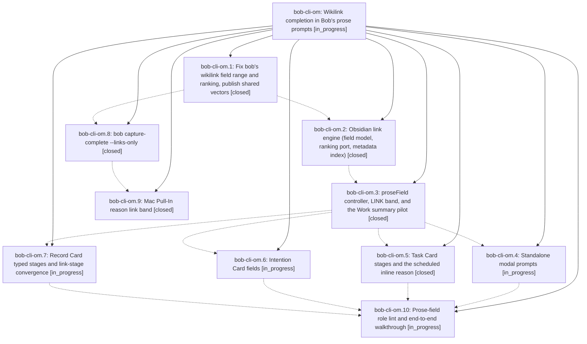

# Bead: bob-cli-om — Wikilink completion in Bob's prose prompts

[Bead Pages](../README.md) / bob-cli-om

**Status:** ◐ in_progress · **Type:** ▸ plan · **Tier:** epic
**Owner:** `bryanbugyi34@gmail.com` · **Created by:** [bbugyi200.apollo.research.5o.linker.w0](https://github.com/bobs-org/bob-cli--agents/blob/main/sessions/bbugyi200.apollo.research.5o.linker.w0.md) · **Assignee:** `bob-cli-om.land`
**Created:** 2026-11-21 10:32:17 EST
**Plan:** [202611/prose\_wikilink\_completion.md](https://github.com/bobs-org/bob-cli--plans/blob/main/202611/prose_wikilink_completion.md)

<!-- sase:links:start -->

## Links

| Relation | Artifact | Why |
| --- | --- | --- |
| implemented-by | [plan:202611/prose_wikilink_completion.md][1] | derived from the plan's `bead_id:` frontmatter field |

_Plus 2 automatic references — see [Referenced By](#referenced-by)._

[1]: https://github.com/bobs-org/bob-cli--plans/blob/main/202611/prose_wikilink_completion.md

<!-- sase:links:end -->

## Description

Typing `[[` in any Bob-owned field that writes Markdown prose into the vault (intentions, Work/Rotten/Cancel/Schedule Log reasons, record text, notebook summaries, the Mac Pull-In reason) opens one consistent LINK band that inserts exactly the link it shows, never submits a half-typed link, never touches text after the caret, and never writes the vault. Identifier and filter fields stay literal.

## Phases

| Bead | Title | Status | Size | Created | Agents | Commits |
|---|---|---|---|---|---:|---:|
| [bob-cli-om.1](bob-cli-om.1.md) | Fix bob's wikilink field range and ranking, publish shared vectors | ✓ closed | medium | 2026-11-21 | 1 | 1 |
| [bob-cli-om.10](bob-cli-om.10.md) | Prose-field role lint and end-to-end walkthrough | ◐ in_progress | small | 2026-11-21 | 1 | 0 |
| [bob-cli-om.2](bob-cli-om.2.md) | Obsidian link engine (field model, ranking port, metadata index) | ✓ closed | medium | 2026-11-21 | 1 | 0 |
| [bob-cli-om.3](bob-cli-om.3.md) | proseField controller, LINK band, and the Work summary pilot | ✓ closed | medium | 2026-11-21 | 1 | 0 |
| [bob-cli-om.4](bob-cli-om.4.md) | Standalone modal prompts | ◐ in_progress | medium | 2026-11-21 | 1 | 0 |
| [bob-cli-om.5](bob-cli-om.5.md) | Task Card stages and the scheduled inline reason | ✓ closed | medium | 2026-11-21 | 1 | 0 |
| [bob-cli-om.6](bob-cli-om.6.md) | Intention Card fields | ◐ in_progress | medium | 2026-11-21 | 1 | 0 |
| [bob-cli-om.7](bob-cli-om.7.md) | Record Card typed stages and link-stage convergence | ◐ in_progress | medium | 2026-11-21 | 1 | 0 |
| [bob-cli-om.8](bob-cli-om.8.md) | bob capture-complete --links-only | ✓ closed | small | 2026-11-21 | 1 | 1 |
| [bob-cli-om.9](bob-cli-om.9.md) | Mac Pull-In reason link band | ✓ closed | medium | 2026-11-21 | 1 | 1 |

## Lineage

## Agents

| Agent | Bead | Commits |
|---|---|---:|
| [bbugyi200.apollo.bob-cli-om.1](https://github.com/bobs-org/bob-cli--agents/blob/main/sessions/bbugyi200.apollo.bob-cli-om.1.md) | [bob-cli-om.1](bob-cli-om.1.md) | 1 |
| [bbugyi200.apollo.bob-cli-om.10](https://github.com/bobs-org/bob-cli--agents/blob/main/agents/bbugyi200.apollo.bob-cli-om.10/README.md) | [bob-cli-om.10](bob-cli-om.10.md) | 0 |
| [bbugyi200.apollo.bob-cli-om.2](https://github.com/bobs-org/bob-cli--agents/blob/main/agents/bbugyi200.apollo.bob-cli-om.2/README.md) | [bob-cli-om.2](bob-cli-om.2.md) | 0 |
| [bbugyi200.apollo.bob-cli-om.3](https://github.com/bobs-org/bob-cli--agents/blob/main/agents/bbugyi200.apollo.bob-cli-om.3/README.md) | [bob-cli-om.3](bob-cli-om.3.md) | 0 |
| [bbugyi200.apollo.bob-cli-om.4](https://github.com/bobs-org/bob-cli--agents/blob/main/agents/bbugyi200.apollo.bob-cli-om.4/README.md) | [bob-cli-om.4](bob-cli-om.4.md) | 0 |
| [bbugyi200.apollo.bob-cli-om.5](https://github.com/bobs-org/bob-cli--agents/blob/main/agents/bbugyi200.apollo.bob-cli-om.5/README.md) | [bob-cli-om.5](bob-cli-om.5.md) | 0 |
| [bbugyi200.apollo.bob-cli-om.6](https://github.com/bobs-org/bob-cli--agents/blob/main/agents/bbugyi200.apollo.bob-cli-om.6/README.md) | [bob-cli-om.6](bob-cli-om.6.md) | 0 |
| [bbugyi200.apollo.bob-cli-om.7](https://github.com/bobs-org/bob-cli--agents/blob/main/agents/bbugyi200.apollo.bob-cli-om.7/README.md) | [bob-cli-om.7](bob-cli-om.7.md) | 0 |
| [bbugyi200.apollo.bob-cli-om.8](https://github.com/bobs-org/bob-cli--agents/blob/main/agents/bbugyi200.apollo.bob-cli-om.8/README.md) | [bob-cli-om.8](bob-cli-om.8.md) | 1 |
| [bbugyi200.apollo.bob-cli-om.9](https://github.com/bobs-org/bob-cli--agents/blob/main/agents/bbugyi200.apollo.bob-cli-om.9/README.md) | [bob-cli-om.9](bob-cli-om.9.md) | 1 |
| [bbugyi200.apollo.bob-cli-om.land](https://github.com/bobs-org/bob-cli--agents/blob/main/agents/bbugyi200.apollo.bob-cli-om.land/README.md) | [bob-cli-om](README.md) | 0 |

## Commits

| Repo | Commit | Subject | Bead | Committed |
|---|---|---|---|---|
| bob-cli | [`746f4d5`](https://github.com/bobs-org/bob-cli/commit/746f4d5a4aa5ada921ca8bce5d454a473ab4d0ed) | fix(capture): preserve wikilink fields and rank candidates | [bob-cli-om.1](bob-cli-om.1.md) | 2026-11-21 11:23:05 EST |
| bob-cli | [`270b5b2`](https://github.com/bobs-org/bob-cli/commit/270b5b23fb38d15663c68efd85f3bde4161d4bd6) | feat(capture-complete): add -L/--links-only and -S/--source-note | [bob-cli-om.8](bob-cli-om.8.md) | 2026-11-21 12:21:19 EST |
| bob-mac-capture | [`bob-mac-capture@f27ce23`](https://github.com/bobs-org/bob-mac-capture/commit/f27ce23005395e159caabfb1e6104ae2864cfb78) | feat(capture): complete pull-in cancel reason links-only wikilink band | [bob-cli-om.9](bob-cli-om.9.md) | 2026-11-21 13:19:37 EST |

<!-- sase:referenced-by:start -->

## Referenced By

| Relation | Artifact | Why | Uses |
| --- | --- | --- | ---: |
| read-by | [agent:bob-cli-om.2][1] | Need epic plan and decisions context | 1 |
| read-by | [agent:bob-cli-om.8][2] | Need epic plan and decisions | 1 |

[1]: https://github.com/bobs-org/bob-cli--agents/blob/main/agents/bbugyi200.apollo.bob-cli-om.2/README.md
[2]: https://github.com/bobs-org/bob-cli--agents/blob/main/agents/bbugyi200.apollo.bob-cli-om.8/README.md

<!-- sase:referenced-by:end -->
