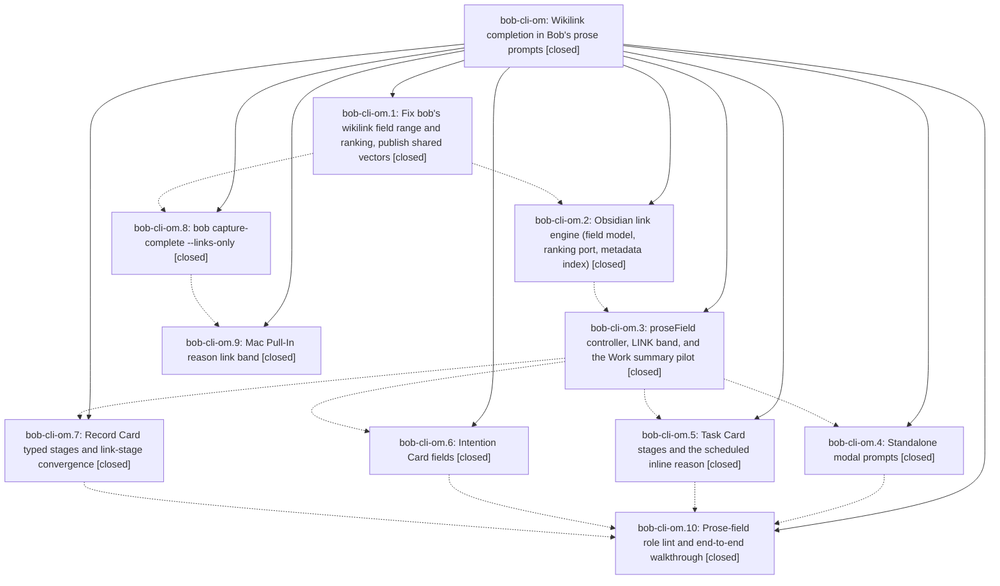

# Bead: bob-cli-om — Wikilink completion in Bob's prose prompts

[Bead Pages](../README.md) / bob-cli-om

**Status:** ✓ closed · **Resolution:** done · **Type:** ▸ plan · **Tier:** epic
**Owner:** `bryanbugyi34@gmail.com` · **Created by:** [bbugyi200.apollo.research.5o.linker.w0](https://github.com/bobs-org/bob-cli--agents/blob/main/sessions/bbugyi200.apollo.research.5o.linker.w0.md) · **Assignee:** `bob-cli-om.land`
**Created:** 2026-11-21 10:32:17 EST · **Closed:** 2026-11-21 17:14:37 EST
**Plan:** [202611/prose\_wikilink\_completion.md](https://github.com/bobs-org/bob-cli--plans/blob/main/202611/prose_wikilink_completion.md)

<!-- sase:links:start -->

## Links

| Relation | Artifact | Why |
| --- | --- | --- |
| implemented-by | [plan:202611/prose_wikilink_completion.md][1] | derived from the plan's `bead_id:` frontmatter field |

_Plus 7 automatic references — see [Referenced By](#referenced-by)._

[1]: https://github.com/bobs-org/bob-cli--plans/blob/main/202611/prose_wikilink_completion.md

<!-- sase:links:end -->

## Description

Typing `[[` in any Bob-owned field that writes Markdown prose into the vault (intentions, Work/Rotten/Cancel/Schedule Log reasons, record text, notebook summaries, the Mac Pull-In reason) opens one consistent LINK band that inserts exactly the link it shows, never submits a half-typed link, never touches text after the caret, and never writes the vault. Identifier and filter fields stay literal.

## Notes

[2026-11-21T19:13:56Z · bob-cli-o6.6.1.5] DISCOVERED ISSUE: this epic's nav doc additions pushed bob-plugins docs/bob-navigation-hotkeys.md past the 6000-word reference cap. On a clean worktree at bob-plugins 24bc9cc, npm run docs:check lint exits 1 with 'docs/reference/plugins/bob-navigation-hotkeys.md:1: budget: over budget at 6302 words (cap 6000 for reference/)'; plugin-apis.md also warns at 8274/8000. wc growth: 983076e 8631 -> 79fe2e1 (om.3) 8918 -> 24bc9cc (om.4) 8973. The landing should trim the page back under the cap (tracked by task bob-cli-ob, now +1'd with this evidence). Reported by bob-cli-o6.6.1.5.

[2026-11-21T21:39:48Z · bob-cli-oo.land] DISCOVERED ISSUE: the om.10 prose-field role lint (bob-plugins scripts/test-prose-field-roles.cjs, from c2e28cad) never sees bob-ledger-tools Category-card text controls, because its creationSite() regex does not match the bankCategoryUiAppend(parent, "input", ...) helper. Undeclared sites on bob-plugins 604c8a9a: 248g-plugin-bank-category-new-stage.js:370 and :404 (new-category stage), 248h-plugin-bank-subscription-linker.js:539 (subscription query) and :593 (stage input). The new bank note input (248n-plugin-bank-note-stage.js) now carries '// bob-text: literal bank row note; ...' from the bob-cli-oo landing, but the lint still cannot enforce it. Fix: add bankCategoryUiAppend to creationSite() and declare those four sites literal (bank fields never complete per the plan's 'Never completes' list). Found by bob-cli-oo.land.

[2026-11-21T21:39:55Z · bob-cli-oo.land] DISCOVERED ISSUE: om.3's R9 perf gate '10k-note first link-index build is ≤ 40 ms CPU' (scripts/test-navigation-prose-field-performance.cjs) failed in a full bob-plugins npm test at load average 134.8 (815.6 ms) on 604c8a9a + bob-cli-oo landing edits (no bob-navigation-hotkeys changes); an isolated node --test rerun passes (both R9 tests green). The CPU-time budget still flakes under host load, like the ledger-tools 25 ms gates (bob-cli-km/io). Found by bob-cli-oo.land.

[2026-11-21T22:14:37Z · bob-cli-om.land] LANDED by bob-cli-om.land.

VERIFIED (step 1): all 10 phases are closed, and I read every phase and epic note. I read the epic's commits:
- bob-cli: 746f4d5a (om.1), 270b5b23 (om.8).
- bob-plugins: 92f643de, 79fe2e15, cdd9df70, 24bc9cc6, da0737b1, e6d7aed7, c2e28cad, fc806cfe.
- bob-mac-capture: f27ce230.

Decisions honored. link_text=path: accepted rows insert bob's insert_target path, as the vectors require. decision_record=no: no decisions strand was added and no memory was edited.

Checks:
- `capture-complete -c 9 'Read [[da because of the outage'` returns replacement {7,9}.
- `[[sa▏#Overview|our plan]]` (caret at ▏) replaces only the target; the authored subpath and alias stay.
- tests/fixtures/wikilink_complete/vectors.json is byte-identical in bob-cli and bob-plugins (sha 4feff46c).
- The vault has nav 2.101.0, block-id-prompt 1.40.0, bob-mail 0.3.0, and ledger-tools 1.157.0, all synced. This resolves the om.3 #1, om.4 #1, and om.6 #1 deploy follow-ups.
- Plan's recall-history check: the USED BEFORE catalog is re-derived by bob from vault log text, which Obsidian's rename rewrites. The noteUsed overlay is session-only and revalidates after 1 s. Renames therefore behave sensibly, and no task is needed.
- The real-Obsidian walkthrough (om.10 #5, 53/53) covers the om.10 #1 gap.

LANDING FIXES (epic work):
(a) Mac CI. Run 44934909998 on f27ce230 failed only the known flake CaptureDotRouteAliasTests fast-double-dot (bob-cli-ko). I reran it on the same SHA and every step is green (om.9 #2).
(b) Docs budget. This epic grew bob-plugins docs/bob-navigation-hotkeys.md from 5960 to 6307 lint words, past the 6000 reference cap. I condensed the epic's Wikilink section and linked the relation-label stage's duplicated cancel/complete text to task-card.md#links-stage-and-closing-labels. The page is now 5983 words, the anchors are kept, and bob-docs lint exits 0 (epic note #1, om.7 #4).
(c) Role lint. scripts/test-prose-field-roles.cjs only recognized four named helpers, so 11 creation sites built through other DOM helpers had no role: bank setup, category, and subscription inputs, stats date and radio inputs, the bank queue checkbox, and the copy-chip author fields. The scanner now matches any *Append, *El, or *Element helper with an input or textarea tag. Those sites carry literal or none markers. Mutation check: the lint fails without the markers. I rebuilt ledger-tools and bob-chips and synced them.

EPIC NOTES:
- #1 (nav docs budget) is fixed by (b).
- #2 (oo.land: the role lint cannot see bankCategoryUiAppend sites) is fixed by (c), which covers all four sites it named plus seven more.
- #3 (oo.land: the om.3 R9 "first link-index build <= 40 ms CPU" gate failed at 815.6 ms under load 134.8) is epic work. scripts/test-navigation-prose-field-performance.cjs used best-of-5 from a cold JIT, and cold builds cost 34-51 ms CPU even on a quiet 16-CPU apollo. It now runs 3 untimed warm-up builds and takes the best of 9 via cpu-work-perf-support.cjs, with a diagnostic that reports load and every sample. Quiet-host best is about 28 ms against the old 34-36 ms, under the unchanged 40 ms budget. test:perf passes 13/13. Extreme oversubscription can still inflate every sample, the same residual risk as the bob-cli-io and bob-cli-km gates.
- Correction: while fixing this note's text I overwrote #2 by mistake, then restored oo.land's original text from bead history.

INTEGRATED (step 2):
- bob-cli: no later commit touches the epic's code. e90c0165 changed only the catalog thread count.
- bob-plugins: bob-cli-oo's bank row-note input is literal (ae305a32). The bank cleaner folds [[links]] to plain text, and the plan keeps bank fields literal. I rebased onto 24ed1719 and rebuilt generated main.js rather than merging it.
- bob-mac-capture: no later commits.

TESTS:
- npm test: 8415/8422 pass. The 2 failures are the known 25 ms load flakes, which pass 40/40 alone at load average 130. test:perf 13/13.
- npm run validate 12/12. docs:inventory current. Post-rebase targeted suites 337/337.
- just docs-check: every gate through search, tutorial, and media passes. Its unit tests fail only on test_contracts (55 vs 54 contracts after a0961435), which is tracked on active epic bob-cli-on and is not this epic's.

FOLLOW-UPS:
- om.4 #2 (q on a button does not close S12/S13): +1 on bob-cli-mt, the same q-parity remediation.
- Perf flakes (om.4 #3, om.5 #1, om.6 #3, om.7 #3, om.10 #4): +1 on bob-cli-io and bob-cli-km.
- Mac flake: +1 on bob-cli-ko.
- Docs budget (om.1 #1, om.3 #2, om.8 #1, om.9 #1, om.10 #1): the nav page is fixed here, vault-format by cb9f8fad, and ledger-tools by ae305a32. plugin-apis still warns at 8308/8000: +1 on bob-cli-ob.
- om.6 #2: new bob-cli-ow (small). A removal blur closes the LINK band, and rebind drops the hint. I judged this hardening, not an open defect: no shipped host can hit it (S14 guards the blur, S15 keeps its input, S6 commits on blur, S10 reattaches).
- om.10 #2: new bob-cli-ox (small). The shared e2e trust step leaves the Settings window active. Linked as related to bob-cli-nq, nr, and np.
- om.10 #3: new bob-cli-oy (medium). Task Card theme and relation stages may close on trusted Esc. Linked as related to bob-cli-mt.
- om.2 #1 declined: the LINK band keeps LINK_RESULT_LIMIT=20 rather than the plan's 50. That equals bob's RESULT_LIMIT, so Obsidian and the Mac show the same ranked top-N, and the band window follows the selection.

There are no epic symbols, no symvision recipe, and no parent bead.

## Phases

| Bead | Title | Status | Size | Created | Agents | Commits |
|---|---|---|---|---|---:|---:|
| [bob-cli-om.1](bob-cli-om.1.md) | Fix bob's wikilink field range and ranking, publish shared vectors | ✓ closed | medium | 2026-11-21 | 1 | 1 |
| [bob-cli-om.10](bob-cli-om.10.md) | Prose-field role lint and end-to-end walkthrough | ✓ closed | small | 2026-11-21 | 1 | 2 |
| [bob-cli-om.2](bob-cli-om.2.md) | Obsidian link engine (field model, ranking port, metadata index) | ✓ closed | medium | 2026-11-21 | 1 | 1 |
| [bob-cli-om.3](bob-cli-om.3.md) | proseField controller, LINK band, and the Work summary pilot | ✓ closed | medium | 2026-11-21 | 1 | 1 |
| [bob-cli-om.4](bob-cli-om.4.md) | Standalone modal prompts | ✓ closed | medium | 2026-11-21 | 1 | 1 |
| [bob-cli-om.5](bob-cli-om.5.md) | Task Card stages and the scheduled inline reason | ✓ closed | medium | 2026-11-21 | 1 | 1 |
| [bob-cli-om.6](bob-cli-om.6.md) | Intention Card fields | ✓ closed | medium | 2026-11-21 | 1 | 1 |
| [bob-cli-om.7](bob-cli-om.7.md) | Record Card typed stages and link-stage convergence | ✓ closed | medium | 2026-11-21 | 1 | 1 |
| [bob-cli-om.8](bob-cli-om.8.md) | bob capture-complete --links-only | ✓ closed | small | 2026-11-21 | 1 | 1 |
| [bob-cli-om.9](bob-cli-om.9.md) | Mac Pull-In reason link band | ✓ closed | medium | 2026-11-21 | 1 | 1 |

## Lineage

## Agents

| Agent | Bead | Commits |
|---|---|---:|
| [bbugyi200.apollo.bob-cli-om.1](https://github.com/bobs-org/bob-cli--agents/blob/main/sessions/bbugyi200.apollo.bob-cli-om.1.md) | [bob-cli-om.1](bob-cli-om.1.md) | 1 |
| [bbugyi200.apollo.bob-cli-om.10](https://github.com/bobs-org/bob-cli--agents/blob/main/agents/bbugyi200.apollo.bob-cli-om.10/README.md) | [bob-cli-om.10](bob-cli-om.10.md) | 2 |
| [bbugyi200.apollo.bob-cli-om.2](https://github.com/bobs-org/bob-cli--agents/blob/main/agents/bbugyi200.apollo.bob-cli-om.2/README.md) | [bob-cli-om.2](bob-cli-om.2.md) | 1 |
| [bbugyi200.apollo.bob-cli-om.3](https://github.com/bobs-org/bob-cli--agents/blob/main/agents/bbugyi200.apollo.bob-cli-om.3/README.md) | [bob-cli-om.3](bob-cli-om.3.md) | 1 |
| [bbugyi200.apollo.bob-cli-om.4](https://github.com/bobs-org/bob-cli--agents/blob/main/agents/bbugyi200.apollo.bob-cli-om.4/README.md) | [bob-cli-om.4](bob-cli-om.4.md) | 1 |
| [bbugyi200.apollo.bob-cli-om.5](https://github.com/bobs-org/bob-cli--agents/blob/main/agents/bbugyi200.apollo.bob-cli-om.5/README.md) | [bob-cli-om.5](bob-cli-om.5.md) | 1 |
| [bbugyi200.apollo.bob-cli-om.6](https://github.com/bobs-org/bob-cli--agents/blob/main/agents/bbugyi200.apollo.bob-cli-om.6/README.md) | [bob-cli-om.6](bob-cli-om.6.md) | 1 |
| [bbugyi200.apollo.bob-cli-om.7](https://github.com/bobs-org/bob-cli--agents/blob/main/agents/bbugyi200.apollo.bob-cli-om.7/README.md) | [bob-cli-om.7](bob-cli-om.7.md) | 1 |
| [bbugyi200.apollo.bob-cli-om.8](https://github.com/bobs-org/bob-cli--agents/blob/main/agents/bbugyi200.apollo.bob-cli-om.8/README.md) | [bob-cli-om.8](bob-cli-om.8.md) | 1 |
| [bbugyi200.apollo.bob-cli-om.9](https://github.com/bobs-org/bob-cli--agents/blob/main/agents/bbugyi200.apollo.bob-cli-om.9/README.md) | [bob-cli-om.9](bob-cli-om.9.md) | 1 |
| [bbugyi200.apollo.bob-cli-om.land](https://github.com/bobs-org/bob-cli--agents/blob/main/agents/bbugyi200.apollo.bob-cli-om.land/README.md) | [bob-cli-om](README.md) | 1 |

## Commits

| Repo | Commit | Subject | Bead | Committed |
|---|---|---|---|---|
| bob-cli | [`746f4d5`](https://github.com/bobs-org/bob-cli/commit/746f4d5a4aa5ada921ca8bce5d454a473ab4d0ed) | fix(capture): preserve wikilink fields and rank candidates | [bob-cli-om.1](bob-cli-om.1.md) | 2026-11-21 11:23:05 EST |
| bob-plugins | [`bob-plugins@92f643d`](https://github.com/bobs-org/bob-plugins/commit/92f643dea982b557cd08200f532fd4e82749a2ad) | feat(nav): add prose wikilink link engine (field model, ranking, metadata index) | [bob-cli-om.2](bob-cli-om.2.md) | 2026-11-21 11:38:13 EST |
| bob-cli | [`270b5b2`](https://github.com/bobs-org/bob-cli/commit/270b5b23fb38d15663c68efd85f3bde4161d4bd6) | feat(capture-complete): add -L/--links-only and -S/--source-note | [bob-cli-om.8](bob-cli-om.8.md) | 2026-11-21 12:21:19 EST |
| bob-plugins | [`bob-plugins@79fe2e1`](https://github.com/bobs-org/bob-plugins/commit/79fe2e15e25956aa913944d97cb8605f5ad65ad6) | feat(nav): add proseField LINK band and Work summary \[\[ pilot | [bob-cli-om.3](bob-cli-om.3.md) | 2026-11-21 12:31:56 EST |
| bob-mac-capture | [`bob-mac-capture@f27ce23`](https://github.com/bobs-org/bob-mac-capture/commit/f27ce23005395e159caabfb1e6104ae2864cfb78) | feat(capture): complete pull-in cancel reason links-only wikilink band | [bob-cli-om.9](bob-cli-om.9.md) | 2026-11-21 13:19:37 EST |
| bob-plugins | [`bob-plugins@cdd9df7`](https://github.com/bobs-org/bob-plugins/commit/cdd9df707ad1f2b1d1a1ff23a6c5ee2f920067fb) | feat(nav): complete \[\[ links in Task Card reason stages and the scheduled inline reason | [bob-cli-om.5](bob-cli-om.5.md) | 2026-11-21 13:44:18 EST |
| bob-plugins | [`bob-plugins@24bc9cc`](https://github.com/bobs-org/bob-plugins/commit/24bc9cc6f87df9366afe17d121503cdb5a47408d) | feat(nav): wire \[\[ completion into the standalone modal prompts | [bob-cli-om.4](bob-cli-om.4.md) | 2026-11-21 14:03:19 EST |
| bob-plugins | [`bob-plugins@da0737b`](https://github.com/bobs-org/bob-plugins/commit/da0737b159bb9465fbb3836c8e7720f4510c1455) | feat(ledger-tools): complete \[\[ wikilinks in the Intention Card fields | [bob-cli-om.6](bob-cli-om.6.md) | 2026-11-21 14:23:32 EST |
| bob-plugins | [`bob-plugins@e6d7aed`](https://github.com/bobs-org/bob-plugins/commit/e6d7aed7fdc21825d56a785618e730e56af86a0b) | feat(ledger-tools): complete \[\[ links in the Record Card typed stages | [bob-cli-om.7](bob-cli-om.7.md) | 2026-11-21 14:36:58 EST |
| bob-plugins | [`bob-plugins@c2e28ca`](https://github.com/bobs-org/bob-plugins/commit/c2e28cad167df64c11f373c8c98be5d3fb79ef74) | feat(bob-plugins): lint prose field roles and add walkthrough | [bob-cli-om.10](bob-cli-om.10.md) | 2026-11-21 15:03:32 EST |
| bob-plugins | [`bob-plugins@fc806cf`](https://github.com/bobs-org/bob-plugins/commit/fc806cfeb6d92a28ee46c802a25df16cda485804) | fix(nav): back the LINK band out before Obsidian's Escape close and walk real prose hosts | [bob-cli-om.10](bob-cli-om.10.md) | 2026-11-21 16:24:56 EST |
| bob-plugins | [`bob-plugins@f703f1c`](https://github.com/bobs-org/bob-plugins/commit/f703f1cf01b9a5ac019f6ed32e95c11efba41dcc) | fix(bob-plugins): land prose wikilink completion with full role lint coverage, trimmed nav docs, and a steadier R9 gate | [bob-cli-om](README.md) | 2026-11-21 17:20:58 EST |

<!-- sase:referenced-by:start -->

## Referenced By

| Relation | Artifact | Why | Uses |
| --- | --- | --- | ---: |
| read-by | [agent:bob-cli-o6.6.1.5][1] | Check epic notes for an existing DISCOVERED ISSUE about the nav docs budget | 2 |
| read-by | [agent:bob-cli-o6.6.1.land][2] | Check active epic notes for already-recorded docs gate issues before routing landing follow-ups | 1 |
| read-by | [agent:bob-cli-om.2][3] | Need epic plan and decisions context | 1 |
| read-by | [agent:bob-cli-om.6][4] | Check sibling phase states and epic notes | 1 |
| read-by | [agent:bob-cli-om.7][5] | see sibling phase status and notes | 1 |
| read-by | [agent:bob-cli-om.8][6] | Need epic plan and decisions | 1 |
| read-by | [agent:bob-cli-oo.land][7] | Check whether the prose-field lint epic is still open and covers bank card inputs | 2 |

[1]: https://github.com/bobs-org/bob-cli--agents/blob/main/agents/bbugyi200.apollo.bob-cli-o6.6.1.5/README.md
[2]: https://github.com/bobs-org/bob-cli--agents/blob/main/agents/bbugyi200.apollo.bob-cli-o6.6.1.land/README.md
[3]: https://github.com/bobs-org/bob-cli--agents/blob/main/agents/bbugyi200.apollo.bob-cli-om.2/README.md
[4]: https://github.com/bobs-org/bob-cli--agents/blob/main/agents/bbugyi200.apollo.bob-cli-om.6/README.md
[5]: https://github.com/bobs-org/bob-cli--agents/blob/main/agents/bbugyi200.apollo.bob-cli-om.7/README.md
[6]: https://github.com/bobs-org/bob-cli--agents/blob/main/agents/bbugyi200.apollo.bob-cli-om.8/README.md
[7]: https://github.com/bobs-org/bob-cli--agents/blob/main/agents/bbugyi200.apollo.bob-cli-oo.land/README.md

<!-- sase:referenced-by:end -->
