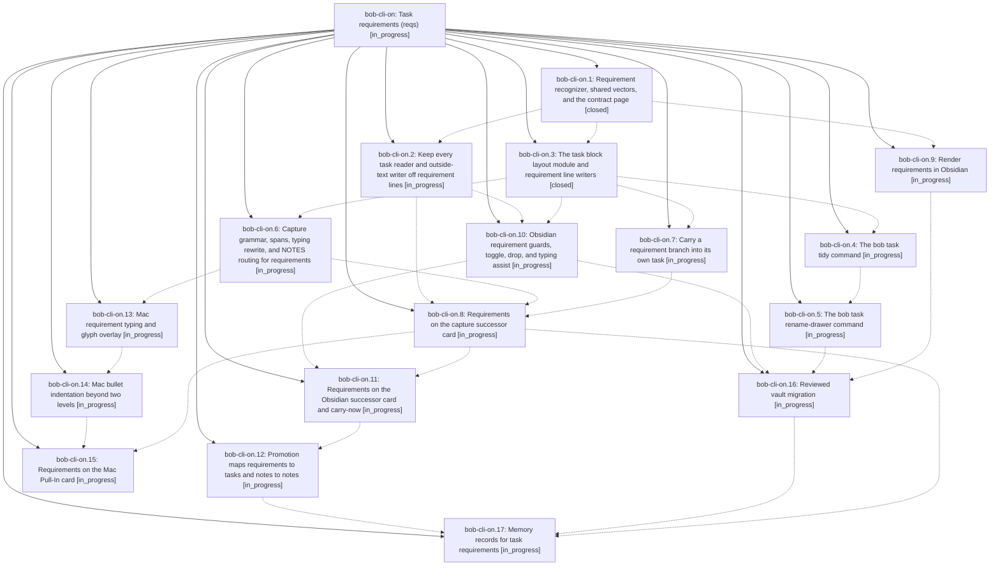

# Bead: bob-cli-on — Task requirements (reqs)

[Bead Pages](../README.md) / bob-cli-on

**Status:** ◐ in_progress · **Type:** ▸ plan · **Tier:** epic
**Owner:** `bryanbugyi34@gmail.com` · **Created by:** [bbugyi200.athena.1ex](https://github.com/bobs-org/bob-cli--agents/blob/main/sessions/bbugyi200.athena.1ex.md) · **Assignee:** `bob-cli-on.land`
**Created:** 2026-11-21 11:13:26 EST
**Plan:** [202611/task\_requirements.md](https://github.com/bobs-org/bob-cli--plans/blob/main/202611/task_requirements.md)

<!-- sase:links:start -->

## Links

| Relation | Artifact | Why |
| --- | --- | --- |
| implemented-by | [plan:202611/task_requirements.md][1] | derived from the plan's `bead_id:` frontmatter field |

[1]: https://github.com/bobs-org/bob-cli--plans/blob/main/202611/task_requirements.md

<!-- sase:links:end -->

## Description

A task can carry requirements: checkbox children without `#task`, nested as deep as the work needs, drawn as a quiet ⌗⌗ run in the task's ink. They are met when the task closes and can never be ticked early. They can be dropped with a reason or carried into their own task, and the close card audits them once. They sit in one canonical block order beside a NOTES drawer, and they promote one level at a time into project tasks. bob-cli, bob-plugins, Bob Mac Capture, and the vault agree byte for byte through shared vectors, and every legacy REQUIREMENTS drawer becomes NOTES.

## Phases

| Bead | Title | Status | Size | Created | Agents | Commits |
|---|---|---|---|---|---:|---:|
| [bob-cli-on.1](bob-cli-on.1.md) | Requirement recognizer, shared vectors, and the contract page | ✓ closed | medium | 2026-11-21 | 1 | 1 |
| [bob-cli-on.10](bob-cli-on.10.md) | Obsidian requirement guards, toggle, drop, and typing assist | ◐ in_progress | large | 2026-11-21 | 1 | 0 |
| [bob-cli-on.11](bob-cli-on.11.md) | Requirements on the Obsidian successor card and carry-now | ◐ in_progress | large | 2026-11-21 | 1 | 0 |
| [bob-cli-on.12](bob-cli-on.12.md) | Promotion maps requirements to tasks and notes to notes | ◐ in_progress | medium | 2026-11-21 | 1 | 0 |
| [bob-cli-on.13](bob-cli-on.13.md) | Mac requirement typing and glyph overlay | ◐ in_progress | medium | 2026-11-21 | 1 | 0 |
| [bob-cli-on.14](bob-cli-on.14.md) | Mac bullet indentation beyond two levels | ◐ in_progress | medium | 2026-11-21 | 1 | 0 |
| [bob-cli-on.15](bob-cli-on.15.md) | Requirements on the Mac Pull-In card | ◐ in_progress | large | 2026-11-21 | 1 | 0 |
| [bob-cli-on.16](bob-cli-on.16.md) | Reviewed vault migration | ◐ in_progress | small | 2026-11-21 | 1 | 0 |
| [bob-cli-on.17](bob-cli-on.17.md) | Memory records for task requirements | ◐ in_progress | small | 2026-11-21 | 1 | 0 |
| [bob-cli-on.2](bob-cli-on.2.md) | Keep every task reader and outside-text writer off requirement lines | ◐ in_progress | medium | 2026-11-21 | 1 | 1 |
| [bob-cli-on.3](bob-cli-on.3.md) | The task block layout module and requirement line writers | ✓ closed | medium | 2026-11-21 | 1 | 1 |
| [bob-cli-on.4](bob-cli-on.4.md) | The bob task tidy command | ◐ in_progress | medium | 2026-11-21 | 1 | 0 |
| [bob-cli-on.5](bob-cli-on.5.md) | The bob task rename-drawer command | ◐ in_progress | medium | 2026-11-21 | 1 | 0 |
| [bob-cli-on.6](bob-cli-on.6.md) | Capture grammar, spans, typing rewrite, and NOTES routing for requirements | ◐ in_progress | large | 2026-11-21 | 1 | 0 |
| [bob-cli-on.7](bob-cli-on.7.md) | Carry a requirement branch into its own task | ◐ in_progress | medium | 2026-11-21 | 1 | 0 |
| [bob-cli-on.8](bob-cli-on.8.md) | Requirements on the capture successor card | ◐ in_progress | large | 2026-11-21 | 1 | 0 |
| [bob-cli-on.9](bob-cli-on.9.md) | Render requirements in Obsidian | ◐ in_progress | medium | 2026-11-21 | 1 | 1 |

## Lineage

## Agents

| Agent | Bead | Commits |
|---|---|---:|
| [bbugyi200.athena.bob-cli-on.1](https://github.com/bobs-org/bob-cli--agents/blob/main/agents/bbugyi200.athena.bob-cli-on.1/README.md) | [bob-cli-on.1](bob-cli-on.1.md) | 1 |
| [bbugyi200.athena.bob-cli-on.10](https://github.com/bobs-org/bob-cli--agents/blob/main/agents/bbugyi200.athena.bob-cli-on.10/README.md) | [bob-cli-on.10](bob-cli-on.10.md) | 0 |
| [bbugyi200.athena.bob-cli-on.11](https://github.com/bobs-org/bob-cli--agents/blob/main/agents/bbugyi200.athena.bob-cli-on.11/README.md) | [bob-cli-on.11](bob-cli-on.11.md) | 0 |
| [bbugyi200.athena.bob-cli-on.12](https://github.com/bobs-org/bob-cli--agents/blob/main/agents/bbugyi200.athena.bob-cli-on.12/README.md) | [bob-cli-on.12](bob-cli-on.12.md) | 0 |
| [bbugyi200.athena.bob-cli-on.13](https://github.com/bobs-org/bob-cli--agents/blob/main/agents/bbugyi200.athena.bob-cli-on.13/README.md) | [bob-cli-on.13](bob-cli-on.13.md) | 0 |
| [bbugyi200.athena.bob-cli-on.14](https://github.com/bobs-org/bob-cli--agents/blob/main/agents/bbugyi200.athena.bob-cli-on.14/README.md) | [bob-cli-on.14](bob-cli-on.14.md) | 0 |
| [bbugyi200.athena.bob-cli-on.15](https://github.com/bobs-org/bob-cli--agents/blob/main/agents/bbugyi200.athena.bob-cli-on.15/README.md) | [bob-cli-on.15](bob-cli-on.15.md) | 0 |
| [bbugyi200.athena.bob-cli-on.16](https://github.com/bobs-org/bob-cli--agents/blob/main/agents/bbugyi200.athena.bob-cli-on.16/README.md) | [bob-cli-on.16](bob-cli-on.16.md) | 0 |
| [bbugyi200.athena.bob-cli-on.17](https://github.com/bobs-org/bob-cli--agents/blob/main/agents/bbugyi200.athena.bob-cli-on.17/README.md) | [bob-cli-on.17](bob-cli-on.17.md) | 0 |
| [bbugyi200.athena.bob-cli-on.2](https://github.com/bobs-org/bob-cli--agents/blob/main/sessions/bbugyi200.athena.bob-cli-on.2.md) | [bob-cli-on.2](bob-cli-on.2.md) | 1 |
| [bbugyi200.athena.bob-cli-on.3](https://github.com/bobs-org/bob-cli--agents/blob/main/agents/bbugyi200.athena.bob-cli-on.3/README.md) | [bob-cli-on.3](bob-cli-on.3.md) | 1 |
| [bbugyi200.athena.bob-cli-on.4](https://github.com/bobs-org/bob-cli--agents/blob/main/agents/bbugyi200.athena.bob-cli-on.4/README.md) | [bob-cli-on.4](bob-cli-on.4.md) | 0 |
| [bbugyi200.athena.bob-cli-on.5](https://github.com/bobs-org/bob-cli--agents/blob/main/agents/bbugyi200.athena.bob-cli-on.5/README.md) | [bob-cli-on.5](bob-cli-on.5.md) | 0 |
| [bbugyi200.athena.bob-cli-on.6](https://github.com/bobs-org/bob-cli--agents/blob/main/sessions/bbugyi200.athena.bob-cli-on.6.md) | [bob-cli-on.6](bob-cli-on.6.md) | 0 |
| [bbugyi200.athena.bob-cli-on.7](https://github.com/bobs-org/bob-cli--agents/blob/main/agents/bbugyi200.athena.bob-cli-on.7/README.md) | [bob-cli-on.7](bob-cli-on.7.md) | 0 |
| [bbugyi200.athena.bob-cli-on.8](https://github.com/bobs-org/bob-cli--agents/blob/main/agents/bbugyi200.athena.bob-cli-on.8/README.md) | [bob-cli-on.8](bob-cli-on.8.md) | 0 |
| [bbugyi200.athena.bob-cli-on.9](https://github.com/bobs-org/bob-cli--agents/blob/main/sessions/bbugyi200.athena.bob-cli-on.9.md) | [bob-cli-on.9](bob-cli-on.9.md) | 1 |
| [bbugyi200.athena.bob-cli-on.land](https://github.com/bobs-org/bob-cli--agents/blob/main/agents/bbugyi200.athena.bob-cli-on.land/README.md) | [bob-cli-on](README.md) | 0 |

## Commits

| Repo | Commit | Subject | Bead | Committed |
|---|---|---|---|---|
| bob-cli | [`a096143`](https://github.com/bobs-org/bob-cli/commit/a0961435506e4810841527ecd0b81505cb6d0632) | feat(task-reqs): add req forest recognizer contract | [bob-cli-on.1](bob-cli-on.1.md) | 2026-11-21 12:16:31 EST |
| bob-cli | [`ca07094`](https://github.com/bobs-org/bob-cli/commit/ca070941c05b42840a40d87f0e4f6a6e0aab6090) | feat(task-reqs): add task block layout and req line writers | [bob-cli-on.3](bob-cli-on.3.md) | 2026-11-21 13:32:20 EST |
| bob-cli | [`250c305`](https://github.com/bobs-org/bob-cli/commit/250c3053d652d1d6b48299557fc8272a809bab88) | docs(tasks): document requirement marks | [bob-cli-on.9](bob-cli-on.9.md) | 2026-11-21 13:37:40 EST |
| bob-cli | [`532df82`](https://github.com/bobs-org/bob-cli/commit/532df8259187f65b6f66864669eb80b133fcb35e) | feat(task-reqs): keep readers and writers off requirement lines | [bob-cli-on.2](bob-cli-on.2.md) | 2026-11-21 13:50:46 EST |
