# Bead: bob-cli-on — Task requirements (reqs)

[Bead Pages](../README.md) / bob-cli-on

**Status:** ◐ in_progress · **Type:** ▸ plan · **Tier:** epic
**Owner:** `bryanbugyi34@gmail.com` · **Created by:** [bbugyi200.athena.1ex](https://github.com/bobs-org/bob-cli--agents/blob/main/sessions/bbugyi200.athena.1ex.md) · **Assignee:** `bob-cli-on.land`
**Created:** 2026-11-21 11:13:26 EST
**Plan:** [202611/task\_requirements.md](https://github.com/bobs-org/bob-cli--plans/blob/main/202611/task_requirements.md)

<!-- sase:links:start -->

## Links

| Relation | Artifact | Why |
| --- | --- | --- |
| implemented-by | [plan:202611/task_requirements.md][1] | derived from the plan's `bead_id:` frontmatter field |

_Plus 6 automatic references — see [Referenced By](#referenced-by)._

[1]: https://github.com/bobs-org/bob-cli--plans/blob/main/202611/task_requirements.md

<!-- sase:links:end -->

## Description

A task can carry requirements: checkbox children without `#task`, nested as deep as the work needs, drawn as a quiet ⌗⌗ run in the task's ink. They are met when the task closes and can never be ticked early. They can be dropped with a reason or carried into their own task, and the close card audits them once. They sit in one canonical block order beside a NOTES drawer, and they promote one level at a time into project tasks. bob-cli, bob-plugins, Bob Mac Capture, and the vault agree byte for byte through shared vectors, and every legacy REQUIREMENTS drawer becomes NOTES.

## Notes

[2026-11-21T19:54:07Z · bob-cli-o6.6.1.land] DISCOVERED ISSUE: bob-cli a0961435 (bob-cli-on.1, req-contract) registered docs/task-requirements.md as a contract without updating the bob-docs contract tests, so tools/docs/tests/test_contracts.py fails 3/8 on master dfe20ca3: test_current_registry_and_generated_nav_are_complete_and_unique (registry has 55 entries, test expects 54), test_llmstxt_contracts_section_lists_exactly_registry_stems (index 46 'task-split.md' != 'task-requirements.md'), and test_readme_table_matches_original_contract_index_snapshot (README table sha f23b0e44... != pinned 34f4f8a4...). Repro: uv run --project tools/docs pytest -q tools/docs/tests/test_contracts.py. It is masked today only because just docs-check stops earlier at the reference word-budget lint. Proposed by bob-cli-o6.6.1.5 note #2 (also reproduced on clean base 250c3053 with that phase's docs stashed; evidence file:explicit:282423e57c9f033d6cf61ecc, bobcli-docs-postlint.log); re-verified on dfe20ca3 by the bob-cli-o6.6.1 land agent. Fix belongs with this epic: bump the expected count, the llms.txt list, and the README snapshot, following the precedent of bob-cli-hs.

[2026-11-22T02:50:55Z · bob-cli-on.6.1.land] DISCOVERED ISSUE (from bob-cli-on.6.1.4 PROPOSED FOLLOW-UP #1, reproduced and widened by the bob-cli-on.6.1 land agent on master 3ce97d73): NOTES routing for a req-owning ^prj task writes into an H2 '## NOTES' section with task-style tab indentation and duplicates the heading. Repro in a scratch vault: pk.md = frontmatter type [[project]] + '- [ ] #task #prj Pk root ^prj' / '\t- [ ] hand req' / '## Tasks' / '- [ ] #task Row a'. 'bob capture -- $'@pk+prj\n- first note'' appends '## NOTES\n\t- first note' at end of file (a tab-indented bullet straight under an H2 reads as an indented code block); a second note capture yields '## NOTES\n\t- first note\n\n\t- second note\n## NOTES\n' (an extra empty '## NOTES' per capture). The first-req scoop has the same shape: '@pm+prj\n- [ ] only req' on a ^prj with a loose note writes '## NOTES\n\t- loose'. Root cause predates bob-cli-on.6.1: note_home / ensure_notes_drawer / scoop_loose_notes (ca070941, bob-cli-on.3 block-layout) treat project_h2_drawers H2 sections as task drawers but write tab-indented children and mis-detect the section end. bob-cli-on.6.1 only made it reachable from requirement capture to ^prj targets (the plan said to record a follow-up rather than change task_block_layout there). Needs a decided ^prj notes home ('## Notes' H2 with column-zero bullets, matching the promotion/migration sections of plan:202611/task_requirements.md) in task_block_layout and its JS twin + RL vectors, then capture, toggle, and tidy follow it.

[2026-11-22T02:51:05Z · bob-cli-on.6.1.land] DISCOVERED ISSUE (from bob-cli-on.6.1.2 PROPOSED FOLLOW-UP #1, re-verified by the bob-cli-on.6.1 land agent): capture grammar 29 (7cc94933) lets sub_bullet_depths exceed 2 beneath requirements, but the bob-mac-capture-owned mounted docs still say otherwise: docs/capture-previews.md:165 reads 'sub_bullet_depths (1 or 2)' and docs/protocol.md:382 describes depth handling for 'sub_bullet_depths' without the deeper levels. These files live in bob-mac-capture (gitignored mount in bob-cli), so the edit belongs with the Mac phases: bob-cli-on.14 (mac-nesting, which generalizes the Mac to any authored depth) should update that wording, and bob-cli-on.13 (mac-authoring) already owns docs/protocol.md for req_marker depth. bob-cli's own docs (capture.md, json-outputs.md, capture-syntax.md) already state depths may exceed 2.

[2026-11-22T03:18:27Z · bob-cli-on.10.1.land] DISCOVERED ISSUE (corroboration from the bob-cli-on.10.1 land agent): (a) note #1's docs contract tests still fail 3/8 on master e5ee4a8d — reproduced with 'uv run --project tools/docs python -m pytest tools/docs/tests/test_contracts.py -q' (registry 55 vs pinned 54, llms.txt list, README table sha f23b0e44…); also reported by bob-cli-on.10.1.3 note #1 and bob-cli-on.10.1.5 note #1. (b) note #2's ^prj NOTES home was found independently by bob-cli-on.10.1.1 (note #1) while porting the RL twin, which mirrors it on purpose: for a ^prj task file_into_notes -> ensure_notes_drawer -> capture_drawers::ensure_drawer takes the is_prj_parent path, appends '## NOTES' at EOF, and because drawers() lists only bullet drawers an existing '## NOTES' H2 is never found, so each write appends another empty heading. bob task tidy refuses such plans through content_preserved, but the RW writers (toggle note->req first-req scoop, insert_reqs) have no such guard, and no RL/RW vector covers ^prj. Whatever home bob-cli decides needs new RL/RW vectors re-copied into the cycler and nav twins (plugins/task-status-cycler/src/196-197, nav 696-697, byte-identical; scripts/test-task-reqs-twin-copies.cjs enforces it).

[2026-11-22T09:05:24Z · bob-cli-os.land] DISCOVERED ISSUE (corroboration from the bob-cli-os land agent): the 3 tools/docs/tests/test_contracts.py failures recorded in this epic's notes still reproduce on master 2f4fef6d (test_current_registry_and_generated_nav_are_complete_and_unique, test_llmstxt_contracts_section_lists_exactly_registry_stems, test_readme_table_matches_original_contract_index_snapshot; 3 failed, 5 passed via tools/docs/.venv/bin/python -m pytest tools/docs/tests/test_contracts.py). bob-cli-os.5 (note #1), bob-cli-os.9 (note #1), and bob-cli-os.10 (note #3) also hit them during unrelated podcast work.

## Phases

| Bead | Title | Status | Size | Created | Agents | Commits |
|---|---|---|---|---|---:|---:|
| [bob-cli-on.1](bob-cli-on.1.md) | Requirement recognizer, shared vectors, and the contract page | ✓ closed | medium | 2026-11-21 | 1 | 1 |
| [bob-cli-on.10](bob-cli-on.10.md) | Obsidian requirement guards, toggle, drop, and typing assist | ✓ closed | large | 2026-11-21 | 1 | 0 |
| [bob-cli-on.11](bob-cli-on.11.md) | Requirements on the Obsidian successor card and carry-now | ◐ in_progress | large | 2026-11-21 | 1 | 0 |
| [bob-cli-on.12](bob-cli-on.12.md) | Promotion maps requirements to tasks and notes to notes | ◐ in_progress | medium | 2026-11-21 | 1 | 0 |
| [bob-cli-on.13](bob-cli-on.13.md) | Mac requirement typing and glyph overlay | ✓ closed | medium | 2026-11-21 | 1 | 0 |
| [bob-cli-on.14](bob-cli-on.14.md) | Mac bullet indentation beyond two levels | ◐ in_progress | medium | 2026-11-21 | 1 | 0 |
| [bob-cli-on.15](bob-cli-on.15.md) | Requirements on the Mac Pull-In card | ◐ in_progress | large | 2026-11-21 | 1 | 0 |
| [bob-cli-on.16](bob-cli-on.16.md) | Reviewed vault migration | ✓ closed | small | 2026-11-21 | 1 | 0 |
| [bob-cli-on.17](bob-cli-on.17.md) | Memory records for task requirements | ◐ in_progress | small | 2026-11-21 | 1 | 0 |
| [bob-cli-on.2](bob-cli-on.2.md) | Keep every task reader and outside-text writer off requirement lines | ✓ closed | medium | 2026-11-21 | 1 | 1 |
| [bob-cli-on.3](bob-cli-on.3.md) | The task block layout module and requirement line writers | ✓ closed | medium | 2026-11-21 | 1 | 1 |
| [bob-cli-on.4](bob-cli-on.4.md) | The bob task tidy command | ✓ closed | medium | 2026-11-21 | 1 | 1 |
| [bob-cli-on.5](bob-cli-on.5.md) | The bob task rename-drawer command | ✓ closed | medium | 2026-11-21 | 1 | 1 |
| [bob-cli-on.6](bob-cli-on.6.md) | Capture grammar, spans, typing rewrite, and NOTES routing for requirements | ✓ closed | large | 2026-11-21 | 1 | 0 |
| [bob-cli-on.7](bob-cli-on.7.md) | Carry a requirement branch into its own task | ✓ closed | medium | 2026-11-21 | 1 | 1 |
| [bob-cli-on.8](bob-cli-on.8.md) | Requirements on the capture successor card | ◐ in_progress | large | 2026-11-21 | 1 | 0 |
| [bob-cli-on.9](bob-cli-on.9.md) | Render requirements in Obsidian | ✓ closed | medium | 2026-11-21 | 1 | 1 |

## Lineage

```mermaid
flowchart TD
    n0["bob-cli-on: Task requirements (reqs) [in_progress]"]
    n1["bob-cli-on.1: Requirement recognizer, shared vectors, and the contract page [closed]"]
    n2["bob-cli-on.10: Obsidian requirement guards, toggle, drop, and typing assist [closed]"]
    n3["bob-cli-on.10.1: Obsidian requirement guards, toggle, drop, and typing assist [closed]"]
    n4["bob-cli-on.10.1.1: Recognizer and layout twins in the cycler [closed]"]
    n5["bob-cli-on.10.1.2: Writer twin, cross-plugin copies, and the offer-close scope fix [closed]"]
    n6["bob-cli-on.10.1.3: Cycler requirement guards, Alt+[ drop, and Alt+] restore [closed]"]
    n7["bob-cli-on.10.1.4: Ctrl+] note/req toggle, `- [` typing assist, and o/O continuation [closed]"]
    n8["bob-cli-on.10.1.5: Nav and Block ID Prompt requirement guards and the owner Task Card [closed]"]
    n9["bob-cli-on.10.1.6: Contract section, cross-plugin e2e, and ship [closed]"]
    n10["bob-cli-on.11: Requirements on the Obsidian successor card and carry-now [in_progress]"]
    n11["bob-cli-on.12: Promotion maps requirements to tasks and notes to notes [in_progress]"]
    n12["bob-cli-on.13: Mac requirement typing and glyph overlay [closed]"]
    n13["bob-cli-on.14: Mac bullet indentation beyond two levels [in_progress]"]
    n14["bob-cli-on.15: Requirements on the Mac Pull-In card [in_progress]"]
    n15["bob-cli-on.16: Reviewed vault migration [closed]"]
    n16["bob-cli-on.17: Memory records for task requirements [in_progress]"]
    n17["bob-cli-on.2: Keep every task reader and outside-text writer off requirement lines [closed]"]
    n18["bob-cli-on.3: The task block layout module and requirement line writers [closed]"]
    n19["bob-cli-on.4: The bob task tidy command [closed]"]
    n20["bob-cli-on.5: The bob task rename-drawer command [closed]"]
    n21["bob-cli-on.6: Capture grammar, spans, typing rewrite, and NOTES routing for requirements [closed]"]
    n22["bob-cli-on.6.1: Requirement bullets in capture (grammar 29) [closed]"]
    n23["bob-cli-on.6.1.1: Numeric authored depth with today's behavior kept [closed]"]
    n24["bob-cli-on.6.1.2: Shared requirement position resolver, refusals, req_marker span, grammar 29 [closed]"]
    n25["bob-cli-on.6.1.3: Requirements in the blocks capture creates [closed]"]
    n26["bob-cli-on.6.1.4: Requirements added to existing tasks, the scoop, and req_link [closed]"]
    n27["bob-cli-on.6.1.5: The expand_req_marker typing rewrite [closed]"]
    n28["bob-cli-on.7: Carry a requirement branch into its own task [closed]"]
    n29["bob-cli-on.8: Requirements on the capture successor card [in_progress]"]
    n30["bob-cli-on.8.1: Requirements on the capture successor card [in_progress]"]
    n31["bob-cli-on.8.1.1: Pre-close requirement groups and snapshot identity [closed]"]
    n32["bob-cli-on.8.1.2: Requirement verdict resolution and refusal rules [closed]"]
    n33["bob-cli-on.8.1.3: Atomic carry and drop planning [in_progress]"]
    n34["bob-cli-on.8.1.4: Carried-task pull-in and final jump resolution [in_progress]"]
    n35["bob-cli-on.8.1.5: CLI, capability gate, JSON, and human output [in_progress]"]
    n36["bob-cli-on.8.1.6: Published contract and cross-feature regression evidence [in_progress]"]
    n37["bob-cli-on.9: Render requirements in Obsidian [closed]"]
    n0 --> n1
    n0 --> n2
    n2 --> n3
    n3 --> n4
    n3 --> n5
    n3 --> n6
    n3 --> n7
    n3 --> n8
    n3 --> n9
    n0 --> n10
    n0 --> n11
    n0 --> n12
    n0 --> n13
    n0 --> n14
    n0 --> n15
    n0 --> n16
    n0 --> n17
    n0 --> n18
    n0 --> n19
    n0 --> n20
    n0 --> n21
    n21 --> n22
    n22 --> n23
    n22 --> n24
    n22 --> n25
    n22 --> n26
    n22 --> n27
    n0 --> n28
    n0 --> n29
    n29 --> n30
    n30 --> n31
    n30 --> n32
    n30 --> n33
    n30 --> n34
    n30 --> n35
    n30 --> n36
    n0 --> n37
    n1 -.-> n17
    n1 -.-> n18
    n1 -.-> n37
    n2 -.-> n10
    n2 -.-> n15
    n4 -.-> n5
    n5 -.-> n6
    n5 -.-> n8
    n6 -.-> n7
    n7 -.-> n9
    n8 -.-> n9
    n10 -.-> n11
    n11 -.-> n16
    n12 -.-> n13
    n13 -.-> n14
    n15 -.-> n16
    n17 -.-> n2
    n17 -.-> n29
    n18 -.-> n2
    n18 -.-> n19
    n18 -.-> n21
    n18 -.-> n28
    n19 -.-> n20
    n20 -.-> n15
    n21 -.-> n12
    n21 -.-> n29
    n23 -.-> n24
    n24 -.-> n25
    n24 -.-> n27
    n25 -.-> n26
    n28 -.-> n29
    n29 -.-> n10
    n29 -.-> n14
    n29 -.-> n16
    n31 -.-> n32
    n32 -.-> n33
    n33 -.-> n34
    n34 -.-> n35
    n35 -.-> n36
    n37 -.-> n15
```

## Agents

| Agent | Bead | Commits |
|---|---|---:|
| [bbugyi200.athena.bob-cli-on.1](https://github.com/bobs-org/bob-cli--agents/blob/main/agents/bbugyi200.athena.bob-cli-on.1/README.md) | [bob-cli-on.1](bob-cli-on.1.md) | 1 |
| [bbugyi200.athena.bob-cli-on.10](https://github.com/bobs-org/bob-cli--agents/blob/main/sessions/bbugyi200.athena.bob-cli-on.10.md) | [bob-cli-on.10](bob-cli-on.10.md) | 0 |
| [bbugyi200.athena.bob-cli-on.10.1.1](https://github.com/bobs-org/bob-cli--agents/blob/main/agents/bbugyi200.athena.bob-cli-on.10.1.1/README.md) | [bob-cli-on.10.1.1](bob-cli-on.10.1.1.md) | 0 |
| [bbugyi200.athena.bob-cli-on.10.1.2](https://github.com/bobs-org/bob-cli--agents/blob/main/agents/bbugyi200.athena.bob-cli-on.10.1.2/README.md) | [bob-cli-on.10.1.2](bob-cli-on.10.1.2.md) | 0 |
| [bbugyi200.athena.bob-cli-on.10.1.3](https://github.com/bobs-org/bob-cli--agents/blob/main/agents/bbugyi200.athena.bob-cli-on.10.1.3/README.md) | [bob-cli-on.10.1.3](bob-cli-on.10.1.3.md) | 0 |
| [bbugyi200.athena.bob-cli-on.10.1.4](https://github.com/bobs-org/bob-cli--agents/blob/main/agents/bbugyi200.athena.bob-cli-on.10.1.4/README.md) | [bob-cli-on.10.1.4](bob-cli-on.10.1.4.md) | 0 |
| [bbugyi200.athena.bob-cli-on.10.1.5](https://github.com/bobs-org/bob-cli--agents/blob/main/agents/bbugyi200.athena.bob-cli-on.10.1.5/README.md) | [bob-cli-on.10.1.5](bob-cli-on.10.1.5.md) | 0 |
| [bbugyi200.athena.bob-cli-on.10.1.6](https://github.com/bobs-org/bob-cli--agents/blob/main/agents/bbugyi200.athena.bob-cli-on.10.1.6/README.md) | [bob-cli-on.10.1.6](bob-cli-on.10.1.6.md) | 1 |
| [bbugyi200.athena.bob-cli-on.10.1.land](https://github.com/bobs-org/bob-cli--agents/blob/main/sessions/bbugyi200.athena.bob-cli-on.10.1.land.md) | [bob-cli-on.10.1](bob-cli-on.10.1.md) | 1 |
| [bbugyi200.athena.bob-cli-on.11](https://github.com/bobs-org/bob-cli--agents/blob/main/agents/bbugyi200.athena.bob-cli-on.11/README.md) | [bob-cli-on.11](bob-cli-on.11.md) | 0 |
| [bbugyi200.athena.bob-cli-on.12](https://github.com/bobs-org/bob-cli--agents/blob/main/agents/bbugyi200.athena.bob-cli-on.12/README.md) | [bob-cli-on.12](bob-cli-on.12.md) | 0 |
| [bbugyi200.athena.bob-cli-on.13](https://github.com/bobs-org/bob-cli--agents/blob/main/sessions/bbugyi200.athena.bob-cli-on.13.md) | [bob-cli-on.13](bob-cli-on.13.md) | 0 |
| [bbugyi200.athena.bob-cli-on.14](https://github.com/bobs-org/bob-cli--agents/blob/main/agents/bbugyi200.athena.bob-cli-on.14/README.md) | [bob-cli-on.14](bob-cli-on.14.md) | 0 |
| [bbugyi200.athena.bob-cli-on.15](https://github.com/bobs-org/bob-cli--agents/blob/main/agents/bbugyi200.athena.bob-cli-on.15/README.md) | [bob-cli-on.15](bob-cli-on.15.md) | 0 |
| [bbugyi200.athena.bob-cli-on.16](https://github.com/bobs-org/bob-cli--agents/blob/main/sessions/bbugyi200.athena.bob-cli-on.16.md) | [bob-cli-on.16](bob-cli-on.16.md) | 0 |
| [bbugyi200.athena.bob-cli-on.17](https://github.com/bobs-org/bob-cli--agents/blob/main/agents/bbugyi200.athena.bob-cli-on.17/README.md) | [bob-cli-on.17](bob-cli-on.17.md) | 0 |
| [bbugyi200.athena.bob-cli-on.2](https://github.com/bobs-org/bob-cli--agents/blob/main/sessions/bbugyi200.athena.bob-cli-on.2.md) | [bob-cli-on.2](bob-cli-on.2.md) | 1 |
| [bbugyi200.athena.bob-cli-on.3](https://github.com/bobs-org/bob-cli--agents/blob/main/agents/bbugyi200.athena.bob-cli-on.3/README.md) | [bob-cli-on.3](bob-cli-on.3.md) | 1 |
| [bbugyi200.athena.bob-cli-on.4](https://github.com/bobs-org/bob-cli--agents/blob/main/agents/bbugyi200.athena.bob-cli-on.4/README.md) | [bob-cli-on.4](bob-cli-on.4.md) | 1 |
| [bbugyi200.athena.bob-cli-on.5](https://github.com/bobs-org/bob-cli--agents/blob/main/agents/bbugyi200.athena.bob-cli-on.5/README.md) | [bob-cli-on.5](bob-cli-on.5.md) | 1 |
| [bbugyi200.athena.bob-cli-on.6](https://github.com/bobs-org/bob-cli--agents/blob/main/sessions/bbugyi200.athena.bob-cli-on.6.md) | [bob-cli-on.6](bob-cli-on.6.md) | 0 |
| [bbugyi200.athena.bob-cli-on.6.1.1](https://github.com/bobs-org/bob-cli--agents/blob/main/agents/bbugyi200.athena.bob-cli-on.6.1.1/README.md) | [bob-cli-on.6.1.1](bob-cli-on.6.1.1.md) | 1 |
| [bbugyi200.athena.bob-cli-on.6.1.2](https://github.com/bobs-org/bob-cli--agents/blob/main/agents/bbugyi200.athena.bob-cli-on.6.1.2/README.md) | [bob-cli-on.6.1.2](bob-cli-on.6.1.2.md) | 1 |
| [bbugyi200.athena.bob-cli-on.6.1.3](https://github.com/bobs-org/bob-cli--agents/blob/main/agents/bbugyi200.athena.bob-cli-on.6.1.3/README.md) | [bob-cli-on.6.1.3](bob-cli-on.6.1.3.md) | 1 |
| [bbugyi200.athena.bob-cli-on.6.1.4](https://github.com/bobs-org/bob-cli--agents/blob/main/agents/bbugyi200.athena.bob-cli-on.6.1.4/README.md) | [bob-cli-on.6.1.4](bob-cli-on.6.1.4.md) | 1 |
| [bbugyi200.athena.bob-cli-on.6.1.5](https://github.com/bobs-org/bob-cli--agents/blob/main/agents/bbugyi200.athena.bob-cli-on.6.1.5/README.md) | [bob-cli-on.6.1.5](bob-cli-on.6.1.5.md) | 1 |
| [bbugyi200.athena.bob-cli-on.6.1.land](https://github.com/bobs-org/bob-cli--agents/blob/main/agents/bbugyi200.athena.bob-cli-on.6.1.land/README.md) | [bob-cli-on.6.1](bob-cli-on.6.1.md) | 3 |
| [bbugyi200.athena.bob-cli-on.7](https://github.com/bobs-org/bob-cli--agents/blob/main/agents/bbugyi200.athena.bob-cli-on.7/README.md) | [bob-cli-on.7](bob-cli-on.7.md) | 1 |
| [bbugyi200.athena.bob-cli-on.8](https://github.com/bobs-org/bob-cli--agents/blob/main/sessions/bbugyi200.athena.bob-cli-on.8.md) | [bob-cli-on.8](bob-cli-on.8.md) | 0 |
| [bbugyi200.athena.bob-cli-on.8.1.1](https://github.com/bobs-org/bob-cli--agents/blob/main/agents/bbugyi200.athena.bob-cli-on.8.1.1/README.md) | [bob-cli-on.8.1.1](bob-cli-on.8.1.1.md) | 1 |
| [bbugyi200.athena.bob-cli-on.8.1.2](https://github.com/bobs-org/bob-cli--agents/blob/main/agents/bbugyi200.athena.bob-cli-on.8.1.2/README.md) | [bob-cli-on.8.1.2](bob-cli-on.8.1.2.md) | 1 |
| [bbugyi200.athena.bob-cli-on.8.1.3](https://github.com/bobs-org/bob-cli--agents/blob/main/agents/bbugyi200.athena.bob-cli-on.8.1.3/README.md) | [bob-cli-on.8.1.3](bob-cli-on.8.1.3.md) | 0 |
| [bbugyi200.athena.bob-cli-on.8.1.4](https://github.com/bobs-org/bob-cli--agents/blob/main/agents/bbugyi200.athena.bob-cli-on.8.1.4/README.md) | [bob-cli-on.8.1.4](bob-cli-on.8.1.4.md) | 0 |
| [bbugyi200.athena.bob-cli-on.8.1.5](https://github.com/bobs-org/bob-cli--agents/blob/main/agents/bbugyi200.athena.bob-cli-on.8.1.5/README.md) | [bob-cli-on.8.1.5](bob-cli-on.8.1.5.md) | 0 |
| [bbugyi200.athena.bob-cli-on.8.1.6](https://github.com/bobs-org/bob-cli--agents/blob/main/agents/bbugyi200.athena.bob-cli-on.8.1.6/README.md) | [bob-cli-on.8.1.6](bob-cli-on.8.1.6.md) | 0 |
| [bbugyi200.athena.bob-cli-on.8.1.land](https://github.com/bobs-org/bob-cli--agents/blob/main/agents/bbugyi200.athena.bob-cli-on.8.1.land/README.md) | [bob-cli-on.8.1](bob-cli-on.8.1.md) | 0 |
| [bbugyi200.athena.bob-cli-on.9](https://github.com/bobs-org/bob-cli--agents/blob/main/sessions/bbugyi200.athena.bob-cli-on.9.md) | [bob-cli-on.9](bob-cli-on.9.md) | 1 |
| [bbugyi200.athena.bob-cli-on.land](https://github.com/bobs-org/bob-cli--agents/blob/main/agents/bbugyi200.athena.bob-cli-on.land/README.md) | [bob-cli-on](README.md) | 0 |

## Commits

| Repo | Commit | Subject | Bead | Committed |
|---|---|---|---|---|
| bob-cli | [`a096143`](https://github.com/bobs-org/bob-cli/commit/a0961435506e4810841527ecd0b81505cb6d0632) | feat(task-reqs): add req forest recognizer contract | [bob-cli-on.1](bob-cli-on.1.md) | 2026-11-21 12:16:31 EST |
| bob-cli | [`ca07094`](https://github.com/bobs-org/bob-cli/commit/ca070941c05b42840a40d87f0e4f6a6e0aab6090) | feat(task-reqs): add task block layout and req line writers | [bob-cli-on.3](bob-cli-on.3.md) | 2026-11-21 13:32:20 EST |
| bob-cli | [`250c305`](https://github.com/bobs-org/bob-cli/commit/250c3053d652d1d6b48299557fc8272a809bab88) | docs(tasks): document requirement marks | [bob-cli-on.9](bob-cli-on.9.md) | 2026-11-21 13:37:40 EST |
| bob-cli | [`532df82`](https://github.com/bobs-org/bob-cli/commit/532df8259187f65b6f66864669eb80b133fcb35e) | feat(task-reqs): keep readers and writers off requirement lines | [bob-cli-on.2](bob-cli-on.2.md) | 2026-11-21 13:50:46 EST |
| bob-cli | [`f888213`](https://github.com/bobs-org/bob-cli/commit/f888213a22650dd6e33b38e9f77e7a65ca8e24e6) | feat(task): add bob task tidy to repair open task blocks | [bob-cli-on.4](bob-cli-on.4.md) | 2026-11-21 14:12:31 EST |
| bob-cli | [`2239120`](https://github.com/bobs-org/bob-cli/commit/2239120810ed5867eefc66a468cee04972aa6b45) | feat(task-split)!: carry a requirement branch into its own task | [bob-cli-on.7](bob-cli-on.7.md) | 2026-11-21 14:25:11 EST |
| bob-cli | [`1d89d95`](https://github.com/bobs-org/bob-cli/commit/1d89d95f3b2288601111965abad896eff5fd0195) | refactor(capture): make authored bullet depth a numeric level | [bob-cli-on.6.1.1](bob-cli-on.6.1.1.md) | 2026-11-21 15:12:33 EST |
| bob-cli | [`d8fae3e`](https://github.com/bobs-org/bob-cli/commit/d8fae3e5c734404864da0376818953733743ce56) | feat(task): add bob task rename-drawer to rename and merge drawers vault-wide | [bob-cli-on.5](bob-cli-on.5.md) | 2026-11-21 15:33:08 EST |
| bob-cli | [`7cc9493`](https://github.com/bobs-org/bob-cli/commit/7cc94933c2b3922e9a4c6eb80c9fc8415ce09311) | feat(capture)!: admit requirement bullets with req\_marker spans (grammar 29) | [bob-cli-on.6.1.2](bob-cli-on.6.1.2.md) | 2026-11-21 19:06:20 EST |
| bob-cli | [`c05deef`](https://github.com/bobs-org/bob-cli/commit/c05deef26b80d09c3f69181c8ab0f4dd60637168) | feat(capture): add requirement marker typing rewrite | [bob-cli-on.6.1.5](bob-cli-on.6.1.5.md) | 2026-11-21 20:14:58 EST |
| bob-cli | [`0a623b7`](https://github.com/bobs-org/bob-cli/commit/0a623b7036fbc9ccb86ebd4ef28889374affc604) | feat(capture): write new-task requirement bullets into the reqs zone | [bob-cli-on.6.1.3](bob-cli-on.6.1.3.md) | 2026-11-21 20:30:10 EST |
| bob-cli | [`3ce97d7`](https://github.com/bobs-org/bob-cli/commit/3ce97d736056fdf78ab3435badb3a03888842953) | feat(capture): write requirements to existing tasks | [bob-cli-on.6.1.4](bob-cli-on.6.1.4.md) | 2026-11-21 21:23:31 EST |
| bob-cli | [`536455a`](https://github.com/bobs-org/bob-cli/commit/536455acc9f2999bc46aeea8ec021970bdc9b9c9) | fix(capture): count nested requirements added to existing tasks | [bob-cli-on.6.1](bob-cli-on.6.1.md) | 2026-11-21 22:04:20 EST |
| bob-cli | [`e5ee4a8`](https://github.com/bobs-org/bob-cli/commit/e5ee4a8d9e942b7bbd9478ac1fa66a52d5c70ddf) | docs(task-reqs): add §5 Obsidian gestures table with exact copy and undo rule | [bob-cli-on.10.1.6](bob-cli-on.10.1.6.md) | 2026-11-21 22:08:54 EST |
| bob-cli--plans | [`bob-cli--plans@1d397b7`](https://github.com/bobs-org/bob-cli--plans/commit/1d397b783ee7e5eff90d3fc711bc5ad83054adac) | docs(plans): mark req gestures plan done | [bob-cli-on.10.1](bob-cli-on.10.1.md) | 2026-11-21 23:06:05 EST |
| bob-cli | [`ffeae19`](https://github.com/bobs-org/bob-cli/commit/ffeae199611e17eb6d8367e9a66ddee1e8c2aac4) | fix(capture): read deep requirement-chain lines like level 2 in completion, selectors, and aliases | [bob-cli-on.6.1](bob-cli-on.6.1.md) | 2026-11-22 07:14:25 EST |
| bob-cli--plans | [`bob-cli--plans@68b6574`](https://github.com/bobs-org/bob-cli--plans/commit/68b6574091c051ec55d70083c50cb0069dc17a25) | docs(plans): mark the capture requirement-bullets epic and its lexical-helpers tale done | [bob-cli-on.6.1](bob-cli-on.6.1.md) | 2026-11-22 07:15:18 EST |
| bob-cli | [`e4ee55b`](https://github.com/bobs-org/bob-cli/commit/e4ee55bdfe14f6b43ca71d2a3deaace7480b029b) | feat(task-complete): collect pre-close requirement groups and snapshot identity | [bob-cli-on.8.1.1](bob-cli-on.8.1.1.md) | 2026-11-22 08:03:26 EST |
| bob-cli | [`0a83bb1`](https://github.com/bobs-org/bob-cli/commit/0a83bb1c4f7a4466e5cd218afa7a0999556e2fbb) | feat(task-complete): add requirement verdict selection model | [bob-cli-on.8.1.2](bob-cli-on.8.1.2.md) | 2026-11-22 08:42:58 EST |

<!-- sase:referenced-by:start -->

## Referenced By

| Relation | Artifact | Why | Uses |
| --- | --- | --- | ---: |
| read-by | [agent:bob-cli-o6.6.1.5][1] | Look for existing DISCOVERED ISSUE notes about plugin fixture drift | 2 |
| read-by | [agent:bob-cli-o6.6.1.land][2] | Check active epic notes for already-recorded docs gate issues before routing landing follow-ups | 1 |
| read-by | [agent:bob-cli-oj.7][3] | Check whether the test_contracts.py walks.md failure is already tracked so I cite it instead of re-proposing | 1 |
| read-by | [agent:bob-cli-on.6.1.land][4] | Need existing notes to avoid duplicating discovered issues | 2 |
| read-by | [agent:bob-cli-on.7][5] | Check epic notes and sibling phase status for req-split | 1 |
| read-by | [agent:bob-cli-os.land][6] | Check whether the test_contracts docs-check failure is recorded on the causing epic | 1 |

[1]: https://github.com/bobs-org/bob-cli--agents/blob/main/agents/bbugyi200.athena.bob-cli-o6.6.1.5/README.md
[2]: https://github.com/bobs-org/bob-cli--agents/blob/main/agents/bbugyi200.athena.bob-cli-o6.6.1.land/README.md
[3]: https://github.com/bobs-org/bob-cli--agents/blob/main/agents/bbugyi200.athena.bob-cli-oj.7/README.md
[4]: https://github.com/bobs-org/bob-cli--agents/blob/main/sessions/bbugyi200.athena.bob-cli-on.6.1.land.md
[5]: https://github.com/bobs-org/bob-cli--agents/blob/main/agents/bbugyi200.athena.bob-cli-on.7/README.md
[6]: https://github.com/bobs-org/bob-cli--agents/blob/main/agents/bbugyi200.athena.bob-cli-os.land/README.md

<!-- sase:referenced-by:end -->
