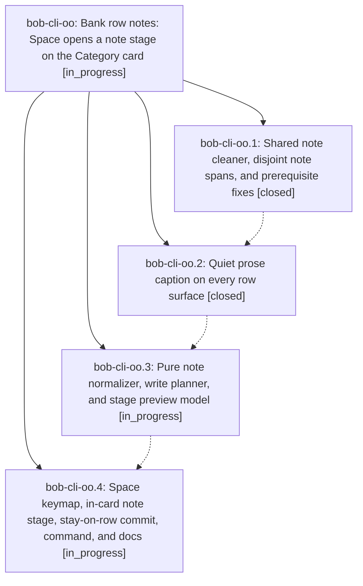

# Bead: bob-cli-oo — Bank row notes: Space opens a note stage on the Category card

[Bead Pages](../README.md) / bob-cli-oo

**Status:** ◐ in_progress · **Type:** ▸ plan · **Tier:** epic
**Owner:** `bryanbugyi34@gmail.com` · **Created by:** [bbugyi200.apollo.research.5q.linker.w0](https://github.com/bobs-org/bob-cli--agents/blob/main/sessions/bbugyi200.apollo.research.5q.linker.w0.md) · **Assignee:** `bob-cli-oo.land`
**Created:** 2026-11-21 12:07:07 EST
**Plan:** [202611/bank\_row\_notes.md](https://github.com/bobs-org/bob-cli--plans/blob/main/202611/bank_row_notes.md)

<!-- sase:links:start -->

## Links

| Relation | Artifact | Why |
| --- | --- | --- |
| implemented-by | [plan:202611/bank_row_notes.md][1] | derived from the plan's `bead_id:` frontmatter field |

[1]: https://github.com/bobs-org/bob-cli--plans/blob/main/202611/bank_row_notes.md

<!-- sase:links:end -->

## Description

During the ]b bank walk, Space on the Category card writes a short note into the row's inline `— note` tail and stays on the same row (no tick, no advance), and the note renders everywhere as a quiet muted-italic dash-led caption.

## Notes

[2026-11-21T19:54:14Z · bob-cli-o6.6.1.land] DISCOVERED ISSUE: bob-plugins d9fe19d (bob-cli-oo.2, bank row note captions) added a sentence to docs/bob-ledger-tools.md (wc 6580 -> 6627 words) and pushed the mounted page over the reference cap: on bob-cli dfe20ca3 + bob-plugins e6d7aed, uv run --project tools/docs bob-docs lint exits 1 with 'docs/reference/plugins/bob-ledger-tools.md:1: budget: over budget at 6042 words (cap 6000 for reference/)'. At bob-plugins 238fa91 (the previous ledger-tools docs change) lint did not report this page. Every bob-plugins and bob-cli docs gate fails lint until it is trimmed. Found by the bob-cli-o6.6.1 land agent while re-verifying docs gates; corroborated on the standing headroom task bob-cli-il.

## Phases

| Bead | Title | Status | Size | Created | Agents | Commits |
|---|---|---|---|---|---:|---:|
| [bob-cli-oo.1](bob-cli-oo.1.md) | Shared note cleaner, disjoint note spans, and prerequisite fixes | ✓ closed | medium | 2026-11-21 | 1 | 2 |
| [bob-cli-oo.2](bob-cli-oo.2.md) | Quiet prose caption on every row surface | ✓ closed | small | 2026-11-21 | 1 | 1 |
| [bob-cli-oo.3](bob-cli-oo.3.md) | Pure note normalizer, write planner, and stage preview model | ◐ in_progress | small | 2026-11-21 | 1 | 3 |
| [bob-cli-oo.4](bob-cli-oo.4.md) | Space keymap, in-card note stage, stay-on-row commit, command, and docs | ◐ in_progress | medium | 2026-11-21 | 1 | 0 |

## Lineage

## Agents

| Agent | Bead | Commits |
|---|---|---:|
| [bbugyi200.apollo.bob-cli-oo.1](https://github.com/bobs-org/bob-cli--agents/blob/main/agents/bbugyi200.apollo.bob-cli-oo.1/README.md) | [bob-cli-oo.1](bob-cli-oo.1.md) | 2 |
| [bbugyi200.apollo.bob-cli-oo.2](https://github.com/bobs-org/bob-cli--agents/blob/main/agents/bbugyi200.apollo.bob-cli-oo.2/README.md) | [bob-cli-oo.2](bob-cli-oo.2.md) | 1 |
| [bbugyi200.apollo.bob-cli-oo.3](https://github.com/bobs-org/bob-cli--agents/blob/main/sessions/bbugyi200.apollo.bob-cli-oo.3.md) | [bob-cli-oo.3](bob-cli-oo.3.md) | 3 |
| [bbugyi200.apollo.bob-cli-oo.4](https://github.com/bobs-org/bob-cli--agents/blob/main/agents/bbugyi200.apollo.bob-cli-oo.4/README.md) | [bob-cli-oo.4](bob-cli-oo.4.md) | 0 |
| [bbugyi200.apollo.bob-cli-oo.land](https://github.com/bobs-org/bob-cli--agents/blob/main/agents/bbugyi200.apollo.bob-cli-oo.land/README.md) | [bob-cli-oo](README.md) | 0 |

## Commits

| Repo | Commit | Subject | Bead | Committed |
|---|---|---|---|---|
| bob-cli | [`baca870`](https://github.com/bobs-org/bob-cli/commit/baca8701459fb39fdeb783d5cdb95ac9f2b20b21) | feat(bank): share the five-step note cleaner and document tail order | [bob-cli-oo.1](bob-cli-oo.1.md) | 2026-11-21 12:53:38 EST |
| bob-plugins | [`bob-plugins@1731913`](https://github.com/bobs-org/bob-plugins/commit/1731913b2fa9d856cddc4ee07457f43cbd54489b) | feat(ledger-tools): parse bank notes with the shared cleaner | [bob-cli-oo.1](bob-cli-oo.1.md) | 2026-11-21 13:31:48 EST |
| bob-plugins | [`bob-plugins@d9fe19d`](https://github.com/bobs-org/bob-plugins/commit/d9fe19d8f22f73c360c30812bd5a4a1ac38ba0b8) | feat(ledger-tools): caption bank row notes as quiet prose | [bob-cli-oo.2](bob-cli-oo.2.md) | 2026-11-21 14:17:56 EST |
| bob-cli | [`dfe20ca`](https://github.com/bobs-org/bob-cli/commit/dfe20ca3040b1328b7356083fbb0f8afd4d97d80) | docs(glossary): describe bank row notes | [bob-cli-oo.3](bob-cli-oo.3.md) | 2026-11-21 14:36:44 EST |
| bob-plugins | [`bob-plugins@303e5db`](https://github.com/bobs-org/bob-plugins/commit/303e5dbf534dea3e8225b0f12941e928ddf4490d) | feat(bank): add pure row note write model | [bob-cli-oo.3](bob-cli-oo.3.md) | 2026-11-21 14:44:10 EST |
| bob-plugins | [`bob-plugins@909b30f`](https://github.com/bobs-org/bob-plugins/commit/909b30fdfa004886445f97eed1fa70ec78d103fc) | test(task-status-cycler): refresh shared successor fixture | [bob-cli-oo.3](bob-cli-oo.3.md) | 2026-11-21 14:58:31 EST |
