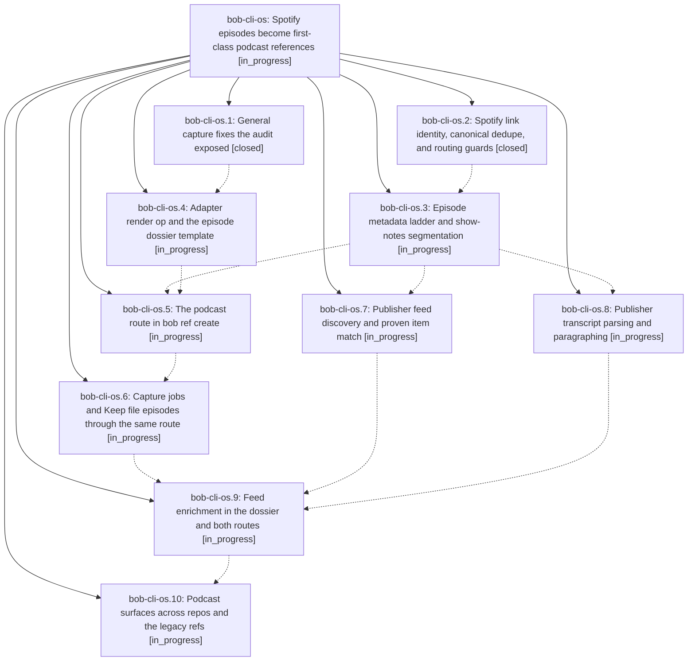

# Bead: bob-cli-os — Spotify episodes become first-class podcast references

[Bead Pages](../README.md) / bob-cli-os

**Status:** ◐ in_progress · **Type:** ▸ plan · **Tier:** epic
**Owner:** `bryanbugyi34@gmail.com` · **Created by:** [bbugyi200.apollo.research.5r.linker.w0](https://github.com/bobs-org/bob-cli--agents/blob/main/sessions/bbugyi200.apollo.research.5r.linker.w0.md) · **Assignee:** `bob-cli-os.land`
**Created:** 2026-11-21 14:59:41 EST
**Plan:** [202611/spotify\_episode\_refs.md](https://github.com/bobs-org/bob-cli--plans/blob/main/202611/spotify_episode_refs.md)

<!-- sase:links:start -->

## Links

| Relation | Artifact | Why |
| --- | --- | --- |
| implemented-by | [plan:202611/spotify_episode_refs.md][1] | derived from the plan's `bead_id:` frontmatter field |

_Plus 1 automatic references — see [Referenced By](#referenced-by)._

[1]: https://github.com/bobs-org/bob-cli--plans/blob/main/202611/spotify_episode_refs.md

<!-- sase:links:end -->

## Description

Every Spotify episode link given to `bob ref create`, capture, or Keep becomes one deduplicated `podcasts` reference. Its PDF is an episode dossier: cover, show, date, duration, clickable chapters, full show notes, and a highlightable transcript when the publisher's own feed proves the match. Every other Spotify link is refused, or is kept as an ordinary item, with a hint that says what to do instead. No Spotify link reaches the article engine again.

## Phases

| Bead | Title | Status | Size | Created | Agents | Commits |
|---|---|---|---|---|---:|---:|
| [bob-cli-os.1](bob-cli-os.1.md) | General capture fixes the audit exposed | ✓ closed | medium | 2026-11-21 | 1 | 1 |
| [bob-cli-os.10](bob-cli-os.10.md) | Podcast surfaces across repos and the legacy refs | ◐ in_progress | small | 2026-11-21 | 1 | 0 |
| [bob-cli-os.2](bob-cli-os.2.md) | Spotify link identity, canonical dedupe, and routing guards | ✓ closed | medium | 2026-11-21 | 1 | 1 |
| [bob-cli-os.3](bob-cli-os.3.md) | Episode metadata ladder and show-notes segmentation | ◐ in_progress | medium | 2026-11-21 | 1 | 0 |
| [bob-cli-os.4](bob-cli-os.4.md) | Adapter render op and the episode dossier template | ◐ in_progress | medium | 2026-11-21 | 1 | 0 |
| [bob-cli-os.5](bob-cli-os.5.md) | The podcast route in bob ref create | ◐ in_progress | medium | 2026-11-21 | 1 | 0 |
| [bob-cli-os.6](bob-cli-os.6.md) | Capture jobs and Keep file episodes through the same route | ◐ in_progress | medium | 2026-11-21 | 1 | 0 |
| [bob-cli-os.7](bob-cli-os.7.md) | Publisher feed discovery and proven item match | ◐ in_progress | medium | 2026-11-21 | 1 | 0 |
| [bob-cli-os.8](bob-cli-os.8.md) | Publisher transcript parsing and paragraphing | ◐ in_progress | medium | 2026-11-21 | 1 | 0 |
| [bob-cli-os.9](bob-cli-os.9.md) | Feed enrichment in the dossier and both routes | ◐ in_progress | medium | 2026-11-21 | 1 | 0 |

## Lineage

## Agents

| Agent | Bead | Commits |
|---|---|---:|
| [bbugyi200.apollo.bob-cli-os.1](https://github.com/bobs-org/bob-cli--agents/blob/main/agents/bbugyi200.apollo.bob-cli-os.1/README.md) | [bob-cli-os.1](bob-cli-os.1.md) | 1 |
| [bbugyi200.apollo.bob-cli-os.10](https://github.com/bobs-org/bob-cli--agents/blob/main/agents/bbugyi200.apollo.bob-cli-os.10/README.md) | [bob-cli-os.10](bob-cli-os.10.md) | 0 |
| [bbugyi200.apollo.bob-cli-os.2](https://github.com/bobs-org/bob-cli--agents/blob/main/agents/bbugyi200.apollo.bob-cli-os.2/README.md) | [bob-cli-os.2](bob-cli-os.2.md) | 1 |
| [bbugyi200.apollo.bob-cli-os.3](https://github.com/bobs-org/bob-cli--agents/blob/main/agents/bbugyi200.apollo.bob-cli-os.3/README.md) | [bob-cli-os.3](bob-cli-os.3.md) | 0 |
| [bbugyi200.apollo.bob-cli-os.4](https://github.com/bobs-org/bob-cli--agents/blob/main/agents/bbugyi200.apollo.bob-cli-os.4/README.md) | [bob-cli-os.4](bob-cli-os.4.md) | 0 |
| [bbugyi200.apollo.bob-cli-os.5](https://github.com/bobs-org/bob-cli--agents/blob/main/agents/bbugyi200.apollo.bob-cli-os.5/README.md) | [bob-cli-os.5](bob-cli-os.5.md) | 0 |
| [bbugyi200.apollo.bob-cli-os.6](https://github.com/bobs-org/bob-cli--agents/blob/main/agents/bbugyi200.apollo.bob-cli-os.6/README.md) | [bob-cli-os.6](bob-cli-os.6.md) | 0 |
| [bbugyi200.apollo.bob-cli-os.7](https://github.com/bobs-org/bob-cli--agents/blob/main/agents/bbugyi200.apollo.bob-cli-os.7/README.md) | [bob-cli-os.7](bob-cli-os.7.md) | 0 |
| [bbugyi200.apollo.bob-cli-os.8](https://github.com/bobs-org/bob-cli--agents/blob/main/agents/bbugyi200.apollo.bob-cli-os.8/README.md) | [bob-cli-os.8](bob-cli-os.8.md) | 0 |
| [bbugyi200.apollo.bob-cli-os.9](https://github.com/bobs-org/bob-cli--agents/blob/main/agents/bbugyi200.apollo.bob-cli-os.9/README.md) | [bob-cli-os.9](bob-cli-os.9.md) | 0 |
| [bbugyi200.apollo.bob-cli-os.land](https://github.com/bobs-org/bob-cli--agents/blob/main/agents/bbugyi200.apollo.bob-cli-os.land/README.md) | [bob-cli-os](README.md) | 0 |

## Commits

| Repo | Commit | Subject | Bead | Committed |
|---|---|---|---|---|
| bob-cli | [`ddc9e17`](https://github.com/bobs-org/bob-cli/commit/ddc9e177548417ca4bfe0b76107e00a2d649e2b6) | feat(ref)!: give Spotify links canonical identity and refuse non-episodes | [bob-cli-os.2](bob-cli-os.2.md) | 2026-11-21 16:05:39 EST |
| bob-cli | [`0114a6c`](https://github.com/bobs-org/bob-cli/commit/0114a6cc1e560df93de50edaa8821db627055702) | fix(ref): keep base62 ids out of stems, save ingest source stores, and print the recorded URL in mastheads | [bob-cli-os.1](bob-cli-os.1.md) | 2026-11-21 16:24:37 EST |

<!-- sase:referenced-by:start -->

## Referenced By

| Relation | Artifact | Why | Uses |
| --- | --- | --- | ---: |
| read-by | [agent:bob-cli-os.2][1] | Need epic context and phase list | 2 |

[1]: https://github.com/bobs-org/bob-cli--agents/blob/main/agents/bbugyi200.apollo.bob-cli-os.2/README.md

<!-- sase:referenced-by:end -->
