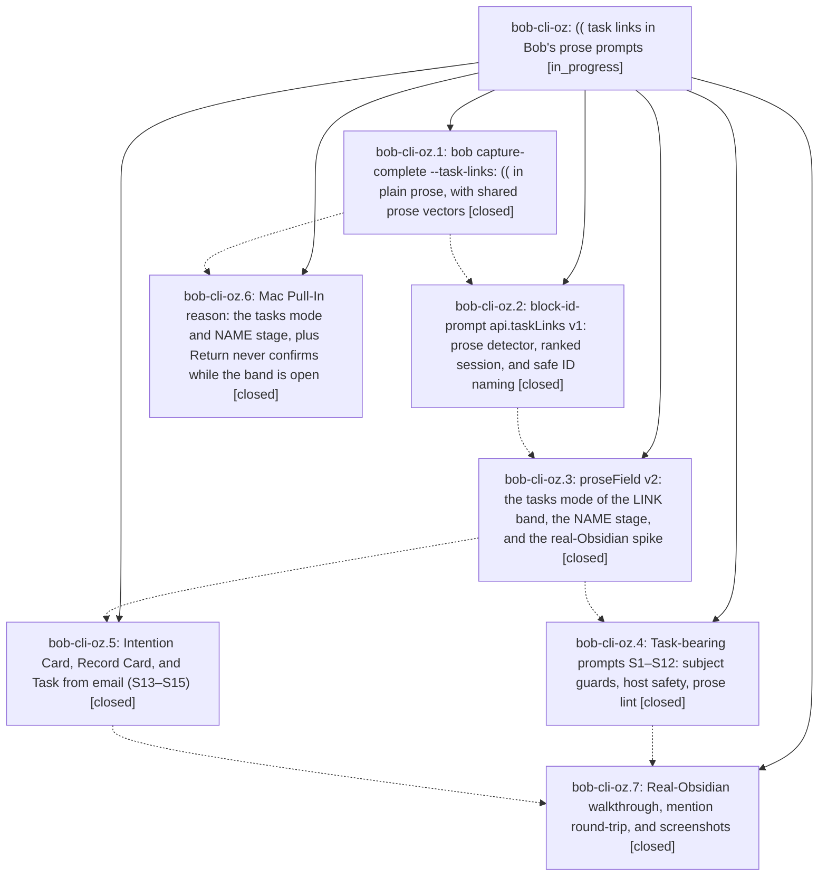

# Bead: bob-cli-oz — (( task links in Bob's prose prompts

[Bead Pages](../README.md) / bob-cli-oz

**Status:** ◐ in_progress · **Type:** ▸ plan · **Tier:** epic
**Owner:** `bryanbugyi34@gmail.com` · **Created by:** [bbugyi200.apollo.ff](https://github.com/bobs-org/bob-cli--agents/blob/main/sessions/bbugyi200.apollo.ff.md) · **Assignee:** `bob-cli-oz.land`
**Created:** 2026-11-21 17:39:51 EST
**Plan:** [202611/prompt\_task\_links.md](https://github.com/bobs-org/bob-cli--plans/blob/main/202611/prompt_task_links.md)

<!-- sase:links:start -->

## Links

| Relation | Artifact | Why |
| --- | --- | --- |
| implemented-by | [plan:202611/prompt_task_links.md][1] | derived from the plan's `bead_id:` frontmatter field |

_Plus 1 automatic references — see [Referenced By](#referenced-by)._

[1]: https://github.com/bobs-org/bob-cli--plans/blob/main/202611/prompt_task_links.md

<!-- sase:links:end -->

## Description

Typing (( in every Bob prose prompt that already completes [[ (S1–S16) opens the LINK band's tasks mode. It inserts bob's exact [[target#^id]] link to any vault task, names an ID-less task in place with one explicit write, never submits the prompt early, and never moves focus out of the field.

## Notes

[2026-11-22T13:20:42Z · bob-cli-oz.land] LANDING TRIAGE (bob-cli-oz.land) of every PROPOSED FOLLOW-UP:
(1) oz.1#1 docs-check test_contracts.py failures — declined: already fixed on master; uv run --project tools/docs python -m pytest tools/docs/tests/test_contracts.py passes 8/8 at e4ee55bd.
(2) oz.2#1, oz.3#2, oz.4#1, oz.5#1, oz.6#1 published-URL false positive at podcast/feed.rs:70 — declined: fixed in 2f4fef6d (url_mentions_ignore entry) by the bob-cli-os landing.
(3) oz.2--2#2, oz.4#3, oz.7#7 ledger-tools 25 ms wall-clock budgets under parallel npm test — corroborated with +1 on bob-cli-km (event-link-times) and bob-cli-io (frees-marks); not caused by this epic.
(4) oz.3#2, oz.7#3/#4 plugin-apis.md 8401/8000 word warning — corroborated with +1 on bob-cli-ob; nav docs are back under the 6000-word cap.
(5) oz.2--2#2 clean-base offer_close/vectors.json ENOENT — declined: clean-base worktree artifact, absent from the real tree.
(6) oz.7#3 apollo ENOSPC — declined as a bead: host capacity, not a repo defect (apollo root still 100% full, 132 MB free at landing); reported to Bryan. Live e2e runs belong on athena.
(7) oz.4#4 nav sync refusal — resolved by oz.4 note #6 (Bryan-approved force sync).
(8) oz.7#6 stale bob-mail vault build — resolved by the lander: bob plugins sync -p bob-mail succeeded without -F because commit c2e28ca holds the stamped bundle byte for byte; the vault now has the S13 links/tasks wiring (bob-mail 0.3.0 synced).
EPIC-CAUSED, remaining epic work (planned as a lander tale):
(a) oz.7#2 S15 Enter-save timeout — root cause: 189e commitName re-arms the held-Enter swallow after the async session.name() resolves; when Enter's keyup arrived during a vault.process write, swallowEnter stays true and the next Enter (the submit) is eaten. Explains the S14 double-Enter and S15 recordApplyTyped harness fallbacks.
(b) 189e NAME handleKeydown and backOut ignore namePending, so a second Enter during the write starts a second commitName and Esc changes the stage mid-write (plan: any key while the write is in flight is swallowed).
(c) oz.4#2 S6: naming an ID-less sibling successor row from the cancel reason changes its line digest, so its staged verdict refuses with changed_identity (T11).
(d) oz.7#1 live NAME Esc ladder never exercised in real Obsidian; the walkthrough skipped Esc-from-NAME.
(e) Plan T9 perf gate for api.taskLinks (open ≤50 ms, rank ≤12 ms over 5,000 tasks, no vault reads in rank) was never added to test:perf; rank() maps every ranked row through publicRow per keystroke.

## Phases

| Bead | Title | Status | Size | Created | Agents | Commits |
|---|---|---|---|---|---:|---:|
| [bob-cli-oz.1](bob-cli-oz.1.md) | bob capture-complete --task-links: (( in plain prose, with shared prose vectors | ✓ closed | small | 2026-11-21 | 1 | 1 |
| [bob-cli-oz.2](bob-cli-oz.2.md) | block-id-prompt api.taskLinks v1: prose detector, ranked session, and safe ID naming | ✓ closed | medium | 2026-11-21 | 1 | 1 |
| [bob-cli-oz.3](bob-cli-oz.3.md) | proseField v2: the tasks mode of the LINK band, the NAME stage, and the real-Obsidian spike | ✓ closed | medium | 2026-11-21 | 1 | 1 |
| [bob-cli-oz.4](bob-cli-oz.4.md) | Task-bearing prompts S1–S12: subject guards, host safety, prose lint | ✓ closed | medium | 2026-11-21 | 1 | 1 |
| [bob-cli-oz.5](bob-cli-oz.5.md) | Intention Card, Record Card, and Task from email (S13–S15) | ✓ closed | medium | 2026-11-21 | 1 | 1 |
| [bob-cli-oz.6](bob-cli-oz.6.md) | Mac Pull-In reason: the tasks mode and NAME stage, plus Return never confirms while the band is open | ✓ closed | medium | 2026-11-21 | 1 | 1 |
| [bob-cli-oz.7](bob-cli-oz.7.md) | Real-Obsidian walkthrough, mention round-trip, and screenshots | ✓ closed | small | 2026-11-21 | 1 | 1 |

## Lineage

## Agents

| Agent | Bead | Commits |
|---|---|---:|
| [bbugyi200.apollo.bob-cli-oz.1](https://github.com/bobs-org/bob-cli--agents/blob/main/agents/bbugyi200.apollo.bob-cli-oz.1/README.md) | [bob-cli-oz.1](bob-cli-oz.1.md) | 1 |
| [bbugyi200.apollo.bob-cli-oz.2](https://github.com/bobs-org/bob-cli--agents/blob/main/sessions/bbugyi200.apollo.bob-cli-oz.2.md) | [bob-cli-oz.2](bob-cli-oz.2.md) | 1 |
| [bbugyi200.apollo.bob-cli-oz.3](https://github.com/bobs-org/bob-cli--agents/blob/main/agents/bbugyi200.apollo.bob-cli-oz.3/README.md) | [bob-cli-oz.3](bob-cli-oz.3.md) | 1 |
| [bbugyi200.apollo.bob-cli-oz.4](https://github.com/bobs-org/bob-cli--agents/blob/main/sessions/bbugyi200.apollo.bob-cli-oz.4.md) | [bob-cli-oz.4](bob-cli-oz.4.md) | 1 |
| [bbugyi200.apollo.bob-cli-oz.5](https://github.com/bobs-org/bob-cli--agents/blob/main/sessions/bbugyi200.apollo.bob-cli-oz.5.md) | [bob-cli-oz.5](bob-cli-oz.5.md) | 1 |
| [bbugyi200.apollo.bob-cli-oz.6](https://github.com/bobs-org/bob-cli--agents/blob/main/agents/bbugyi200.apollo.bob-cli-oz.6/README.md) | [bob-cli-oz.6](bob-cli-oz.6.md) | 1 |
| [bbugyi200.apollo.bob-cli-oz.7](https://github.com/bobs-org/bob-cli--agents/blob/main/agents/bbugyi200.apollo.bob-cli-oz.7/README.md) | [bob-cli-oz.7](bob-cli-oz.7.md) | 1 |
| [bbugyi200.apollo.bob-cli-oz.land](https://github.com/bobs-org/bob-cli--agents/blob/main/sessions/bbugyi200.apollo.bob-cli-oz.land.md) | [bob-cli-oz](README.md) | 1 |

## Commits

| Repo | Commit | Subject | Bead | Committed |
|---|---|---|---|---|
| bob-cli | [`145b00d`](https://github.com/bobs-org/bob-cli/commit/145b00d50e56a47c2a288a9405d044956b2e0ced) | feat(capture): complete (( task links in plain prose with capture-complete -L -T | [bob-cli-oz.1](bob-cli-oz.1.md) | 2026-11-21 23:26:26 EST |
| bob-plugins | [`bob-plugins@a346fd2`](https://github.com/bobs-org/bob-plugins/commit/a346fd2f3bfbae27296535fb3075c3b15b4812f3) | feat(block-id-prompt): add task links API | [bob-cli-oz.2](bob-cli-oz.2.md) | 2026-11-22 00:02:06 EST |
| bob-mac-capture | [`bob-mac-capture@355cfd9`](https://github.com/bobs-org/bob-mac-capture/commit/355cfd99e85fbd34ff45e418aeaf7d85ed9121e2) | feat(capture): complete (( task links in the Pull-In reason LINK band | [bob-cli-oz.6](bob-cli-oz.6.md) | 2026-11-22 00:20:04 EST |
| bob-plugins | [`bob-plugins@6a2f6ce`](https://github.com/bobs-org/bob-plugins/commit/6a2f6ce5c8eb38f2f8c4265f00d9322c058341b6) | feat(nav): add tasks mode to proseField LINK band with in-band NAME stage | [bob-cli-oz.3](bob-cli-oz.3.md) | 2026-11-22 00:44:26 EST |
| bob-plugins | [`bob-plugins@577b3cc`](https://github.com/bobs-org/bob-plugins/commit/577b3cc615da328a5361e27500a524ac70b6417a) | feat(nav): declare task subjects for (( in S1-S12 prompts and keep host writes safe | [bob-cli-oz.4](bob-cli-oz.4.md) | 2026-11-22 01:23:02 EST |
| bob-plugins | [`bob-plugins@c1d8d19`](https://github.com/bobs-org/bob-plugins/commit/c1d8d1989a413d672dcd4d6477b562959f9a0181) | feat(prompts): wire task links into card surfaces | [bob-cli-oz.5](bob-cli-oz.5.md) | 2026-11-22 01:25:12 EST |
| bob-plugins | [`bob-plugins@12da82a`](https://github.com/bobs-org/bob-plugins/commit/12da82af7b3a9eedc7567f962fe55b845f0e466e) | feat(nav): add real-Obsidian (( walkthrough and peel one prose layer per Escape | [bob-cli-oz.7](bob-cli-oz.7.md) | 2026-11-22 08:09:10 EST |
| bob-plugins | [`bob-plugins@65fce22`](https://github.com/bobs-org/bob-plugins/commit/65fce2281dca17551bed7b6ae1985196f66a5ff0) | feat(nav): land prompt task-links follow-ups items 1-3 plus tests, docs, perf harness | [bob-cli-oz](README.md) | 2026-11-22 08:48:07 EST |

<!-- sase:referenced-by:start -->

## Referenced By

| Relation | Artifact | Why | Uses |
| --- | --- | --- | ---: |
| read-by | [agent:bob-cli-oz.4][1] | epic overview and notes | 1 |

[1]: https://github.com/bobs-org/bob-cli--agents/blob/main/sessions/bbugyi200.apollo.bob-cli-oz.4.md

<!-- sase:referenced-by:end -->
