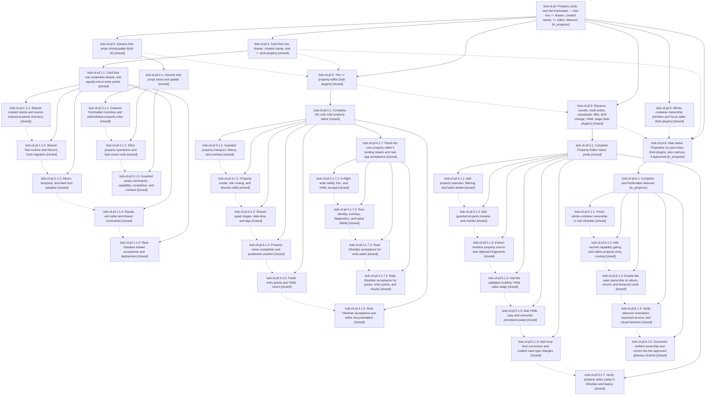

# Bead: bob-cli-pf — Property cards own the frontmatter — foot row, =- drawer, created stamp, =+ editor, takeover

[Bead Pages](../README.md) / bob-cli-pf

**Status:** ◐ in_progress · **Type:** ▸ plan · **Tier:** epic
**Owner:** `bryanbugyi34@gmail.com` · **Created by:** [bbugyi200.apollo.research.5v.linker.w0](https://github.com/bobs-org/bob-cli--agents/blob/main/sessions/bbugyi200.apollo.research.5v.linker.w0.md) · **Assignee:** `bob-cli-pf.land`
**Created:** 2026-11-22 14:35:12 EST
**Plan:** [202611/card\_owned\_frontmatter.md](https://github.com/bobs-org/bob-cli--plans/blob/main/202611/card_owned_frontmatter.md)

<!-- sase:links:start -->

## Links

| Relation | Artifact | Why |
| --- | --- | --- |
| implemented-by | [plan:202611/card_owned_frontmatter.md][1] | derived from the plan's `bead_id:` frontmatter field |

_Plus 7 automatic references — see [Referenced By](#referenced-by)._

[1]: https://github.com/bobs-org/bob-cli--plans/blob/main/202611/card_owned_frontmatter.md

<!-- sase:links:end -->

## Description

On every note a property card mounts on, the card shows the whole frontmatter: a quiet foot row with a concise created stamp and a collapsed read-only Properties drawer toggled by =-. A keyboard-first =+ property editor, backed by a byte-preserving `bob props` writer, does at least everything Obsidian's native Properties can on any Markdown note. Obsidian's native Properties block is hidden on card notes, and every failure path brings it back.

## Notes

[2026-11-24T12:26:23Z · ft--code] COORDINATION: Live Preview Vim property keys are now bare - (Properties drawer) and + (Property Editor) instead of =- / =+. == is unchanged; pending = then - or + falls through to Vim. registerPropertyCardSecondKeyArm("+") keeps its historical name. Vault vimrc nnoremap - :bob_daily is removed; :bob_daily and open-today-daily-note stay. Reading-view keys are out of scope. Work is in bob-plugins bob-ledger-tools plus the vault vimrc.

[2026-11-24T12:28:34Z · ft--code] DEPLOY: bob plugins sync of this bare -/+ work was withheld without -F. Vault bob-ledger-tools is currently a dirty deploy from bob-cli_10 at f729388 (2026-11-24T12:27:22Z) for in-progress frontmatter takeover (240q). Overwriting that uncommitted build would discard pf.6.1 vault bytes. Acceptance is the athena source-tree e2e; vault deploy can follow once that dirty stamp is gone or the takeover commit is in HEAD.

## Phases

| Bead | Title | Status | Size | Created | Agents | Commits |
|---|---|---|---|---|---:|---:|
| [bob-cli-pf.1](bob-cli-pf.1.md) | Card foot row, drawer, created stamp, and =- (bob-plugins) | ✓ closed | large | 2026-11-22 | 1 | 0 |
| [bob-cli-pf.2](bob-cli-pf.2.md) | Generic bob props show\|update (bob-cli) | ✓ closed | large | 2026-11-22 | 1 | 0 |
| [bob-cli-pf.3](bob-cli-pf.3.md) | Whole-container ownership primitive and focus spike (bob-plugins) | ✓ closed | medium | 2026-11-22 | 1 | 1 |
| [bob-cli-pf.4](bob-cli-pf.4.md) | The =+ property editor (bob-plugins) | ✓ closed | large | 2026-11-22 | 1 | 0 |
| [bob-cli-pf.5](bob-cli-pf.5.md) | Rename, reorder, multi-select, copy/paste, filter, kind change, YAML stage (bob-plugins) | ✓ closed | large | 2026-11-22 | 1 | 0 |
| [bob-cli-pf.6](bob-cli-pf.6.md) | Hide native Properties on card notes (bob-plugins, plus memory if approved) | ◐ in_progress | large | 2026-11-22 | 1 | 0 |

## Lineage

## Dependencies

- **Blocks:** [bob-cli-pl.1](../bob-cli-pl/bob-cli-pl.1.md) ◐ · ⧖ 2026-11-22
- **Blocks:** [bob-cli-pl.2](../bob-cli-pl/bob-cli-pl.2.md) ◐ · ⧖ 2026-11-22
- **Blocks:** [bob-cli-pl.4](../bob-cli-pl/bob-cli-pl.4.md) ◐ · ⧖ 2026-11-22

## Agents

| Agent | Bead | Commits |
|---|---|---:|
| [bbugyi200.apollo.bob-cli-pf.1](https://github.com/bobs-org/bob-cli--agents/blob/main/sessions/bbugyi200.apollo.bob-cli-pf.1.md) | [bob-cli-pf.1](bob-cli-pf.1.md) | 0 |
| [bbugyi200.apollo.bob-cli-pf.1.1.1](https://github.com/bobs-org/bob-cli--agents/blob/main/sessions/bbugyi200.apollo.bob-cli-pf.1.1.1.md) | [bob-cli-pf.1.1.1](bob-cli-pf.1.1.1.md) | 1 |
| [bbugyi200.apollo.bob-cli-pf.1.1.2](https://github.com/bobs-org/bob-cli--agents/blob/main/agents/bbugyi200.apollo.bob-cli-pf.1.1.2/README.md) | [bob-cli-pf.1.1.2](bob-cli-pf.1.1.2.md) | 1 |
| [bbugyi200.apollo.bob-cli-pf.1.1.3](https://github.com/bobs-org/bob-cli--agents/blob/main/agents/bbugyi200.apollo.bob-cli-pf.1.1.3/README.md) | [bob-cli-pf.1.1.3](bob-cli-pf.1.1.3.md) | 1 |
| [bbugyi200.apollo.bob-cli-pf.1.1.4](https://github.com/bobs-org/bob-cli--agents/blob/main/sessions/bbugyi200.apollo.bob-cli-pf.1.1.4.md) | [bob-cli-pf.1.1.4](bob-cli-pf.1.1.4.md) | 2 |
| [bbugyi200.apollo.bob-cli-pf.1.1.5](https://github.com/bobs-org/bob-cli--agents/blob/main/agents/bbugyi200.apollo.bob-cli-pf.1.1.5/README.md) | [bob-cli-pf.1.1.5](bob-cli-pf.1.1.5.md) | 1 |
| [bbugyi200.apollo.bob-cli-pf.1.1.land](https://github.com/bobs-org/bob-cli--agents/blob/main/sessions/bbugyi200.apollo.bob-cli-pf.1.1.land.md) | [bob-cli-pf.1.1](bob-cli-pf.1.1.md) | 2 |
| [bbugyi200.apollo.bob-cli-pf.2](https://github.com/bobs-org/bob-cli--agents/blob/main/sessions/bbugyi200.apollo.bob-cli-pf.2.md) | [bob-cli-pf.2](bob-cli-pf.2.md) | 0 |
| [bbugyi200.apollo.bob-cli-pf.2.1.1](https://github.com/bobs-org/bob-cli--agents/blob/main/sessions/bbugyi200.apollo.bob-cli-pf.2.1.1.md) | [bob-cli-pf.2.1.1](bob-cli-pf.2.1.1.md) | 1 |
| [bbugyi200.apollo.bob-cli-pf.2.1.2](https://github.com/bobs-org/bob-cli--agents/blob/main/sessions/bbugyi200.apollo.bob-cli-pf.2.1.2.md) | [bob-cli-pf.2.1.2](bob-cli-pf.2.1.2.md) | 1 |
| [bbugyi200.apollo.bob-cli-pf.2.1.3](https://github.com/bobs-org/bob-cli--agents/blob/main/agents/bbugyi200.apollo.bob-cli-pf.2.1.3/README.md) | [bob-cli-pf.2.1.3](bob-cli-pf.2.1.3.md) | 1 |
| [bbugyi200.apollo.bob-cli-pf.2.1.land](https://github.com/bobs-org/bob-cli--agents/blob/main/sessions/bbugyi200.apollo.bob-cli-pf.2.1.land.md) | [bob-cli-pf.2.1](bob-cli-pf.2.1.md) | 2 |
| [bbugyi200.apollo.bob-cli-pf.3](https://github.com/bobs-org/bob-cli--agents/blob/main/agents/bbugyi200.apollo.bob-cli-pf.3/README.md) | [bob-cli-pf.3](bob-cli-pf.3.md) | 1 |
| [bbugyi200.apollo.bob-cli-pf.4](https://github.com/bobs-org/bob-cli--agents/blob/main/sessions/bbugyi200.apollo.bob-cli-pf.4.md) | [bob-cli-pf.4](bob-cli-pf.4.md) | 0 |
| [bbugyi200.apollo.bob-cli-pf.4.1.1](https://github.com/bobs-org/bob-cli--agents/blob/main/agents/bbugyi200.apollo.bob-cli-pf.4.1.1/README.md) | [bob-cli-pf.4.1.1](bob-cli-pf.4.1.1.md) | 1 |
| [bbugyi200.apollo.bob-cli-pf.4.1.2](https://github.com/bobs-org/bob-cli--agents/blob/main/agents/bbugyi200.apollo.bob-cli-pf.4.1.2/README.md) | [bob-cli-pf.4.1.2](bob-cli-pf.4.1.2.md) | 1 |
| [bbugyi200.apollo.bob-cli-pf.4.1.3](https://github.com/bobs-org/bob-cli--agents/blob/main/sessions/bbugyi200.apollo.bob-cli-pf.4.1.3.md) | [bob-cli-pf.4.1.3](bob-cli-pf.4.1.3.md) | 1 |
| [bbugyi200.apollo.bob-cli-pf.4.1.4](https://github.com/bobs-org/bob-cli--agents/blob/main/agents/bbugyi200.apollo.bob-cli-pf.4.1.4/README.md) | [bob-cli-pf.4.1.4](bob-cli-pf.4.1.4.md) | 1 |
| [bbugyi200.apollo.bob-cli-pf.4.1.5](https://github.com/bobs-org/bob-cli--agents/blob/main/agents/bbugyi200.apollo.bob-cli-pf.4.1.5/README.md) | [bob-cli-pf.4.1.5](bob-cli-pf.4.1.5.md) | 1 |
| [bbugyi200.apollo.bob-cli-pf.4.1.6](https://github.com/bobs-org/bob-cli--agents/blob/main/sessions/bbugyi200.apollo.bob-cli-pf.4.1.6.md) | [bob-cli-pf.4.1.6](bob-cli-pf.4.1.6.md) | 1 |
| [bbugyi200.apollo.bob-cli-pf.4.1.7.1](https://github.com/bobs-org/bob-cli--agents/blob/main/agents/bbugyi200.apollo.bob-cli-pf.4.1.7.1/README.md) | [bob-cli-pf.4.1.7.1](bob-cli-pf.4.1.7.1.md) | 1 |
| [bbugyi200.apollo.bob-cli-pf.4.1.7.2](https://github.com/bobs-org/bob-cli--agents/blob/main/agents/bbugyi200.apollo.bob-cli-pf.4.1.7.2/README.md) | [bob-cli-pf.4.1.7.2](bob-cli-pf.4.1.7.2.md) | 1 |
| [bbugyi200.apollo.bob-cli-pf.4.1.7.3](https://github.com/bobs-org/bob-cli--agents/blob/main/sessions/bbugyi200.apollo.bob-cli-pf.4.1.7.3.md) | [bob-cli-pf.4.1.7.3](bob-cli-pf.4.1.7.3.md) | 9 |
| [bbugyi200.apollo.bob-cli-pf.4.1.7.4](https://github.com/bobs-org/bob-cli--agents/blob/main/sessions/bbugyi200.apollo.bob-cli-pf.4.1.7.4.md) | [bob-cli-pf.4.1.7.4](bob-cli-pf.4.1.7.4.md) | 9 |
| [bbugyi200.apollo.bob-cli-pf.4.1.7.land](https://github.com/bobs-org/bob-cli--agents/blob/main/sessions/bbugyi200.apollo.bob-cli-pf.4.1.7.land.md) | [bob-cli-pf.4.1.7](bob-cli-pf.4.1.7.md) | 2 |
| [bbugyi200.apollo.bob-cli-pf.5](https://github.com/bobs-org/bob-cli--agents/blob/main/sessions/bbugyi200.apollo.bob-cli-pf.5.md) | [bob-cli-pf.5](bob-cli-pf.5.md) | 0 |
| [bbugyi200.apollo.bob-cli-pf.5.1.1](https://github.com/bobs-org/bob-cli--agents/blob/main/sessions/bbugyi200.apollo.bob-cli-pf.5.1.1.md) | [bob-cli-pf.5.1.1](bob-cli-pf.5.1.1.md) | 0 |
| [bbugyi200.apollo.bob-cli-pf.5.1.2](https://github.com/bobs-org/bob-cli--agents/blob/main/agents/bbugyi200.apollo.bob-cli-pf.5.1.2/README.md) | [bob-cli-pf.5.1.2](bob-cli-pf.5.1.2.md) | 1 |
| [bbugyi200.apollo.bob-cli-pf.5.1.3](https://github.com/bobs-org/bob-cli--agents/blob/main/agents/bbugyi200.apollo.bob-cli-pf.5.1.3/README.md) | [bob-cli-pf.5.1.3](bob-cli-pf.5.1.3.md) | 1 |
| [bbugyi200.apollo.bob-cli-pf.5.1.4](https://github.com/bobs-org/bob-cli--agents/blob/main/agents/bbugyi200.apollo.bob-cli-pf.5.1.4/README.md) | [bob-cli-pf.5.1.4](bob-cli-pf.5.1.4.md) | 1 |
| [bbugyi200.apollo.bob-cli-pf.5.1.5](https://github.com/bobs-org/bob-cli--agents/blob/main/agents/bbugyi200.apollo.bob-cli-pf.5.1.5/README.md) | [bob-cli-pf.5.1.5](bob-cli-pf.5.1.5.md) | 1 |
| [bbugyi200.apollo.bob-cli-pf.5.1.6](https://github.com/bobs-org/bob-cli--agents/blob/main/agents/bbugyi200.apollo.bob-cli-pf.5.1.6/README.md) | [bob-cli-pf.5.1.6](bob-cli-pf.5.1.6.md) | 1 |
| [bbugyi200.apollo.bob-cli-pf.5.1.7](https://github.com/bobs-org/bob-cli--agents/blob/main/agents/bbugyi200.apollo.bob-cli-pf.5.1.7/README.md) | [bob-cli-pf.5.1.7](bob-cli-pf.5.1.7.md) | 2 |
| [bbugyi200.apollo.bob-cli-pf.5.1.land](https://github.com/bobs-org/bob-cli--agents/blob/main/agents/bbugyi200.apollo.bob-cli-pf.5.1.land/README.md) | [bob-cli-pf.5.1](bob-cli-pf.5.1.md) | 1 |
| [bbugyi200.apollo.bob-cli-pf.6](https://github.com/bobs-org/bob-cli--agents/blob/main/sessions/bbugyi200.apollo.bob-cli-pf.6.md) | [bob-cli-pf.6](bob-cli-pf.6.md) | 0 |
| [bbugyi200.apollo.bob-cli-pf.6.1.1](https://github.com/bobs-org/bob-cli--agents/blob/main/agents/bbugyi200.apollo.bob-cli-pf.6.1.1/README.md) | [bob-cli-pf.6.1.1](bob-cli-pf.6.1.1.md) | 1 |
| [bbugyi200.apollo.bob-cli-pf.6.1.2](https://github.com/bobs-org/bob-cli--agents/blob/main/agents/bbugyi200.apollo.bob-cli-pf.6.1.2/README.md) | [bob-cli-pf.6.1.2](bob-cli-pf.6.1.2.md) | 1 |
| [bbugyi200.apollo.bob-cli-pf.6.1.3](https://github.com/bobs-org/bob-cli--agents/blob/main/agents/bbugyi200.apollo.bob-cli-pf.6.1.3/README.md) | [bob-cli-pf.6.1.3](bob-cli-pf.6.1.3.md) | 1 |
| [bbugyi200.apollo.bob-cli-pf.6.1.4](https://github.com/bobs-org/bob-cli--agents/blob/main/sessions/bbugyi200.apollo.bob-cli-pf.6.1.4.md) | [bob-cli-pf.6.1.4](bob-cli-pf.6.1.4.md) | 31 |
| [bbugyi200.apollo.bob-cli-pf.6.1.5](https://github.com/bobs-org/bob-cli--agents/blob/main/agents/bbugyi200.apollo.bob-cli-pf.6.1.5/README.md) | [bob-cli-pf.6.1.5](bob-cli-pf.6.1.5.md) | 1 |
| [bbugyi200.apollo.bob-cli-pf.6.1.land](https://github.com/bobs-org/bob-cli--agents/blob/main/agents/bbugyi200.apollo.bob-cli-pf.6.1.land/README.md) | [bob-cli-pf.6.1](bob-cli-pf.6.1.md) | 0 |
| [bbugyi200.apollo.bob-cli-pf.land](https://github.com/bobs-org/bob-cli--agents/blob/main/agents/bbugyi200.apollo.bob-cli-pf.land/README.md) | [bob-cli-pf](README.md) | 0 |

## Commits

| Repo | Commit | Subject | Bead | Committed |
|---|---|---|---|---|
| bob-plugins | [`bob-plugins@394633f`](https://github.com/bobs-org/bob-plugins/commit/394633fb3113fbd2971feff54442ae05e912a23d) | feat(ledger-tools): add unwired frontmatter ownership kit | [bob-cli-pf.3](bob-cli-pf.3.md) | 2026-11-22 15:04:14 EST |
| bob-plugins | [`bob-plugins@538d421`](https://github.com/bobs-org/bob-plugins/commit/538d42134a92a30976ac6155f2dcddd55282f94b) | feat(property-cards): add created formatter and source-ordered inventory | [bob-cli-pf.1.1.1](bob-cli-pf.1.1.1.md) | 2026-11-22 15:15:03 EST |
| bob-plugins | [`bob-plugins@15d82db`](https://github.com/bobs-org/bob-plugins/commit/15d82db75a1ac8a2a0920acaecbb73e8b75775e9) | feat(ledger-tools): add shared property-card foot runtime and migrate record sheet | [bob-cli-pf.1.1.2](bob-cli-pf.1.1.2.md) | 2026-11-22 17:06:38 EST |
| bob-cli | [`e98c7fe`](https://github.com/bobs-org/bob-cli/commit/e98c7fe96c24e3c3b243eb05c6cd5bf4ce07b024) | feat(props): add frontmatter inventory and roles | [bob-cli-pf.2.1.1](bob-cli-pf.2.1.1.md) | 2026-11-22 17:06:45 EST |
| bob-plugins | [`bob-plugins@b3188ab`](https://github.com/bobs-org/bob-plugins/commit/b3188ab5be762a75786f51e2ed9e10f2063f2cc7) | feat(ledger-tools): adopt shared property-card foot on album, temporal, and bank cards | [bob-cli-pf.1.1.3](bob-cli-pf.1.1.3.md) | 2026-11-22 17:52:22 EST |
| bob-plugins | [`bob-plugins@175283d`](https://github.com/bobs-org/bob-plugins/commit/175283d3c48bfbd7c9f768890827d12b6c84e26d) | feat(ledger-tools): add property card drawer entrypoints | [bob-cli-pf.1.1.4](bob-cli-pf.1.1.4.md) | 2026-11-22 18:25:56 EST |
| bob-plugins | [`bob-plugins@d382785`](https://github.com/bobs-org/bob-plugins/commit/d3827858b5cb120deb6b1db0c64c7fa46c2c165d) | docs(ledger-tools): document property drawer access | [bob-cli-pf.1.1.4](bob-cli-pf.1.1.4.md) | 2026-11-22 18:56:06 EST |
| bob-cli | [`fdd9472`](https://github.com/bobs-org/bob-cli/commit/fdd94725e315babce6ff79668d2b01ec97016b72) | feat(props): add strict span operations and byte-exact undo | [bob-cli-pf.2.1.2](bob-cli-pf.2.1.2.md) | 2026-11-22 19:11:52 EST |
| bob-cli | [`3e480e4`](https://github.com/bobs-org/bob-cli/commit/3e480e4a3075245fee1b6369fbda3c5a325d5652) | feat(props): add bob props show and update commands | [bob-cli-pf.2.1.3](bob-cli-pf.2.1.3.md) | 2026-11-22 20:39:30 EST |
| bob-plugins | [`bob-plugins@c8deb53`](https://github.com/bobs-org/bob-plugins/commit/c8deb534ddd48fe0a89db09ef206137cf9ec8c25) | feat(ledger-tools): add real-Obsidian card-foot acceptance and heal live mount tracking | [bob-cli-pf.1.1.5](bob-cli-pf.1.1.5.md) | 2026-11-22 20:54:57 EST |
| bob-plugins | [`bob-plugins@bb57281`](https://github.com/bobs-org/bob-plugins/commit/bb57281a9e155df3a9771758f930b23b4408db92) | fix(property-cards): repair drawer tag search and pane fallback | [bob-cli-pf.1.1](bob-cli-pf.1.1.md) | 2026-11-22 21:44:28 EST |
| bob-cli--plans | [`bob-cli--plans@4abf33e`](https://github.com/bobs-org/bob-cli--plans/commit/4abf33e33885bfb5e798c8787be6d44a15e86926) | docs(plans): mark card foot drawer epic complete | [bob-cli-pf.1.1](bob-cli-pf.1.1.md) | 2026-11-22 21:45:36 EST |
| bob-cli | [`3966100`](https://github.com/bobs-org/bob-cli/commit/396610031495186d77f64f580a02a3ceb8f114ac) | feat(props): repair ownership, reversible writes, and CLI contract | [bob-cli-pf.2.1](bob-cli-pf.2.1.md) | 2026-11-22 22:55:51 EST |
| bob-cli--plans | [`bob-cli--plans@77c260f`](https://github.com/bobs-org/bob-cli--plans/commit/77c260f3fce6382df29e4d3792550c82ac6d8439) | chore(plans): mark props\_cli and landing repairs done | [bob-cli-pf.2.1](bob-cli-pf.2.1.md) | 2026-11-22 22:57:10 EST |
| bob-plugins | [`bob-plugins@8ac4790`](https://github.com/bobs-org/bob-plugins/commit/8ac4790050d81a839ffe66bb1e23313241f494c3) | feat(ledger-tools): add guarded props v1 client, history, and overlays | [bob-cli-pf.4.1.1](bob-cli-pf.4.1.1.md) | 2026-11-22 23:27:23 EST |
| bob-plugins | [`bob-plugins@a5c2269`](https://github.com/bobs-org/bob-plugins/commit/a5c2269960e3116aa512ad5c33688b0413bf00b5) | feat(ledger-tools): add property editor shell modal with role routing | [bob-cli-pf.4.1.2](bob-cli-pf.4.1.2.md) | 2026-11-22 23:41:12 EST |
| bob-plugins | [`bob-plugins@a7c9135`](https://github.com/bobs-org/bob-plugins/commit/a7c91350122782fb8add63cafea11ed9555339c1) | feat(property-editor): add typed value stages | [bob-cli-pf.4.1.3](bob-cli-pf.4.1.3.md) | 2026-11-23 00:47:25 EST |
| bob-plugins | [`bob-plugins@15e1fa6`](https://github.com/bobs-org/bob-plugins/commit/15e1fa6bbbb3785b261d7cbcc79d89490d422541) | feat(property-editor): add positioned creation with vault name completion | [bob-cli-pf.4.1.4](bob-cli-pf.4.1.4.md) | 2026-11-23 01:34:36 EST |
| bob-plugins | [`bob-plugins@5455076`](https://github.com/bobs-org/bob-plugins/commit/54550765ee461e8979fe10f6fc6ac3f9a276ede5) | feat(property-editor): wire public entry points and props YAML return | [bob-cli-pf.4.1.5](bob-cli-pf.4.1.5.md) | 2026-11-23 02:06:39 EST |
| bob-plugins | [`bob-plugins@c60b2d3`](https://github.com/bobs-org/bob-plugins/commit/c60b2d3ead07c8fa008892401e689a27d5c5a293) | feat(property-editor): add Obsidian acceptance workflow and docs | [bob-cli-pf.4.1.6](bob-cli-pf.4.1.6.md) | 2026-11-23 02:38:40 EST |
| bob-plugins | [`bob-plugins@dcc6820`](https://github.com/bobs-org/bob-plugins/commit/dcc68207ceba6cc8d86c6a9ee347350df84b6cb9) | feat(bob-ledger-tools): property editor write safety and session hardening | [bob-cli-pf.4.1.7.1](bob-cli-pf.4.1.7.1.md) | 2026-11-23 03:33:52 EST |
| bob-plugins | [`bob-plugins@3141cf6`](https://github.com/bobs-org/bob-plugins/commit/3141cf64ff40a7ac23967cdf27432b44149f3b21) | feat(property-editor): row identity, overlays, diagnostics, and value fidelity | [bob-cli-pf.4.1.7.2](bob-cli-pf.4.1.7.2.md) | 2026-11-23 03:52:40 EST |
| bob-plugins | [`bob-plugins@d6bf53c`](https://github.com/bobs-org/bob-plugins/commit/d6bf53c508f340c939c91c3b8ada6b626f493df9) | test(property-editor): expand real Obsidian write acceptance | [bob-cli-pf.4.1.7.3](bob-cli-pf.4.1.7.3.md) | 2026-11-23 04:20:39 EST |
| bob-plugins | [`bob-plugins@099dc02`](https://github.com/bobs-org/bob-plugins/commit/099dc02e5508a24addb0fcdddb4c393214a71dc7) | test(property-editor): use a custom record fixture noun | [bob-cli-pf.4.1.7.3](bob-cli-pf.4.1.7.3.md) | 2026-11-23 04:35:42 EST |
| bob-plugins | [`bob-plugins@3419a35`](https://github.com/bobs-org/bob-plugins/commit/3419a35622651f530b68f1d4ebdc5d9f47df8e5e) | test(property-editor): diagnose modal startup and strengthen write acceptance | [bob-cli-pf.4.1.7.3](bob-cli-pf.4.1.7.3.md) | 2026-11-23 05:39:03 EST |
| bob-plugins | [`bob-plugins@e65cfe0`](https://github.com/bobs-org/bob-plugins/commit/e65cfe03a01b7ec4efbb6ca521844f09bb434d7e) | fix(e2e): focus Obsidian before opening property editor | [bob-cli-pf.4.1.7.3](bob-cli-pf.4.1.7.3.md) | 2026-11-23 05:54:36 EST |
| bob-plugins | [`bob-plugins@3bd5c5c`](https://github.com/bobs-org/bob-plugins/commit/3bd5c5c26d56b70def897c6efd1660f2d64ee4cf) | fix(property-editor): target YAML recovery and stabilize acceptance | [bob-cli-pf.4.1.7.3](bob-cli-pf.4.1.7.3.md) | 2026-11-23 06:20:57 EST |
| bob-plugins | [`bob-plugins@b3681ac`](https://github.com/bobs-org/bob-plugins/commit/b3681acc185c2fa3f1f5418f1d67d81cbafef7c6) | fix(properties): keep keyboard focus on selected rows and empty editors | [bob-cli-pf.4.1.7.3](bob-cli-pf.4.1.7.3.md) | 2026-11-23 06:43:14 EST |
| bob-cli | [`de66b39`](https://github.com/bobs-org/bob-cli/commit/de66b399e4d9a9837989687ec172217b32d4238f) | fix(props): resolve canonical record ownership through its album folder | [bob-cli-pf.4.1.7.3](bob-cli-pf.4.1.7.3.md) | 2026-11-23 07:10:01 EST |
| bob-plugins | [`bob-plugins@028979f`](https://github.com/bobs-org/bob-plugins/commit/028979f51011fc4183eef940a6d51e64154a007d) | fix(properties): focus restored rows and newly opened stage inputs | [bob-cli-pf.4.1.7.3](bob-cli-pf.4.1.7.3.md) | 2026-11-23 07:11:30 EST |
| bob-plugins | [`bob-plugins@c4f8094`](https://github.com/bobs-org/bob-plugins/commit/c4f80943bbeb87fda20cbac76964240fc670f3b8) | fix(property-editor): preserve Obsidian widget types in name completion | [bob-cli-pf.4.1.7.3](bob-cli-pf.4.1.7.3.md) | 2026-11-23 07:38:58 EST |
| bob-plugins | [`bob-plugins@1408a83`](https://github.com/bobs-org/bob-plugins/commit/1408a834014eb1dfb1f856f5f9c32f73356d07b3) | feat(property-editor): distinguish selected and locked rows | [bob-cli-pf.4.1.7.4](bob-cli-pf.4.1.7.4.md) | 2026-11-23 09:00:34 EST |
| bob-plugins | [`bob-plugins@e06f85e`](https://github.com/bobs-org/bob-plugins/commit/e06f85e3462eb76b494da2fcfcd5c143137a36d3) | fix(e2e): close Obsidian's blank startup window before Property Editor | [bob-cli-pf.4.1.7.4](bob-cli-pf.4.1.7.4.md) | 2026-11-23 09:25:53 EST |
| bob-plugins | [`bob-plugins@2a78691`](https://github.com/bobs-org/bob-plugins/commit/2a7869183f19a1d3cf6b6277688f8c84f4c51743) | fix(property-editor): keep requested edit key across empty cache | [bob-cli-pf.4.1.7.4](bob-cli-pf.4.1.7.4.md) | 2026-11-23 09:45:07 EST |
| bob-plugins | [`bob-plugins@337977b`](https://github.com/bobs-org/bob-plugins/commit/337977b0c6ab5d4dcb2fa206d1d8de0e75ef955a) | fix(e2e): match Property Editor stale-refusal copy | [bob-cli-pf.4.1.7.4](bob-cli-pf.4.1.7.4.md) | 2026-11-23 09:56:40 EST |
| bob-plugins | [`bob-plugins@b75ed48`](https://github.com/bobs-org/bob-plugins/commit/b75ed48930150fe5268283d3d92b0921187fa65d) | fix(e2e): match quoted YAML on Property Editor stale-refusal bytes | [bob-cli-pf.4.1.7.4](bob-cli-pf.4.1.7.4.md) | 2026-11-23 10:06:17 EST |
| bob-plugins | [`bob-plugins@074bf2d`](https://github.com/bobs-org/bob-plugins/commit/074bf2d3d71b4731e15738919e849c69e41c0ff9) | test(property-editor): wait for exact undo draft, not held-draft substring | [bob-cli-pf.4.1.7.4](bob-cli-pf.4.1.7.4.md) | 2026-11-23 10:16:58 EST |
| bob-plugins | [`bob-plugins@e60541b`](https://github.com/bobs-org/bob-plugins/commit/e60541b3ec35b6d9b5aef8b886ce3e57a473f77e) | fix(property-editor): stack narrow rows on an inner grid | [bob-cli-pf.4.1.7.4](bob-cli-pf.4.1.7.4.md) | 2026-11-23 10:32:00 EST |
| bob-plugins | [`bob-plugins@e2e944a`](https://github.com/bobs-org/bob-plugins/commit/e2e944af199ed8d49685f0b7616fc10fcc73e009) | fix(property-editor): restore selected-row fill over the button reset | [bob-cli-pf.4.1.7.4](bob-cli-pf.4.1.7.4.md) | 2026-11-23 10:44:09 EST |
| bob-plugins | [`bob-plugins@2661302`](https://github.com/bobs-org/bob-plugins/commit/2661302799f3dc4842ca4782a21221201d32673b) | fix(property-editor): grow stacked rows with a flex button | [bob-cli-pf.4.1.7.4](bob-cli-pf.4.1.7.4.md) | 2026-11-23 10:56:03 EST |
| bob-plugins | [`bob-plugins@8efc5a6`](https://github.com/bobs-org/bob-plugins/commit/8efc5a6d3caff4747cc73ad4ad7a6063066ba980) | fix(property-editor): preserve YAML Done selection through cache-first reopen | [bob-cli-pf.4.1.7](bob-cli-pf.4.1.7.md) | 2026-11-23 12:34:55 EST |
| bob-cli--plans | [`bob-cli--plans@806e56f`](https://github.com/bobs-org/bob-cli--plans/commit/806e56fdce2b0569caf00f2dad86c56515acec32) | chore(plans): mark property editor yaml-return and parent plans done | [bob-cli-pf.4.1.7](bob-cli-pf.4.1.7.md) | 2026-11-23 12:36:18 EST |
| bob-plugins | [`bob-plugins@76565b6`](https://github.com/bobs-org/bob-plugins/commit/76565b6d71da6be7f6fb8313cbddcb8d986320bc) | feat(property-editor): add guarded rename and source-order reorder | [bob-cli-pf.5.1.2](bob-cli-pf.5.1.2.md) | 2026-11-23 14:08:54 EST |
| bob-plugins | [`bob-plugins@310ce9b`](https://github.com/bobs-org/bob-plugins/commit/310ce9bb13192512d12a0dd1604615b4401d2296) | feat(property-editor): add read-only YAML source and clipboard fragments | [bob-cli-pf.5.1.3](bob-cli-pf.5.1.3.md) | 2026-11-23 14:35:17 EST |
| bob-plugins | [`bob-plugins@1d78b50`](https://github.com/bobs-org/bob-plugins/commit/1d78b500e156b45563ec7cd38787bf4aab1e42bd) | feat(property-editor): add the validated multiline YAML value stage | [bob-cli-pf.5.1.4](bob-cli-pf.5.1.4.md) | 2026-11-23 15:07:08 EST |
| bob-plugins | [`bob-plugins@a73f70b`](https://github.com/bobs-org/bob-plugins/commit/a73f70bf4f22c0916e95546275594fd825036e9a) | feat(property-editor): add guarded YAML clipboard paste | [bob-cli-pf.5.1.5](bob-cli-pf.5.1.5.md) | 2026-11-23 15:48:09 EST |
| bob-plugins | [`bob-plugins@d3a17f0`](https://github.com/bobs-org/bob-plugins/commit/d3a17f0c1793c742f0200cef48c130f80d6ffc1d) | feat(property-editor): preview kind conversion and confirm vault type changes | [bob-cli-pf.5.1.6](bob-cli-pf.5.1.6.md) | 2026-11-23 16:20:03 EST |
| bob-cli | [`8d82c62`](https://github.com/bobs-org/bob-cli/commit/8d82c621b25d1595ec8a495c30f6087fbc87f524) | fix(props): keep trailing newline on multiline set\_yaml replace | [bob-cli-pf.5.1.7](bob-cli-pf.5.1.7.md) | 2026-11-23 20:05:34 EST |
| bob-plugins | [`bob-plugins@305b637`](https://github.com/bobs-org/bob-plugins/commit/305b637c66ce4b6a52c13c0ab9d83d1c49f99887) | test(property-editor): prove native parity in real Obsidian and fix copy/filter spans | [bob-cli-pf.5.1.7](bob-cli-pf.5.1.7.md) | 2026-11-23 20:07:03 EST |
| bob-cli--plans | [`bob-cli--plans@ac6bb6e`](https://github.com/bobs-org/bob-cli--plans/commit/ac6bb6eca6a4620b3f58b32a29183fa0ad22ffaf) | chore(plans): mark property\_editor\_parity done after bob-cli-pf.5.1 landing | [bob-cli-pf.5.1](bob-cli-pf.5.1.md) | 2026-11-23 20:31:33 EST |

… and 35 more commits

<!-- sase:referenced-by:start -->

## Referenced By

| Relation | Artifact | Why | Uses |
| --- | --- | --- | ---: |
| read-by | [agent:bob-cli-pf.6.1.1][1] | Need ancestor epic scope and decisions | 1 |
| read-by | [agent:research.5y.cdx][2] | Understand property-card foundation epic and its intended extension points | 1 |
| read-by | [agent:research.5y.cld][3] | Understand the property cards epic to design area/project note property cards | 1 |
| read-by | [agent:research.5y.final][4] | Lead consolidation: verify pf epic status, phase completion, and D5 bank.md deferral wording before merging the swarm's area/project property-card research | 1 |
| read-by | [agent:research.5y.gem][5] | Understand the bob-cli-pf epic scope, phases, and linked plan | 1 |
| read-by | [agent:research.5y.grk][6] | Need the property-card epic scope before designing area and project cards | 1 |
| read-by | [agent:research.5y.mus][7] | Need pf epic scope to design property cards for areas and projects | 1 |

[1]: https://github.com/bobs-org/bob-cli--agents/blob/main/agents/bbugyi200.apollo.bob-cli-pf.6.1.1/README.md
[2]: https://github.com/bobs-org/bob-cli--agents/blob/main/agents/bbugyi200.apollo.research.5y.cdx/README.md
[3]: https://github.com/bobs-org/bob-cli--agents/blob/main/agents/bbugyi200.apollo.research.5y.cld/README.md
[4]: https://github.com/bobs-org/bob-cli--agents/blob/main/agents/bbugyi200.apollo.research.5y.final/README.md
[5]: https://github.com/bobs-org/bob-cli--agents/blob/main/agents/bbugyi200.apollo.research.5y.gem/README.md
[6]: https://github.com/bobs-org/bob-cli--agents/blob/main/agents/bbugyi200.apollo.research.5y.grk/README.md
[7]: https://github.com/bobs-org/bob-cli--agents/blob/main/agents/bbugyi200.apollo.research.5y.mus/README.md

<!-- sase:referenced-by:end -->
