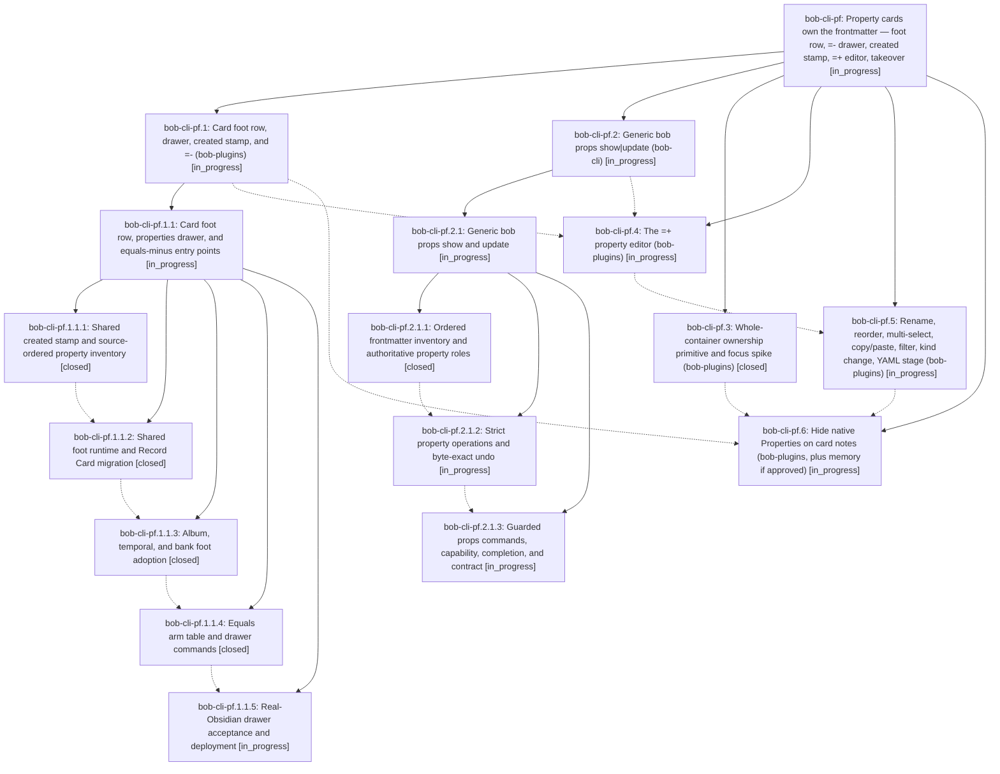

# Bead: bob-cli-pf — Property cards own the frontmatter — foot row, =- drawer, created stamp, =+ editor, takeover

[Bead Pages](../README.md) / bob-cli-pf

**Status:** ◐ in_progress · **Type:** ▸ plan · **Tier:** epic
**Owner:** `bryanbugyi34@gmail.com` · **Created by:** [bbugyi200.apollo.research.5v.linker.w0](https://github.com/bobs-org/bob-cli--agents/blob/main/sessions/bbugyi200.apollo.research.5v.linker.w0.md) · **Assignee:** `bob-cli-pf.land`
**Created:** 2026-11-22 14:35:12 EST
**Plan:** [202611/card\_owned\_frontmatter.md](https://github.com/bobs-org/bob-cli--plans/blob/main/202611/card_owned_frontmatter.md)

<!-- sase:links:start -->

## Links

| Relation | Artifact | Why |
| --- | --- | --- |
| implemented-by | [plan:202611/card_owned_frontmatter.md][1] | derived from the plan's `bead_id:` frontmatter field |

_Plus 6 automatic references — see [Referenced By](#referenced-by)._

[1]: https://github.com/bobs-org/bob-cli--plans/blob/main/202611/card_owned_frontmatter.md

<!-- sase:links:end -->

## Description

On every note a property card mounts on, the card shows the whole frontmatter: a quiet foot row with a concise created stamp and a collapsed read-only Properties drawer toggled by =-. A keyboard-first =+ property editor, backed by a byte-preserving `bob props` writer, does at least everything Obsidian's native Properties can on any Markdown note. Obsidian's native Properties block is hidden on card notes, and every failure path brings it back.

## Phases

| Bead | Title | Status | Size | Created | Agents | Commits |
|---|---|---|---|---|---:|---:|
| [bob-cli-pf.1](bob-cli-pf.1.md) | Card foot row, drawer, created stamp, and =- (bob-plugins) | ◐ in_progress | large | 2026-11-22 | 1 | 0 |
| [bob-cli-pf.2](bob-cli-pf.2.md) | Generic bob props show\|update (bob-cli) | ◐ in_progress | large | 2026-11-22 | 1 | 0 |
| [bob-cli-pf.3](bob-cli-pf.3.md) | Whole-container ownership primitive and focus spike (bob-plugins) | ✓ closed | medium | 2026-11-22 | 1 | 1 |
| [bob-cli-pf.4](bob-cli-pf.4.md) | The =+ property editor (bob-plugins) | ◐ in_progress | large | 2026-11-22 | 1 | 0 |
| [bob-cli-pf.5](bob-cli-pf.5.md) | Rename, reorder, multi-select, copy/paste, filter, kind change, YAML stage (bob-plugins) | ◐ in_progress | large | 2026-11-22 | 1 | 0 |
| [bob-cli-pf.6](bob-cli-pf.6.md) | Hide native Properties on card notes (bob-plugins, plus memory if approved) | ◐ in_progress | large | 2026-11-22 | 1 | 0 |

## Lineage

## Agents

| Agent | Bead | Commits |
|---|---|---:|
| [bbugyi200.apollo.bob-cli-pf.1](https://github.com/bobs-org/bob-cli--agents/blob/main/sessions/bbugyi200.apollo.bob-cli-pf.1.md) | [bob-cli-pf.1](bob-cli-pf.1.md) | 0 |
| [bbugyi200.apollo.bob-cli-pf.1.1.1](https://github.com/bobs-org/bob-cli--agents/blob/main/sessions/bbugyi200.apollo.bob-cli-pf.1.1.1.md) | [bob-cli-pf.1.1.1](bob-cli-pf.1.1.1.md) | 1 |
| [bbugyi200.apollo.bob-cli-pf.1.1.2](https://github.com/bobs-org/bob-cli--agents/blob/main/agents/bbugyi200.apollo.bob-cli-pf.1.1.2/README.md) | [bob-cli-pf.1.1.2](bob-cli-pf.1.1.2.md) | 1 |
| [bbugyi200.apollo.bob-cli-pf.1.1.3](https://github.com/bobs-org/bob-cli--agents/blob/main/agents/bbugyi200.apollo.bob-cli-pf.1.1.3/README.md) | [bob-cli-pf.1.1.3](bob-cli-pf.1.1.3.md) | 1 |
| [bbugyi200.apollo.bob-cli-pf.1.1.4](https://github.com/bobs-org/bob-cli--agents/blob/main/sessions/bbugyi200.apollo.bob-cli-pf.1.1.4.md) | [bob-cli-pf.1.1.4](bob-cli-pf.1.1.4.md) | 2 |
| [bbugyi200.apollo.bob-cli-pf.1.1.5](https://github.com/bobs-org/bob-cli--agents/blob/main/agents/bbugyi200.apollo.bob-cli-pf.1.1.5/README.md) | [bob-cli-pf.1.1.5](bob-cli-pf.1.1.5.md) | 0 |
| [bbugyi200.apollo.bob-cli-pf.1.1.land](https://github.com/bobs-org/bob-cli--agents/blob/main/agents/bbugyi200.apollo.bob-cli-pf.1.1.land/README.md) | [bob-cli-pf.1.1](bob-cli-pf.1.1.md) | 0 |
| [bbugyi200.apollo.bob-cli-pf.2](https://github.com/bobs-org/bob-cli--agents/blob/main/sessions/bbugyi200.apollo.bob-cli-pf.2.md) | [bob-cli-pf.2](bob-cli-pf.2.md) | 0 |
| [bbugyi200.apollo.bob-cli-pf.2.1.1](https://github.com/bobs-org/bob-cli--agents/blob/main/sessions/bbugyi200.apollo.bob-cli-pf.2.1.1.md) | [bob-cli-pf.2.1.1](bob-cli-pf.2.1.1.md) | 1 |
| [bbugyi200.apollo.bob-cli-pf.2.1.2](https://github.com/bobs-org/bob-cli--agents/blob/main/sessions/bbugyi200.apollo.bob-cli-pf.2.1.2.md) | [bob-cli-pf.2.1.2](bob-cli-pf.2.1.2.md) | 0 |
| [bbugyi200.apollo.bob-cli-pf.2.1.3](https://github.com/bobs-org/bob-cli--agents/blob/main/agents/bbugyi200.apollo.bob-cli-pf.2.1.3/README.md) | [bob-cli-pf.2.1.3](bob-cli-pf.2.1.3.md) | 0 |
| [bbugyi200.apollo.bob-cli-pf.2.1.land](https://github.com/bobs-org/bob-cli--agents/blob/main/agents/bbugyi200.apollo.bob-cli-pf.2.1.land/README.md) | [bob-cli-pf.2.1](bob-cli-pf.2.1.md) | 0 |
| [bbugyi200.apollo.bob-cli-pf.3](https://github.com/bobs-org/bob-cli--agents/blob/main/agents/bbugyi200.apollo.bob-cli-pf.3/README.md) | [bob-cli-pf.3](bob-cli-pf.3.md) | 1 |
| [bbugyi200.apollo.bob-cli-pf.4](https://github.com/bobs-org/bob-cli--agents/blob/main/agents/bbugyi200.apollo.bob-cli-pf.4/README.md) | [bob-cli-pf.4](bob-cli-pf.4.md) | 0 |
| [bbugyi200.apollo.bob-cli-pf.5](https://github.com/bobs-org/bob-cli--agents/blob/main/agents/bbugyi200.apollo.bob-cli-pf.5/README.md) | [bob-cli-pf.5](bob-cli-pf.5.md) | 0 |
| [bbugyi200.apollo.bob-cli-pf.6](https://github.com/bobs-org/bob-cli--agents/blob/main/agents/bbugyi200.apollo.bob-cli-pf.6/README.md) | [bob-cli-pf.6](bob-cli-pf.6.md) | 0 |
| [bbugyi200.apollo.bob-cli-pf.land](https://github.com/bobs-org/bob-cli--agents/blob/main/agents/bbugyi200.apollo.bob-cli-pf.land/README.md) | [bob-cli-pf](README.md) | 0 |

## Commits

| Repo | Commit | Subject | Bead | Committed |
|---|---|---|---|---|
| bob-plugins | [`bob-plugins@394633f`](https://github.com/bobs-org/bob-plugins/commit/394633fb3113fbd2971feff54442ae05e912a23d) | feat(ledger-tools): add unwired frontmatter ownership kit | [bob-cli-pf.3](bob-cli-pf.3.md) | 2026-11-22 15:04:14 EST |
| bob-plugins | [`bob-plugins@538d421`](https://github.com/bobs-org/bob-plugins/commit/538d42134a92a30976ac6155f2dcddd55282f94b) | feat(property-cards): add created formatter and source-ordered inventory | [bob-cli-pf.1.1.1](bob-cli-pf.1.1.1.md) | 2026-11-22 15:15:03 EST |
| bob-plugins | [`bob-plugins@15d82db`](https://github.com/bobs-org/bob-plugins/commit/15d82db75a1ac8a2a0920acaecbb73e8b75775e9) | feat(ledger-tools): add shared property-card foot runtime and migrate record sheet | [bob-cli-pf.1.1.2](bob-cli-pf.1.1.2.md) | 2026-11-22 17:06:38 EST |
| bob-cli | [`e98c7fe`](https://github.com/bobs-org/bob-cli/commit/e98c7fe96c24e3c3b243eb05c6cd5bf4ce07b024) | feat(props): add frontmatter inventory and roles | [bob-cli-pf.2.1.1](bob-cli-pf.2.1.1.md) | 2026-11-22 17:06:45 EST |
| bob-plugins | [`bob-plugins@b3188ab`](https://github.com/bobs-org/bob-plugins/commit/b3188ab5be762a75786f51e2ed9e10f2063f2cc7) | feat(ledger-tools): adopt shared property-card foot on album, temporal, and bank cards | [bob-cli-pf.1.1.3](bob-cli-pf.1.1.3.md) | 2026-11-22 17:52:22 EST |
| bob-plugins | [`bob-plugins@175283d`](https://github.com/bobs-org/bob-plugins/commit/175283d3c48bfbd7c9f768890827d12b6c84e26d) | feat(ledger-tools): add property card drawer entrypoints | [bob-cli-pf.1.1.4](bob-cli-pf.1.1.4.md) | 2026-11-22 18:25:56 EST |
| bob-plugins | [`bob-plugins@d382785`](https://github.com/bobs-org/bob-plugins/commit/d3827858b5cb120deb6b1db0c64c7fa46c2c165d) | docs(ledger-tools): document property drawer access | [bob-cli-pf.1.1.4](bob-cli-pf.1.1.4.md) | 2026-11-22 18:56:06 EST |

<!-- sase:referenced-by:start -->

## Referenced By

| Relation | Artifact | Why | Uses |
| --- | --- | --- | ---: |
| read-by | [agent:research.5y.cdx][1] | Understand property-card foundation epic and its intended extension points | 1 |
| read-by | [agent:research.5y.cld][2] | Understand the property cards epic to design area/project note property cards | 1 |
| read-by | [agent:research.5y.final][3] | Lead consolidation: verify pf epic status, phase completion, and D5 bank.md deferral wording before merging the swarm's area/project property-card research | 1 |
| read-by | [agent:research.5y.gem][4] | Understand the bob-cli-pf epic scope, phases, and linked plan | 1 |
| read-by | [agent:research.5y.grk][5] | Need the property-card epic scope before designing area and project cards | 1 |
| read-by | [agent:research.5y.mus][6] | Need pf epic scope to design property cards for areas and projects | 1 |

[1]: https://github.com/bobs-org/bob-cli--agents/blob/main/agents/bbugyi200.apollo.research.5y.cdx/README.md
[2]: https://github.com/bobs-org/bob-cli--agents/blob/main/agents/bbugyi200.apollo.research.5y.cld/README.md
[3]: https://github.com/bobs-org/bob-cli--agents/blob/main/agents/bbugyi200.apollo.research.5y.final/README.md
[4]: https://github.com/bobs-org/bob-cli--agents/blob/main/agents/bbugyi200.apollo.research.5y.gem/README.md
[5]: https://github.com/bobs-org/bob-cli--agents/blob/main/agents/bbugyi200.apollo.research.5y.grk/README.md
[6]: https://github.com/bobs-org/bob-cli--agents/blob/main/agents/bbugyi200.apollo.research.5y.mus/README.md

<!-- sase:referenced-by:end -->
