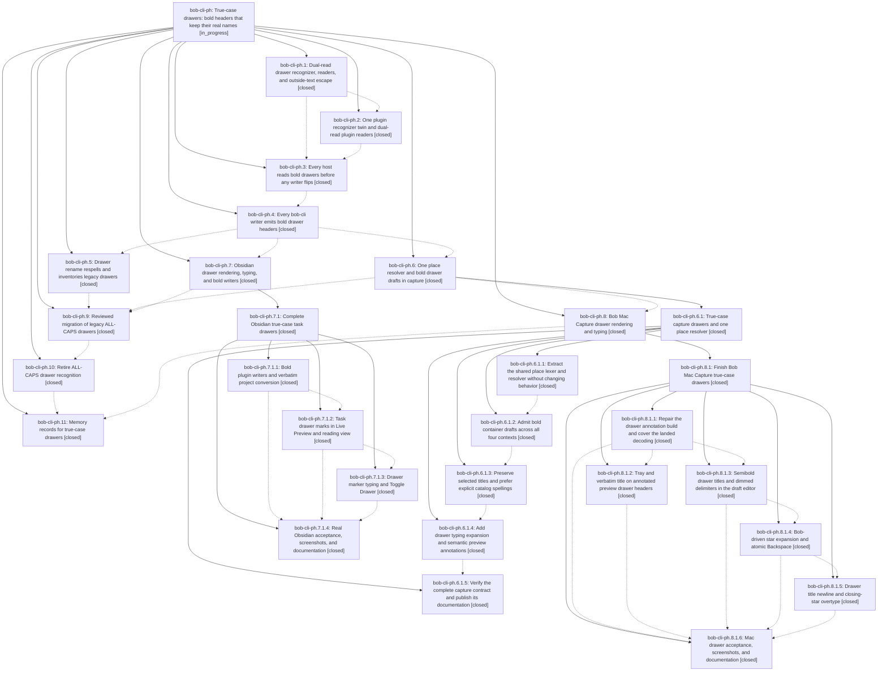

# Bead: bob-cli-ph — True-case drawers: bold headers that keep their real names

[Bead Pages](../README.md) / bob-cli-ph

**Status:** ◐ in_progress · **Type:** ▸ plan · **Tier:** epic
**Owner:** `bryanbugyi34@gmail.com` · **Created by:** [bbugyi200.apollo.research.5x.linker.w0](https://github.com/bobs-org/bob-cli--agents/blob/main/sessions/bbugyi200.apollo.research.5x.linker.w0.md) · **Assignee:** `bob-cli-ph.land`
**Created:** 2026-11-22 17:36:48 EST
**Plan:** [202611/true\_case\_drawers.md](https://github.com/bobs-org/bob-cli--plans/blob/main/202611/true_case_drawers.md)

<!-- sase:links:start -->

## Links

| Relation | Artifact | Why |
| --- | --- | --- |
| implemented-by | [plan:202611/true_case_drawers.md][1] | derived from the plan's `bead_id:` frontmatter field |
| related | [bead:bob-cli-pp][2] | True-case drawers' Mac phase (ph.8) adds drawer rendering in the same editor; it deliberately never hides drawer markers to avoid the req caret defect |
| related | file:explicit:dc76e318e355523f6fc8a927 | attached via sase artifact create --bead |

_Plus 15 automatic references — see [Referenced By](#referenced-by)._

[1]: https://github.com/bobs-org/bob-cli--plans/blob/main/202611/true_case_drawers.md
[2]: https://github.com/bobs-org/bob-cli--beads/blob/main/pages/bob-cli-pp/README.md

<!-- sase:links:end -->

## Description

A task drawer is a `- **Title**` bullet whose title keeps its authored capitalization everywhere: on disk, in capture, in Obsidian and Bob Mac Capture, and through promotion, reversal, and rename. Every surface draws it as a quiet, recognizable drawer, and ALL-CAPS stops being structure after a gated, multi-host-safe migration.

## Notes

[2026-11-23T16:27:53Z · bob-cli-pf.4.1.7.land] DISCOVERED ISSUE: Triaged bob-cli-pf.4.1.7.4 PROPOSED FOLLOW-UP #5. On bob-plugins b2c37102 against bob-cli f6cf62cf, node --test scripts/test-task-reqs-twin-copies.cjs fails its canonical README.md equality assertion (6 pass, 1 fail). git diff shows canonical tests/fixtures/task_reqs/README.md advanced in drawer-reader commit 37b2080e to RQ22/RL61 and bold drawer cases, while cycler/nav/block-id copies retain RQ21/RL60. This is causally owned by active drawer rollout, especially plugin-readers bob-cli-ph.2; synchronize semantic fixtures with the reader rollout, not README alone. No separate task created. The other proposal (#4, missing task-drawers navigation) is already repaired by f6cf62cf mkdocs.yml:375. Corroborates bob-cli-pq.3 notes #5/#7.

[2026-11-23T20:42:29Z · bob-cli-pq.land] HANDOFF from bob-cli-pq.land: Bryan waived the pq↔ph sequencing gate (bob-cli-pq note #1: 'Keep drawer words untouched; the later lander does the taste pass'). bob-cli-pq (criterion diamond) has landed first, so the joint drawer-tray/diamond taste pass belongs to this epic's lander once ph.7 (Obsidian drawer rendering) and ph.8 (Mac drawer rendering) land. Tune the tray's stroke weight beside the requirement diamond (16x16 viewBox, stroke-width 1.75, 0.92em mask in a 1em slot; the single size knob is 0.92em -> 1em, docs/task-requirements.md §4). Diamond-only baselines: notes file:explicit:6ceb733e2949af5516d84d19 (light) / ca9bfcba02f2502cd9513085 (dark); successor card file:explicit:3ba83de21213ca5060841b1a / 4a6962df7831b9d463b4f6b6; Mac preview/agenda file:explicit:a8c8984598169d92da8e1a46 / 3ca540750e2c9d40d78e6510. pq never changed a drawer word (NOTES / **Notes**) in any string.

[2026-11-25T10:57:19Z · bryanbugyi34@gmail.com] This epic should not need to wait for a release. See the drawer_reader_gate_without_release.md file in the research sidecar repo for context.

[2026-11-26T07:01:47Z · bob-cli-q8.land] DISCOVERED ISSUE (from bob-cli-q8 land): just check on bob-cli master 57adf617, plus q8 lander clippy-only fixes, reports 97 failing tests (lib 42, cli 55). The large majority still expect ALL-CAPS drawer recognition that bob-cli-ph.10 (9573ff86, 46aba677, 5d5509de, c3a9bdd9) retired. Examples: native::task_children::tests::classifies_managed_links_logs_drawers_and_nested_tasks (REQUIREMENTS -> Authored, not Drawer), native::gcal::description::bullets::tests::bullet_vectors ('- TBD' vs '- __TBD__'), native::gkeep::render (RECEIPT vs __RECEIPT__), native::gmail::body::inert whole_bold_and_legacy_list_items ('AGENDA'), task_drawer_rename::bare_run_is_a_dry_run_with_an_inventory, capture::complete_drawers::* (11), capture::multi_target::a_glued_drawer_suffix_stays_local_to_its_target, completion::bash::bash_keeps_spaces_in_one_argument ('drawer stays one escaped argument: []'), native::task_merge::tests::task_drawers_and_project_h2_drawers_resolve_for_merge, and native::capture_complete::tests::routes_tasks::three_component_marker_keeps_route_and_task_contexts. A separate trio fails on a project/area '## Tasks' summary line that tests don't expect (ref_library::today::today_matches_unnamed_capture_and_named_capture_remembers_theme, capture::task_theme_writes::new_named_task_reports_and_writes_the_resolved_theme_exception, task_status_hooks::sync::task_status_hooks_groups_area_project_tasks_after_final_statuses), probably not drawer-related. No q8 relation, tie, reconcile-fold, merge-prune, capture-relations, or capture-complete test fails. Repro: just check.

[2026-11-26T09:00:51Z · bob-cli-q7.land] DISCOVERED ISSUE (bob-cli-q7 land triage of PROPOSED FOLLOW-UPs bob-cli-q7.1 #3, q7.2 #1, q7.5 #2/#3): full just check on bob-cli master 8ee8d03c (only q7 docs on top of ph.10's 1c23bce7 baseline) exits 101 with 44 lib / 56 CLI failures. Beyond the 17 q4 settle-drift nodes, the wispr pdftotext node (bob-cli-q9), and one snooze SP4 node, every remaining failure is drawer-cutover expectation drift owned by ph: tests still pin ALL-CAPS titles or pre-cutover escaping, e.g. capture_drawers json_success_shape (Requirements vs REQUIREMENTS), routes_tasks three_component_marker (#r vs #"REQUIREMENTS"), capture_complete::tests::drawers x24, task_tidy, task_block_layout, gkeep image_with_ocr and gmail inert (__RECEIPT__/__AGENDA__ escaping), CLI complete_drawers/sections/multi_target/task_drawer_rename/completion bash+vault drawer nodes. Matches ph.10 note #3 (42/55 at 1c23bce7). No caret Go To node fails. No standalone task filed.

[2026-11-26T09:01:44Z · bob-cli-ph.8.1.land] DISCOVERED ISSUE (corroboration, from bob-cli-ph.8.1.land, triaging bob-cli-ph.8.1.6 PROPOSED FOLLOW-UP #2): independent just check on bob-cli 1c23bce7 (apollo, 2026-11-26 ~08:45Z) again exits 101 in -p bob-obsidian --lib and --test cli (94 failing test names; capture::complete_drawers, native::capture_complete, task_drawer_rename, capture::sections, capture::project_note_offer, capture::drawer_bullets, ...), matching note #4 and bob-cli-ph.10 note #3. Master CI 45780195523 (1c23bce7) test (ubuntu-latest) also failed. No separate task created; this is cutover golden migration owned by this epic's landing.

[2026-11-26T09:02:01Z · bob-cli-ph.8.1.land] DISCOVERED ISSUE (from bob-cli-ph.8.1.land): bob-mac-capture drawer preview fixtures still predate the ph.10 cutover. Tests/Fixtures/drawer-fixtures-README.md records the original drawer-*.json set from bob-cli 05dd83cf (grammar 31), including drawer-capture-legacy-existing.json and drawer-complete-* rows whose FUTURE WORK legacy drawer and REQUIREMENTS-style keys Bob no longer recognizes after 9573ff86/46aba677 (Bob now emits only bold|section; grammar 33). Only the star-expansion fixtures (drawer-parse-empty-skeleton-*, drawer-rewrite-*) come from 01dee47a (grammar 33). Mac tests still pass because decoding is additive, so nothing is red, but the fixtures no longer describe current Bob. Remediation: regenerate with Scripts/generate-drawer-fixtures.sh from a clean post-cutover bob-cli, keep legacy_caps coverage as inline decode payloads per plan:202611/finish_mac_true_case_drawers.md (Fixtures rule), update the README provenance, and watch exact-SHA macOS CI green. Related, not a duplicate: bob-cli-ge (grammar-gate floors). No separate task created; causally owned by this epic's cutover.

[2026-11-26T09:51:21Z · bob-cli-q4.10.1.land] DISCOVERED ISSUE (bob-cli-q4.10.1 land, triage of bob-cli-q4.10.1.6 PROPOSED FOLLOW-UPs #3/#4). (1) Fresh reproduction of note #4/#5/#6 on clean bob-cli master ae78dbb2: full just check fails 98 tests (lib 43, CLI 55). 80 of them are drawer-cutover expectation drift, e.g. capture_complete::tests::drawers x23, capture::complete_drawers x10, capture::sections x6 (left 'Requirements' vs right 'REQUIREMENTS'), task_block_layout x3, task_drawer_rename, completion bash/vault/capture_text drawers, help_options::capture_drawers_help. The other 18 are the 17 q4 settle-drift nodes (on bob-cli-q4) and the wispr node (bob-cli-q9). (2) NEW: the ph.10 plugin reader retirement is committed but not deployed. bob-plugins fda0ef27/2ba3315d touch block-id-prompt, bob-ledger-tools and task-status-cycler, and on athena bob plugins list shows all three drifting from master 8645ed55. block-id-prompt 1.46.0 is clean-deployed from bdb85e34 (2026-11-25T21:24Z). bob-ledger-tools 1.166.4 is an uncommitted build from bob-cli_12 at dc6c76f (02:07Z), which also lacks the bob-cli-pl.9.1.2 bank fixes 06c87a06/8e401c6e/b185579f/5addf8ca/a0ebe63e. task-status-cycler 1.64.2 is an uncommitted build from bob-cli_19 at 2ff8fdd (02:03Z). The live vault therefore still runs pre-cutover drawer readers in those plugins. The unmodified full-vault post-sync smoke gate (bob-plugins --deployed-vault /home/bryan/bob) refuses before Electron startup naming exactly these three; see bob-cli-q4.10.1.6 notes #4/#7 and file:explicit:161491026097b312bac5b238. Remediation: deploy these plugins from clean master via bob plugins sync once the cutover is cleared for the vault, following the protected-sync procedure without -F. The nav lander deliberately did not deploy them. No standalone task filed.

[2026-11-26T10:45:48Z · bob-cli-q5.3.1.land] DISCOVERED ISSUE: bob-cli-q5.3.1 landing triage corroborates drawer-cutover fixture drift from proposing beads bob-cli-q5.3.1.2 note #4 and bob-cli-q5.3.1.3 note #1. Their full checks found the same 98 names (43 lib/55 CLI) on phase and untouched bases 1c23bce7/ae78dbb2. This matches your notes #4/#5/#8: 80 drawer expectations, separate from 17 q4 settlement nodes and q9 WISPr. Reviewed ph.10 scope and source changes; no fresh full test run or standalone task claimed. Please resolve the drawer-owned nodes in this epic landing.

[2026-11-26T11:01:22Z · bob-cli-q8.10.land] DISCOVERED ISSUE corroboration from q8.10 landing: unchanged bob-cli 292d60c0, sase tool run check 231f6b89bd79a9cbc17778a0ba1b3d92, has completed the lib and CLI targets with the same 97 baseline failures: 42 lib + 55 CLI. Of those, 80 are the drawer-cutover expectations already in ph notes #4-#9 and ph.10 #3/#5; 17 are the separately owned q4 settlement set. Examples: native::capture::block_diff::tests::annotate_drawer_lines_uses_after_snapshot_except_removed, capture_complete drawer menus, native::task_drawers/task_block_layout, CLI capture::complete_drawers and capture::sections. No Rust source/test edits in this turn. Searched task duplicates across all statuses, swept recent tasks, and inspected active epic scopes; no separate task filed because this active epic owns the cutover. The WISPr node passes on this run.

[2026-11-26T11:07:12Z · bob-cli-q5.2.1.land] DISCOVERED ISSUE: bob-cli-q5.2.1 landing triage of proposing beads bob-cli-q5.2.1.2 note #5, .3 note #1, and .4 note #1. These independently report the same drawer-cutover failures already in ph notes #4-#10. Phase .2 compared all 98 names AND normalized diagnostics at bbcae8e0 versus untouched 1c23bce7 (43 lib/55 CLI); the draw

… and 3335 more characters

## Phases

| Bead | Title | Status | Size | Created | Agents | Commits |
|---|---|---|---|---|---:|---:|
| [bob-cli-ph.1](bob-cli-ph.1.md) | Dual-read drawer recognizer, readers, and outside-text escape | ✓ closed | large | 2026-11-22 | 1 | 2 |
| [bob-cli-ph.10](bob-cli-ph.10.md) | Retire ALL-CAPS drawer recognition | ✓ closed | medium | 2026-11-22 | 1 | 9 |
| [bob-cli-ph.11](bob-cli-ph.11.md) | Memory records for true-case drawers | ✓ closed | small | 2026-11-22 | 1 | 1 |
| [bob-cli-ph.2](bob-cli-ph.2.md) | One plugin recognizer twin and dual-read plugin readers | ✓ closed | large | 2026-11-22 | 1 | 4 |
| [bob-cli-ph.3](bob-cli-ph.3.md) | Every host reads bold drawers before any writer flips | ✓ closed | small | 2026-11-22 | 1 | 2 |
| [bob-cli-ph.4](bob-cli-ph.4.md) | Every bob-cli writer emits bold drawer headers | ✓ closed | medium | 2026-11-22 | 1 | 1 |
| [bob-cli-ph.5](bob-cli-ph.5.md) | Drawer rename respells and inventories legacy drawers | ✓ closed | medium | 2026-11-22 | 1 | 1 |
| [bob-cli-ph.6](bob-cli-ph.6.md) | One place resolver and bold drawer drafts in capture | ✓ closed | large | 2026-11-22 | 1 | 0 |
| [bob-cli-ph.7](bob-cli-ph.7.md) | Obsidian drawer rendering, typing, and bold writers | ✓ closed | large | 2026-11-22 | 1 | 0 |
| [bob-cli-ph.8](bob-cli-ph.8.md) | Bob Mac Capture drawer rendering and typing | ✓ closed | large | 2026-11-22 | 1 | 3 |
| [bob-cli-ph.9](bob-cli-ph.9.md) | Reviewed migration of legacy ALL-CAPS drawers | ✓ closed | small | 2026-11-22 | 1 | 0 |

## Lineage

## Agents

| Agent | Bead | Commits |
|---|---|---:|
| [bbugyi200.apollo.bob-cli-ph.1](https://github.com/bobs-org/bob-cli--agents/blob/main/sessions/bbugyi200.apollo.bob-cli-ph.1.md) | [bob-cli-ph.1](bob-cli-ph.1.md) | 2 |
| [bbugyi200.apollo.bob-cli-ph.10](https://github.com/bobs-org/bob-cli--agents/blob/main/agents/bbugyi200.apollo.bob-cli-ph.10/README.md) | [bob-cli-ph.10](bob-cli-ph.10.md) | 9 |
| [bbugyi200.apollo.bob-cli-ph.11](https://github.com/bobs-org/bob-cli--agents/blob/main/agents/bbugyi200.apollo.bob-cli-ph.11/README.md) | [bob-cli-ph.11](bob-cli-ph.11.md) | 1 |
| [bbugyi200.apollo.bob-cli-ph.2](https://github.com/bobs-org/bob-cli--agents/blob/main/sessions/bbugyi200.apollo.bob-cli-ph.2.md) | [bob-cli-ph.2](bob-cli-ph.2.md) | 4 |
| [bbugyi200.apollo.bob-cli-ph.3](https://github.com/bobs-org/bob-cli--agents/blob/main/agents/bbugyi200.apollo.bob-cli-ph.3/README.md) | [bob-cli-ph.3](bob-cli-ph.3.md) | 2 |
| [bbugyi200.apollo.bob-cli-ph.4](https://github.com/bobs-org/bob-cli--agents/blob/main/agents/bbugyi200.apollo.bob-cli-ph.4/README.md) | [bob-cli-ph.4](bob-cli-ph.4.md) | 1 |
| [bbugyi200.apollo.bob-cli-ph.5](https://github.com/bobs-org/bob-cli--agents/blob/main/sessions/bbugyi200.apollo.bob-cli-ph.5.md) | [bob-cli-ph.5](bob-cli-ph.5.md) | 1 |
| [bbugyi200.apollo.bob-cli-ph.6](https://github.com/bobs-org/bob-cli--agents/blob/main/sessions/bbugyi200.apollo.bob-cli-ph.6.md) | [bob-cli-ph.6](bob-cli-ph.6.md) | 0 |
| [bbugyi200.apollo.bob-cli-ph.6.1.1](https://github.com/bobs-org/bob-cli--agents/blob/main/agents/bbugyi200.apollo.bob-cli-ph.6.1.1/README.md) | [bob-cli-ph.6.1.1](bob-cli-ph.6.1.1.md) | 1 |
| [bbugyi200.apollo.bob-cli-ph.6.1.2](https://github.com/bobs-org/bob-cli--agents/blob/main/agents/bbugyi200.apollo.bob-cli-ph.6.1.2/README.md) | [bob-cli-ph.6.1.2](bob-cli-ph.6.1.2.md) | 1 |
| [bbugyi200.apollo.bob-cli-ph.6.1.3](https://github.com/bobs-org/bob-cli--agents/blob/main/agents/bbugyi200.apollo.bob-cli-ph.6.1.3/README.md) | [bob-cli-ph.6.1.3](bob-cli-ph.6.1.3.md) | 1 |
| [bbugyi200.apollo.bob-cli-ph.6.1.4](https://github.com/bobs-org/bob-cli--agents/blob/main/agents/bbugyi200.apollo.bob-cli-ph.6.1.4/README.md) | [bob-cli-ph.6.1.4](bob-cli-ph.6.1.4.md) | 1 |
| [bbugyi200.apollo.bob-cli-ph.6.1.5](https://github.com/bobs-org/bob-cli--agents/blob/main/sessions/bbugyi200.apollo.bob-cli-ph.6.1.5.md) | [bob-cli-ph.6.1.5](bob-cli-ph.6.1.5.md) | 1 |
| [bbugyi200.apollo.bob-cli-ph.6.1.land](https://github.com/bobs-org/bob-cli--agents/blob/main/agents/bbugyi200.apollo.bob-cli-ph.6.1.land/README.md) | [bob-cli-ph.6.1](bob-cli-ph.6.1.md) | 2 |
| [bbugyi200.apollo.bob-cli-ph.7](https://github.com/bobs-org/bob-cli--agents/blob/main/sessions/bbugyi200.apollo.bob-cli-ph.7.md) | [bob-cli-ph.7](bob-cli-ph.7.md) | 0 |
| [bbugyi200.apollo.bob-cli-ph.7.1.1](https://github.com/bobs-org/bob-cli--agents/blob/main/agents/bbugyi200.apollo.bob-cli-ph.7.1.1/README.md) | [bob-cli-ph.7.1.1](bob-cli-ph.7.1.1.md) | 1 |
| [bbugyi200.apollo.bob-cli-ph.7.1.2](https://github.com/bobs-org/bob-cli--agents/blob/main/sessions/bbugyi200.apollo.bob-cli-ph.7.1.2.md) | [bob-cli-ph.7.1.2](bob-cli-ph.7.1.2.md) | 3 |
| [bbugyi200.apollo.bob-cli-ph.7.1.3](https://github.com/bobs-org/bob-cli--agents/blob/main/agents/bbugyi200.apollo.bob-cli-ph.7.1.3/README.md) | [bob-cli-ph.7.1.3](bob-cli-ph.7.1.3.md) | 1 |
| [bbugyi200.apollo.bob-cli-ph.7.1.4](https://github.com/bobs-org/bob-cli--agents/blob/main/agents/bbugyi200.apollo.bob-cli-ph.7.1.4/README.md) | [bob-cli-ph.7.1.4](bob-cli-ph.7.1.4.md) | 2 |
| [bbugyi200.apollo.bob-cli-ph.7.1.land](https://github.com/bobs-org/bob-cli--agents/blob/main/sessions/bbugyi200.apollo.bob-cli-ph.7.1.land.md) | [bob-cli-ph.7.1](bob-cli-ph.7.1.md) | 5 |
| [bbugyi200.apollo.bob-cli-ph.8](https://github.com/bobs-org/bob-cli--agents/blob/main/sessions/bbugyi200.apollo.bob-cli-ph.8.md) | [bob-cli-ph.8](bob-cli-ph.8.md) | 3 |
| [bbugyi200.apollo.bob-cli-ph.8.1.1](https://github.com/bobs-org/bob-cli--agents/blob/main/sessions/bbugyi200.apollo.bob-cli-ph.8.1.1.md) | [bob-cli-ph.8.1.1](bob-cli-ph.8.1.1.md) | 3 |
| [bbugyi200.apollo.bob-cli-ph.8.1.2](https://github.com/bobs-org/bob-cli--agents/blob/main/sessions/bbugyi200.apollo.bob-cli-ph.8.1.2.md) | [bob-cli-ph.8.1.2](bob-cli-ph.8.1.2.md) | 3 |
| [bbugyi200.apollo.bob-cli-ph.8.1.3](https://github.com/bobs-org/bob-cli--agents/blob/main/sessions/bbugyi200.apollo.bob-cli-ph.8.1.3.md) | [bob-cli-ph.8.1.3](bob-cli-ph.8.1.3.md) | 1 |
| [bbugyi200.apollo.bob-cli-ph.8.1.4](https://github.com/bobs-org/bob-cli--agents/blob/main/sessions/bbugyi200.apollo.bob-cli-ph.8.1.4.md) | [bob-cli-ph.8.1.4](bob-cli-ph.8.1.4.md) | 1 |
| [bbugyi200.apollo.bob-cli-ph.8.1.5](https://github.com/bobs-org/bob-cli--agents/blob/main/sessions/bbugyi200.apollo.bob-cli-ph.8.1.5.md) | [bob-cli-ph.8.1.5](bob-cli-ph.8.1.5.md) | 1 |
| [bbugyi200.apollo.bob-cli-ph.8.1.6](https://github.com/bobs-org/bob-cli--agents/blob/main/sessions/bbugyi200.apollo.bob-cli-ph.8.1.6.md) | [bob-cli-ph.8.1.6](bob-cli-ph.8.1.6.md) | 2 |
| [bbugyi200.apollo.bob-cli-ph.8.1.land](https://github.com/bobs-org/bob-cli--agents/blob/main/sessions/bbugyi200.apollo.bob-cli-ph.8.1.land.md) | [bob-cli-ph.8.1](bob-cli-ph.8.1.md) | 5 |
| [bbugyi200.apollo.bob-cli-ph.9](https://github.com/bobs-org/bob-cli--agents/blob/main/sessions/bbugyi200.apollo.bob-cli-ph.9.md) | [bob-cli-ph.9](bob-cli-ph.9.md) | 0 |
| [bbugyi200.apollo.bob-cli-ph.land](https://github.com/bobs-org/bob-cli--agents/blob/main/sessions/bbugyi200.apollo.bob-cli-ph.land.md) | [bob-cli-ph](README.md) | 4 |

## Commits

| Repo | Commit | Subject | Bead | Committed |
|---|---|---|---|---|
| bob-cli | [`37b2080`](https://github.com/bobs-org/bob-cli/commit/37b2080e9efca170f542954f088ce4169d430cfa) | feat(drawers): add dual-read task drawer readers | [bob-cli-ph.1](bob-cli-ph.1.md) | 2026-11-23 08:06:21 EST |
| bob-cli | [`c25d92f`](https://github.com/bobs-org/bob-cli/commit/c25d92fdd4e2c4073ec1a24bda34251fae8eded9) | feat(capture): add task drawer contracts and docs | [bob-cli-ph.1](bob-cli-ph.1.md) | 2026-11-23 12:14:15 EST |
| bob-cli | [`b1fa8ad`](https://github.com/bobs-org/bob-cli/commit/b1fa8ad6de8c3818152296f7c9af7cb2ec21ed1e) | docs: document plugin task drawer reader parity | [bob-cli-ph.2](bob-cli-ph.2.md) | 2026-11-23 13:04:10 EST |
| bob-plugins | [`bob-plugins@19ac4a3`](https://github.com/bobs-org/bob-plugins/commit/19ac4a3e4bafc2362b2b6189553dec99cfba1500) | feat: unify task drawer readers across plugins | [bob-cli-ph.2](bob-cli-ph.2.md) | 2026-11-23 13:05:47 EST |
| bob-plugins | [`bob-plugins@6268f24`](https://github.com/bobs-org/bob-plugins/commit/6268f246c33434e1c3da94213ca5e4d76a8eccd5) | test(plugins): anchor keep-moving style assertion to picker rule | [bob-cli-ph.2](bob-cli-ph.2.md) | 2026-11-23 13:20:45 EST |
| bob-plugins | [`bob-plugins@63e9e76`](https://github.com/bobs-org/bob-plugins/commit/63e9e7609338d91de8f592c3c134d69abd92b9ab) | test(plugins): load drawer DV/DH vectors from the cycler fixture | [bob-cli-ph.2](bob-cli-ph.2.md) | 2026-11-23 16:51:32 EST |
| bob-cli | [`fd99ebb`](https://github.com/bobs-org/bob-cli/commit/fd99ebb85dcf0555cc48570397c419f4dd8f3167) | chore: add Bob host reader currency gate | [bob-cli-ph.3](bob-cli-ph.3.md) | 2026-11-23 18:51:04 EST |
| bob-cli | [`5ab392a`](https://github.com/bobs-org/bob-cli/commit/5ab392a1ba087c6f87d8685035979498082079ed) | chore(dev): let bob-host-currency gate on a bold-drawer read probe | [bob-cli-ph.3](bob-cli-ph.3.md) | 2026-11-25 06:49:42 EST |
| bob-cli | [`8f88a52`](https://github.com/bobs-org/bob-cli/commit/8f88a52c1cfc59236d6ddc4bd36ee6f11de95afd) | feat(task-drawers): emit bold drawer headers from every writer | [bob-cli-ph.4](bob-cli-ph.4.md) | 2026-11-25 08:27:23 EST |
| bob-cli | [`ae42b3e`](https://github.com/bobs-org/bob-cli/commit/ae42b3ed2a48ddc218021262c0fdd3fc791d99a1) | feat(task-drawers): preserve rename spelling and inventory legacy drawers | [bob-cli-ph.5](bob-cli-ph.5.md) | 2026-11-25 09:29:31 EST |
| bob-plugins | [`bob-plugins@f2e8c62`](https://github.com/bobs-org/bob-plugins/commit/f2e8c62a29464701cb097233579c156964cb4996) | feat(task-drawers)!: emit bold drawer headers and verbatim project conversion in plugins | [bob-cli-ph.7.1.1](bob-cli-ph.7.1.1.md) | 2026-11-25 09:38:13 EST |
| bob-cli | [`45a5434`](https://github.com/bobs-org/bob-cli/commit/45a54345f59c7cefec7121ac46f61fe34ba3fbf1) | refactor(capture): extract shared place lexer and resolver | [bob-cli-ph.6.1.1](bob-cli-ph.6.1.1.md) | 2026-11-25 09:41:35 EST |
| bob-plugins | [`bob-plugins@2796d63`](https://github.com/bobs-org/bob-plugins/commit/2796d63dc79b3c5e44d113a5b2aae4bbc2ee4ad8) | feat(drawers): add task drawer marks in Obsidian | [bob-cli-ph.7.1.2](bob-cli-ph.7.1.2.md) | 2026-11-25 10:11:25 EST |
| bob-plugins | [`bob-plugins@5ed3bd2`](https://github.com/bobs-org/bob-plugins/commit/5ed3bd22603800d8d2c73f4a2b0ddeb2b494206c) | fix(bob-ledger-tools): export task drawer helpers after initialization | [bob-cli-ph.7.1.2](bob-cli-ph.7.1.2.md) | 2026-11-25 10:25:15 EST |
| bob-plugins | [`bob-plugins@1753d73`](https://github.com/bobs-org/bob-plugins/commit/1753d730133fd125e4b32cd53bd8223efc4ff47b) | docs(bob-ledger-tools): list task drawer marks command | [bob-cli-ph.7.1.2](bob-cli-ph.7.1.2.md) | 2026-11-25 10:33:52 EST |
| bob-plugins | [`bob-plugins@8d3c555`](https://github.com/bobs-org/bob-plugins/commit/8d3c555c61041065281b74259086b82633719c47) | feat(task-status-cycler): add drawer marker typing and Toggle Drawer | [bob-cli-ph.7.1.3](bob-cli-ph.7.1.3.md) | 2026-11-25 11:21:53 EST |
| bob-cli | [`22fea30`](https://github.com/bobs-org/bob-cli/commit/22fea308101c894185bc29d494c1b5bdca6dff71) | feat(capture): admit whole-bold container drafts | [bob-cli-ph.6.1.2](bob-cli-ph.6.1.2.md) | 2026-11-25 12:14:41 EST |
| bob-cli | [`0742684`](https://github.com/bobs-org/bob-cli/commit/0742684de3390415ffb5dbb3423c0dbc841f4b3e) | docs(task-drawers): document Obsidian trays, typing, and conversion | [bob-cli-ph.7.1.4](bob-cli-ph.7.1.4.md) | 2026-11-25 12:51:09 EST |
| bob-plugins | [`bob-plugins@8254caa`](https://github.com/bobs-org/bob-plugins/commit/8254caa48938b49b73cd4187c216406d1e3f5fea) | feat(task-status-cycler): add Obsidian drawer acceptance and typing precedence | [bob-cli-ph.7.1.4](bob-cli-ph.7.1.4.md) | 2026-11-25 13:03:36 EST |
| bob-cli | [`8a1d16a`](https://github.com/bobs-org/bob-cli/commit/8a1d16a621f7829bf94b3ccabf49c04ab9192fd5) | feat(capture): prefer catalog spellings and preserve authored drawer titles | [bob-cli-ph.6.1.3](bob-cli-ph.6.1.3.md) | 2026-11-25 13:27:40 EST |
| bob-plugins | [`bob-plugins@6906848`](https://github.com/bobs-org/bob-plugins/commit/6906848059293c497d371d032c28555f10f7ab12) | fix(drawers): preserve title bytes and strengthen landing regressions | [bob-cli-ph.7.1](bob-cli-ph.7.1.md) | 2026-11-25 13:49:42 EST |
| bob-plugins | [`bob-plugins@e5d3d6e`](https://github.com/bobs-org/bob-plugins/commit/e5d3d6e0df8551d668feba24fc9296388be58a80) | test(drawers): capture Obsidian visual diagnostics | [bob-cli-ph.7.1](bob-cli-ph.7.1.md) | 2026-11-25 14:08:42 EST |
| bob-plugins | [`bob-plugins@9d2dbd2`](https://github.com/bobs-org/bob-plugins/commit/9d2dbd2cdc3e0e223b2365d6ca71cc243d1dd669) | fix(ledger-tools): repair task drawer landing visuals | [bob-cli-ph.7.1](bob-cli-ph.7.1.md) | 2026-11-25 15:17:05 EST |
| bob-cli | [`dfc7fac`](https://github.com/bobs-org/bob-cli/commit/dfc7facb18ded459c5471372a65731a543e5f1f7) | feat(capture): wire drawer editor rewrite markers through JSON and previews | [bob-cli-ph.6.1.4](bob-cli-ph.6.1.4.md) | 2026-11-25 15:51:26 EST |
| bob-cli | [`d67a5b7`](https://github.com/bobs-org/bob-cli/commit/d67a5b7b8135af40ba8f345e90cb9a12f3fe0812) | docs(capture): complete drawer contract references | [bob-cli-ph.6.1.5](bob-cli-ph.6.1.5.md) | 2026-11-25 16:19:55 EST |
| bob-plugins | [`bob-plugins@4369a43`](https://github.com/bobs-org/bob-plugins/commit/4369a4360be4441977bcbf5a673cbbddbaf96f3e) | fix(drawers): shield completed drawer headers in reading view | [bob-cli-ph.7.1](bob-cli-ph.7.1.md) | 2026-11-25 17:33:56 EST |
| bob-cli | [`2d2f200`](https://github.com/bobs-org/bob-cli/commit/2d2f200dfdbdce64c6ff685b0df5366e510e32f0) | feat(capture)!: land true-case drawers with one reserved-name rule | [bob-cli-ph.6.1](bob-cli-ph.6.1.md) | 2026-11-25 18:25:58 EST |
| bob-cli--plans | [`bob-cli--plans@5d3da5e`](https://github.com/bobs-org/bob-cli--plans/commit/5d3da5e0e76637aea0e969935c58ed7da97e1192) | chore(plans): mark capture\_true\_case\_drawers done | [bob-cli-ph.6.1](bob-cli-ph.6.1.md) | 2026-11-25 18:27:16 EST |
| bob-cli--plans | [`bob-cli--plans@c15fb27`](https://github.com/bobs-org/bob-cli--plans/commit/c15fb27b034f4413371b9deaed50ff4bae33f7bb) | docs(plan): mark true-case drawer epic complete | [bob-cli-ph.7.1](bob-cli-ph.7.1.md) | 2026-11-25 18:59:29 EST |
| bob-mac-capture | [`bob-mac-capture@4eb9b2e`](https://github.com/bobs-org/bob-mac-capture/commit/4eb9b2e977dc8275a5849d5ac7f8bc8fabb617b2) | fix(mac): require grammar 30 for drawer fixtures | [bob-cli-ph.8](bob-cli-ph.8.md) | 2026-11-25 19:18:09 EST |
| bob-cli | [`f4da72f`](https://github.com/bobs-org/bob-cli/commit/f4da72ff5dd08b9827eb8b13a9f2bce04c47d9f6) | docs(task-drawers): describe Mac thin-client drawer contract | [bob-cli-ph.8](bob-cli-ph.8.md) | 2026-11-25 19:51:53 EST |
| bob-mac-capture | [`bob-mac-capture@b45b195`](https://github.com/bobs-org/bob-mac-capture/commit/b45b1951b0f983edc4d8e9deae5ad92e96bb00ab) | feat(mac): carry true-case drawer annotations from Bob | [bob-cli-ph.8](bob-cli-ph.8.md) | 2026-11-25 19:53:07 EST |
| bob-mac-capture | [`bob-mac-capture@b0062be`](https://github.com/bobs-org/bob-mac-capture/commit/b0062be1749f388a849c5bf0251c7fb3f914bf94) | fix(mac-capture): decode drawer summary markers safely | [bob-cli-ph.8.1.1](bob-cli-ph.8.1.1.md) | 2026-11-25 21:11:04 EST |
| bob-mac-capture | [`bob-mac-capture@5073564`](https://github.com/bobs-org/bob-mac-capture/commit/5073564e3ce639eca04bd05659b1a5e6fd04a0f8) | test(mac-capture): align drawer assertions with true-case output | [bob-cli-ph.8.1.1](bob-cli-ph.8.1.1.md) | 2026-11-25 21:37:30 EST |
| bob-cli | [`9573ff8`](https://github.com/bobs-org/bob-cli/commit/9573ff869fbef177ff041e78bcf28ddac85a71be) | feat: retire all-caps task drawer recognition | [bob-cli-ph.10](bob-cli-ph.10.md) | 2026-11-25 21:51:35 EST |
| bob-plugins | [`bob-plugins@fda0ef2`](https://github.com/bobs-org/bob-plugins/commit/fda0ef27749b2b1feae59841ea1024911ff38bc1) | feat: retire all-caps plugin drawer readers | [bob-cli-ph.10](bob-cli-ph.10.md) | 2026-11-25 21:52:59 EST |
| bob-cli | [`46aba67`](https://github.com/bobs-org/bob-cli/commit/46aba67724194df951bf2c23132f15861d2351ec) | fix(drawers): restore rename flow and complete bold-only cutover verification | [bob-cli-ph.10](bob-cli-ph.10.md) | 2026-11-25 22:21:33 EST |
| bob-cli | [`5d5509d`](https://github.com/bobs-org/bob-cli/commit/5d5509de4f27f4042eccf52b1c0f6171e43e88d9) | fix(capture): update drawer parser test fixtures | [bob-cli-ph.10](bob-cli-ph.10.md) | 2026-11-25 22:36:58 EST |
| bob-mac-capture | [`bob-mac-capture@4c36dd0`](https://github.com/bobs-org/bob-mac-capture/commit/4c36dd027dd07baa29c09fd021a4ef1f50d9b935) | test(mac-capture): update drawer presentation fixtures | [bob-cli-ph.8.1.1](bob-cli-ph.8.1.1.md) | 2026-11-25 22:43:08 EST |
| bob-cli | [`d820323`](https://github.com/bobs-org/bob-cli/commit/d8203235ac54ac416160d34f5e4080499315bbfe) | fix(capture): borrow parsed drawer kind in record fixture | [bob-cli-ph.10](bob-cli-ph.10.md) | 2026-11-25 22:51:25 EST |
| bob-mac-capture | [`bob-mac-capture@4d9e845`](https://github.com/bobs-org/bob-mac-capture/commit/4d9e845e5a76e20d8f3b34406c9b30feba12fbbf) | feat(mac-capture): tray and verbatim title on drawer preview headers | [bob-cli-ph.8.1.2](bob-cli-ph.8.1.2.md) | 2026-11-25 23:08:02 EST |
| bob-plugins | [`bob-plugins@4f55996`](https://github.com/bobs-org/bob-plugins/commit/4f5599677a44d4eb98fedef23fa96e193edd02f1) | test(drawers): fix uppercase subtree expectation | [bob-cli-ph.10](bob-cli-ph.10.md) | 2026-11-25 23:11:23 EST |
| bob-mac-capture | [`bob-mac-capture@b422fbd`](https://github.com/bobs-org/bob-mac-capture/commit/b422fbdc84f520f0ea4d995e736c693def48b557) | feat(capture): style drawer titles and delimiters | [bob-cli-ph.8.1.3](bob-cli-ph.8.1.3.md) | 2026-11-25 23:25:14 EST |
| bob-mac-capture | [`bob-mac-capture@c2dd7fb`](https://github.com/bobs-org/bob-mac-capture/commit/c2dd7fbfdf85f6bf7679a38be318eb8d457fb41b) | fix(mac-capture): hoist throwing edgeRows out of the drawer render builder | [bob-cli-ph.8.1.2](bob-cli-ph.8.1.2.md) | 2026-11-25 23:30:44 EST |
| bob-cli | [`c3a9bdd`](https://github.com/bobs-org/bob-cli/commit/c3a9bdd9088399cf4da683b6a0cfccb515fcb68e) | test(drawers): migrate task-requirements fixture vectors to bold headers | [bob-cli-ph.10](bob-cli-ph.10.md) | 2026-11-25 23:54:14 EST |
| bob-plugins | [`bob-plugins@2ba3315`](https://github.com/bobs-org/bob-plugins/commit/2ba3315d12b714469eeaa7747db0f054602a27ec) | test(drawers): align plugin fixtures with bold-only readers | [bob-cli-ph.10](bob-cli-ph.10.md) | 2026-11-25 23:55:37 EST |
| bob-mac-capture | [`bob-mac-capture@5d50d5a`](https://github.com/bobs-org/bob-mac-capture/commit/5d50d5a6ddf46b4aa35efefbb83739734b6094f2) | fix(mac-capture): correct drawer CI assertions and delimiter full-ink color | [bob-cli-ph.8.1.2](bob-cli-ph.8.1.2.md) | 2026-11-26 00:20:27 EST |
| bob-mac-capture | [`bob-mac-capture@c561b26`](https://github.com/bobs-org/bob-mac-capture/commit/c561b26a0a8d39de5996ec470c5eae3959d09937) | feat(mac-capture): drive drawer star expansion and atomic Backspace through capture-rewrite | [bob-cli-ph.8.1.4](bob-cli-ph.8.1.4.md) | 2026-11-26 00:43:34 EST |
| bob-mac-capture | [`bob-mac-capture@7d6e12a`](https://github.com/bobs-org/bob-mac-capture/commit/7d6e12a7397bbb270a616a06357c58dddaf832f8) | feat(capture): handle drawer title newline and star overtype | [bob-cli-ph.8.1.5](bob-cli-ph.8.1.5.md) | 2026-11-26 01:51:48 EST |
| bob-cli | [`631a49d`](https://github.com/bobs-org/bob-cli/commit/631a49d5d55f18ea6b343ce778f6148e457e1bf1) | docs(drawers): reconcile Mac Capture section with shipped true-case behavior | [bob-cli-ph.8.1.6](bob-cli-ph.8.1.6.md) | 2026-11-26 03:03:30 EST |

… and 12 more commits

<!-- sase:referenced-by:start -->

## Referenced By

| Relation | Artifact | Why | Uses |
| --- | --- | --- | ---: |
| read-by | [agent:1fk][1] | Research whether pq.3/pq.5 truly depend on bob-cli-ph | 1 |
| read-by | [agent:bob-cli-ph.10][2] | Review cutover failure evidence already reported by other phase landers | 1 |
| read-by | [agent:bob-cli-ph.4][3] | need epic decisions and notes | 1 |
| read-by | [agent:bob-cli-ph.6.1.2][4] | Need ancestor epic decisions that govern the capture-drawer phase | 1 |
| read-by | [agent:bob-cli-ph.7.1.land--3][5] | Confirm parent plan stays open during closeout | 1 |
| read-by | [agent:bob-cli-ph.7.1.land--7][5] | Confirm the containing Obsidian phase epic remains open after drawer closeout | 1 |
| read-by | [agent:bob-cli-ph.land][6] | Need the parent link | 2 |
| read-by | [agent:bob-cli-pq.land][7] | Check drawer epic status for sequencing and taste pass ownership | 1 |
| read-by | [agent:bob-cli-q4.10.1.land][8] | Check whether the true-case drawer epic owns the 98 bob-cli just check failures proposed by q4.10.1.6 | 2 |
| read-by | [agent:g1][9] | Research how to progress the epic without waiting for a release | 1 |
| read-by | [agent:research.66.cdx][10] | Independent research into better-o and all-ops-reconcile-tasks; inspect referenced scope and completion | 1 |
| read-by | [agent:research.66.cld][11] | Context for better-o / all-ops-reconcile research | 1 |
| read-by | [agent:research.66.final][12] | Consolidating swarm research on better-o: verify drawer-epic phase states and the pn/po writer-gap beads the reports cite | 1 |
| read-by | [agent:research.66.gem][13] | Referenced in ^better-o for ongoing drawer changes | 1 |
| read-by | [agent:research.66.grk][14] | Need the true-case drawers epic that better-o says is still in progress | 1 |

[1]: https://github.com/bobs-org/bob-cli--agents/blob/main/agents/bbugyi200.apollo.1fk/README.md
[2]: https://github.com/bobs-org/bob-cli--agents/blob/main/sessions/bbugyi200.apollo.bob-cli-ph.10.md
[3]: https://github.com/bobs-org/bob-cli--agents/blob/main/agents/bbugyi200.apollo.bob-cli-ph.4/README.md
[4]: https://github.com/bobs-org/bob-cli--agents/blob/main/agents/bbugyi200.apollo.bob-cli-ph.6.1.2/README.md
[5]: https://github.com/bobs-org/bob-cli--agents/blob/main/sessions/bbugyi200.apollo.bob-cli-ph.7.1.land.md
[6]: https://github.com/bobs-org/bob-cli--agents/blob/main/sessions/bbugyi200.apollo.bob-cli-ph.land.md
[7]: https://github.com/bobs-org/bob-cli--agents/blob/main/agents/bbugyi200.apollo.bob-cli-pq.land/README.md
[8]: https://github.com/bobs-org/bob-cli--agents/blob/main/agents/bbugyi200.apollo.bob-cli-q4.10.1.land/README.md
[9]: https://github.com/bobs-org/bob-cli--agents/blob/main/agents/bbugyi200.apollo.g1/README.md
[10]: https://github.com/bobs-org/bob-cli--agents/blob/main/agents/bbugyi200.apollo.research.66.cdx/README.md
[11]: https://github.com/bobs-org/bob-cli--agents/blob/main/agents/bbugyi200.apollo.research.66.cld/README.md
[12]: https://github.com/bobs-org/bob-cli--agents/blob/main/agents/bbugyi200.apollo.research.66.final/README.md
[13]: https://github.com/bobs-org/bob-cli--agents/blob/main/agents/bbugyi200.apollo.research.66.gem/README.md
[14]: https://github.com/bobs-org/bob-cli--agents/blob/main/agents/bbugyi200.apollo.research.66.grk/README.md

<!-- sase:referenced-by:end -->
