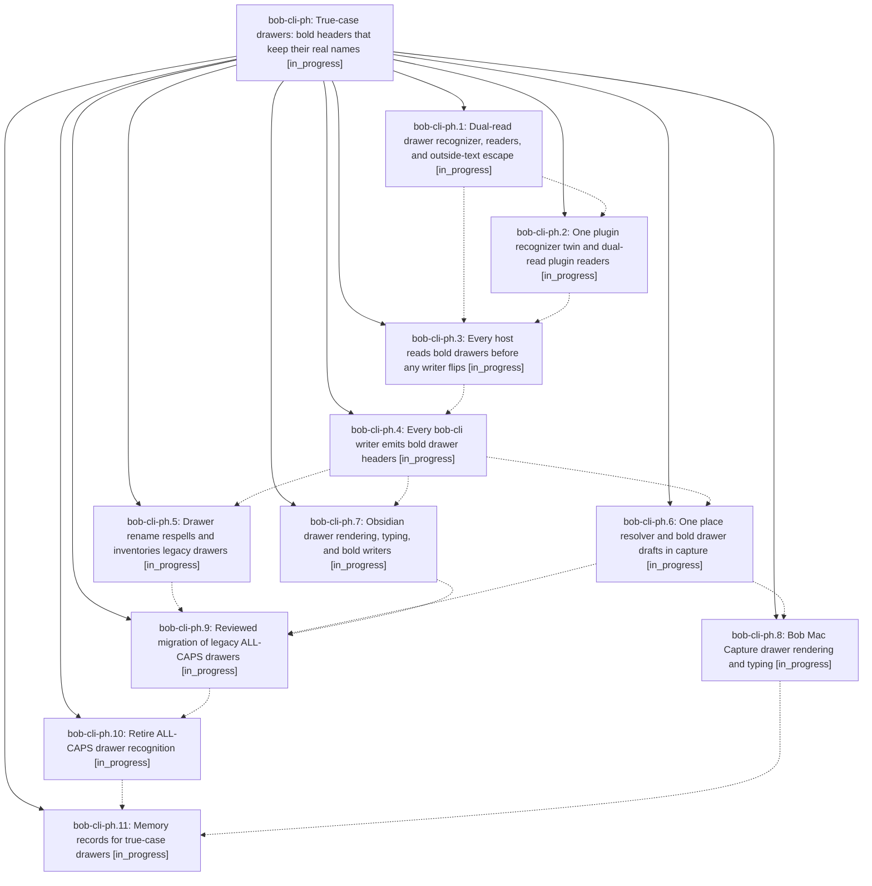

# Bead: bob-cli-ph — True-case drawers: bold headers that keep their real names

[Bead Pages](../README.md) / bob-cli-ph

**Status:** ◐ in_progress · **Type:** ▸ plan · **Tier:** epic
**Owner:** `bryanbugyi34@gmail.com` · **Created by:** [bbugyi200.apollo.research.5x.linker.w0](https://github.com/bobs-org/bob-cli--agents/blob/main/sessions/bbugyi200.apollo.research.5x.linker.w0.md) · **Assignee:** `bob-cli-ph.land`
**Created:** 2026-11-22 17:36:48 EST
**Plan:** [202611/true\_case\_drawers.md](https://github.com/bobs-org/bob-cli--plans/blob/main/202611/true_case_drawers.md)

<!-- sase:links:start -->

## Links

| Relation | Artifact | Why |
| --- | --- | --- |
| implemented-by | [plan:202611/true_case_drawers.md][1] | derived from the plan's `bead_id:` frontmatter field |
| related | [bead:bob-cli-pp][2] | True-case drawers' Mac phase (ph.8) adds drawer rendering in the same editor; it deliberately never hides drawer markers to avoid the req caret defect |

[1]: https://github.com/bobs-org/bob-cli--plans/blob/main/202611/true_case_drawers.md
[2]: https://github.com/bobs-org/bob-cli--beads/blob/main/pages/bob-cli-pp/README.md

<!-- sase:links:end -->

## Description

A task drawer is a `- **Title**` bullet whose title keeps its authored capitalization everywhere: on disk, in capture, in Obsidian and Bob Mac Capture, and through promotion, reversal, and rename. Every surface draws it as a quiet, recognizable drawer, and ALL-CAPS stops being structure after a gated, multi-host-safe migration.

## Phases

| Bead | Title | Status | Size | Created | Agents | Commits |
|---|---|---|---|---|---:|---:|
| [bob-cli-ph.1](bob-cli-ph.1.md) | Dual-read drawer recognizer, readers, and outside-text escape | ◐ in_progress | large | 2026-11-22 | 1 | 1 |
| [bob-cli-ph.10](bob-cli-ph.10.md) | Retire ALL-CAPS drawer recognition | ◐ in_progress | medium | 2026-11-22 | 1 | 0 |
| [bob-cli-ph.11](bob-cli-ph.11.md) | Memory records for true-case drawers | ◐ in_progress | small | 2026-11-22 | 1 | 0 |
| [bob-cli-ph.2](bob-cli-ph.2.md) | One plugin recognizer twin and dual-read plugin readers | ◐ in_progress | large | 2026-11-22 | 1 | 0 |
| [bob-cli-ph.3](bob-cli-ph.3.md) | Every host reads bold drawers before any writer flips | ◐ in_progress | small | 2026-11-22 | 1 | 0 |
| [bob-cli-ph.4](bob-cli-ph.4.md) | Every bob-cli writer emits bold drawer headers | ◐ in_progress | medium | 2026-11-22 | 1 | 0 |
| [bob-cli-ph.5](bob-cli-ph.5.md) | Drawer rename respells and inventories legacy drawers | ◐ in_progress | medium | 2026-11-22 | 1 | 0 |
| [bob-cli-ph.6](bob-cli-ph.6.md) | One place resolver and bold drawer drafts in capture | ◐ in_progress | large | 2026-11-22 | 1 | 0 |
| [bob-cli-ph.7](bob-cli-ph.7.md) | Obsidian drawer rendering, typing, and bold writers | ◐ in_progress | large | 2026-11-22 | 1 | 0 |
| [bob-cli-ph.8](bob-cli-ph.8.md) | Bob Mac Capture drawer rendering and typing | ◐ in_progress | large | 2026-11-22 | 1 | 0 |
| [bob-cli-ph.9](bob-cli-ph.9.md) | Reviewed migration of legacy ALL-CAPS drawers | ◐ in_progress | small | 2026-11-22 | 1 | 0 |

## Lineage

## Agents

| Agent | Bead | Commits |
|---|---|---:|
| [bbugyi200.apollo.bob-cli-ph.1](https://github.com/bobs-org/bob-cli--agents/blob/main/sessions/bbugyi200.apollo.bob-cli-ph.1.md) | [bob-cli-ph.1](bob-cli-ph.1.md) | 1 |
| [bbugyi200.apollo.bob-cli-ph.10](https://github.com/bobs-org/bob-cli--agents/blob/main/agents/bbugyi200.apollo.bob-cli-ph.10/README.md) | [bob-cli-ph.10](bob-cli-ph.10.md) | 0 |
| [bbugyi200.apollo.bob-cli-ph.11](https://github.com/bobs-org/bob-cli--agents/blob/main/agents/bbugyi200.apollo.bob-cli-ph.11/README.md) | [bob-cli-ph.11](bob-cli-ph.11.md) | 0 |
| [bbugyi200.apollo.bob-cli-ph.2](https://github.com/bobs-org/bob-cli--agents/blob/main/agents/bbugyi200.apollo.bob-cli-ph.2/README.md) | [bob-cli-ph.2](bob-cli-ph.2.md) | 0 |
| [bbugyi200.apollo.bob-cli-ph.3](https://github.com/bobs-org/bob-cli--agents/blob/main/agents/bbugyi200.apollo.bob-cli-ph.3/README.md) | [bob-cli-ph.3](bob-cli-ph.3.md) | 0 |
| [bbugyi200.apollo.bob-cli-ph.4](https://github.com/bobs-org/bob-cli--agents/blob/main/agents/bbugyi200.apollo.bob-cli-ph.4/README.md) | [bob-cli-ph.4](bob-cli-ph.4.md) | 0 |
| [bbugyi200.apollo.bob-cli-ph.5](https://github.com/bobs-org/bob-cli--agents/blob/main/agents/bbugyi200.apollo.bob-cli-ph.5/README.md) | [bob-cli-ph.5](bob-cli-ph.5.md) | 0 |
| [bbugyi200.apollo.bob-cli-ph.6](https://github.com/bobs-org/bob-cli--agents/blob/main/agents/bbugyi200.apollo.bob-cli-ph.6/README.md) | [bob-cli-ph.6](bob-cli-ph.6.md) | 0 |
| [bbugyi200.apollo.bob-cli-ph.7](https://github.com/bobs-org/bob-cli--agents/blob/main/agents/bbugyi200.apollo.bob-cli-ph.7/README.md) | [bob-cli-ph.7](bob-cli-ph.7.md) | 0 |
| [bbugyi200.apollo.bob-cli-ph.8](https://github.com/bobs-org/bob-cli--agents/blob/main/agents/bbugyi200.apollo.bob-cli-ph.8/README.md) | [bob-cli-ph.8](bob-cli-ph.8.md) | 0 |
| [bbugyi200.apollo.bob-cli-ph.9](https://github.com/bobs-org/bob-cli--agents/blob/main/agents/bbugyi200.apollo.bob-cli-ph.9/README.md) | [bob-cli-ph.9](bob-cli-ph.9.md) | 0 |
| [bbugyi200.apollo.bob-cli-ph.land](https://github.com/bobs-org/bob-cli--agents/blob/main/agents/bbugyi200.apollo.bob-cli-ph.land/README.md) | [bob-cli-ph](README.md) | 0 |

## Commits

| Repo | Commit | Subject | Bead | Committed |
|---|---|---|---|---|
| bob-cli | [`37b2080`](https://github.com/bobs-org/bob-cli/commit/37b2080e9efca170f542954f088ce4169d430cfa) | feat(drawers): add dual-read task drawer readers | [bob-cli-ph.1](bob-cli-ph.1.md) | 2026-11-23 08:06:21 EST |
