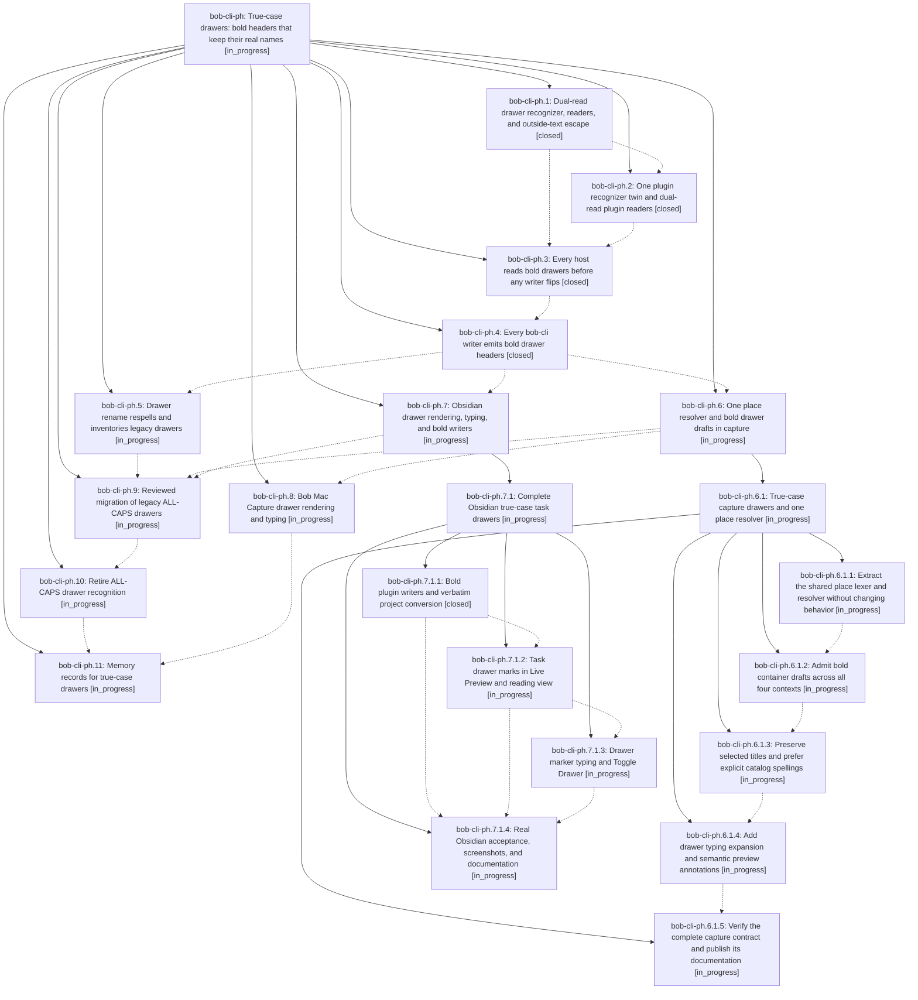

# Bead: bob-cli-ph — True-case drawers: bold headers that keep their real names

[Bead Pages](../README.md) / bob-cli-ph

**Status:** ◐ in_progress · **Type:** ▸ plan · **Tier:** epic
**Owner:** `bryanbugyi34@gmail.com` · **Created by:** [bbugyi200.apollo.research.5x.linker.w0](https://github.com/bobs-org/bob-cli--agents/blob/main/sessions/bbugyi200.apollo.research.5x.linker.w0.md) · **Assignee:** `bob-cli-ph.land`
**Created:** 2026-11-22 17:36:48 EST
**Plan:** [202611/true\_case\_drawers.md](https://github.com/bobs-org/bob-cli--plans/blob/main/202611/true_case_drawers.md)

<!-- sase:links:start -->

## Links

| Relation | Artifact | Why |
| --- | --- | --- |
| implemented-by | [plan:202611/true_case_drawers.md][1] | derived from the plan's `bead_id:` frontmatter field |
| related | [bead:bob-cli-pp][2] | True-case drawers' Mac phase (ph.8) adds drawer rendering in the same editor; it deliberately never hides drawer markers to avoid the req caret defect |

_Plus 9 automatic references — see [Referenced By](#referenced-by)._

[1]: https://github.com/bobs-org/bob-cli--plans/blob/main/202611/true_case_drawers.md
[2]: https://github.com/bobs-org/bob-cli--beads/blob/main/pages/bob-cli-pp/README.md

<!-- sase:links:end -->

## Description

A task drawer is a `- **Title**` bullet whose title keeps its authored capitalization everywhere: on disk, in capture, in Obsidian and Bob Mac Capture, and through promotion, reversal, and rename. Every surface draws it as a quiet, recognizable drawer, and ALL-CAPS stops being structure after a gated, multi-host-safe migration.

## Notes

[2026-11-23T16:27:53Z · bob-cli-pf.4.1.7.land] DISCOVERED ISSUE: Triaged bob-cli-pf.4.1.7.4 PROPOSED FOLLOW-UP #5. On bob-plugins b2c37102 against bob-cli f6cf62cf, node --test scripts/test-task-reqs-twin-copies.cjs fails its canonical README.md equality assertion (6 pass, 1 fail). git diff shows canonical tests/fixtures/task_reqs/README.md advanced in drawer-reader commit 37b2080e to RQ22/RL61 and bold drawer cases, while cycler/nav/block-id copies retain RQ21/RL60. This is causally owned by active drawer rollout, especially plugin-readers bob-cli-ph.2; synchronize semantic fixtures with the reader rollout, not README alone. No separate task created. The other proposal (#4, missing task-drawers navigation) is already repaired by f6cf62cf mkdocs.yml:375. Corroborates bob-cli-pq.3 notes #5/#7.

[2026-11-23T20:42:29Z · bob-cli-pq.land] HANDOFF from bob-cli-pq.land: Bryan waived the pq↔ph sequencing gate (bob-cli-pq note #1: 'Keep drawer words untouched; the later lander does the taste pass'). bob-cli-pq (criterion diamond) has landed first, so the joint drawer-tray/diamond taste pass belongs to this epic's lander once ph.7 (Obsidian drawer rendering) and ph.8 (Mac drawer rendering) land. Tune the tray's stroke weight beside the requirement diamond (16x16 viewBox, stroke-width 1.75, 0.92em mask in a 1em slot; the single size knob is 0.92em -> 1em, docs/task-requirements.md §4). Diamond-only baselines: notes file:explicit:6ceb733e2949af5516d84d19 (light) / ca9bfcba02f2502cd9513085 (dark); successor card file:explicit:3ba83de21213ca5060841b1a / 4a6962df7831b9d463b4f6b6; Mac preview/agenda file:explicit:a8c8984598169d92da8e1a46 / 3ca540750e2c9d40d78e6510. pq never changed a drawer word (NOTES / **Notes**) in any string.

[2026-11-25T10:57:19Z · bryanbugyi34@gmail.com] This epic should not need to wait for a release. See the drawer_reader_gate_without_release.md file in the research sidecar repo for context.

## Phases

| Bead | Title | Status | Size | Created | Agents | Commits |
|---|---|---|---|---|---:|---:|
| [bob-cli-ph.1](bob-cli-ph.1.md) | Dual-read drawer recognizer, readers, and outside-text escape | ✓ closed | large | 2026-11-22 | 1 | 2 |
| [bob-cli-ph.10](bob-cli-ph.10.md) | Retire ALL-CAPS drawer recognition | ◐ in_progress | medium | 2026-11-22 | 1 | 0 |
| [bob-cli-ph.11](bob-cli-ph.11.md) | Memory records for true-case drawers | ◐ in_progress | small | 2026-11-22 | 1 | 0 |
| [bob-cli-ph.2](bob-cli-ph.2.md) | One plugin recognizer twin and dual-read plugin readers | ✓ closed | large | 2026-11-22 | 1 | 4 |
| [bob-cli-ph.3](bob-cli-ph.3.md) | Every host reads bold drawers before any writer flips | ✓ closed | small | 2026-11-22 | 1 | 2 |
| [bob-cli-ph.4](bob-cli-ph.4.md) | Every bob-cli writer emits bold drawer headers | ✓ closed | medium | 2026-11-22 | 1 | 1 |
| [bob-cli-ph.5](bob-cli-ph.5.md) | Drawer rename respells and inventories legacy drawers | ◐ in_progress | medium | 2026-11-22 | 1 | 0 |
| [bob-cli-ph.6](bob-cli-ph.6.md) | One place resolver and bold drawer drafts in capture | ◐ in_progress | large | 2026-11-22 | 1 | 0 |
| [bob-cli-ph.7](bob-cli-ph.7.md) | Obsidian drawer rendering, typing, and bold writers | ◐ in_progress | large | 2026-11-22 | 1 | 0 |
| [bob-cli-ph.8](bob-cli-ph.8.md) | Bob Mac Capture drawer rendering and typing | ◐ in_progress | large | 2026-11-22 | 1 | 0 |
| [bob-cli-ph.9](bob-cli-ph.9.md) | Reviewed migration of legacy ALL-CAPS drawers | ◐ in_progress | small | 2026-11-22 | 1 | 0 |

## Lineage

## Agents

| Agent | Bead | Commits |
|---|---|---:|
| [bbugyi200.apollo.bob-cli-ph.1](https://github.com/bobs-org/bob-cli--agents/blob/main/sessions/bbugyi200.apollo.bob-cli-ph.1.md) | [bob-cli-ph.1](bob-cli-ph.1.md) | 2 |
| [bbugyi200.apollo.bob-cli-ph.10](https://github.com/bobs-org/bob-cli--agents/blob/main/agents/bbugyi200.apollo.bob-cli-ph.10/README.md) | [bob-cli-ph.10](bob-cli-ph.10.md) | 0 |
| [bbugyi200.apollo.bob-cli-ph.11](https://github.com/bobs-org/bob-cli--agents/blob/main/agents/bbugyi200.apollo.bob-cli-ph.11/README.md) | [bob-cli-ph.11](bob-cli-ph.11.md) | 0 |
| [bbugyi200.apollo.bob-cli-ph.2](https://github.com/bobs-org/bob-cli--agents/blob/main/sessions/bbugyi200.apollo.bob-cli-ph.2.md) | [bob-cli-ph.2](bob-cli-ph.2.md) | 4 |
| [bbugyi200.apollo.bob-cli-ph.3](https://github.com/bobs-org/bob-cli--agents/blob/main/agents/bbugyi200.apollo.bob-cli-ph.3/README.md) | [bob-cli-ph.3](bob-cli-ph.3.md) | 2 |
| [bbugyi200.apollo.bob-cli-ph.4](https://github.com/bobs-org/bob-cli--agents/blob/main/agents/bbugyi200.apollo.bob-cli-ph.4/README.md) | [bob-cli-ph.4](bob-cli-ph.4.md) | 1 |
| [bbugyi200.apollo.bob-cli-ph.5](https://github.com/bobs-org/bob-cli--agents/blob/main/sessions/bbugyi200.apollo.bob-cli-ph.5.md) | [bob-cli-ph.5](bob-cli-ph.5.md) | 0 |
| [bbugyi200.apollo.bob-cli-ph.6](https://github.com/bobs-org/bob-cli--agents/blob/main/sessions/bbugyi200.apollo.bob-cli-ph.6.md) | [bob-cli-ph.6](bob-cli-ph.6.md) | 0 |
| [bbugyi200.apollo.bob-cli-ph.6.1.1](https://github.com/bobs-org/bob-cli--agents/blob/main/agents/bbugyi200.apollo.bob-cli-ph.6.1.1/README.md) | [bob-cli-ph.6.1.1](bob-cli-ph.6.1.1.md) | 0 |
| [bbugyi200.apollo.bob-cli-ph.6.1.2](https://github.com/bobs-org/bob-cli--agents/blob/main/agents/bbugyi200.apollo.bob-cli-ph.6.1.2/README.md) | [bob-cli-ph.6.1.2](bob-cli-ph.6.1.2.md) | 0 |
| [bbugyi200.apollo.bob-cli-ph.6.1.3](https://github.com/bobs-org/bob-cli--agents/blob/main/agents/bbugyi200.apollo.bob-cli-ph.6.1.3/README.md) | [bob-cli-ph.6.1.3](bob-cli-ph.6.1.3.md) | 0 |
| [bbugyi200.apollo.bob-cli-ph.6.1.4](https://github.com/bobs-org/bob-cli--agents/blob/main/agents/bbugyi200.apollo.bob-cli-ph.6.1.4/README.md) | [bob-cli-ph.6.1.4](bob-cli-ph.6.1.4.md) | 0 |
| [bbugyi200.apollo.bob-cli-ph.6.1.5](https://github.com/bobs-org/bob-cli--agents/blob/main/agents/bbugyi200.apollo.bob-cli-ph.6.1.5/README.md) | [bob-cli-ph.6.1.5](bob-cli-ph.6.1.5.md) | 0 |
| [bbugyi200.apollo.bob-cli-ph.6.1.land](https://github.com/bobs-org/bob-cli--agents/blob/main/agents/bbugyi200.apollo.bob-cli-ph.6.1.land/README.md) | [bob-cli-ph.6.1](bob-cli-ph.6.1.md) | 0 |
| [bbugyi200.apollo.bob-cli-ph.7](https://github.com/bobs-org/bob-cli--agents/blob/main/sessions/bbugyi200.apollo.bob-cli-ph.7.md) | [bob-cli-ph.7](bob-cli-ph.7.md) | 0 |
| [bbugyi200.apollo.bob-cli-ph.7.1.1](https://github.com/bobs-org/bob-cli--agents/blob/main/agents/bbugyi200.apollo.bob-cli-ph.7.1.1/README.md) | [bob-cli-ph.7.1.1](bob-cli-ph.7.1.1.md) | 1 |
| [bbugyi200.apollo.bob-cli-ph.7.1.2](https://github.com/bobs-org/bob-cli--agents/blob/main/agents/bbugyi200.apollo.bob-cli-ph.7.1.2/README.md) | [bob-cli-ph.7.1.2](bob-cli-ph.7.1.2.md) | 0 |
| [bbugyi200.apollo.bob-cli-ph.7.1.3](https://github.com/bobs-org/bob-cli--agents/blob/main/agents/bbugyi200.apollo.bob-cli-ph.7.1.3/README.md) | [bob-cli-ph.7.1.3](bob-cli-ph.7.1.3.md) | 0 |
| [bbugyi200.apollo.bob-cli-ph.7.1.4](https://github.com/bobs-org/bob-cli--agents/blob/main/agents/bbugyi200.apollo.bob-cli-ph.7.1.4/README.md) | [bob-cli-ph.7.1.4](bob-cli-ph.7.1.4.md) | 0 |
| [bbugyi200.apollo.bob-cli-ph.7.1.land](https://github.com/bobs-org/bob-cli--agents/blob/main/agents/bbugyi200.apollo.bob-cli-ph.7.1.land/README.md) | [bob-cli-ph.7.1](bob-cli-ph.7.1.md) | 0 |
| [bbugyi200.apollo.bob-cli-ph.8](https://github.com/bobs-org/bob-cli--agents/blob/main/agents/bbugyi200.apollo.bob-cli-ph.8/README.md) | [bob-cli-ph.8](bob-cli-ph.8.md) | 0 |
| [bbugyi200.apollo.bob-cli-ph.9](https://github.com/bobs-org/bob-cli--agents/blob/main/agents/bbugyi200.apollo.bob-cli-ph.9/README.md) | [bob-cli-ph.9](bob-cli-ph.9.md) | 0 |
| [bbugyi200.apollo.bob-cli-ph.land](https://github.com/bobs-org/bob-cli--agents/blob/main/agents/bbugyi200.apollo.bob-cli-ph.land/README.md) | [bob-cli-ph](README.md) | 0 |

## Commits

| Repo | Commit | Subject | Bead | Committed |
|---|---|---|---|---|
| bob-cli | [`37b2080`](https://github.com/bobs-org/bob-cli/commit/37b2080e9efca170f542954f088ce4169d430cfa) | feat(drawers): add dual-read task drawer readers | [bob-cli-ph.1](bob-cli-ph.1.md) | 2026-11-23 08:06:21 EST |
| bob-cli | [`c25d92f`](https://github.com/bobs-org/bob-cli/commit/c25d92fdd4e2c4073ec1a24bda34251fae8eded9) | feat(capture): add task drawer contracts and docs | [bob-cli-ph.1](bob-cli-ph.1.md) | 2026-11-23 12:14:15 EST |
| bob-cli | [`b1fa8ad`](https://github.com/bobs-org/bob-cli/commit/b1fa8ad6de8c3818152296f7c9af7cb2ec21ed1e) | docs: document plugin task drawer reader parity | [bob-cli-ph.2](bob-cli-ph.2.md) | 2026-11-23 13:04:10 EST |
| bob-plugins | [`bob-plugins@19ac4a3`](https://github.com/bobs-org/bob-plugins/commit/19ac4a3e4bafc2362b2b6189553dec99cfba1500) | feat: unify task drawer readers across plugins | [bob-cli-ph.2](bob-cli-ph.2.md) | 2026-11-23 13:05:47 EST |
| bob-plugins | [`bob-plugins@6268f24`](https://github.com/bobs-org/bob-plugins/commit/6268f246c33434e1c3da94213ca5e4d76a8eccd5) | test(plugins): anchor keep-moving style assertion to picker rule | [bob-cli-ph.2](bob-cli-ph.2.md) | 2026-11-23 13:20:45 EST |
| bob-plugins | [`bob-plugins@63e9e76`](https://github.com/bobs-org/bob-plugins/commit/63e9e7609338d91de8f592c3c134d69abd92b9ab) | test(plugins): load drawer DV/DH vectors from the cycler fixture | [bob-cli-ph.2](bob-cli-ph.2.md) | 2026-11-23 16:51:32 EST |
| bob-cli | [`fd99ebb`](https://github.com/bobs-org/bob-cli/commit/fd99ebb85dcf0555cc48570397c419f4dd8f3167) | chore: add Bob host reader currency gate | [bob-cli-ph.3](bob-cli-ph.3.md) | 2026-11-23 18:51:04 EST |
| bob-cli | [`5ab392a`](https://github.com/bobs-org/bob-cli/commit/5ab392a1ba087c6f87d8685035979498082079ed) | chore(dev): let bob-host-currency gate on a bold-drawer read probe | [bob-cli-ph.3](bob-cli-ph.3.md) | 2026-11-25 06:49:42 EST |
| bob-cli | [`8f88a52`](https://github.com/bobs-org/bob-cli/commit/8f88a52c1cfc59236d6ddc4bd36ee6f11de95afd) | feat(task-drawers): emit bold drawer headers from every writer | [bob-cli-ph.4](bob-cli-ph.4.md) | 2026-11-25 08:27:23 EST |
| bob-plugins | [`bob-plugins@f2e8c62`](https://github.com/bobs-org/bob-plugins/commit/f2e8c62a29464701cb097233579c156964cb4996) | feat(task-drawers)!: emit bold drawer headers and verbatim project conversion in plugins | [bob-cli-ph.7.1.1](bob-cli-ph.7.1.1.md) | 2026-11-25 09:38:13 EST |

<!-- sase:referenced-by:start -->

## Referenced By

| Relation | Artifact | Why | Uses |
| --- | --- | --- | ---: |
| read-by | [agent:1fk][1] | Research whether pq.3/pq.5 truly depend on bob-cli-ph | 1 |
| read-by | [agent:bob-cli-ph.4][2] | need epic decisions and notes | 1 |
| read-by | [agent:bob-cli-pq.land][3] | Check drawer epic status for sequencing and taste pass ownership | 1 |
| read-by | [agent:g1][4] | Research how to progress the epic without waiting for a release | 1 |
| read-by | [agent:research.66.cdx][5] | Independent research into better-o and all-ops-reconcile-tasks; inspect referenced scope and completion | 1 |
| read-by | [agent:research.66.cld][6] | Context for better-o / all-ops-reconcile research | 1 |
| read-by | [agent:research.66.final][7] | Consolidating swarm research on better-o: verify drawer-epic phase states and the pn/po writer-gap beads the reports cite | 1 |
| read-by | [agent:research.66.gem][8] | Referenced in ^better-o for ongoing drawer changes | 1 |
| read-by | [agent:research.66.grk][9] | Need the true-case drawers epic that better-o says is still in progress | 1 |

[1]: https://github.com/bobs-org/bob-cli--agents/blob/main/agents/bbugyi200.apollo.1fk/README.md
[2]: https://github.com/bobs-org/bob-cli--agents/blob/main/agents/bbugyi200.apollo.bob-cli-ph.4/README.md
[3]: https://github.com/bobs-org/bob-cli--agents/blob/main/agents/bbugyi200.apollo.bob-cli-pq.land/README.md
[4]: https://github.com/bobs-org/bob-cli--agents/blob/main/agents/bbugyi200.apollo.g1/README.md
[5]: https://github.com/bobs-org/bob-cli--agents/blob/main/agents/bbugyi200.apollo.research.66.cdx/README.md
[6]: https://github.com/bobs-org/bob-cli--agents/blob/main/agents/bbugyi200.apollo.research.66.cld/README.md
[7]: https://github.com/bobs-org/bob-cli--agents/blob/main/agents/bbugyi200.apollo.research.66.final/README.md
[8]: https://github.com/bobs-org/bob-cli--agents/blob/main/agents/bbugyi200.apollo.research.66.gem/README.md
[9]: https://github.com/bobs-org/bob-cli--agents/blob/main/agents/bbugyi200.apollo.research.66.grk/README.md

<!-- sase:referenced-by:end -->
