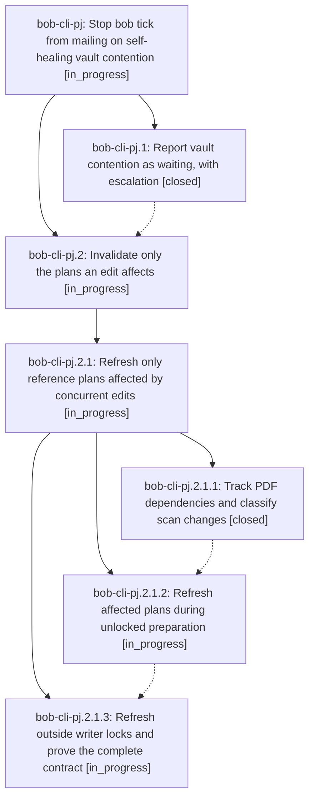

# Bead: bob-cli-pj — Stop bob tick from mailing on self-healing vault contention

[Bead Pages](../README.md) / bob-cli-pj

**Status:** ◐ in_progress · **Type:** ▸ plan · **Tier:** epic
**Owner:** `bryanbugyi34@gmail.com` · **Created by:** [bbugyi200.athena.1fa.1](https://github.com/bobs-org/bob-cli--agents/blob/main/sessions/bbugyi200.athena.1fa.1.md) · **Assignee:** `bob-cli-pj.land`
**Created:** 2026-11-22 18:00:45 EST
**Plan:** [202611/tick\_contention\_noise.md](https://github.com/bobs-org/bob-cli--plans/blob/main/202611/tick_contention_noise.md)

<!-- sase:links:start -->

## Links

| Relation | Artifact | Why |
| --- | --- | --- |
| implemented-by | [plan:202611/tick_contention_noise.md][1] | derived from the plan's `bead_id:` frontmatter field |

_Plus 1 automatic references — see [Referenced By](#referenced-by)._

[1]: https://github.com/bobs-org/bob-cli--plans/blob/main/202611/tick_contention_noise.md

<!-- sase:links:end -->

## Description

Mac bob tick runs exit 0 with a waiting step when the only trouble is vault-lock contention or notes edited mid-scan, persistent contention still alerts, and a refs full scan re-plans only the PDFs an edit actually affects.

## Phases

| Bead | Title | Status | Size | Created | Agents | Commits |
|---|---|---|---|---|---:|---:|
| [bob-cli-pj.1](bob-cli-pj.1.md) | Report vault contention as waiting, with escalation | ✓ closed | medium | 2026-11-22 | 1 | 1 |
| [bob-cli-pj.2](bob-cli-pj.2.md) | Invalidate only the plans an edit affects | ◐ in_progress | large | 2026-11-22 | 1 | 0 |

## Lineage

## Agents

| Agent | Bead | Commits |
|---|---|---:|
| [bbugyi200.athena.bob-cli-pj.1](https://github.com/bobs-org/bob-cli--agents/blob/main/agents/bbugyi200.athena.bob-cli-pj.1/README.md) | [bob-cli-pj.1](bob-cli-pj.1.md) | 1 |
| [bbugyi200.athena.bob-cli-pj.2](https://github.com/bobs-org/bob-cli--agents/blob/main/sessions/bbugyi200.athena.bob-cli-pj.2.md) | [bob-cli-pj.2](bob-cli-pj.2.md) | 0 |
| [bbugyi200.athena.bob-cli-pj.2.1.1](https://github.com/bobs-org/bob-cli--agents/blob/main/agents/bbugyi200.athena.bob-cli-pj.2.1.1/README.md) | [bob-cli-pj.2.1.1](bob-cli-pj.2.1.1.md) | 1 |
| [bbugyi200.athena.bob-cli-pj.2.1.2](https://github.com/bobs-org/bob-cli--agents/blob/main/agents/bbugyi200.athena.bob-cli-pj.2.1.2/README.md) | [bob-cli-pj.2.1.2](bob-cli-pj.2.1.2.md) | 0 |
| [bbugyi200.athena.bob-cli-pj.2.1.3](https://github.com/bobs-org/bob-cli--agents/blob/main/agents/bbugyi200.athena.bob-cli-pj.2.1.3/README.md) | [bob-cli-pj.2.1.3](bob-cli-pj.2.1.3.md) | 0 |
| [bbugyi200.athena.bob-cli-pj.2.1.land](https://github.com/bobs-org/bob-cli--agents/blob/main/agents/bbugyi200.athena.bob-cli-pj.2.1.land/README.md) | [bob-cli-pj.2.1](bob-cli-pj.2.1.md) | 0 |
| [bbugyi200.athena.bob-cli-pj.land](https://github.com/bobs-org/bob-cli--agents/blob/main/agents/bbugyi200.athena.bob-cli-pj.land/README.md) | [bob-cli-pj](README.md) | 0 |

## Commits

| Repo | Commit | Subject | Bead | Committed |
|---|---|---|---|---|
| bob-cli | [`badcd30`](https://github.com/bobs-org/bob-cli/commit/badcd30ced3384f9b84028cc838fe5538b6203e5) | feat(tick)!: report vault contention as waiting with escalation | [bob-cli-pj.1](bob-cli-pj.1.md) | 2026-11-22 18:42:28 EST |
| bob-cli | [`063a876`](https://github.com/bobs-org/bob-cli/commit/063a876807b0a008cc6cc0e65d68ddb10c0eea60) | feat(highlights): classify scan changes from per-PDF dependency evidence | [bob-cli-pj.2.1.1](bob-cli-pj.2.1.1.md) | 2026-11-22 19:31:05 EST |

<!-- sase:referenced-by:start -->

## Referenced By

| Relation | Artifact | Why | Uses |
| --- | --- | --- | ---: |
| read-by | [agent:bob-cli-pj.1][1] | Need parent epic context and decisions | 1 |

[1]: https://github.com/bobs-org/bob-cli--agents/blob/main/agents/bbugyi200.athena.bob-cli-pj.1/README.md

<!-- sase:referenced-by:end -->
