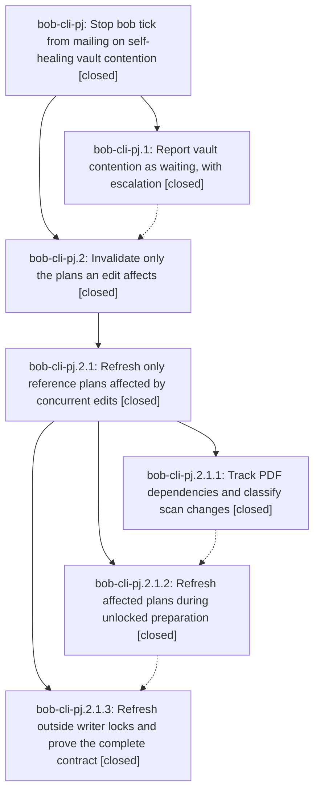

# Bead: bob-cli-pj — Stop bob tick from mailing on self-healing vault contention

[Bead Pages](../README.md) / bob-cli-pj

**Status:** ✓ closed · **Resolution:** done · **Type:** ▸ plan · **Tier:** epic
**Owner:** `bryanbugyi34@gmail.com` · **Created by:** [bbugyi200.athena.1fa.1](https://github.com/bobs-org/bob-cli--agents/blob/main/sessions/bbugyi200.athena.1fa.1.md) · **Assignee:** `bob-cli-pj.land`
**Created:** 2026-11-22 18:00:45 EST · **Closed:** 2026-11-22 22:51:14 EST
**Plan:** [202611/tick\_contention\_noise.md](https://github.com/bobs-org/bob-cli--plans/blob/main/202611/tick_contention_noise.md)

<!-- sase:links:start -->

## Links

| Relation | Artifact | Why |
| --- | --- | --- |
| implemented-by | [plan:202611/tick_contention_noise.md][1] | derived from the plan's `bead_id:` frontmatter field |

_Plus 1 automatic references — see [Referenced By](#referenced-by)._

[1]: https://github.com/bobs-org/bob-cli--plans/blob/main/202611/tick_contention_noise.md

<!-- sase:links:end -->

## Description

Mac bob tick runs exit 0 with a waiting step when the only trouble is vault-lock contention or notes edited mid-scan, persistent contention still alerts, and a refs full scan re-plans only the PDFs an edit actually affects.

## Notes

[2026-11-23T03:07:26Z · bob-cli-pj.land] LAND FOLLOW-UP TRIAGE: Used sase_new_task; searched CI/feature tasks, swept last-week tasks, inspected active epic plans and plausible causal owners. The only PROPOSED FOLLOW-UP is pj.2.1.3 #1. Its Mac capture-previews/keyboard failures duplicate jz; protocol duplicates h9. Owning epic on.15.1 is now closed and reports Mac c0959905 fixed them (5976/5995/6000, cap 6000); retained resolution attribution on jz/h9, no new task and no new +1 because not independently reproduced. Plugin-apis 8963/8000 is advisory, already tracked by ob and causally recorded on active on.11.1; recorded attributed disposition on both. Declined a CI-failure duplicate for that warning. Phase pj.2.1.2's fake-curl transient passed its isolated rerun; no new independent recurrence here. No performance follow-up was proposed or newly measured.

[2026-11-23T03:07:30Z · bob-cli-pj.land] LAND VERIFICATION (incomplete) at 15225a6a: Read epic, every descendant (.1, .2, .2.1 and its .1/.2/.3), every note, both epic plans and repair tale refs_refresh_landing.md. Inspected commits badcd30c/063a8768/33f6d08d/29d7fec7/15225a6a and actual tick/scan implementation. Two-hour decision, waiting codes/cadences, pending derive preservation, destination scan_failed, three-site convergence, shared 4+1 budget, pinned date, recovery/intake lock rules and live dependency comparison repairs are present. Remaining approved acceptance work: real link-reader acquisition during refresh with redirect output; actual root-parent plus owned-root consumer union; production ownership replacement through stable refresh; real locator-line-shift vs unrelated index changes; archive occupancy finalization. Current live_vault_link_acquisition_selects_unowned_markdown and clean_baseline_drops_obsolete_owners tests manually construct evidence, so they do not exercise these lifecycles. Existing same_length_edits_before_evidence_replan mixes parent edits with global/config/library changes and permits refusal, so it does not prove the targeted parent path. This remains epic work, scoped as one medium tale responsible for this epic's final closeout. No new Rust or docs gate run claimed by this audit; nested lander reported check run 9d1be27cee08c4bf935c9c3a581e780c green. No epic-symbols, no symvision recipe, parent_id null.

[2026-11-23T03:07:34Z · bob-cli-pj.land] LAND INTEGRATION: Fetched origin/master and fast-forwarded cleanly from ef640fde to nested repair 15225a6a. Reviewed non-epic drift since first epic commit and since creation: props inventory/span/CLI e98c7fe9/fdd94725/3e480e4a, Gmail HTML 8c019eb4, dedicated Pomodoro-link history 7f104e52, requirement docs c17dd80a/9d0cbfbe/bf005290/ef640fde. Property updates acquire the maintenance lock and reread/replan before atomic write; Markdown/root/candidate evidence already covers their effects. Daily history edits feed finalization and actual shared-read consumers. No duplicated scan code or new consumer migration is required. No integration source edits needed. Remaining tale must repeat drift/readiness checks before close.

[2026-11-23T03:51:14Z · bob-cli-pj.land] Implemented the accepted tick contention plan. Added production-flow scan interleave coverage for acquiring a vault-link dependency, root-parent owner/resolver scope, stable routed-owner replacement, current routed-target edits, moved reading locators, and archive ID occupancy during finalization. Existing unrelated_daily_edit_finalizes_without_reparsing_pdfs and failed_subset_plan_is_replaced_by_later_recovery_without_stale_drafts coverage remains green.

Verification passed: cargo test --test cli highlights::scan_interleave:: -- --nocapture (47 passed); cargo test --test cli tick:: -- --nocapture (23 passed); sase tool run check; just docs-check (447 passed, one skipped because font dependencies are unavailable); cargo fmt --check; git diff --check. The final origin/master fetch showed no branch drift. No just symvision recipe is available, and epic-symbols reported no entries.

Follow-up review: the plugin API documentation word-budget advisory is already tracked by bob-cli-ob/on.11.1 and is not a CI failure. The Mac documentation budget warnings were fixed in the existing Mac capture work and require no new task. The fake-curl failure passed on rerun and did not recur; no performance follow-up was measured. No new follow-up task is warranted. The accepted two-hour stall_after decision was retained.

## Phases

| Bead | Title | Status | Size | Created | Agents | Commits |
|---|---|---|---|---|---:|---:|
| [bob-cli-pj.1](bob-cli-pj.1.md) | Report vault contention as waiting, with escalation | ✓ closed | medium | 2026-11-22 | 1 | 1 |
| [bob-cli-pj.2](bob-cli-pj.2.md) | Invalidate only the plans an edit affects | ✓ closed | large | 2026-11-22 | 1 | 0 |

## Lineage

## Agents

| Agent | Bead | Commits |
|---|---|---:|
| [bbugyi200.athena.bob-cli-pj.1](https://github.com/bobs-org/bob-cli--agents/blob/main/agents/bbugyi200.athena.bob-cli-pj.1/README.md) | [bob-cli-pj.1](bob-cli-pj.1.md) | 1 |
| [bbugyi200.athena.bob-cli-pj.2](https://github.com/bobs-org/bob-cli--agents/blob/main/sessions/bbugyi200.athena.bob-cli-pj.2.md) | [bob-cli-pj.2](bob-cli-pj.2.md) | 0 |
| [bbugyi200.athena.bob-cli-pj.2.1.1](https://github.com/bobs-org/bob-cli--agents/blob/main/agents/bbugyi200.athena.bob-cli-pj.2.1.1/README.md) | [bob-cli-pj.2.1.1](bob-cli-pj.2.1.1.md) | 1 |
| [bbugyi200.athena.bob-cli-pj.2.1.2](https://github.com/bobs-org/bob-cli--agents/blob/main/agents/bbugyi200.athena.bob-cli-pj.2.1.2/README.md) | [bob-cli-pj.2.1.2](bob-cli-pj.2.1.2.md) | 1 |
| [bbugyi200.athena.bob-cli-pj.2.1.3](https://github.com/bobs-org/bob-cli--agents/blob/main/agents/bbugyi200.athena.bob-cli-pj.2.1.3/README.md) | [bob-cli-pj.2.1.3](bob-cli-pj.2.1.3.md) | 1 |
| [bbugyi200.athena.bob-cli-pj.2.1.land](https://github.com/bobs-org/bob-cli--agents/blob/main/sessions/bbugyi200.athena.bob-cli-pj.2.1.land.md) | [bob-cli-pj.2.1](bob-cli-pj.2.1.md) | 2 |
| [bbugyi200.athena.bob-cli-pj.land](https://github.com/bobs-org/bob-cli--agents/blob/main/sessions/bbugyi200.athena.bob-cli-pj.land.md) | [bob-cli-pj](README.md) | 2 |

## Commits

| Repo | Commit | Subject | Bead | Committed |
|---|---|---|---|---|
| bob-cli | [`badcd30`](https://github.com/bobs-org/bob-cli/commit/badcd30ced3384f9b84028cc838fe5538b6203e5) | feat(tick)!: report vault contention as waiting with escalation | [bob-cli-pj.1](bob-cli-pj.1.md) | 2026-11-22 18:42:28 EST |
| bob-cli | [`063a876`](https://github.com/bobs-org/bob-cli/commit/063a876807b0a008cc6cc0e65d68ddb10c0eea60) | feat(highlights): classify scan changes from per-PDF dependency evidence | [bob-cli-pj.2.1.1](bob-cli-pj.2.1.1.md) | 2026-11-22 19:31:05 EST |
| bob-cli | [`33f6d08`](https://github.com/bobs-org/bob-cli/commit/33f6d08d2da67c69930a6c24628c3cdbd59f429d) | feat(highlights): refresh affected plans during preparation | [bob-cli-pj.2.1.2](bob-cli-pj.2.1.2.md) | 2026-11-22 20:22:03 EST |
| bob-cli | [`29d7fec`](https://github.com/bobs-org/bob-cli/commit/29d7fec797ccc09ae932d51cc8a08bf365a637fa) | feat(highlights-ref): lock-window scan coherence with typed ScanChange classification | [bob-cli-pj.2.1.3](bob-cli-pj.2.1.3.md) | 2026-11-22 21:00:28 EST |
| bob-cli | [`15225a6`](https://github.com/bobs-org/bob-cli/commit/15225a6a7b86e887c7b35a655c719ce197efbc88) | feat(highlights-ref): converge refresh with live dependencies and lock-window settle | [bob-cli-pj.2.1](bob-cli-pj.2.1.md) | 2026-11-22 22:01:49 EST |
| bob-cli--plans | [`bob-cli--plans@b000b3b`](https://github.com/bobs-org/bob-cli--plans/commit/b000b3ba6773cf4ef8ab07ee830be978624ce8b6) | chore(plans): mark refs\_incremental\_coherence done after verified landing | [bob-cli-pj.2.1](bob-cli-pj.2.1.md) | 2026-11-22 22:02:23 EST |
| bob-cli | [`4fed68f`](https://github.com/bobs-org/bob-cli/commit/4fed68fce90e080e679ec49a49397a0e48a5bb08) | test(highlights-ref): cover incremental scan refresh contention | [bob-cli-pj](README.md) | 2026-11-22 22:52:58 EST |
| bob-cli--plans | [`bob-cli--plans@08b2765`](https://github.com/bobs-org/bob-cli--plans/commit/08b2765eb6028a786a812a20753e4b8b89ec2127) | docs(plans): mark tick contention plan complete | [bob-cli-pj](README.md) | 2026-11-22 22:53:30 EST |

<!-- sase:referenced-by:start -->

## Referenced By

| Relation | Artifact | Why | Uses |
| --- | --- | --- | ---: |
| read-by | [agent:bob-cli-pj.1][1] | Need parent epic context and decisions | 1 |

[1]: https://github.com/bobs-org/bob-cli--agents/blob/main/agents/bbugyi200.athena.bob-cli-pj.1/README.md

<!-- sase:referenced-by:end -->
