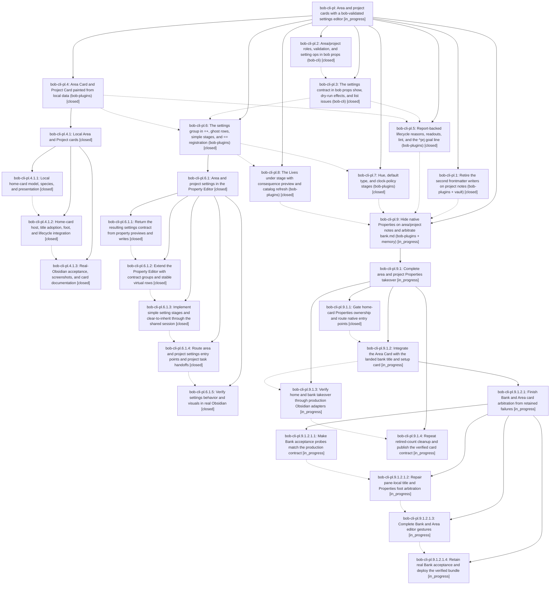

# Bead: bob-cli-pl — Area and project cards with a bob-validated settings editor

[Bead Pages](../README.md) / bob-cli-pl

**Status:** ◐ in_progress · **Type:** ▸ plan · **Tier:** epic
**Owner:** `bryanbugyi34@gmail.com` · **Created by:** [bbugyi200.apollo.research.5y.linker.w1](https://github.com/bobs-org/bob-cli--agents/blob/main/sessions/bbugyi200.apollo.research.5y.linker.w1.md) · **Assignee:** `bob-cli-pl.land`
**Created:** 2026-11-22 20:56:40 EST
**Plan:** [202611/area\_project\_cards.md](https://github.com/bobs-org/bob-cli--plans/blob/main/202611/area_project_cards.md)

<!-- sase:links:start -->

## Links

| Relation | Artifact | Why |
| --- | --- | --- |
| implemented-by | [plan:202611/area_project_cards.md][1] | derived from the plan's `bead_id:` frontmatter field |

_Plus 4 automatic references — see [Referenced By](#referenced-by)._

[1]: https://github.com/bobs-org/bob-cli--plans/blob/main/202611/area_project_cards.md

<!-- sase:links:end -->

## Description

Every area and project note opens with a calm property card (an Area Card or a Project Card) that says what the home is, where it sits, its lifecycle, and the policies it declares. `=+` (and `==`) edit every area/project setting through typed, inheritance-aware stages that bob validates and writes byte-preservingly. Once no second frontmatter writer remains, the cards take over native Properties on these notes, bank.md included, and every failure path brings native Properties back.

## Notes

[2026-11-23T18:41:38Z · 1fn--code] DISCOVERED ISSUE: plan:202611/req_close_note_drift.md fixes the owner-scoped requirement close preflight but leaves Undo out of scope. After Carry or Carry+pull-in in a project note, Bob Project Tasks' task_count/open_task_count refresh can make the receipt's whole-note guarded Undo refuse with “Could not undo requirement writes”. Follow-up bug bead bob-cli-pr tracks the remaining Undo behavior, sharing the project-note writer trigger with phase bob-cli-pl.1.

[2026-11-24T12:26:31Z · ft--code] COORDINATION: Property Editor Live Preview Vim entry is now bare + (Shift+= included). =+ (pending = then +) falls through to Vim and does not open the editor. Phase bob-cli-pl.6 still says =+ in its title; treat that as the Property Editor, now opened with +. registerPropertyCardSecondKeyArm("+") is unchanged. Drawer toggle is bare -.

## Phases

| Bead | Title | Status | Size | Created | Agents | Commits |
|---|---|---|---|---|---:|---:|
| [bob-cli-pl.1](bob-cli-pl.1.md) | Retire the second frontmatter writers on project notes (bob-plugins + vault) | ✓ closed | medium | 2026-11-22 | 1 | 2 |
| [bob-cli-pl.2](bob-cli-pl.2.md) | Area/project roles, validation, and setting ops in bob props (bob-cli) | ✓ closed | medium | 2026-11-22 | 1 | 1 |
| [bob-cli-pl.3](bob-cli-pl.3.md) | The settings contract in bob props show, dry-run effects, and list issues (bob-cli) | ✓ closed | medium | 2026-11-22 | 1 | 1 |
| [bob-cli-pl.4](bob-cli-pl.4.md) | Area Card and Project Card painted from local data (bob-plugins) | ✓ closed | large | 2026-11-22 | 1 | 0 |
| [bob-cli-pl.5](bob-cli-pl.5.md) | Report-backed lifecycle reasons, readouts, lint, and the ^prj goal line (bob-plugins) | ✓ closed | medium | 2026-11-22 | 1 | 1 |
| [bob-cli-pl.6](bob-cli-pl.6.md) | The settings group in =+, ghost rows, simple stages, and == registration (bob-plugins) | ✓ closed | large | 2026-11-22 | 1 | 0 |
| [bob-cli-pl.7](bob-cli-pl.7.md) | Hue, default type, and clock-policy stages (bob-plugins) | ✓ closed | medium | 2026-11-22 | 1 | 1 |
| [bob-cli-pl.8](bob-cli-pl.8.md) | The Lives under stage with consequence preview and catalog refresh (bob-plugins) | ✓ closed | medium | 2026-11-22 | 1 | 1 |
| [bob-cli-pl.9](bob-cli-pl.9.md) | Hide native Properties on area/project notes and arbitrate bank.md (bob-plugins + memory) | ◐ in_progress | large | 2026-11-22 | 1 | 0 |

## Lineage

## Agents

| Agent | Bead | Commits |
|---|---|---:|
| [bbugyi200.apollo.bob-cli-pl.1](https://github.com/bobs-org/bob-cli--agents/blob/main/sessions/bbugyi200.apollo.bob-cli-pl.1.md) | [bob-cli-pl.1](bob-cli-pl.1.md) | 2 |
| [bbugyi200.apollo.bob-cli-pl.2](https://github.com/bobs-org/bob-cli--agents/blob/main/sessions/bbugyi200.apollo.bob-cli-pl.2.md) | [bob-cli-pl.2](bob-cli-pl.2.md) | 1 |
| [bbugyi200.apollo.bob-cli-pl.3](https://github.com/bobs-org/bob-cli--agents/blob/main/agents/bbugyi200.apollo.bob-cli-pl.3/README.md) | [bob-cli-pl.3](bob-cli-pl.3.md) | 1 |
| [bbugyi200.apollo.bob-cli-pl.4](https://github.com/bobs-org/bob-cli--agents/blob/main/sessions/bbugyi200.apollo.bob-cli-pl.4.md) | [bob-cli-pl.4](bob-cli-pl.4.md) | 0 |
| [bbugyi200.apollo.bob-cli-pl.4.1.1](https://github.com/bobs-org/bob-cli--agents/blob/main/agents/bbugyi200.apollo.bob-cli-pl.4.1.1/README.md) | [bob-cli-pl.4.1.1](bob-cli-pl.4.1.1.md) | 1 |
| [bbugyi200.apollo.bob-cli-pl.4.1.2](https://github.com/bobs-org/bob-cli--agents/blob/main/agents/bbugyi200.apollo.bob-cli-pl.4.1.2/README.md) | [bob-cli-pl.4.1.2](bob-cli-pl.4.1.2.md) | 1 |
| [bbugyi200.apollo.bob-cli-pl.4.1.3](https://github.com/bobs-org/bob-cli--agents/blob/main/sessions/bbugyi200.apollo.bob-cli-pl.4.1.3.md) | [bob-cli-pl.4.1.3](bob-cli-pl.4.1.3.md) | 2 |
| [bbugyi200.apollo.bob-cli-pl.4.1.land](https://github.com/bobs-org/bob-cli--agents/blob/main/sessions/bbugyi200.apollo.bob-cli-pl.4.1.land.md) | [bob-cli-pl.4.1](bob-cli-pl.4.1.md) | 2 |
| [bbugyi200.apollo.bob-cli-pl.5](https://github.com/bobs-org/bob-cli--agents/blob/main/agents/bbugyi200.apollo.bob-cli-pl.5/README.md) | [bob-cli-pl.5](bob-cli-pl.5.md) | 1 |
| [bbugyi200.apollo.bob-cli-pl.6](https://github.com/bobs-org/bob-cli--agents/blob/main/sessions/bbugyi200.apollo.bob-cli-pl.6.md) | [bob-cli-pl.6](bob-cli-pl.6.md) | 0 |
| [bbugyi200.apollo.bob-cli-pl.6.1.1](https://github.com/bobs-org/bob-cli--agents/blob/main/sessions/bbugyi200.apollo.bob-cli-pl.6.1.1.md) | [bob-cli-pl.6.1.1](bob-cli-pl.6.1.1.md) | 1 |
| [bbugyi200.apollo.bob-cli-pl.6.1.2](https://github.com/bobs-org/bob-cli--agents/blob/main/sessions/bbugyi200.apollo.bob-cli-pl.6.1.2.md) | [bob-cli-pl.6.1.2](bob-cli-pl.6.1.2.md) | 3 |
| [bbugyi200.apollo.bob-cli-pl.6.1.3](https://github.com/bobs-org/bob-cli--agents/blob/main/agents/bbugyi200.apollo.bob-cli-pl.6.1.3/README.md) | [bob-cli-pl.6.1.3](bob-cli-pl.6.1.3.md) | 1 |
| [bbugyi200.apollo.bob-cli-pl.6.1.4](https://github.com/bobs-org/bob-cli--agents/blob/main/agents/bbugyi200.apollo.bob-cli-pl.6.1.4/README.md) | [bob-cli-pl.6.1.4](bob-cli-pl.6.1.4.md) | 1 |
| [bbugyi200.apollo.bob-cli-pl.6.1.5](https://github.com/bobs-org/bob-cli--agents/blob/main/sessions/bbugyi200.apollo.bob-cli-pl.6.1.5.md) | [bob-cli-pl.6.1.5](bob-cli-pl.6.1.5.md) | 10 |
| [bbugyi200.apollo.bob-cli-pl.6.1.land](https://github.com/bobs-org/bob-cli--agents/blob/main/agents/bbugyi200.apollo.bob-cli-pl.6.1.land/README.md) | [bob-cli-pl.6.1](bob-cli-pl.6.1.md) | 2 |
| [bbugyi200.apollo.bob-cli-pl.7](https://github.com/bobs-org/bob-cli--agents/blob/main/agents/bbugyi200.apollo.bob-cli-pl.7/README.md) | [bob-cli-pl.7](bob-cli-pl.7.md) | 1 |
| [bbugyi200.apollo.bob-cli-pl.8](https://github.com/bobs-org/bob-cli--agents/blob/main/agents/bbugyi200.apollo.bob-cli-pl.8/README.md) | [bob-cli-pl.8](bob-cli-pl.8.md) | 1 |
| [bbugyi200.apollo.bob-cli-pl.9](https://github.com/bobs-org/bob-cli--agents/blob/main/sessions/bbugyi200.apollo.bob-cli-pl.9.md) | [bob-cli-pl.9](bob-cli-pl.9.md) | 0 |
| [bbugyi200.apollo.bob-cli-pl.9.1.1](https://github.com/bobs-org/bob-cli--agents/blob/main/agents/bbugyi200.apollo.bob-cli-pl.9.1.1/README.md) | [bob-cli-pl.9.1.1](bob-cli-pl.9.1.1.md) | 1 |
| [bbugyi200.apollo.bob-cli-pl.9.1.2](https://github.com/bobs-org/bob-cli--agents/blob/main/sessions/bbugyi200.apollo.bob-cli-pl.9.1.2.md) | [bob-cli-pl.9.1.2](bob-cli-pl.9.1.2.md) | 5 |
| [bbugyi200.apollo.bob-cli-pl.9.1.2.1.1](https://github.com/bobs-org/bob-cli--agents/blob/main/sessions/bbugyi200.apollo.bob-cli-pl.9.1.2.1.1.md) | [bob-cli-pl.9.1.2.1.1](bob-cli-pl.9.1.2.1.1.md) | 1 |
| [bbugyi200.apollo.bob-cli-pl.9.1.2.1.2](https://github.com/bobs-org/bob-cli--agents/blob/main/agents/bbugyi200.apollo.bob-cli-pl.9.1.2.1.2/README.md) | [bob-cli-pl.9.1.2.1.2](bob-cli-pl.9.1.2.1.2.md) | 0 |
| [bbugyi200.apollo.bob-cli-pl.9.1.2.1.3](https://github.com/bobs-org/bob-cli--agents/blob/main/agents/bbugyi200.apollo.bob-cli-pl.9.1.2.1.3/README.md) | [bob-cli-pl.9.1.2.1.3](bob-cli-pl.9.1.2.1.3.md) | 0 |
| [bbugyi200.apollo.bob-cli-pl.9.1.2.1.4](https://github.com/bobs-org/bob-cli--agents/blob/main/agents/bbugyi200.apollo.bob-cli-pl.9.1.2.1.4/README.md) | [bob-cli-pl.9.1.2.1.4](bob-cli-pl.9.1.2.1.4.md) | 0 |
| [bbugyi200.apollo.bob-cli-pl.9.1.2.1.land](https://github.com/bobs-org/bob-cli--agents/blob/main/agents/bbugyi200.apollo.bob-cli-pl.9.1.2.1.land/README.md) | [bob-cli-pl.9.1.2.1](bob-cli-pl.9.1.2.1.md) | 0 |
| [bbugyi200.apollo.bob-cli-pl.9.1.3](https://github.com/bobs-org/bob-cli--agents/blob/main/agents/bbugyi200.apollo.bob-cli-pl.9.1.3/README.md) | [bob-cli-pl.9.1.3](bob-cli-pl.9.1.3.md) | 0 |
| [bbugyi200.apollo.bob-cli-pl.9.1.4](https://github.com/bobs-org/bob-cli--agents/blob/main/agents/bbugyi200.apollo.bob-cli-pl.9.1.4/README.md) | [bob-cli-pl.9.1.4](bob-cli-pl.9.1.4.md) | 0 |
| [bbugyi200.apollo.bob-cli-pl.9.1.land](https://github.com/bobs-org/bob-cli--agents/blob/main/agents/bbugyi200.apollo.bob-cli-pl.9.1.land/README.md) | [bob-cli-pl.9.1](bob-cli-pl.9.1.md) | 0 |
| [bbugyi200.apollo.bob-cli-pl.land](https://github.com/bobs-org/bob-cli--agents/blob/main/agents/bbugyi200.apollo.bob-cli-pl.land/README.md) | [bob-cli-pl](README.md) | 0 |

## Commits

| Repo | Commit | Subject | Bead | Committed |
|---|---|---|---|---|
| bob-plugins | [`bob-plugins@5717d51`](https://github.com/bobs-org/bob-plugins/commit/5717d5182523c2d357ec604b1476fc5e32c12e10) | feat(ledger-tools): add local Area and Project card presentation | [bob-cli-pl.4.1.1](bob-cli-pl.4.1.1.md) | 2026-11-24 10:27:37 EST |
| bob-plugins | [`bob-plugins@b5f2f6c`](https://github.com/bobs-org/bob-plugins/commit/b5f2f6c1b62278b51872298ff99b48e175a02a5c) | feat(ledger-tools): mount Area and Project cards in Live Preview and Reading | [bob-cli-pl.4.1.2](bob-cli-pl.4.1.2.md) | 2026-11-24 10:46:18 EST |
| bob-cli | [`d39680d`](https://github.com/bobs-org/bob-cli/commit/d39680dda4120b90602467ec812ec819d7a984d2) | feat(props): validate area and project setting writes | [bob-cli-pl.2](bob-cli-pl.2.md) | 2026-11-24 10:59:57 EST |
| bob-plugins | [`bob-plugins@21bbd30`](https://github.com/bobs-org/bob-plugins/commit/21bbd30cc7305a8952adfc0280063fd5d66a24f4) | test(cards): add local home card acceptance coverage | [bob-cli-pl.4.1.3](bob-cli-pl.4.1.3.md) | 2026-11-24 11:36:30 EST |
| bob-cli | [`31131fe`](https://github.com/bobs-org/bob-cli/commit/31131fe2f6151fafb941f92a78894d19784f04f6) | fix(props): allow removal of retired project count fields | [bob-cli-pl.1](bob-cli-pl.1.md) | 2026-11-24 12:07:50 EST |
| bob-cli | [`4b23bbe`](https://github.com/bobs-org/bob-cli/commit/4b23bbef29a3dd932158930c40bc1d0c8d5be2f2) | feat(props): expose the area and project settings contract | [bob-cli-pl.3](bob-cli-pl.3.md) | 2026-11-24 12:18:07 EST |
| bob-plugins | [`bob-plugins@b4023b8`](https://github.com/bobs-org/bob-plugins/commit/b4023b85b8c3291f1f575d9fa920e02f82c28b60) | fix(projects): retire duplicate frontmatter writers | [bob-cli-pl.1](bob-cli-pl.1.md) | 2026-11-24 12:32:05 EST |
| bob-plugins | [`bob-plugins@71cf808`](https://github.com/bobs-org/bob-plugins/commit/71cf808a2cdede5324072f6c3a81a08ee1c4f4d3) | test: correct home-card acceptance assertions | [bob-cli-pl.4.1.3](bob-cli-pl.4.1.3.md) | 2026-11-24 13:42:42 EST |
| bob-plugins | [`bob-plugins@45697ae`](https://github.com/bobs-org/bob-plugins/commit/45697ae018dbeb60fd687890faccb781196c3a42) | fix(home-cards): finish local Area and Project card landing | [bob-cli-pl.4.1](bob-cli-pl.4.1.md) | 2026-11-24 15:42:08 EST |
| bob-cli--plans | [`bob-cli--plans@741102d`](https://github.com/bobs-org/bob-cli--plans/commit/741102d13744f2f6ff150359858bd4f17a02d636) | docs(plans): mark local home-card epic and finish tale done | [bob-cli-pl.4.1](bob-cli-pl.4.1.md) | 2026-11-24 15:43:14 EST |
| bob-plugins | [`bob-plugins@d59ee11`](https://github.com/bobs-org/bob-plugins/commit/d59ee11bd8621db6ca10b6826ffd5178604059e9) | feat(ledger-tools): add home card live patch with blocked-project links and goal line | [bob-cli-pl.5](bob-cli-pl.5.md) | 2026-11-24 16:31:04 EST |
| bob-cli | [`447ef1a`](https://github.com/bobs-org/bob-cli/commit/447ef1a5815924ca08329aee256598eaa9f999f9) | feat(props): return settings contract from successful property updates | [bob-cli-pl.6.1.1](bob-cli-pl.6.1.1.md) | 2026-11-24 16:46:13 EST |
| bob-plugins | [`bob-plugins@d55a175`](https://github.com/bobs-org/bob-plugins/commit/d55a17599e017f309880b4a3f520e495cfcd131c) | feat(props): add contract-backed settings rows | [bob-cli-pl.6.1.2](bob-cli-pl.6.1.2.md) | 2026-11-24 17:28:59 EST |
| bob-plugins | [`bob-plugins@7649f6f`](https://github.com/bobs-org/bob-plugins/commit/7649f6fe4f45394d517c4b57e864f717c3bad64b) | fix(property-editor): correct settings row grouping and navigation | [bob-cli-pl.6.1.2](bob-cli-pl.6.1.2.md) | 2026-11-24 17:40:26 EST |
| bob-plugins | [`bob-plugins@a22851f`](https://github.com/bobs-org/bob-plugins/commit/a22851fd13501bf0169ee690e07c60f573f9e5f6) | fix(props): preserve source row identity in settings fallback | [bob-cli-pl.6.1.2](bob-cli-pl.6.1.2.md) | 2026-11-24 18:05:38 EST |
| bob-plugins | [`bob-plugins@e1a4d1c`](https://github.com/bobs-org/bob-plugins/commit/e1a4d1cff0dc1e77d2be07f19ac0b39862db88d6) | feat(props): add Property Editor setting stages and clear-to-inherit | [bob-cli-pl.6.1.3](bob-cli-pl.6.1.3.md) | 2026-11-25 06:15:10 EST |
| bob-plugins | [`bob-plugins@876782f`](https://github.com/bobs-org/bob-plugins/commit/876782fed9878db3a1f3db5f0c33bb8ed4d6ab7d) | feat(props): route area/project settings entry points and project task handoffs | [bob-cli-pl.6.1.4](bob-cli-pl.6.1.4.md) | 2026-11-25 06:41:06 EST |
| bob-plugins | [`bob-plugins@6904786`](https://github.com/bobs-org/bob-plugins/commit/69047866eacd505e8a306440c99e71b481cfdf31) | test(props): add real-Obsidian settings acceptance coverage | [bob-cli-pl.6.1.5](bob-cli-pl.6.1.5.md) | 2026-11-25 07:15:21 EST |
| bob-plugins | [`bob-plugins@2ec1304`](https://github.com/bobs-org/bob-plugins/commit/2ec1304231ad4d3c6c47b290aab938f8fb57a1b4) | test(property-editor): navigate expanded managed rows in Obsidian acceptance | [bob-cli-pl.6.1.5](bob-cli-pl.6.1.5.md) | 2026-11-25 07:58:11 EST |
| bob-plugins | [`bob-plugins@7c34314`](https://github.com/bobs-org/bob-plugins/commit/7c3431499200db62cd062ecab0e2587010a426f6) | test(settings): reopen managed rows after YAML navigation | [bob-cli-pl.6.1.5](bob-cli-pl.6.1.5.md) | 2026-11-25 08:15:19 EST |
| bob-plugins | [`bob-plugins@ede02e2`](https://github.com/bobs-org/bob-plugins/commit/ede02e2d8f1982c5336d2430f58eb3e3a234092f) | test(plugins): focus selected rows in acceptance harness | [bob-cli-pl.6.1.5](bob-cli-pl.6.1.5.md) | 2026-11-25 09:11:29 EST |
| bob-plugins | [`bob-plugins@8e4f6ad`](https://github.com/bobs-org/bob-plugins/commit/8e4f6adc4c707aaf5407cbf9bb94678918ffec3d) | fix(settings): expand managed property rows in acceptance harness | [bob-cli-pl.6.1.5](bob-cli-pl.6.1.5.md) | 2026-11-25 10:18:53 EST |
| bob-plugins | [`bob-plugins@49bdcb8`](https://github.com/bobs-org/bob-plugins/commit/49bdcb85a4979c837779cc0812b8d26e91bf1b24) | fix(property-editor): route source-only marked deletes through shared batch handler | [bob-cli-pl.6.1.5](bob-cli-pl.6.1.5.md) | 2026-11-25 11:30:31 EST |
| bob-plugins | [`bob-plugins@475527c`](https://github.com/bobs-org/bob-plugins/commit/475527caa1eee0469d7553de51b503a4e8237afb) | test(bob-ledger-tools): expand managed group before protected copy | [bob-cli-pl.6.1.5](bob-cli-pl.6.1.5.md) | 2026-11-25 12:14:58 EST |
| bob-plugins | [`bob-plugins@689da09`](https://github.com/bobs-org/bob-plugins/commit/689da09262ecd1492cc1bc52e84cebad2fb79631) | test(settings): unblock Obsidian acceptance and cover setting writes | [bob-cli-pl.6.1.5](bob-cli-pl.6.1.5.md) | 2026-11-25 13:10:32 EST |
| bob-plugins | [`bob-plugins@fd2a290`](https://github.com/bobs-org/bob-plugins/commit/fd2a2907fdba71ee5389d73a330eef30897b3746) | test(settings): correct Obsidian fixtures and visible acceptance probes | [bob-cli-pl.6.1.5](bob-cli-pl.6.1.5.md) | 2026-11-25 13:43:55 EST |
| bob-plugins | [`bob-plugins@9d30502`](https://github.com/bobs-org/bob-plugins/commit/9d3050229114783c4b7647ad8a0e6fa5910d9e64) | fix(property-editor): pass settings acceptance in real Obsidian | [bob-cli-pl.6.1.5](bob-cli-pl.6.1.5.md) | 2026-11-25 17:09:12 EST |
| bob-plugins | [`bob-plugins@ea3bc6a`](https://github.com/bobs-org/bob-plugins/commit/ea3bc6a42500cb93ea77f69f4e50fbd7adf44261) | fix(property-editor): keep setting notes above Save/Cancel and show Review scope once | [bob-cli-pl.6.1](bob-cli-pl.6.1.md) | 2026-11-25 18:11:31 EST |
| bob-cli--plans | [`bob-cli--plans@8779f61`](https://github.com/bobs-org/bob-cli--plans/commit/8779f61ddf1e903e808d0eddde833c920a8b4a59) | chore(plans): mark area\_project\_settings plan done after bob-cli-pl.6.1 landing | [bob-cli-pl.6.1](bob-cli-pl.6.1.md) | 2026-11-25 18:12:32 EST |
| bob-plugins | [`bob-plugins@0d319a5`](https://github.com/bobs-org/bob-plugins/commit/0d319a535b5e59ff905153400165fdcbaaf9575e) | feat(property-editor): Lives under stage with consequence preview and catalog refresh | [bob-cli-pl.8](bob-cli-pl.8.md) | 2026-11-25 18:36:34 EST |
| bob-plugins | [`bob-plugins@691182f`](https://github.com/bobs-org/bob-plugins/commit/691182f43befa4f2b0c980340e6f2dbd7796b0f3) | feat(property-editor): add hue type and clock policy stages | [bob-cli-pl.7](bob-cli-pl.7.md) | 2026-11-25 19:35:59 EST |
| bob-plugins | [`bob-plugins@8698046`](https://github.com/bobs-org/bob-plugins/commit/8698046c10872ccde3e3a3c185e2447d3bcf24ed) | feat(ledger-tools): per-path props contract routing with home ownership and entry routing | [bob-cli-pl.9.1.1](bob-cli-pl.9.1.1.md) | 2026-11-25 20:19:22 EST |
| bob-plugins | [`bob-plugins@06c87a0`](https://github.com/bobs-org/bob-plugins/commit/06c87a0682d66d903017d66be98c02cfb813f379) | fix(plugins): preserve takeover timeout evidence | [bob-cli-pl.9.1.2](bob-cli-pl.9.1.2.md) | 2026-11-25 22:23:59 EST |
| bob-plugins | [`bob-plugins@8e401c6`](https://github.com/bobs-org/bob-plugins/commit/8e401c6ed34d3bc8074be904cfb983fe5d28ec17) | fix(plugins): preserve bank setup alongside area ownership | [bob-cli-pl.9.1.2](bob-cli-pl.9.1.2.md) | 2026-11-25 23:27:08 EST |
| bob-plugins | [`bob-plugins@b185579`](https://github.com/bobs-org/bob-plugins/commit/b185579f35970bceb102d301bdd11b269af54a3b) | fix(plugins): capture bank fallback adapter in widget | [bob-cli-pl.9.1.2](bob-cli-pl.9.1.2.md) | 2026-11-26 01:02:16 EST |
| bob-plugins | [`bob-plugins@5addf8c`](https://github.com/bobs-org/bob-plugins/commit/5addf8ca4b42208f7366757d449ad0d640d94ac7) | fix(plugins): refresh Bank arbitration after Area foot mounts | [bob-cli-pl.9.1.2](bob-cli-pl.9.1.2.md) | 2026-11-26 01:54:13 EST |
| bob-plugins | [`bob-plugins@a0ebe63`](https://github.com/bobs-org/bob-plugins/commit/a0ebe63eca90f814a7503a87ee570836f9876716) | fix(plugins): preserve Area foot registration during Bank arbitration | [bob-cli-pl.9.1.2](bob-cli-pl.9.1.2.md) | 2026-11-26 02:53:44 EST |
| bob-plugins | [`bob-plugins@072b009`](https://github.com/bobs-org/bob-plugins/commit/072b009e91820b51d1bbebb3ef0abe06e7f28d75) | test(acceptance): add Bank-only Obsidian acceptance profile | [bob-cli-pl.9.1.2.1.1](bob-cli-pl.9.1.2.1.1.md) | 2026-11-26 04:10:50 EST |

<!-- sase:referenced-by:start -->

## Referenced By

| Relation | Artifact | Why | Uses |
| --- | --- | --- | ---: |
| read-by | [agent:1fn--code][1] | Verify the discovered issue note recorded for the project-note Undo follow-up | 3 |
| read-by | [agent:bob-cli-pl.5][2] | Need epic scope for phase card-live | 1 |
| read-by | [agent:bob-cli-pl.8][3] | Check epic status and pl.6 dependency | 1 |
| read-by | [agent:fx][4] | Research whether the pl epic's dependency on pf is necessary | 1 |

[1]: https://github.com/bobs-org/bob-cli--agents/blob/main/sessions/bbugyi200.apollo.1fn.md
[2]: https://github.com/bobs-org/bob-cli--agents/blob/main/agents/bbugyi200.apollo.bob-cli-pl.5/README.md
[3]: https://github.com/bobs-org/bob-cli--agents/blob/main/agents/bbugyi200.apollo.bob-cli-pl.8/README.md
[4]: https://github.com/bobs-org/bob-cli--agents/blob/main/agents/bbugyi200.apollo.fx/README.md

<!-- sase:referenced-by:end -->
