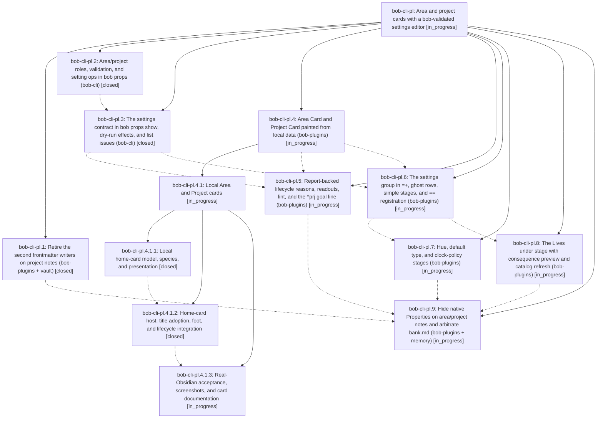

# Bead: bob-cli-pl — Area and project cards with a bob-validated settings editor

[Bead Pages](../README.md) / bob-cli-pl

**Status:** ◐ in_progress · **Type:** ▸ plan · **Tier:** epic
**Owner:** `bryanbugyi34@gmail.com` · **Created by:** [bbugyi200.apollo.research.5y.linker.w1](https://github.com/bobs-org/bob-cli--agents/blob/main/sessions/bbugyi200.apollo.research.5y.linker.w1.md) · **Assignee:** `bob-cli-pl.land`
**Created:** 2026-11-22 20:56:40 EST
**Plan:** [202611/area\_project\_cards.md](https://github.com/bobs-org/bob-cli--plans/blob/main/202611/area_project_cards.md)

<!-- sase:links:start -->

## Links

| Relation | Artifact | Why |
| --- | --- | --- |
| implemented-by | [plan:202611/area_project_cards.md][1] | derived from the plan's `bead_id:` frontmatter field |

_Plus 2 automatic references — see [Referenced By](#referenced-by)._

[1]: https://github.com/bobs-org/bob-cli--plans/blob/main/202611/area_project_cards.md

<!-- sase:links:end -->

## Description

Every area and project note opens with a calm property card (an Area Card or a Project Card) that says what the home is, where it sits, its lifecycle, and the policies it declares. `=+` (and `==`) edit every area/project setting through typed, inheritance-aware stages that bob validates and writes byte-preservingly. Once no second frontmatter writer remains, the cards take over native Properties on these notes, bank.md included, and every failure path brings native Properties back.

## Notes

[2026-11-23T18:41:38Z · 1fn--code] DISCOVERED ISSUE: plan:202611/req_close_note_drift.md fixes the owner-scoped requirement close preflight but leaves Undo out of scope. After Carry or Carry+pull-in in a project note, Bob Project Tasks' task_count/open_task_count refresh can make the receipt's whole-note guarded Undo refuse with “Could not undo requirement writes”. Follow-up bug bead bob-cli-pr tracks the remaining Undo behavior, sharing the project-note writer trigger with phase bob-cli-pl.1.

[2026-11-24T12:26:31Z · ft--code] COORDINATION: Property Editor Live Preview Vim entry is now bare + (Shift+= included). =+ (pending = then +) falls through to Vim and does not open the editor. Phase bob-cli-pl.6 still says =+ in its title; treat that as the Property Editor, now opened with +. registerPropertyCardSecondKeyArm("+") is unchanged. Drawer toggle is bare -.

## Phases

| Bead | Title | Status | Size | Created | Agents | Commits |
|---|---|---|---|---|---:|---:|
| [bob-cli-pl.1](bob-cli-pl.1.md) | Retire the second frontmatter writers on project notes (bob-plugins + vault) | ✓ closed | medium | 2026-11-22 | 1 | 2 |
| [bob-cli-pl.2](bob-cli-pl.2.md) | Area/project roles, validation, and setting ops in bob props (bob-cli) | ✓ closed | medium | 2026-11-22 | 1 | 1 |
| [bob-cli-pl.3](bob-cli-pl.3.md) | The settings contract in bob props show, dry-run effects, and list issues (bob-cli) | ✓ closed | medium | 2026-11-22 | 1 | 0 |
| [bob-cli-pl.4](bob-cli-pl.4.md) | Area Card and Project Card painted from local data (bob-plugins) | ◐ in_progress | large | 2026-11-22 | 1 | 0 |
| [bob-cli-pl.5](bob-cli-pl.5.md) | Report-backed lifecycle reasons, readouts, lint, and the ^prj goal line (bob-plugins) | ◐ in_progress | medium | 2026-11-22 | 1 | 0 |
| [bob-cli-pl.6](bob-cli-pl.6.md) | The settings group in =+, ghost rows, simple stages, and == registration (bob-plugins) | ◐ in_progress | large | 2026-11-22 | 1 | 0 |
| [bob-cli-pl.7](bob-cli-pl.7.md) | Hue, default type, and clock-policy stages (bob-plugins) | ◐ in_progress | medium | 2026-11-22 | 1 | 0 |
| [bob-cli-pl.8](bob-cli-pl.8.md) | The Lives under stage with consequence preview and catalog refresh (bob-plugins) | ◐ in_progress | medium | 2026-11-22 | 1 | 0 |
| [bob-cli-pl.9](bob-cli-pl.9.md) | Hide native Properties on area/project notes and arbitrate bank.md (bob-plugins + memory) | ◐ in_progress | large | 2026-11-22 | 1 | 0 |

## Lineage

## Agents

| Agent | Bead | Commits |
|---|---|---:|
| [bbugyi200.apollo.bob-cli-pl.1](https://github.com/bobs-org/bob-cli--agents/blob/main/sessions/bbugyi200.apollo.bob-cli-pl.1.md) | [bob-cli-pl.1](bob-cli-pl.1.md) | 2 |
| [bbugyi200.apollo.bob-cli-pl.2](https://github.com/bobs-org/bob-cli--agents/blob/main/sessions/bbugyi200.apollo.bob-cli-pl.2.md) | [bob-cli-pl.2](bob-cli-pl.2.md) | 1 |
| [bbugyi200.apollo.bob-cli-pl.3](https://github.com/bobs-org/bob-cli--agents/blob/main/agents/bbugyi200.apollo.bob-cli-pl.3/README.md) | [bob-cli-pl.3](bob-cli-pl.3.md) | 0 |
| [bbugyi200.apollo.bob-cli-pl.4](https://github.com/bobs-org/bob-cli--agents/blob/main/sessions/bbugyi200.apollo.bob-cli-pl.4.md) | [bob-cli-pl.4](bob-cli-pl.4.md) | 0 |
| [bbugyi200.apollo.bob-cli-pl.4.1.1](https://github.com/bobs-org/bob-cli--agents/blob/main/agents/bbugyi200.apollo.bob-cli-pl.4.1.1/README.md) | [bob-cli-pl.4.1.1](bob-cli-pl.4.1.1.md) | 1 |
| [bbugyi200.apollo.bob-cli-pl.4.1.2](https://github.com/bobs-org/bob-cli--agents/blob/main/agents/bbugyi200.apollo.bob-cli-pl.4.1.2/README.md) | [bob-cli-pl.4.1.2](bob-cli-pl.4.1.2.md) | 1 |
| [bbugyi200.apollo.bob-cli-pl.4.1.3](https://github.com/bobs-org/bob-cli--agents/blob/main/sessions/bbugyi200.apollo.bob-cli-pl.4.1.3.md) | [bob-cli-pl.4.1.3](bob-cli-pl.4.1.3.md) | 1 |
| [bbugyi200.apollo.bob-cli-pl.4.1.land](https://github.com/bobs-org/bob-cli--agents/blob/main/agents/bbugyi200.apollo.bob-cli-pl.4.1.land/README.md) | [bob-cli-pl.4.1](bob-cli-pl.4.1.md) | 0 |
| [bbugyi200.apollo.bob-cli-pl.5](https://github.com/bobs-org/bob-cli--agents/blob/main/agents/bbugyi200.apollo.bob-cli-pl.5/README.md) | [bob-cli-pl.5](bob-cli-pl.5.md) | 0 |
| [bbugyi200.apollo.bob-cli-pl.6](https://github.com/bobs-org/bob-cli--agents/blob/main/agents/bbugyi200.apollo.bob-cli-pl.6/README.md) | [bob-cli-pl.6](bob-cli-pl.6.md) | 0 |
| [bbugyi200.apollo.bob-cli-pl.7](https://github.com/bobs-org/bob-cli--agents/blob/main/agents/bbugyi200.apollo.bob-cli-pl.7/README.md) | [bob-cli-pl.7](bob-cli-pl.7.md) | 0 |
| [bbugyi200.apollo.bob-cli-pl.8](https://github.com/bobs-org/bob-cli--agents/blob/main/agents/bbugyi200.apollo.bob-cli-pl.8/README.md) | [bob-cli-pl.8](bob-cli-pl.8.md) | 0 |
| [bbugyi200.apollo.bob-cli-pl.9](https://github.com/bobs-org/bob-cli--agents/blob/main/agents/bbugyi200.apollo.bob-cli-pl.9/README.md) | [bob-cli-pl.9](bob-cli-pl.9.md) | 0 |
| [bbugyi200.apollo.bob-cli-pl.land](https://github.com/bobs-org/bob-cli--agents/blob/main/agents/bbugyi200.apollo.bob-cli-pl.land/README.md) | [bob-cli-pl](README.md) | 0 |

## Commits

| Repo | Commit | Subject | Bead | Committed |
|---|---|---|---|---|
| bob-plugins | [`bob-plugins@5717d51`](https://github.com/bobs-org/bob-plugins/commit/5717d5182523c2d357ec604b1476fc5e32c12e10) | feat(ledger-tools): add local Area and Project card presentation | [bob-cli-pl.4.1.1](bob-cli-pl.4.1.1.md) | 2026-11-24 10:27:37 EST |
| bob-plugins | [`bob-plugins@b5f2f6c`](https://github.com/bobs-org/bob-plugins/commit/b5f2f6c1b62278b51872298ff99b48e175a02a5c) | feat(ledger-tools): mount Area and Project cards in Live Preview and Reading | [bob-cli-pl.4.1.2](bob-cli-pl.4.1.2.md) | 2026-11-24 10:46:18 EST |
| bob-cli | [`d39680d`](https://github.com/bobs-org/bob-cli/commit/d39680dda4120b90602467ec812ec819d7a984d2) | feat(props): validate area and project setting writes | [bob-cli-pl.2](bob-cli-pl.2.md) | 2026-11-24 10:59:57 EST |
| bob-plugins | [`bob-plugins@21bbd30`](https://github.com/bobs-org/bob-plugins/commit/21bbd30cc7305a8952adfc0280063fd5d66a24f4) | test(cards): add local home card acceptance coverage | [bob-cli-pl.4.1.3](bob-cli-pl.4.1.3.md) | 2026-11-24 11:36:30 EST |
| bob-cli | [`31131fe`](https://github.com/bobs-org/bob-cli/commit/31131fe2f6151fafb941f92a78894d19784f04f6) | fix(props): allow removal of retired project count fields | [bob-cli-pl.1](bob-cli-pl.1.md) | 2026-11-24 12:07:50 EST |
| bob-plugins | [`bob-plugins@b4023b8`](https://github.com/bobs-org/bob-plugins/commit/b4023b85b8c3291f1f575d9fa920e02f82c28b60) | fix(projects): retire duplicate frontmatter writers | [bob-cli-pl.1](bob-cli-pl.1.md) | 2026-11-24 12:32:05 EST |

<!-- sase:referenced-by:start -->

## Referenced By

| Relation | Artifact | Why | Uses |
| --- | --- | --- | ---: |
| read-by | [agent:1fn--code][1] | Verify the discovered issue note recorded for the project-note Undo follow-up | 3 |
| read-by | [agent:fx][2] | Research whether the pl epic's dependency on pf is necessary | 1 |

[1]: https://github.com/bobs-org/bob-cli--agents/blob/main/sessions/bbugyi200.apollo.1fn.md
[2]: https://github.com/bobs-org/bob-cli--agents/blob/main/agents/bbugyi200.apollo.fx/README.md

<!-- sase:referenced-by:end -->
