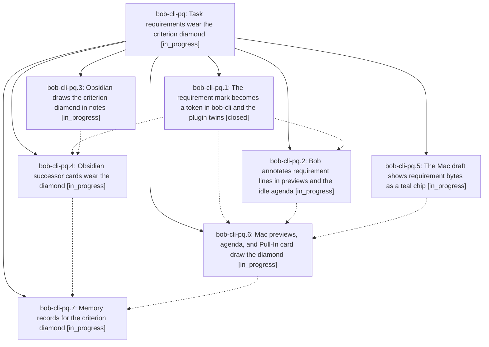

# Bead: bob-cli-pq — Task requirements wear the criterion diamond

[Bead Pages](../README.md) / bob-cli-pq

**Status:** ◐ in_progress · **Type:** ▸ plan · **Tier:** epic
**Owner:** `bryanbugyi34@gmail.com` · **Created by:** [bbugyi200.athena.1f8](https://github.com/bobs-org/bob-cli--agents/blob/main/sessions/bbugyi200.athena.1f8.md) · **Assignee:** `bob-cli-pq.land`
**Created:** 2026-11-23 03:54:18 EST
**Plan:** [202611/task\_reqs\_criterion\_diamond.md](https://github.com/bobs-org/bob-cli--plans/blob/main/202611/task_reqs_criterion_diamond.md)

<!-- sase:links:start -->

## Links

| Relation | Artifact | Why |
| --- | --- | --- |
| implemented-by | [plan:202611/task_reqs_criterion_diamond.md][1] | derived from the plan's `bead_id:` frontmatter field |

[1]: https://github.com/bobs-org/bob-cli--plans/blob/main/202611/task_reqs_criterion_diamond.md

<!-- sase:links:end -->

## Description

Every task requirement is drawn with one quiet, constant-width diamond in its owner's ink, at every depth, in Obsidian, Bob Mac Capture, the successor cards, and CLI text. The mark's fill shows the requirement's state, indentation alone shows its depth, and the Mac draft shows honest bytes. Nothing about how requirements behave, are stored, or are typed changes.

## Phases

| Bead | Title | Status | Size | Created | Agents | Commits |
|---|---|---|---|---|---:|---:|
| [bob-cli-pq.1](bob-cli-pq.1.md) | The requirement mark becomes a token in bob-cli and the plugin twins | ✓ closed | medium | 2026-11-23 | 1 | 1 |
| [bob-cli-pq.2](bob-cli-pq.2.md) | Bob annotates requirement lines in previews and the idle agenda | ◐ in_progress | medium | 2026-11-23 | 1 | 0 |
| [bob-cli-pq.3](bob-cli-pq.3.md) | Obsidian draws the criterion diamond in notes | ◐ in_progress | medium | 2026-11-23 | 1 | 0 |
| [bob-cli-pq.4](bob-cli-pq.4.md) | Obsidian successor cards wear the diamond | ◐ in_progress | small | 2026-11-23 | 1 | 0 |
| [bob-cli-pq.5](bob-cli-pq.5.md) | The Mac draft shows requirement bytes as a teal chip | ◐ in_progress | medium | 2026-11-23 | 1 | 0 |
| [bob-cli-pq.6](bob-cli-pq.6.md) | Mac previews, agenda, and Pull-In card draw the diamond | ◐ in_progress | medium | 2026-11-23 | 1 | 0 |
| [bob-cli-pq.7](bob-cli-pq.7.md) | Memory records for the criterion diamond | ◐ in_progress | small | 2026-11-23 | 1 | 0 |

## Lineage

## Agents

| Agent | Bead | Commits |
|---|---|---:|
| [bbugyi200.athena.bob-cli-pq.1](https://github.com/bobs-org/bob-cli--agents/blob/main/agents/bbugyi200.athena.bob-cli-pq.1/README.md) | [bob-cli-pq.1](bob-cli-pq.1.md) | 1 |
| [bbugyi200.athena.bob-cli-pq.2](https://github.com/bobs-org/bob-cli--agents/blob/main/agents/bbugyi200.athena.bob-cli-pq.2/README.md) | [bob-cli-pq.2](bob-cli-pq.2.md) | 0 |
| [bbugyi200.athena.bob-cli-pq.3](https://github.com/bobs-org/bob-cli--agents/blob/main/sessions/bbugyi200.athena.bob-cli-pq.3.md) | [bob-cli-pq.3](bob-cli-pq.3.md) | 0 |
| [bbugyi200.athena.bob-cli-pq.4](https://github.com/bobs-org/bob-cli--agents/blob/main/agents/bbugyi200.athena.bob-cli-pq.4/README.md) | [bob-cli-pq.4](bob-cli-pq.4.md) | 0 |
| [bbugyi200.athena.bob-cli-pq.5](https://github.com/bobs-org/bob-cli--agents/blob/main/agents/bbugyi200.athena.bob-cli-pq.5/README.md) | [bob-cli-pq.5](bob-cli-pq.5.md) | 0 |
| [bbugyi200.athena.bob-cli-pq.6](https://github.com/bobs-org/bob-cli--agents/blob/main/agents/bbugyi200.athena.bob-cli-pq.6/README.md) | [bob-cli-pq.6](bob-cli-pq.6.md) | 0 |
| [bbugyi200.athena.bob-cli-pq.7](https://github.com/bobs-org/bob-cli--agents/blob/main/agents/bbugyi200.athena.bob-cli-pq.7/README.md) | [bob-cli-pq.7](bob-cli-pq.7.md) | 0 |
| [bbugyi200.athena.bob-cli-pq.land](https://github.com/bobs-org/bob-cli--agents/blob/main/agents/bbugyi200.athena.bob-cli-pq.land/README.md) | [bob-cli-pq](README.md) | 0 |

## Commits

| Repo | Commit | Subject | Bead | Committed |
|---|---|---|---|---|
| bob-cli | [`cb7b9ab`](https://github.com/bobs-org/bob-cli/commit/cb7b9ab13614301918a4cd68dda85501bc7b6b29) | feat(task-reqs): draw requirements with the criterion diamond glyph | [bob-cli-pq.1](bob-cli-pq.1.md) | 2026-11-23 04:29:19 EST |
