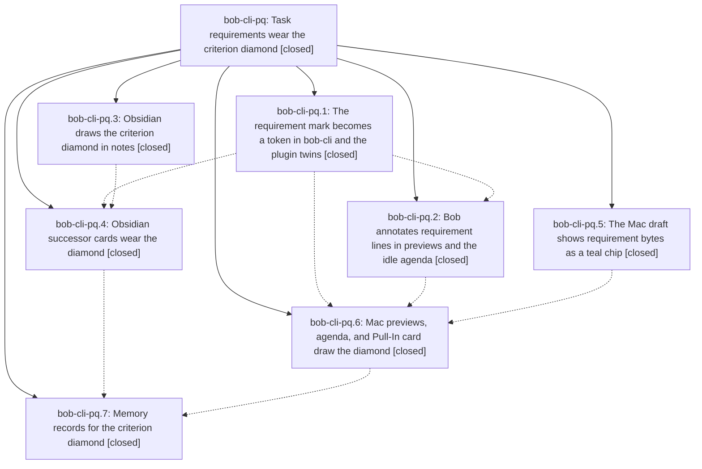

# Bead: bob-cli-pq — Task requirements wear the criterion diamond

[Bead Pages](../README.md) / bob-cli-pq

**Status:** ✓ closed · **Resolution:** done · **Type:** ▸ plan · **Tier:** epic
**Owner:** `bryanbugyi34@gmail.com` · **Created by:** [bbugyi200.athena.1f8](https://github.com/bobs-org/bob-cli--agents/blob/main/sessions/bbugyi200.athena.1f8.md) · **Assignee:** `bob-cli-pq.land`
**Created:** 2026-11-23 03:54:18 EST · **Closed:** 2026-11-23 15:43:13 EST
**Plan:** [202611/task\_reqs\_criterion\_diamond.md](https://github.com/bobs-org/bob-cli--plans/blob/main/202611/task_reqs_criterion_diamond.md)

<!-- sase:links:start -->

## Links

| Relation | Artifact | Why |
| --- | --- | --- |
| implemented-by | [plan:202611/task_reqs_criterion_diamond.md][1] | derived from the plan's `bead_id:` frontmatter field |
| related | [bead:bob-cli-ps][2] | Epic whose phases proposed this record; plan auto-declined memory_req_mark_record |
| related | file:explicit:1e3657df97cbd53012aa3b66 | attached via sase artifact create --bead |
| related | file:explicit:3ba83de21213ca5060841b1a | attached via sase artifact create --bead |
| related | file:explicit:3ca540750e2c9d40d78e6510 | attached via sase artifact create --bead |
| related | file:explicit:4a6962df7831b9d463b4f6b6 | attached via sase artifact create --bead |
| related | file:explicit:7d02c29f42bb8c4ca258de97 | attached via sase artifact create --bead |
| related | file:explicit:a8c8984598169d92da8e1a46 | attached via sase artifact create --bead |

_Plus 3 automatic references — see [Referenced By](#referenced-by)._

[1]: https://github.com/bobs-org/bob-cli--plans/blob/main/202611/task_reqs_criterion_diamond.md
[2]: https://github.com/bobs-org/bob-cli--beads/blob/main/pages/bob-cli-ps/README.md

<!-- sase:links:end -->

## Description

Every task requirement is drawn with one quiet, constant-width diamond in its owner's ink, at every depth, in Obsidian, Bob Mac Capture, the successor cards, and CLI text. The mark's fill shows the requirement's state, indentation alone shows its depth, and the Mac draft shows honest bytes. Nothing about how requirements behave, are stored, or are typed changes.

## Notes

[2026-11-23T15:08:03Z · bryanbugyi34@gmail.com] Bryan waived the ph.7/ph.8 sequencing gate. Keep drawer words untouched; the later lander does the taste pass.

[2026-11-23T20:43:13Z · bob-cli-pq.land] LANDED. Verified all 7 phases against the plan, the DECISIONS, and the commits: bob-cli cb7b9ab1, 87ee683a, f6cf62cf, bd67dfc8; bob-plugins ddbf8bd9, c8846754, b2c37102; bob-mac-capture c6c9c13e, ff157b0e.

Verified:
- req_glyph(state) replaced req_run. The CLI, RV, and copy strings changed only glyph/scope/teaching/human_met/run. There is no ⌗⌗ or req_run/taskReqRun anywhere in the three repos.
- The plugin twins and the RV and task_reqs fixture copies are byte-identical to bob-cli. The Mac RV vectors.json is byte-identical.
- req:{depth,state} is annotated on preview and agenda lines.
- The epic touched no RQ/RL/RW/SP vectors. Live `bob task tidy`: 0 of 614 open tasks tidied.
- bob-cli `just check` green (12,878 tests). `just docs-check` green.
- bob-plugins targeted suites (375 tests, plus 384 for nav-style tests), build:check, and docs:check green.
- Real Obsidian, headless: obsidian-req-close-card-e2e PASS 6/6, verifying pq.4's data-state flips. Deployed-vault startup smoke PASS. All 12 plugins synced.
- Mac exact-SHA CI run 45255052132 ran 5157 tests. All epic suites passed (CaptureRequirementMark, RequirementMarkDesign, CapturePullInRequirementCard, CaptureRequirementCardDecoding, CaptureEditorHighlight). The one failure is unrelated (bob-cli-pt).

Fixed during landing (epic-caused):
(a) glossary:task-requirement had the wrong teaching copy and omitted Mac teal and the [ ] chip. Rewritten to the accepted memory_glossary_req text; glossary page regenerated.
(b) docs/task-requirements.md §4 lacked the mark geometry and cited a wrong §2. Added the geometry table.
(c) Real-Obsidian card screenshots showed staged Drop/Own-task rows drawing the Unicode fallback over the diamond mask, and owner ink never reaching the card mark. Nav staged cues now set --bob-successor-req-ink, and the card restates --bob-req-ink on the mark. Regression test added; screenshots re-verified and stored: file:explicit:3ba83de21213ca5060841b1a, 4a6962df7831b9d463b4f6b6, 1e3657df97cbd53012aa3b66. Mac renders: a8c8984598169d92da8e1a46, 3ca540750e2c9d40d78e6510, 7d02c29f42bb8c4ca258de97.

Integration:
- Post-epic drawer commits (bob-cli 37b2080e, c25d92fd, b1fa8ad6; bob-plugins 19ac4a3e) and the req-close staleness fixes (6d8d5886/be6547bf) use no old requirement glyph or copy. Nothing else needed to adopt the diamond.
- The Mac compile break from 62302372 (async autoclosure in RefsPanelModelTests:2916/2935) was fixed so the epic's Mac tests could run.

Follow-up triage:
- decisions:requirements-wear-the-criterion-diamond (pq.1#2, pq.2#1, pq.3#2, pq.4#1, pq.5#5, pq.7#1): filed as memory task bob-cli-ps, pending Bryan's approval.
- Timing flakes (pq.3#6/#8): +1 on bob-cli-io (frees-marks), bob-cli-km (event-link-times), bob-cli-kn (task-wikilink cold chunk), and bob-cli-m1 (dependencies-stage).
- pq.5#4: bob-cli-pp narrowed by note to the route-emoji overlay.
- pq.6#3: the compile half was fixed here. The remaining unrelated assertion was filed as ci task bob-cli-pt.
- The Mac Pull-In height policy ignores requirement rows (pre-existing since bob-cli-on, exposed by the pq.6 fixture): bob-cli-pu.
- Declined as already resolved on master: drawer Clippy denies (pq.3#4, pq.5#8; just check green), plugin fixture README drift (pq.3#5, pq.4#2; fixed by 19ac4a3e), docs contract-index drift (pq.3#7, pq.4#3, pq.5#7; docs-check green), task-status-cycler and nav deploy drift (pq.3#9, pq.4#5; all synced), and unverified card e2e/screenshots (pq.4#4; done above).
- Joint drawer-tray/diamond taste pass (Bryan's waiver note): handed to the bob-cli-ph lander by note, because ph.7/ph.8 have not landed. The diamond-only taste check keeps the 0.92em size.

No epic-symbol entries. No parent bead.

## Phases

| Bead | Title | Status | Size | Created | Agents | Commits |
|---|---|---|---|---|---:|---:|
| [bob-cli-pq.1](bob-cli-pq.1.md) | The requirement mark becomes a token in bob-cli and the plugin twins | ✓ closed | medium | 2026-11-23 | 1 | 2 |
| [bob-cli-pq.2](bob-cli-pq.2.md) | Bob annotates requirement lines in previews and the idle agenda | ✓ closed | medium | 2026-11-23 | 1 | 1 |
| [bob-cli-pq.3](bob-cli-pq.3.md) | Obsidian draws the criterion diamond in notes | ✓ closed | medium | 2026-11-23 | 1 | 2 |
| [bob-cli-pq.4](bob-cli-pq.4.md) | Obsidian successor cards wear the diamond | ✓ closed | small | 2026-11-23 | 1 | 1 |
| [bob-cli-pq.5](bob-cli-pq.5.md) | The Mac draft shows requirement bytes as a teal chip | ✓ closed | medium | 2026-11-23 | 1 | 1 |
| [bob-cli-pq.6](bob-cli-pq.6.md) | Mac previews, agenda, and Pull-In card draw the diamond | ✓ closed | medium | 2026-11-23 | 1 | 1 |
| [bob-cli-pq.7](bob-cli-pq.7.md) | Memory records for the criterion diamond | ✓ closed | small | 2026-11-23 | 1 | 1 |

## Lineage

## Agents

| Agent | Bead | Commits |
|---|---|---:|
| [bbugyi200.athena.bob-cli-pq.1](https://github.com/bobs-org/bob-cli--agents/blob/main/agents/bbugyi200.athena.bob-cli-pq.1/README.md) | [bob-cli-pq.1](bob-cli-pq.1.md) | 2 |
| [bbugyi200.athena.bob-cli-pq.2](https://github.com/bobs-org/bob-cli--agents/blob/main/sessions/bbugyi200.athena.bob-cli-pq.2.md) | [bob-cli-pq.2](bob-cli-pq.2.md) | 1 |
| [bbugyi200.athena.bob-cli-pq.3](https://github.com/bobs-org/bob-cli--agents/blob/main/agents/bbugyi200.athena.bob-cli-pq.3/README.md) | [bob-cli-pq.3](bob-cli-pq.3.md) | 2 |
| [bbugyi200.athena.bob-cli-pq.4](https://github.com/bobs-org/bob-cli--agents/blob/main/agents/bbugyi200.athena.bob-cli-pq.4/README.md) | [bob-cli-pq.4](bob-cli-pq.4.md) | 1 |
| [bbugyi200.athena.bob-cli-pq.5](https://github.com/bobs-org/bob-cli--agents/blob/main/sessions/bbugyi200.athena.bob-cli-pq.5.md) | [bob-cli-pq.5](bob-cli-pq.5.md) | 1 |
| [bbugyi200.athena.bob-cli-pq.6](https://github.com/bobs-org/bob-cli--agents/blob/main/sessions/bbugyi200.athena.bob-cli-pq.6.md) | [bob-cli-pq.6](bob-cli-pq.6.md) | 1 |
| [bbugyi200.athena.bob-cli-pq.7](https://github.com/bobs-org/bob-cli--agents/blob/main/agents/bbugyi200.athena.bob-cli-pq.7/README.md) | [bob-cli-pq.7](bob-cli-pq.7.md) | 1 |
| [bbugyi200.athena.bob-cli-pq.land](https://github.com/bobs-org/bob-cli--agents/blob/main/agents/bbugyi200.athena.bob-cli-pq.land/README.md) | [bob-cli-pq](README.md) | 4 |

## Commits

| Repo | Commit | Subject | Bead | Committed |
|---|---|---|---|---|
| bob-cli | [`cb7b9ab`](https://github.com/bobs-org/bob-cli/commit/cb7b9ab13614301918a4cd68dda85501bc7b6b29) | feat(task-reqs): draw requirements with the criterion diamond glyph | [bob-cli-pq.1](bob-cli-pq.1.md) | 2026-11-23 04:29:19 EST |
| bob-plugins | [`bob-plugins@ddbf8bd`](https://github.com/bobs-org/bob-plugins/commit/ddbf8bd91f552ecafb12c14b9c182bc538e89681) | feat(task-reqs): draw requirements with the criterion diamond glyph | [bob-cli-pq.1](bob-cli-pq.1.md) | 2026-11-23 04:29:46 EST |
| bob-cli | [`87ee683`](https://github.com/bobs-org/bob-cli/commit/87ee683ae7ed698db10e79c892d2be109a45d737) | feat(task-reqs): annotate preview and agenda lines with req depth and state | [bob-cli-pq.2](bob-cli-pq.2.md) | 2026-11-23 05:10:41 EST |
| bob-cli | [`f6cf62c`](https://github.com/bobs-org/bob-cli/commit/f6cf62cf7a415ca75bebf31a744a286fbba09f5c) | docs(task-reqs): document criterion diamonds and teaching clicks | [bob-cli-pq.3](bob-cli-pq.3.md) | 2026-11-23 10:47:01 EST |
| bob-plugins | [`bob-plugins@c884675`](https://github.com/bobs-org/bob-plugins/commit/c884675435beab310eaa1bf041a4939828ca4a77) | feat(task-reqs): render criterion diamonds with state-aware tooltips | [bob-cli-pq.3](bob-cli-pq.3.md) | 2026-11-23 10:47:29 EST |
| bob-plugins | [`bob-plugins@b2c3710`](https://github.com/bobs-org/bob-plugins/commit/b2c371025c637722abbdc045573b92976141573b) | feat(nav): draw the criterion diamond on successor requirement cards | [bob-cli-pq.4](bob-cli-pq.4.md) | 2026-11-23 11:13:38 EST |
| bob-mac-capture | [`bob-mac-capture@c6c9c13`](https://github.com/bobs-org/bob-mac-capture/commit/c6c9c13e9353ce2dfdb3ed667e2ce916cbc30e91) | feat(capture): render native teal requirement chips | [bob-cli-pq.5](bob-cli-pq.5.md) | 2026-11-23 13:04:36 EST |
| bob-mac-capture | [`bob-mac-capture@ff157b0`](https://github.com/bobs-org/bob-mac-capture/commit/ff157b0e4a680528d545aefc7d5d443752abd8a7) | feat(capture): draw requirement diamond and say Met with task | [bob-cli-pq.6](bob-cli-pq.6.md) | 2026-11-23 14:33:00 EST |
| bob-cli | [`bd67dfc`](https://github.com/bobs-org/bob-cli/commit/bd67dfc8097211bad9e4004a2e8f441aaba8111e) | docs(memory): describe task requirement diamond states | [bob-cli-pq.7](bob-cli-pq.7.md) | 2026-11-23 14:41:10 EST |
| bob-cli | [`588c621`](https://github.com/bobs-org/bob-cli/commit/588c62102181d75920f5826b3c3c25b170e11bf1) | docs(task-reqs): land the criterion diamond glossary and geometry | [bob-cli-pq](README.md) | 2026-11-23 15:44:34 EST |
| bob-mac-capture | [`bob-mac-capture@0b441d3`](https://github.com/bobs-org/bob-mac-capture/commit/0b441d3b9c9f5d29fd05967160126a6fba12ca44) | test(refs): await Highlights task results before asserting | [bob-cli-pq](README.md) | 2026-11-23 15:44:58 EST |
| bob-plugins | [`bob-plugins@6d98af1`](https://github.com/bobs-org/bob-plugins/commit/6d98af17e68af8bc8f34ee60b89595762c38356c) | fix(nav): keep staged requirement cues on the diamond ink | [bob-cli-pq](README.md) | 2026-11-23 15:45:20 EST |
| bob-cli--plans | [`bob-cli--plans@a19bdd6`](https://github.com/bobs-org/bob-cli--plans/commit/a19bdd6ad5395195fe66236558ce1f4e1ba8b31f) | chore(plans): mark task\_reqs\_criterion\_diamond done | [bob-cli-pq](README.md) | 2026-11-23 15:45:40 EST |

<!-- sase:referenced-by:start -->

## Referenced By

| Relation | Artifact | Why | Uses |
| --- | --- | --- | ---: |
| read-by | [agent:1fk][1] | Research whether pq.3/pq.5 truly depend on bob-cli-ph | 1 |
| read-by | [agent:bob-cli-pq.1][2] | Need epic scope decisions plan | 1 |
| read-by | [agent:bob-cli-pq.3][3] | Check whether parent notes revise the rendering prerequisite | 1 |

[1]: https://github.com/bobs-org/bob-cli--agents/blob/main/agents/bbugyi200.athena.1fk/README.md
[2]: https://github.com/bobs-org/bob-cli--agents/blob/main/agents/bbugyi200.athena.bob-cli-pq.1/README.md
[3]: https://github.com/bobs-org/bob-cli--agents/blob/main/sessions/bbugyi200.athena.bob-cli-pq.3.md

<!-- sase:referenced-by:end -->
