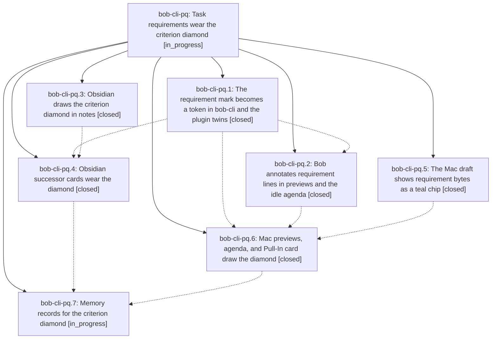

# Bead: bob-cli-pq — Task requirements wear the criterion diamond

[Bead Pages](../README.md) / bob-cli-pq

**Status:** ◐ in_progress · **Type:** ▸ plan · **Tier:** epic
**Owner:** `bryanbugyi34@gmail.com` · **Created by:** [bbugyi200.athena.1f8](https://github.com/bobs-org/bob-cli--agents/blob/main/sessions/bbugyi200.athena.1f8.md) · **Assignee:** `bob-cli-pq.land`
**Created:** 2026-11-23 03:54:18 EST
**Plan:** [202611/task\_reqs\_criterion\_diamond.md](https://github.com/bobs-org/bob-cli--plans/blob/main/202611/task_reqs_criterion_diamond.md)

<!-- sase:links:start -->

## Links

| Relation | Artifact | Why |
| --- | --- | --- |
| implemented-by | [plan:202611/task_reqs_criterion_diamond.md][1] | derived from the plan's `bead_id:` frontmatter field |

_Plus 3 automatic references — see [Referenced By](#referenced-by)._

[1]: https://github.com/bobs-org/bob-cli--plans/blob/main/202611/task_reqs_criterion_diamond.md

<!-- sase:links:end -->

## Description

Every task requirement is drawn with one quiet, constant-width diamond in its owner's ink, at every depth, in Obsidian, Bob Mac Capture, the successor cards, and CLI text. The mark's fill shows the requirement's state, indentation alone shows its depth, and the Mac draft shows honest bytes. Nothing about how requirements behave, are stored, or are typed changes.

## Notes

[2026-11-23T15:08:03Z · bryanbugyi34@gmail.com] Bryan waived the ph.7/ph.8 sequencing gate. Keep drawer words untouched; the later lander does the taste pass.

## Phases

| Bead | Title | Status | Size | Created | Agents | Commits |
|---|---|---|---|---|---:|---:|
| [bob-cli-pq.1](bob-cli-pq.1.md) | The requirement mark becomes a token in bob-cli and the plugin twins | ✓ closed | medium | 2026-11-23 | 1 | 2 |
| [bob-cli-pq.2](bob-cli-pq.2.md) | Bob annotates requirement lines in previews and the idle agenda | ✓ closed | medium | 2026-11-23 | 1 | 1 |
| [bob-cli-pq.3](bob-cli-pq.3.md) | Obsidian draws the criterion diamond in notes | ✓ closed | medium | 2026-11-23 | 1 | 2 |
| [bob-cli-pq.4](bob-cli-pq.4.md) | Obsidian successor cards wear the diamond | ✓ closed | small | 2026-11-23 | 1 | 1 |
| [bob-cli-pq.5](bob-cli-pq.5.md) | The Mac draft shows requirement bytes as a teal chip | ✓ closed | medium | 2026-11-23 | 1 | 1 |
| [bob-cli-pq.6](bob-cli-pq.6.md) | Mac previews, agenda, and Pull-In card draw the diamond | ✓ closed | medium | 2026-11-23 | 1 | 1 |
| [bob-cli-pq.7](bob-cli-pq.7.md) | Memory records for the criterion diamond | ◐ in_progress | small | 2026-11-23 | 1 | 0 |

## Lineage

## Agents

| Agent | Bead | Commits |
|---|---|---:|
| [bbugyi200.athena.bob-cli-pq.1](https://github.com/bobs-org/bob-cli--agents/blob/main/agents/bbugyi200.athena.bob-cli-pq.1/README.md) | [bob-cli-pq.1](bob-cli-pq.1.md) | 2 |
| [bbugyi200.athena.bob-cli-pq.2](https://github.com/bobs-org/bob-cli--agents/blob/main/sessions/bbugyi200.athena.bob-cli-pq.2.md) | [bob-cli-pq.2](bob-cli-pq.2.md) | 1 |
| [bbugyi200.athena.bob-cli-pq.3](https://github.com/bobs-org/bob-cli--agents/blob/main/agents/bbugyi200.athena.bob-cli-pq.3/README.md) | [bob-cli-pq.3](bob-cli-pq.3.md) | 2 |
| [bbugyi200.athena.bob-cli-pq.4](https://github.com/bobs-org/bob-cli--agents/blob/main/agents/bbugyi200.athena.bob-cli-pq.4/README.md) | [bob-cli-pq.4](bob-cli-pq.4.md) | 1 |
| [bbugyi200.athena.bob-cli-pq.5](https://github.com/bobs-org/bob-cli--agents/blob/main/sessions/bbugyi200.athena.bob-cli-pq.5.md) | [bob-cli-pq.5](bob-cli-pq.5.md) | 1 |
| [bbugyi200.athena.bob-cli-pq.6](https://github.com/bobs-org/bob-cli--agents/blob/main/sessions/bbugyi200.athena.bob-cli-pq.6.md) | [bob-cli-pq.6](bob-cli-pq.6.md) | 1 |
| [bbugyi200.athena.bob-cli-pq.7](https://github.com/bobs-org/bob-cli--agents/blob/main/agents/bbugyi200.athena.bob-cli-pq.7/README.md) | [bob-cli-pq.7](bob-cli-pq.7.md) | 0 |
| [bbugyi200.athena.bob-cli-pq.land](https://github.com/bobs-org/bob-cli--agents/blob/main/agents/bbugyi200.athena.bob-cli-pq.land/README.md) | [bob-cli-pq](README.md) | 0 |

## Commits

| Repo | Commit | Subject | Bead | Committed |
|---|---|---|---|---|
| bob-cli | [`cb7b9ab`](https://github.com/bobs-org/bob-cli/commit/cb7b9ab13614301918a4cd68dda85501bc7b6b29) | feat(task-reqs): draw requirements with the criterion diamond glyph | [bob-cli-pq.1](bob-cli-pq.1.md) | 2026-11-23 04:29:19 EST |
| bob-plugins | [`bob-plugins@ddbf8bd`](https://github.com/bobs-org/bob-plugins/commit/ddbf8bd91f552ecafb12c14b9c182bc538e89681) | feat(task-reqs): draw requirements with the criterion diamond glyph | [bob-cli-pq.1](bob-cli-pq.1.md) | 2026-11-23 04:29:46 EST |
| bob-cli | [`87ee683`](https://github.com/bobs-org/bob-cli/commit/87ee683ae7ed698db10e79c892d2be109a45d737) | feat(task-reqs): annotate preview and agenda lines with req depth and state | [bob-cli-pq.2](bob-cli-pq.2.md) | 2026-11-23 05:10:41 EST |
| bob-cli | [`f6cf62c`](https://github.com/bobs-org/bob-cli/commit/f6cf62cf7a415ca75bebf31a744a286fbba09f5c) | docs(task-reqs): document criterion diamonds and teaching clicks | [bob-cli-pq.3](bob-cli-pq.3.md) | 2026-11-23 10:47:01 EST |
| bob-plugins | [`bob-plugins@c884675`](https://github.com/bobs-org/bob-plugins/commit/c884675435beab310eaa1bf041a4939828ca4a77) | feat(task-reqs): render criterion diamonds with state-aware tooltips | [bob-cli-pq.3](bob-cli-pq.3.md) | 2026-11-23 10:47:29 EST |
| bob-plugins | [`bob-plugins@b2c3710`](https://github.com/bobs-org/bob-plugins/commit/b2c371025c637722abbdc045573b92976141573b) | feat(nav): draw the criterion diamond on successor requirement cards | [bob-cli-pq.4](bob-cli-pq.4.md) | 2026-11-23 11:13:38 EST |
| bob-mac-capture | [`bob-mac-capture@c6c9c13`](https://github.com/bobs-org/bob-mac-capture/commit/c6c9c13e9353ce2dfdb3ed667e2ce916cbc30e91) | feat(capture): render native teal requirement chips | [bob-cli-pq.5](bob-cli-pq.5.md) | 2026-11-23 13:04:36 EST |
| bob-mac-capture | [`bob-mac-capture@ff157b0`](https://github.com/bobs-org/bob-mac-capture/commit/ff157b0e4a680528d545aefc7d5d443752abd8a7) | feat(capture): draw requirement diamond and say Met with task | [bob-cli-pq.6](bob-cli-pq.6.md) | 2026-11-23 14:33:00 EST |

<!-- sase:referenced-by:start -->

## Referenced By

| Relation | Artifact | Why | Uses |
| --- | --- | --- | ---: |
| read-by | [agent:1fk][1] | Research whether pq.3/pq.5 truly depend on bob-cli-ph | 1 |
| read-by | [agent:bob-cli-pq.1][2] | Need epic scope decisions plan | 1 |
| read-by | [agent:bob-cli-pq.3][3] | Check whether parent notes revise the rendering prerequisite | 1 |

[1]: https://github.com/bobs-org/bob-cli--agents/blob/main/agents/bbugyi200.athena.1fk/README.md
[2]: https://github.com/bobs-org/bob-cli--agents/blob/main/agents/bbugyi200.athena.bob-cli-pq.1/README.md
[3]: https://github.com/bobs-org/bob-cli--agents/blob/main/sessions/bbugyi200.athena.bob-cli-pq.3.md

<!-- sase:referenced-by:end -->
