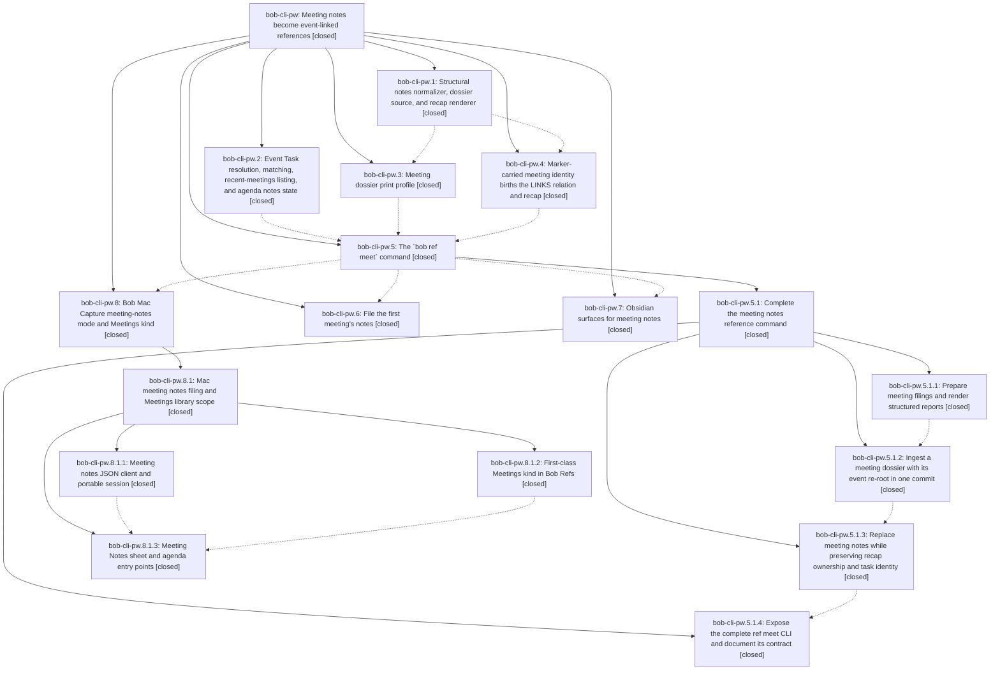

# Bead: bob-cli-pw — Meeting notes become event-linked references

[Bead Pages](../README.md) / bob-cli-pw

**Status:** ✓ closed · **Resolution:** done · **Type:** ▸ plan · **Tier:** epic
**Owner:** `bryanbugyi34@gmail.com` · **Created by:** [bbugyi200.apollo.research.65.linker.w0](https://github.com/bobs-org/bob-cli--agents/blob/main/sessions/bbugyi200.apollo.research.65.linker.w0.md) · **Assignee:** `bob-cli-pw.land`
**Created:** 2026-11-24 10:38:46 EST · **Closed:** 2026-11-25 09:41:31 EST
**Plan:** [202611/meeting\_notes\_event\_refs.md](https://github.com/bobs-org/bob-cli--plans/blob/main/202611/meeting_notes_event_refs.md)

<!-- sase:links:start -->

## Links

| Relation | Artifact | Why |
| --- | --- | --- |
| implemented-by | [plan:202611/meeting_notes_event_refs.md][1] | derived from the plan's `bead_id:` frontmatter field |

_Plus 5 automatic references — see [Referenced By](#referenced-by)._

[1]: https://github.com/bobs-org/bob-cli--plans/blob/main/202611/meeting_notes_event_refs.md

<!-- sase:links:end -->

## Description

One deliberate gesture, from the CLI, Obsidian, or Bob Mac Capture, files AI meeting notes (Wispr Flow first, any producer) as a `meetings` reference. The reference is filed under the meeting's area or project, gets a searchable recap and a polished dossier PDF, and has a Next reading task related `notes from` its Event Task. The `~/tmp/bryan_derrick_meet_notes.txt` notes are filed onto `20261123#^bryan-bugyi-derrick` this way as the first use case.

## Notes

[2026-11-24T16:59:46Z · 1fq--code] DISCOVERED ISSUE (from fix_meetings_build plan step 7): render_recap output layout differs from the epic contract in plan:202611/meeting_notes_event_refs.md ('The recap region'). Contract specifies a '## Notes' heading, a '> [!summary] TL;DR' callout, and '###' sub-headings; current render_recap emits a meta line, a plain TL;DR paragraph, and '##' headings copying the notes' own levels. Left as-is in the committed goldens under tests/fixtures/meetings/golden/ (recap_wispr.md, recap_adversarial.md). A later meeting phase should align the recap layout with the epic contract before recap regions are written into vault notes.

[2026-11-24T17:06:33Z · bob-cli-pl.1--4] DISCOVERED ISSUE: Conflict-repair verification of main rebased onto dbf405e397b7081c5c5531590608637346e49dfc reproduced meeting-module build failures in sase tool run check (ToolRun f4df3fa669a8de2c5c803661f5c8db6c, exit 101). src/native/meetings/dossier.rs:348 class_fence lacks the returned borrow lifetime (E0106); normalize.rs:242 passes &str to parse_next_step(String) (E0308); mod.rs:19-26 reexports unused items denied by the canonical -D unused gate. git diff HEAD -- src/native/meetings is empty, so these are inherited from dbf405e3, not the props conflict repair. The gate stops before tests. Search across task types found no duplicate; causal owner is bob-cli-pw.1. The existing fix_meetings_build work mentioned in note 1 may already address these; record this as independent reproduction on the older integrated base, not a new request to duplicate that work.

[2026-11-24T17:22:00Z · bob-cli-pl.1--4] DISCOVERED ISSUE: Additional impact of note #2 during bob-plugins conflict repair. BOB_CLI_DIR pointing at clean bob-cli 31131fe2 npm run docs:check (from bob-plugins) passed mounted-doc lint, drift, strict Zensical build, published URLs, offline links, edit links and search smoke, then exited 2 at executable tutorial because cargo build --locked --bin bob exited 101: dossier.rs:348 class_fence E0106 and normalize.rs:242 parse_next_step E0308. No bob-cli files changed in this repair. This corroborates the older-base build blocker already owned by pw.1; no duplicate task or fix request.

[2026-11-24T21:35:47Z · bob-cli-px.land] DISCOVERED ISSUE: On clean master 2b3817fe (athena, 2026-11-24), `cargo test -p bob-obsidian --lib native::meetings::profile` deterministically fails 2/4 tests: transcript_appendix_starts_on_its_own_page and wispr_summary_renders_one_or_two_pages_with_stable_words. Real xelatex aborts on pass 1 with '! LaTeX Error: Can be used only in preamble.' at l.277 \\AtBeginDocument{\\hypersetup{pdftitle={...}}}. That line is emitted by src/native/highlights_ref/meeting_profile/meeting.lua:521, which places the pdftitle \\AtBeginDocument after \\begin{document}. The bug came from bob-cli-pw.3 (commit 2b3817fe); pw.3's note #2 reported 4/4 passing, so some later integration change apparently moved the hook out of the preamble. Reproduced in isolation (2 passed, 2 failed) and in the full `just check` lib run, where they were the only failures. Found by the bob-cli-px land agent; not caused by bob-cli-px.

[2026-11-25T13:21:41Z · bob-cli-pw.land] FOLLOW-UP TRIAGE COMPLETE (bob-cli-pw land agent, before the repair-tale proposal):
(1) pw.1 #1, intermittent stats completion tests: duplicate of bob-cli-gd; +1 recorded, with stats_clock named as a second node.
(2) pw.2 #1, Zensical link from docs/develop/plugins/architecture.md:184: already fixed on master (now an absolute published URL); declined.
(3) pw.3 #1 and pw.4 #1, props clippy: fixed by 3deee354; the later pw.5.1 and pw.8.1 just check runs passed; declined.
(4) pw.6 #1 and #4, LINKED FROM mirror and reconcile day: moot per pw.6 #7; declined.
(5) pw.6 #2, -p/--producer clap panic: fixed by 28e23886 (OsString parsers). I re-verified at HEAD 5ab392a1 with a real filing in a scratch vault using -p "Wispr Flow"; declined.
(6) pw.6 #3: superseded by pw.6 #6 (rehang done); declined.
(7) pw.6 #5, real Wispr paste fixture: filed with the plan's Deferred Copy-as-Markdown adapter as bob-cli-pz.
(8) pw.6 #8 and epic note #1, recap layout vs the design of record: caused by the epic; remaining epic work in the repair tale.
(9) epic note #4, meeting.lua emits \AtBeginDocument{\hypersetup{pdftitle}} after \begin{document}, which older LaTeX kernels reject: caused by the epic; repair tale. Removing it keeps all 4 profile tests passing, because the Title comes from pandoc's title metadata.
(10) pw.7 #1, docs budgets and timing flakes: +1 on bob-cli-ob, bob-cli-jz, bob-cli-km, and bob-cli-io.
(11) Plan Deferred items that first-use did not record: created features bob-cli-pz (Copy-as-Markdown adapter plus fixture), bob-cli-q0 (Wispr local-store adapter), bob-cli-q1 (layer-2 enrichment), bob-cli-q2 (owner-aware next-step offers), and bob-cli-q3 (notes from/notes in inverse pair and a prep for label). All are ready.
Nested dispositions stand as recorded on bob-cli-pw.5.1 (#1, #3) and bob-cli-pw.8.1 (#2, #4).
Further epic-caused gaps found in this audit go to the repair tale:
- normalize_wispr treats a multi-line first paragraph as a heading. The dossier then carries a multi-line heading, and parse_dossier drops the non-list lines, so next-step words vanish from the recap. Repro: "Next steps\n(Ari) Ship" with no blank line after the heading.
- The bob-plugins ref-meet adapter's Open event regex never matches bob's real receipt line "relation  notes from [[20261124#^id]]".
- The ref meet --help text uses spec language ("Required codes", "Missing block IDs need an actionable refusal").
- The receipt prints "(1 pages)", and the dry-run prints the Debug shape name.
Integration: the non-epic commits since dbf405e3 are 31131fe2, 4b23bbef, fb946f9c, 3deee354, f07c2395, 976f53ba, 69e5fcb9, 447ef1a5, and 5ab392a1 (props, gmail, and a dev script). They overlap only in shared docs and catalog registries, which merged cleanly. Nothing needs to adopt the meetings feature. Mac 3931c308 (the native repairs) is on origin/master; its tree equals green snapshot e7b7bb3c, and exact-SHA run 45614436809 is green. No --epic-symbol entries; no symvision recipe; no parent bead.

[2026-11-25T14:41:31Z · bob-cli-pw.land--1] land_meeting_notes_repairs done. Repairs: bob-cli recap layout (## Notes, weekday meta, aliased event link, TL;DR callout, ###/####), lossless Wispr/dossier round trip with regression tests, PDF preamble hook removal + guard test, user-facing ref meet help/receipts + docs paragraph + docs-gen; bob-plugins ref-meet toast accepts bare/wikilink/path/alias targets, unit tests updated, build clean, deployed via bob plugins sync. Verify: just check COMPLETED exit 0 (monitor heapsd2ty4hy, 18m39s 2026-11-25); just docs-check FAILED lint exit 1 with only known error bob-navigation-hotkeys 6046 words over 6000 cap (per bob-cli-jz) plus warning plugin-apis 9287 over 8000 cap; smoke passed prior turn with (1 page) receipt, ## Notes + Tue meta + aliased link + TL;DR callout + ### Next steps with both steps kept. Land audit: all 8 phases CLOSED and verified, Mac repairs 3931c308 green exact-SHA run 45614436809, no integration changes since dbf405e3. Follow-ups: +1 gd/ob/jz/km/io; new pz/q0/q1/q2/q3 ready; declined pw.2 #1, pw.3 #1, pw.4 #1, pw.6 #1-4; pw.6 #8 and epic note #4 TeX defects fixed here; nested dispositions on pw.5.1 and pw.8.1 stand.

## Phases

| Bead | Title | Status | Size | Created | Agents | Commits |
|---|---|---|---|---|---:|---:|
| [bob-cli-pw.1](bob-cli-pw.1.md) | Structural notes normalizer, dossier source, and recap renderer | ✓ closed | medium | 2026-11-24 | 1 | 2 |
| [bob-cli-pw.2](bob-cli-pw.2.md) | Event Task resolution, matching, recent-meetings listing, and agenda notes state | ✓ closed | medium | 2026-11-24 | 1 | 1 |
| [bob-cli-pw.3](bob-cli-pw.3.md) | Meeting dossier print profile | ✓ closed | medium | 2026-11-24 | 1 | 1 |
| [bob-cli-pw.4](bob-cli-pw.4.md) | Marker-carried meeting identity births the LINKS relation and recap | ✓ closed | medium | 2026-11-24 | 1 | 1 |
| [bob-cli-pw.5](bob-cli-pw.5.md) | The \`bob ref meet\` command | ✓ closed | large | 2026-11-24 | 1 | 0 |
| [bob-cli-pw.6](bob-cli-pw.6.md) | File the first meeting's notes | ✓ closed | small | 2026-11-24 | 1 | 0 |
| [bob-cli-pw.7](bob-cli-pw.7.md) | Obsidian surfaces for meeting notes | ✓ closed | medium | 2026-11-24 | 1 | 1 |
| [bob-cli-pw.8](bob-cli-pw.8.md) | Bob Mac Capture meeting-notes mode and Meetings kind | ✓ closed | large | 2026-11-24 | 1 | 0 |

## Lineage

## Agents

| Agent | Bead | Commits |
|---|---|---:|
| [bbugyi200.apollo.bob-cli-pw.1](https://github.com/bobs-org/bob-cli--agents/blob/main/sessions/bbugyi200.apollo.bob-cli-pw.1.md) | [bob-cli-pw.1](bob-cli-pw.1.md) | 2 |
| [bbugyi200.apollo.bob-cli-pw.2](https://github.com/bobs-org/bob-cli--agents/blob/main/agents/bbugyi200.apollo.bob-cli-pw.2/README.md) | [bob-cli-pw.2](bob-cli-pw.2.md) | 1 |
| [bbugyi200.apollo.bob-cli-pw.3](https://github.com/bobs-org/bob-cli--agents/blob/main/agents/bbugyi200.apollo.bob-cli-pw.3/README.md) | [bob-cli-pw.3](bob-cli-pw.3.md) | 1 |
| [bbugyi200.apollo.bob-cli-pw.4](https://github.com/bobs-org/bob-cli--agents/blob/main/agents/bbugyi200.apollo.bob-cli-pw.4/README.md) | [bob-cli-pw.4](bob-cli-pw.4.md) | 1 |
| [bbugyi200.apollo.bob-cli-pw.5](https://github.com/bobs-org/bob-cli--agents/blob/main/sessions/bbugyi200.apollo.bob-cli-pw.5.md) | [bob-cli-pw.5](bob-cli-pw.5.md) | 0 |
| [bbugyi200.apollo.bob-cli-pw.5.1.1](https://github.com/bobs-org/bob-cli--agents/blob/main/sessions/bbugyi200.apollo.bob-cli-pw.5.1.1.md) | [bob-cli-pw.5.1.1](bob-cli-pw.5.1.1.md) | 1 |
| [bbugyi200.apollo.bob-cli-pw.5.1.2](https://github.com/bobs-org/bob-cli--agents/blob/main/agents/bbugyi200.apollo.bob-cli-pw.5.1.2/README.md) | [bob-cli-pw.5.1.2](bob-cli-pw.5.1.2.md) | 1 |
| [bbugyi200.apollo.bob-cli-pw.5.1.3](https://github.com/bobs-org/bob-cli--agents/blob/main/agents/bbugyi200.apollo.bob-cli-pw.5.1.3/README.md) | [bob-cli-pw.5.1.3](bob-cli-pw.5.1.3.md) | 1 |
| [bbugyi200.apollo.bob-cli-pw.5.1.4](https://github.com/bobs-org/bob-cli--agents/blob/main/agents/bbugyi200.apollo.bob-cli-pw.5.1.4/README.md) | [bob-cli-pw.5.1.4](bob-cli-pw.5.1.4.md) | 1 |
| [bbugyi200.apollo.bob-cli-pw.5.1.land](https://github.com/bobs-org/bob-cli--agents/blob/main/sessions/bbugyi200.apollo.bob-cli-pw.5.1.land.md) | [bob-cli-pw.5.1](bob-cli-pw.5.1.md) | 2 |
| [bbugyi200.apollo.bob-cli-pw.6](https://github.com/bobs-org/bob-cli--agents/blob/main/sessions/bbugyi200.apollo.bob-cli-pw.6.md) | [bob-cli-pw.6](bob-cli-pw.6.md) | 0 |
| [bbugyi200.apollo.bob-cli-pw.7](https://github.com/bobs-org/bob-cli--agents/blob/main/agents/bbugyi200.apollo.bob-cli-pw.7/README.md) | [bob-cli-pw.7](bob-cli-pw.7.md) | 1 |
| [bbugyi200.apollo.bob-cli-pw.8](https://github.com/bobs-org/bob-cli--agents/blob/main/sessions/bbugyi200.apollo.bob-cli-pw.8.md) | [bob-cli-pw.8](bob-cli-pw.8.md) | 0 |
| [bbugyi200.apollo.bob-cli-pw.8.1.1](https://github.com/bobs-org/bob-cli--agents/blob/main/sessions/bbugyi200.apollo.bob-cli-pw.8.1.1.md) | [bob-cli-pw.8.1.1](bob-cli-pw.8.1.1.md) | 4 |
| [bbugyi200.apollo.bob-cli-pw.8.1.2](https://github.com/bobs-org/bob-cli--agents/blob/main/sessions/bbugyi200.apollo.bob-cli-pw.8.1.2.md) | [bob-cli-pw.8.1.2](bob-cli-pw.8.1.2.md) | 1 |
| [bbugyi200.apollo.bob-cli-pw.8.1.3](https://github.com/bobs-org/bob-cli--agents/blob/main/sessions/bbugyi200.apollo.bob-cli-pw.8.1.3.md) | [bob-cli-pw.8.1.3](bob-cli-pw.8.1.3.md) | 3 |
| [bbugyi200.apollo.bob-cli-pw.8.1.land](https://github.com/bobs-org/bob-cli--agents/blob/main/sessions/bbugyi200.apollo.bob-cli-pw.8.1.land.md) | [bob-cli-pw.8.1](bob-cli-pw.8.1.md) | 2 |
| [bbugyi200.apollo.bob-cli-pw.land](https://github.com/bobs-org/bob-cli--agents/blob/main/sessions/bbugyi200.apollo.bob-cli-pw.land.md) | [bob-cli-pw](README.md) | 3 |

## Commits

| Repo | Commit | Subject | Bead | Committed |
|---|---|---|---|---|
| bob-cli | [`dbf405e`](https://github.com/bobs-org/bob-cli/commit/dbf405e397b7081c5c5531590608637346e49dfc) | feat(meetings): add notes normalization and rendering | [bob-cli-pw.1](bob-cli-pw.1.md) | 2026-11-24 11:11:34 EST |
| bob-cli | [`b832e58`](https://github.com/bobs-org/bob-cli/commit/b832e58df449d9d422a488f1d8f3bf0828a93487) | feat(meetings): add read-only meeting resolver and agenda wiring | [bob-cli-pw.2](bob-cli-pw.2.md) | 2026-11-24 12:52:20 EST |
| bob-cli | [`e5169b8`](https://github.com/bobs-org/bob-cli/commit/e5169b814083d717ab3df15f4adf6ec61a446d01) | fix(meetings): satisfy strict lint checks | [bob-cli-pw.1](bob-cli-pw.1.md) | 2026-11-24 13:13:31 EST |
| bob-cli | [`923df1a`](https://github.com/bobs-org/bob-cli/commit/923df1a63e771bcaa13488b3e0bc64152b97cac4) | feat(meetings): marker-carried meeting identity births LINKS relation and recap | [bob-cli-pw.4](bob-cli-pw.4.md) | 2026-11-24 14:06:22 EST |
| bob-cli | [`2b3817f`](https://github.com/bobs-org/bob-cli/commit/2b3817fee2c1cb43f02600ece3f52ba9147c6eaa) | feat(meetings): add a dossier print profile beside note snapshots | [bob-cli-pw.3](bob-cli-pw.3.md) | 2026-11-24 15:02:25 EST |
| bob-cli | [`15fd03b`](https://github.com/bobs-org/bob-cli/commit/15fd03b24c40308ed63bceeff26d4f65e2313c28) | feat(ref-meet): prepare meeting filings and reports | [bob-cli-pw.5.1.1](bob-cli-pw.5.1.1.md) | 2026-11-24 17:14:35 EST |
| bob-cli | [`bf30944`](https://github.com/bobs-org/bob-cli/commit/bf309445934ef16924565c4f48134400c038b7c7) | feat(meet): ingest meeting dossier with event re-root in one commit | [bob-cli-pw.5.1.2](bob-cli-pw.5.1.2.md) | 2026-11-24 19:09:20 EST |
| bob-cli | [`c5fa6da`](https://github.com/bobs-org/bob-cli/commit/c5fa6da65e33d16ac6591ec2ec32c0280a47bbdf) | feat(meet): overwrite filed notes while preserving recap and identity | [bob-cli-pw.5.1.3](bob-cli-pw.5.1.3.md) | 2026-11-24 20:14:27 EST |
| bob-cli | [`e4c96b0`](https://github.com/bobs-org/bob-cli/commit/e4c96b055ba33cf57962e33fb501700c86c5f264) | feat(ref): add public bob ref meet leaf for filing meeting notes | [bob-cli-pw.5.1.4](bob-cli-pw.5.1.4.md) | 2026-11-24 22:18:33 EST |
| bob-cli | [`28e2388`](https://github.com/bobs-org/bob-cli/commit/28e2388646c80a47c748fda3c816a2fe2ff63235) | fix(ref): land remaining bob ref meet CLI repairs | [bob-cli-pw.5.1](bob-cli-pw.5.1.md) | 2026-11-24 23:47:38 EST |
| bob-cli--plans | [`bob-cli--plans@469a5b5`](https://github.com/bobs-org/bob-cli--plans/commit/469a5b530f24bb5795c2e6cea7c2f85dc5d7e98b) | docs(plan): mark ref\_meet\_cli epic plan done | [bob-cli-pw.5.1](bob-cli-pw.5.1.md) | 2026-11-24 23:49:13 EST |
| bob-mac-capture | [`bob-mac-capture@c8692ed`](https://github.com/bobs-org/bob-mac-capture/commit/c8692ed363408ae398516fc1b0c50787b0425961) | feat(refs): add Meetings library scope | [bob-cli-pw.8.1.2](bob-cli-pw.8.1.2.md) | 2026-11-25 00:13:11 EST |
| bob-plugins | [`bob-plugins@c181966`](https://github.com/bobs-org/bob-plugins/commit/c181966495f4630d9834b35f0faef3fbb2ee9ec4) | feat(plugins): add meeting note Obsidian surfaces | [bob-cli-pw.7](bob-cli-pw.7.md) | 2026-11-25 00:14:34 EST |
| bob-mac-capture | [`bob-mac-capture@7b1fcc0`](https://github.com/bobs-org/bob-mac-capture/commit/7b1fcc052f4f7680fedd24947e2ab984f5074ee4) | feat(meetings): add portable ref meet client and session | [bob-cli-pw.8.1.1](bob-cli-pw.8.1.1.md) | 2026-11-25 00:28:43 EST |
| bob-mac-capture | [`bob-mac-capture@1dea9a7`](https://github.com/bobs-org/bob-mac-capture/commit/1dea9a716eef3795715c62aa1a4dc5c54d18c93f) | test(capture): assert cancellation on leave | [bob-cli-pw.8.1.1](bob-cli-pw.8.1.1.md) | 2026-11-25 00:42:32 EST |
| bob-mac-capture | [`bob-mac-capture@b693bf5`](https://github.com/bobs-org/bob-mac-capture/commit/b693bf56fdd706774dc6fd154ad7d8471bb95c29) | fix(tests): preserve existing fake ref commands | [bob-cli-pw.8.1.1](bob-cli-pw.8.1.1.md) | 2026-11-25 01:17:09 EST |
| bob-mac-capture | [`bob-mac-capture@36b3e4a`](https://github.com/bobs-org/bob-mac-capture/commit/36b3e4aa4c67c8fa51f3873449de32d71b9bec70) | test(refs): correct restored query expectation | [bob-cli-pw.8.1.1](bob-cli-pw.8.1.1.md) | 2026-11-25 01:48:07 EST |
| bob-cli | [`bcf0566`](https://github.com/bobs-org/bob-cli/commit/bcf0566ba90212b9198d38c69da96a00cba9ce78) | docs(guides): link Mac Capture meeting notes flow from filing guide | [bob-cli-pw.8.1.3](bob-cli-pw.8.1.3.md) | 2026-11-25 02:45:27 EST |
| bob-mac-capture | [`bob-mac-capture@3b443fe`](https://github.com/bobs-org/bob-mac-capture/commit/3b443fe6cdb6849d01787041ba17a23dadc7c9e2) | feat(meetings): add Meeting Notes sheet and agenda entry points | [bob-cli-pw.8.1.3](bob-cli-pw.8.1.3.md) | 2026-11-25 02:46:21 EST |
| bob-mac-capture | [`bob-mac-capture@284417d`](https://github.com/bobs-org/bob-mac-capture/commit/284417d783db8a2c4626045bbc4e17458ee670b8) | test(mac-capture): fix MeetingNotesKeyRouter init order and status-menu assertions | [bob-cli-pw.8.1.3](bob-cli-pw.8.1.3.md) | 2026-11-25 04:21:58 EST |
| bob-mac-capture | [`bob-mac-capture@3931c30`](https://github.com/bobs-org/bob-mac-capture/commit/3931c308b376904d063208e13f793691396e58cc) | fix(meetings): repair native Meeting Notes landing flows | [bob-cli-pw.8.1](bob-cli-pw.8.1.md) | 2026-11-25 07:30:34 EST |
| bob-cli--plans | [`bob-cli--plans@79c2b32`](https://github.com/bobs-org/bob-cli--plans/commit/79c2b325fda4eeb293391e9aed35ed5910444545) | docs(plan): mark mac\_meeting\_notes epic plan done | [bob-cli-pw.8.1](bob-cli-pw.8.1.md) | 2026-11-25 07:31:58 EST |
| bob-cli | [`f47055d`](https://github.com/bobs-org/bob-cli/commit/f47055dad542113dc21e6251828c2a3e4cfc7597) | fix(meetings): land meeting-notes repairs | [bob-cli-pw](README.md) | 2026-11-25 09:14:17 EST |
| bob-plugins | [`bob-plugins@a458c96`](https://github.com/bobs-org/bob-plugins/commit/a458c96f448b6c298709685951c438c6015f04b5) | fix(command-mode): accept wikilink relation targets for ref-meet toast | [bob-cli-pw](README.md) | 2026-11-25 09:15:51 EST |
| bob-cli--plans | [`bob-cli--plans@3e7f216`](https://github.com/bobs-org/bob-cli--plans/commit/3e7f2165c2bb43f0aeb3e562e7418b00478794de) | docs(plans): mark meeting\_notes\_event\_refs done | [bob-cli-pw](README.md) | 2026-11-25 09:42:35 EST |

<!-- sase:referenced-by:start -->

## Referenced By

| Relation | Artifact | Why | Uses |
| --- | --- | --- | ---: |
| read-by | [agent:bob-cli-pl.1--4][1] | Confirm the meeting epic owns the compile errors blocking mounted plugin docs checks | 2 |
| read-by | [agent:bob-cli-pw.2][2] | Need parent epic scope and plan pointer | 1 |
| read-by | [agent:bob-cli-pw.3][3] | Need parent epic phases and remaining work | 1 |
| read-by | [agent:bob-cli-pw.4][4] | Need epic children status | 1 |
| read-by | [agent:bob-cli-pw.8.1.land--3][5] | Confirm containing epic bob-cli-pw remains open after phase close | 1 |

[1]: https://github.com/bobs-org/bob-cli--agents/blob/main/sessions/bbugyi200.apollo.bob-cli-pl.1.md
[2]: https://github.com/bobs-org/bob-cli--agents/blob/main/agents/bbugyi200.apollo.bob-cli-pw.2/README.md
[3]: https://github.com/bobs-org/bob-cli--agents/blob/main/agents/bbugyi200.apollo.bob-cli-pw.3/README.md
[4]: https://github.com/bobs-org/bob-cli--agents/blob/main/agents/bbugyi200.apollo.bob-cli-pw.4/README.md
[5]: https://github.com/bobs-org/bob-cli--agents/blob/main/sessions/bbugyi200.apollo.bob-cli-pw.8.1.land.md

<!-- sase:referenced-by:end -->
