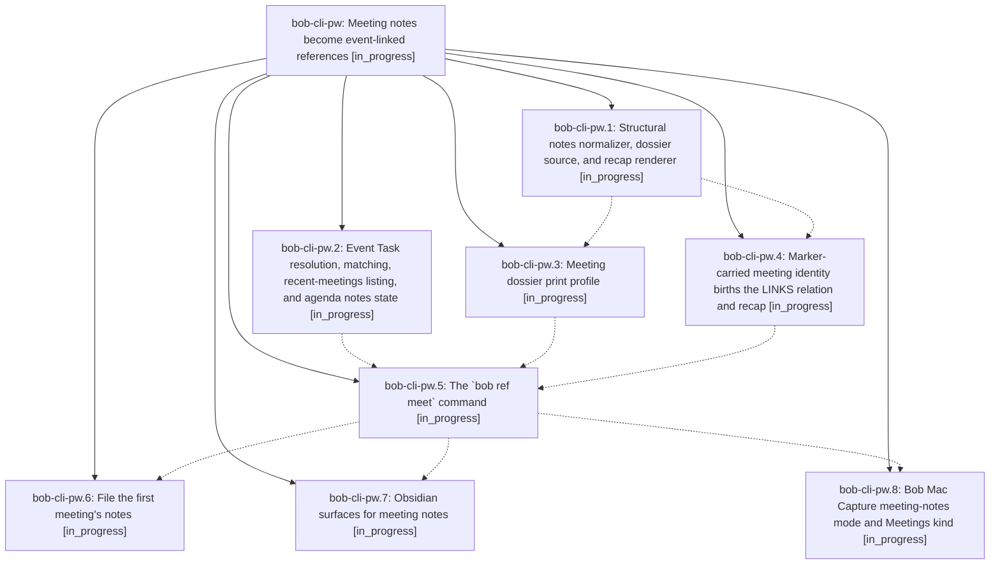

# Bead: bob-cli-pw — Meeting notes become event-linked references

[Bead Pages](../README.md) / bob-cli-pw

**Status:** ◐ in_progress · **Type:** ▸ plan · **Tier:** epic
**Owner:** `bryanbugyi34@gmail.com` · **Created by:** [bbugyi200.apollo.research.65.linker.w0](https://github.com/bobs-org/bob-cli--agents/blob/main/sessions/bbugyi200.apollo.research.65.linker.w0.md) · **Assignee:** `bob-cli-pw.land`
**Created:** 2026-11-24 10:38:46 EST
**Plan:** [202611/meeting\_notes\_event\_refs.md](https://github.com/bobs-org/bob-cli--plans/blob/main/202611/meeting_notes_event_refs.md)

## Description

One deliberate gesture, from the CLI, Obsidian, or Bob Mac Capture, files AI meeting notes (Wispr Flow first, any producer) as a `meetings` reference. The reference is filed under the meeting's area or project, gets a searchable recap and a polished dossier PDF, and has a Next reading task related `notes from` its Event Task. The `~/tmp/bryan_derrick_meet_notes.txt` notes are filed onto `20261123#^bryan-bugyi-derrick` this way as the first use case.

## Phases

| Bead | Title | Status | Size | Created | Agents | Commits |
|---|---|---|---|---|---:|---:|
| [bob-cli-pw.1](bob-cli-pw.1.md) | Structural notes normalizer, dossier source, and recap renderer | ◐ in_progress | medium | 2026-11-24 | 1 | 1 |
| [bob-cli-pw.2](bob-cli-pw.2.md) | Event Task resolution, matching, recent-meetings listing, and agenda notes state | ◐ in_progress | medium | 2026-11-24 | 1 | 0 |
| [bob-cli-pw.3](bob-cli-pw.3.md) | Meeting dossier print profile | ◐ in_progress | medium | 2026-11-24 | 1 | 0 |
| [bob-cli-pw.4](bob-cli-pw.4.md) | Marker-carried meeting identity births the LINKS relation and recap | ◐ in_progress | medium | 2026-11-24 | 1 | 0 |
| [bob-cli-pw.5](bob-cli-pw.5.md) | The \`bob ref meet\` command | ◐ in_progress | large | 2026-11-24 | 1 | 0 |
| [bob-cli-pw.6](bob-cli-pw.6.md) | File the first meeting's notes | ◐ in_progress | small | 2026-11-24 | 1 | 0 |
| [bob-cli-pw.7](bob-cli-pw.7.md) | Obsidian surfaces for meeting notes | ◐ in_progress | medium | 2026-11-24 | 1 | 0 |
| [bob-cli-pw.8](bob-cli-pw.8.md) | Bob Mac Capture meeting-notes mode and Meetings kind | ◐ in_progress | large | 2026-11-24 | 1 | 0 |

## Lineage

## Agents

| Agent | Bead | Commits |
|---|---|---:|
| [bbugyi200.apollo.bob-cli-pw.1](https://github.com/bobs-org/bob-cli--agents/blob/main/sessions/bbugyi200.apollo.bob-cli-pw.1.md) | [bob-cli-pw.1](bob-cli-pw.1.md) | 1 |
| [bbugyi200.apollo.bob-cli-pw.2](https://github.com/bobs-org/bob-cli--agents/blob/main/agents/bbugyi200.apollo.bob-cli-pw.2/README.md) | [bob-cli-pw.2](bob-cli-pw.2.md) | 0 |
| [bbugyi200.apollo.bob-cli-pw.3](https://github.com/bobs-org/bob-cli--agents/blob/main/agents/bbugyi200.apollo.bob-cli-pw.3/README.md) | [bob-cli-pw.3](bob-cli-pw.3.md) | 0 |
| [bbugyi200.apollo.bob-cli-pw.4](https://github.com/bobs-org/bob-cli--agents/blob/main/agents/bbugyi200.apollo.bob-cli-pw.4/README.md) | [bob-cli-pw.4](bob-cli-pw.4.md) | 0 |
| [bbugyi200.apollo.bob-cli-pw.5](https://github.com/bobs-org/bob-cli--agents/blob/main/agents/bbugyi200.apollo.bob-cli-pw.5/README.md) | [bob-cli-pw.5](bob-cli-pw.5.md) | 0 |
| [bbugyi200.apollo.bob-cli-pw.6](https://github.com/bobs-org/bob-cli--agents/blob/main/agents/bbugyi200.apollo.bob-cli-pw.6/README.md) | [bob-cli-pw.6](bob-cli-pw.6.md) | 0 |
| [bbugyi200.apollo.bob-cli-pw.7](https://github.com/bobs-org/bob-cli--agents/blob/main/agents/bbugyi200.apollo.bob-cli-pw.7/README.md) | [bob-cli-pw.7](bob-cli-pw.7.md) | 0 |
| [bbugyi200.apollo.bob-cli-pw.8](https://github.com/bobs-org/bob-cli--agents/blob/main/agents/bbugyi200.apollo.bob-cli-pw.8/README.md) | [bob-cli-pw.8](bob-cli-pw.8.md) | 0 |
| [bbugyi200.apollo.bob-cli-pw.land](https://github.com/bobs-org/bob-cli--agents/blob/main/agents/bbugyi200.apollo.bob-cli-pw.land/README.md) | [bob-cli-pw](README.md) | 0 |

## Commits

| Repo | Commit | Subject | Bead | Committed |
|---|---|---|---|---|
| bob-cli | [`dbf405e`](https://github.com/bobs-org/bob-cli/commit/dbf405e397b7081c5c5531590608637346e49dfc) | feat(meetings): add notes normalization and rendering | [bob-cli-pw.1](bob-cli-pw.1.md) | 2026-11-24 11:11:34 EST |
