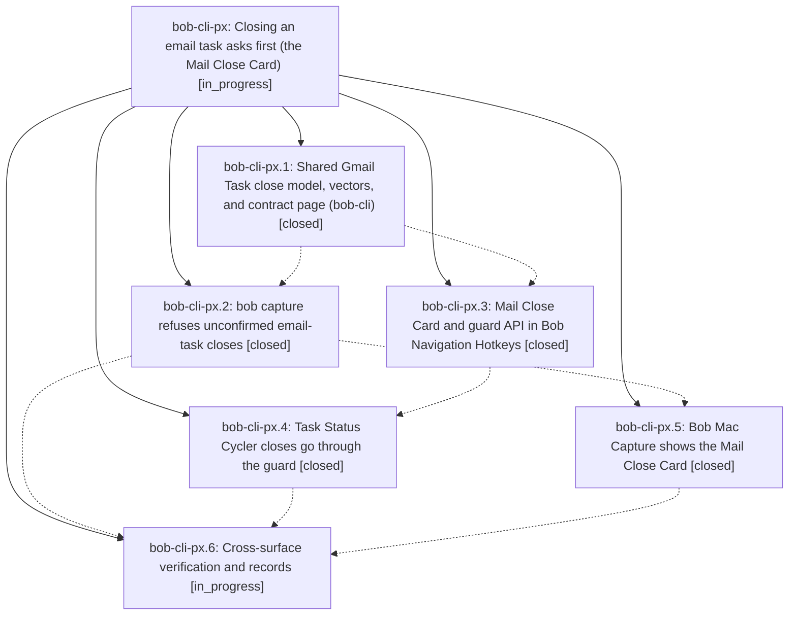

# Bead: bob-cli-px — Closing an email task asks first (the Mail Close Card)

[Bead Pages](../README.md) / bob-cli-px

**Status:** ◐ in_progress · **Type:** ▸ plan · **Tier:** epic
**Owner:** `bryanbugyi34@gmail.com` · **Created by:** [bbugyi200.athena.1fs](https://github.com/bobs-org/bob-cli--agents/blob/main/sessions/bbugyi200.athena.1fs.md) · **Assignee:** `bob-cli-px.land`
**Created:** 2026-11-24 12:22:30 EST
**Plan:** [202611/email\_task\_close\_confirmation.md](https://github.com/bobs-org/bob-cli--plans/blob/main/202611/email_task_close_confirmation.md)

<!-- sase:links:start -->

## Links

| Relation | Artifact | Why |
| --- | --- | --- |
| implemented-by | [plan:202611/email_task_close_confirmation.md][1] | derived from the plan's `bead_id:` frontmatter field |

[1]: https://github.com/bobs-org/bob-cli--plans/blob/main/202611/email_task_close_confirmation.md

<!-- sase:links:end -->

## Description

No interactive gesture in Obsidian, bob capture, or Bob Mac Capture can complete or cancel a Gmail Task without first showing one calm, beautiful confirmation card that says whose turn the thread is on and what closing it will cost; a stray Enter, Alt+[, or muscle-memory keypress keeps the task open.

## Phases

| Bead | Title | Status | Size | Created | Agents | Commits |
|---|---|---|---|---|---:|---:|
| [bob-cli-px.1](bob-cli-px.1.md) | Shared Gmail Task close model, vectors, and contract page (bob-cli) | ✓ closed | medium | 2026-11-24 | 1 | 1 |
| [bob-cli-px.2](bob-cli-px.2.md) | bob capture refuses unconfirmed email-task closes | ✓ closed | medium | 2026-11-24 | 1 | 1 |
| [bob-cli-px.3](bob-cli-px.3.md) | Mail Close Card and guard API in Bob Navigation Hotkeys | ✓ closed | medium | 2026-11-24 | 1 | 1 |
| [bob-cli-px.4](bob-cli-px.4.md) | Task Status Cycler closes go through the guard | ✓ closed | medium | 2026-11-24 | 1 | 1 |
| [bob-cli-px.5](bob-cli-px.5.md) | Bob Mac Capture shows the Mail Close Card | ✓ closed | medium | 2026-11-24 | 1 | 0 |
| [bob-cli-px.6](bob-cli-px.6.md) | Cross-surface verification and records | ◐ in_progress | small | 2026-11-24 | 1 | 0 |

## Lineage

## Agents

| Agent | Bead | Commits |
|---|---|---:|
| [bbugyi200.athena.bob-cli-px.1](https://github.com/bobs-org/bob-cli--agents/blob/main/agents/bbugyi200.athena.bob-cli-px.1/README.md) | [bob-cli-px.1](bob-cli-px.1.md) | 1 |
| [bbugyi200.athena.bob-cli-px.2](https://github.com/bobs-org/bob-cli--agents/blob/main/agents/bbugyi200.athena.bob-cli-px.2/README.md) | [bob-cli-px.2](bob-cli-px.2.md) | 1 |
| [bbugyi200.athena.bob-cli-px.3](https://github.com/bobs-org/bob-cli--agents/blob/main/sessions/bbugyi200.athena.bob-cli-px.3.md) | [bob-cli-px.3](bob-cli-px.3.md) | 1 |
| [bbugyi200.athena.bob-cli-px.4](https://github.com/bobs-org/bob-cli--agents/blob/main/agents/bbugyi200.athena.bob-cli-px.4/README.md) | [bob-cli-px.4](bob-cli-px.4.md) | 1 |
| [bbugyi200.athena.bob-cli-px.5](https://github.com/bobs-org/bob-cli--agents/blob/main/agents/bbugyi200.athena.bob-cli-px.5/README.md) | [bob-cli-px.5](bob-cli-px.5.md) | 0 |
| [bbugyi200.athena.bob-cli-px.6](https://github.com/bobs-org/bob-cli--agents/blob/main/agents/bbugyi200.athena.bob-cli-px.6/README.md) | [bob-cli-px.6](bob-cli-px.6.md) | 0 |
| [bbugyi200.athena.bob-cli-px.land](https://github.com/bobs-org/bob-cli--agents/blob/main/agents/bbugyi200.athena.bob-cli-px.land/README.md) | [bob-cli-px](README.md) | 0 |

## Commits

| Repo | Commit | Subject | Bead | Committed |
|---|---|---|---|---|
| bob-cli | [`f07c239`](https://github.com/bobs-org/bob-cli/commit/f07c2395e6e30f1a60c72b59e15d5ebd32839ae4) | feat(gmail): add shared mail close card model | [bob-cli-px.1](bob-cli-px.1.md) | 2026-11-24 13:12:16 EST |
| bob-cli | [`976f53b`](https://github.com/bobs-org/bob-cli/commit/976f53ba4e6f47ca80a723ac4f1f9d94495db01a) | feat(capture)!: refuse unconfirmed Gmail Task closes | [bob-cli-px.2](bob-cli-px.2.md) | 2026-11-24 14:13:52 EST |
| bob-plugins | [`bob-plugins@06f236c`](https://github.com/bobs-org/bob-plugins/commit/06f236c21942d7f42bf6445832d0b7afdd337f79) | feat(navigation): guard Gmail task closes with Mail Close Card | [bob-cli-px.3](bob-cli-px.3.md) | 2026-11-24 14:50:25 EST |
| bob-plugins | [`bob-plugins@6150d7e`](https://github.com/bobs-org/bob-plugins/commit/6150d7e65bd7b663ae87dc26bdbb2d9388a718eb) | feat(cycler): guard Gmail task closes with the Mail Close Card | [bob-cli-px.4](bob-cli-px.4.md) | 2026-11-24 15:30:59 EST |
