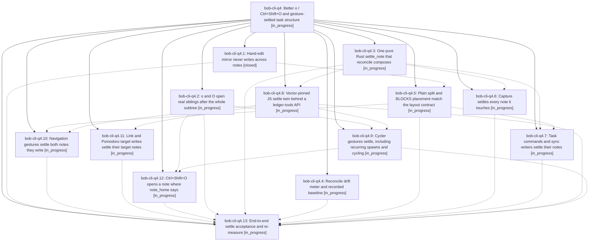

# Bead: bob-cli-q4 — Better o / Ctrl+Shift+O and gesture-settled task structure

[Bead Pages](../README.md) / bob-cli-q4

**Status:** ◐ in_progress · **Type:** ▸ plan · **Tier:** epic
**Owner:** `bryanbugyi34@gmail.com` · **Created by:** [bbugyi200.athena.1fw](https://github.com/bobs-org/bob-cli--agents/blob/main/sessions/bbugyi200.athena.1fw.md) · **Assignee:** `bob-cli-q4.land`
**Created:** 2026-11-25 08:51:35 EST
**Plan:** [202611/better\_o\_gesture\_settle.md](https://github.com/bobs-org/bob-cli--plans/blob/main/202611/better_o_gesture_settle.md)

## Description

Vim `o`, `O`, and `Ctrl+Shift+O` in Obsidian write into the right zone of a task block and never split a task from its children. Every bob-cli writer and every Obsidian gesture that changes a task's status or note settles that note's local structure in the same write. That means the local future-schedule Blocked rule, the `## Tasks` status groups, and the badge row. `bob task reconcile` then only does clock-driven and vault-wide work, and the drift numbers prove it.

## Phases

| Bead | Title | Status | Size | Created | Agents | Commits |
|---|---|---|---|---|---:|---:|
| [bob-cli-q4.1](bob-cli-q4.1.md) | Hand-edit mirror never writes across notes | ✓ closed | medium | 2026-11-25 | 1 | 1 |
| [bob-cli-q4.10](bob-cli-q4.10.md) | Navigation gestures settle both notes they write | ◐ in_progress | large | 2026-11-25 | 1 | 0 |
| [bob-cli-q4.11](bob-cli-q4.11.md) | Link and Pomodoro target writes settle their target notes | ◐ in_progress | medium | 2026-11-25 | 1 | 0 |
| [bob-cli-q4.12](bob-cli-q4.12.md) | Ctrl+Shift+O opens a note where note\_home says | ◐ in_progress | medium | 2026-11-25 | 1 | 0 |
| [bob-cli-q4.13](bob-cli-q4.13.md) | End-to-end settle acceptance and re-measure | ◐ in_progress | medium | 2026-11-25 | 1 | 0 |
| [bob-cli-q4.2](bob-cli-q4.2.md) | o and O open real siblings after the whole subtree | ◐ in_progress | medium | 2026-11-25 | 1 | 0 |
| [bob-cli-q4.3](bob-cli-q4.3.md) | One pure Rust settle\_note that reconcile composes | ◐ in_progress | medium | 2026-11-25 | 1 | 0 |
| [bob-cli-q4.4](bob-cli-q4.4.md) | Reconcile drift meter and recorded baseline | ◐ in_progress | medium | 2026-11-25 | 1 | 0 |
| [bob-cli-q4.5](bob-cli-q4.5.md) | Plain split and BLOCKS placement match the layout contract | ◐ in_progress | medium | 2026-11-25 | 1 | 0 |
| [bob-cli-q4.6](bob-cli-q4.6.md) | Capture settles every note it touches | ◐ in_progress | medium | 2026-11-25 | 1 | 0 |
| [bob-cli-q4.7](bob-cli-q4.7.md) | Task commands and sync writers settle their notes | ◐ in_progress | medium | 2026-11-25 | 1 | 0 |
| [bob-cli-q4.8](bob-cli-q4.8.md) | Vector-pinned JS settle twin behind a ledger-tools API | ◐ in_progress | large | 2026-11-25 | 1 | 0 |
| [bob-cli-q4.9](bob-cli-q4.9.md) | Cycler gestures settle, including recurring spawns and cycling | ◐ in_progress | large | 2026-11-25 | 1 | 0 |

## Lineage

## Agents

| Agent | Bead | Commits |
|---|---|---:|
| [bbugyi200.athena.bob-cli-q4.1](https://github.com/bobs-org/bob-cli--agents/blob/main/agents/bbugyi200.athena.bob-cli-q4.1/README.md) | [bob-cli-q4.1](bob-cli-q4.1.md) | 1 |
| [bbugyi200.athena.bob-cli-q4.10](https://github.com/bobs-org/bob-cli--agents/blob/main/agents/bbugyi200.athena.bob-cli-q4.10/README.md) | [bob-cli-q4.10](bob-cli-q4.10.md) | 0 |
| [bbugyi200.athena.bob-cli-q4.11](https://github.com/bobs-org/bob-cli--agents/blob/main/agents/bbugyi200.athena.bob-cli-q4.11/README.md) | [bob-cli-q4.11](bob-cli-q4.11.md) | 0 |
| [bbugyi200.athena.bob-cli-q4.12](https://github.com/bobs-org/bob-cli--agents/blob/main/agents/bbugyi200.athena.bob-cli-q4.12/README.md) | [bob-cli-q4.12](bob-cli-q4.12.md) | 0 |
| [bbugyi200.athena.bob-cli-q4.13](https://github.com/bobs-org/bob-cli--agents/blob/main/agents/bbugyi200.athena.bob-cli-q4.13/README.md) | [bob-cli-q4.13](bob-cli-q4.13.md) | 0 |
| [bbugyi200.athena.bob-cli-q4.2](https://github.com/bobs-org/bob-cli--agents/blob/main/agents/bbugyi200.athena.bob-cli-q4.2/README.md) | [bob-cli-q4.2](bob-cli-q4.2.md) | 0 |
| [bbugyi200.athena.bob-cli-q4.3](https://github.com/bobs-org/bob-cli--agents/blob/main/agents/bbugyi200.athena.bob-cli-q4.3/README.md) | [bob-cli-q4.3](bob-cli-q4.3.md) | 0 |
| [bbugyi200.athena.bob-cli-q4.4](https://github.com/bobs-org/bob-cli--agents/blob/main/agents/bbugyi200.athena.bob-cli-q4.4/README.md) | [bob-cli-q4.4](bob-cli-q4.4.md) | 0 |
| [bbugyi200.athena.bob-cli-q4.5](https://github.com/bobs-org/bob-cli--agents/blob/main/agents/bbugyi200.athena.bob-cli-q4.5/README.md) | [bob-cli-q4.5](bob-cli-q4.5.md) | 0 |
| [bbugyi200.athena.bob-cli-q4.6](https://github.com/bobs-org/bob-cli--agents/blob/main/agents/bbugyi200.athena.bob-cli-q4.6/README.md) | [bob-cli-q4.6](bob-cli-q4.6.md) | 0 |
| [bbugyi200.athena.bob-cli-q4.7](https://github.com/bobs-org/bob-cli--agents/blob/main/agents/bbugyi200.athena.bob-cli-q4.7/README.md) | [bob-cli-q4.7](bob-cli-q4.7.md) | 0 |
| [bbugyi200.athena.bob-cli-q4.8](https://github.com/bobs-org/bob-cli--agents/blob/main/agents/bbugyi200.athena.bob-cli-q4.8/README.md) | [bob-cli-q4.8](bob-cli-q4.8.md) | 0 |
| [bbugyi200.athena.bob-cli-q4.9](https://github.com/bobs-org/bob-cli--agents/blob/main/agents/bbugyi200.athena.bob-cli-q4.9/README.md) | [bob-cli-q4.9](bob-cli-q4.9.md) | 0 |
| [bbugyi200.athena.bob-cli-q4.land](https://github.com/bobs-org/bob-cli--agents/blob/main/agents/bbugyi200.athena.bob-cli-q4.land/README.md) | [bob-cli-q4](README.md) | 0 |

## Commits

| Repo | Commit | Subject | Bead | Committed |
|---|---|---|---|---|
| bob-plugins | [`bob-plugins@9a98738`](https://github.com/bobs-org/bob-plugins/commit/9a987385709c0d4ada689c94b9c0e66798e81c2f) | fix(nav): drop debounced hand-edit mirror pass when the editor switched notes | [bob-cli-q4.1](bob-cli-q4.1.md) | 2026-11-25 09:07:04 EST |
