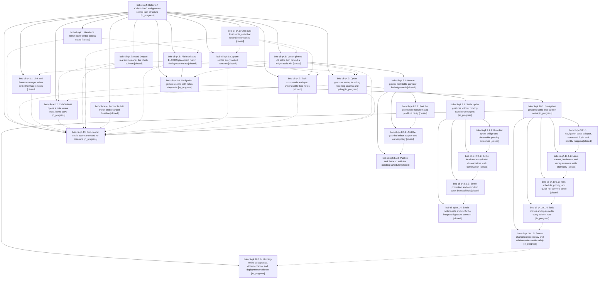

# Bead: bob-cli-q4 — Better o / Ctrl+Shift+O and gesture-settled task structure

[Bead Pages](../README.md) / bob-cli-q4

**Status:** ◐ in_progress · **Type:** ▸ plan · **Tier:** epic
**Owner:** `bryanbugyi34@gmail.com` · **Created by:** [bbugyi200.athena.1fw](https://github.com/bobs-org/bob-cli--agents/blob/main/sessions/bbugyi200.athena.1fw.md) · **Assignee:** `bob-cli-q4.land`
**Created:** 2026-11-25 08:51:35 EST
**Plan:** [202611/better\_o\_gesture\_settle.md](https://github.com/bobs-org/bob-cli--plans/blob/main/202611/better_o_gesture_settle.md)

<!-- sase:links:start -->

## Links

| Relation | Artifact | Why |
| --- | --- | --- |
| implemented-by | [plan:202611/better_o_gesture_settle.md][1] | derived from the plan's `bead_id:` frontmatter field |

_Plus 7 automatic references — see [Referenced By](#referenced-by)._

[1]: https://github.com/bobs-org/bob-cli--plans/blob/main/202611/better_o_gesture_settle.md

<!-- sase:links:end -->

## Description

Vim `o`, `O`, and `Ctrl+Shift+O` in Obsidian write into the right zone of a task block and never split a task from its children. Every bob-cli writer and every Obsidian gesture that changes a task's status or note settles that note's local structure in the same write. That means the local future-schedule Blocked rule, the `## Tasks` status groups, and the badge row. `bob task reconcile` then only does clock-driven and vault-wide work, and the drift numbers prove it.

## Notes

[2026-11-25T18:13:43Z · bob-cli-ph.7.1.land] DISCOVERED ISSUE: Landing triage from bob-cli-ph.7.1.4 PROPOSED FOLLOW-UP #6. That phase reported just check cli target 4120 pass / 17 fail across capture inbox_route, note_pull, project_note, project_note_offer, task_theme_writes, ref_library::today, and task_status_hooks grouping. This drawer child epic changes only plugins/docs in bob-cli. Concurrent 007ef5ed (q4.6) now settles capture postimages and 08a708d3 (q4.7) settles ref checkbox/insert writes, making q4 the credible causal owner of grouping/badge/line expectation drift. Reviewed q4.3/.6/.7 scopes and source; please reproduce each named node and fix assertions or behavior according to the settle contract, without weakening product invariants. Lander targeted cargo test --test cli -- capture::inbox_route capture::note_pull capture::project_note capture::project_note_offer task_theme_writes ref_library::today task_status_hooks at e532b11f was interrupted with exit 143 during a cold compile, so no fresh Rust failure reproduction is claimed. No duplicate standalone task filed.

[2026-11-25T18:13:50Z · bob-cli-ph.7.1.land] DISCOVERED ISSUE: Triage of bob-cli-ph.7.1.3 #2 and ph.7.1.4 #2 docs proposals: independent count_words at bob-plugins 8254caa4 finds navigation 6068/6000 vs 6046 at f2e8c62a^; the 22-word increment comes from eac9d744 (q4.5) managed-link split prose. plugin-apis is 9929/8000 advisory vs 9287 pre-epic; c9454208 (q4.8.1.3) adds the 642-word taskSettle API block. Existing hard-cap/headroom tasks jz/ob corroborated; q4 owns its increments and should trim them while preserving contract docs. Drawer acceptance conversion prose is net-zero.

[2026-11-25T22:32:25Z · bob-cli-ph.6.1.land] DISCOVERED ISSUE (fresh reproduction for note #1; from bob-cli-ph.6.1 landing triage of PROPOSED FOLLOW-UPs bob-cli-ph.6.1.3 #1/#3, ph.6.1.4 #2, ph.6.1.5 #2): cargo test --test cli at bob-cli d67a5b7b fails exactly 17 settle-drift nodes: capture::inbox_route x2 (ir_dependency_touch_follows_its_routed_task, ir_routed_link_moves_with_repair_stamp_follow_and_open_notes), capture::note_pull x3 (np2_pick_all, np_move_groups, np16_inbox_choice), capture::project_note x3 (capture_move_landing_repairs..., capture_project_note_choice_answers..., capture_project_note_task_links_write_the_worked_example), capture::project_note_offer x6, capture::task_theme_writes::new_named_task_reports_and_writes_the_resolved_theme_exception, ref_library::today::today_matches_unnamed_capture_and_named_capture_remembers_theme, task_status_hooks::sync::task_status_hooks_groups_area_project_tasks_after_final_statuses. The same 17 fail identically at 08a708d3 (q4.7), before any ph.6.1 behavior change landed, and the diffs are the new ## Tasks badge row / ### Next & In Progress grouping (e.g. ref_library::today expects the settled chip row and group heading but the capture postimage lacks it, or vice versa). ph.6.1 is not causal; no standalone task filed.

[2026-11-26T00:04:26Z · bob-cli-q5.1.1.land] DISCOVERED ISSUE (fresh reproduction from the bob-cli-q5.1.1 snooze land triage of PROPOSED FOLLOW-UPs q5.1.1.2 #1, q5.1.1.4 #1, q5.1.1.5 #3): cargo test --test cli on bob-cli master 6a3e5df6 (plus snooze landing edits that touch only snooze add/docs) gives 4166 passed / 17 failed, exactly the settle-drift node set already recorded here: capture::inbox_route x2, capture::note_pull x3, capture::project_note x3, capture::project_note_offer x6, capture::task_theme_writes::new_named_task_reports_and_writes_the_resolved_theme_exception, ref_library::today::today_matches_unnamed_capture_and_named_capture_remembers_theme, task_status_hooks::sync::task_status_hooks_groups_area_project_tasks_after_final_statuses. completion::capture_text no longer fails after 2d2f200d. No snooze test fails.

## Phases

| Bead | Title | Status | Size | Created | Agents | Commits |
|---|---|---|---|---|---:|---:|
| [bob-cli-q4.1](bob-cli-q4.1.md) | Hand-edit mirror never writes across notes | ✓ closed | medium | 2026-11-25 | 1 | 1 |
| [bob-cli-q4.10](bob-cli-q4.10.md) | Navigation gestures settle both notes they write | ◐ in_progress | large | 2026-11-25 | 1 | 0 |
| [bob-cli-q4.11](bob-cli-q4.11.md) | Link and Pomodoro target writes settle their target notes | ✓ closed | medium | 2026-11-25 | 1 | 1 |
| [bob-cli-q4.12](bob-cli-q4.12.md) | Ctrl+Shift+O opens a note where note\_home says | ◐ in_progress | medium | 2026-11-25 | 1 | 0 |
| [bob-cli-q4.13](bob-cli-q4.13.md) | End-to-end settle acceptance and re-measure | ◐ in_progress | medium | 2026-11-25 | 1 | 0 |
| [bob-cli-q4.2](bob-cli-q4.2.md) | o and O open real siblings after the whole subtree | ✓ closed | medium | 2026-11-25 | 1 | 1 |
| [bob-cli-q4.3](bob-cli-q4.3.md) | One pure Rust settle\_note that reconcile composes | ✓ closed | medium | 2026-11-25 | 1 | 1 |
| [bob-cli-q4.4](bob-cli-q4.4.md) | Reconcile drift meter and recorded baseline | ✓ closed | medium | 2026-11-25 | 1 | 1 |
| [bob-cli-q4.5](bob-cli-q4.5.md) | Plain split and BLOCKS placement match the layout contract | ✓ closed | medium | 2026-11-25 | 1 | 2 |
| [bob-cli-q4.6](bob-cli-q4.6.md) | Capture settles every note it touches | ✓ closed | medium | 2026-11-25 | 1 | 1 |
| [bob-cli-q4.7](bob-cli-q4.7.md) | Task commands and sync writers settle their notes | ✓ closed | medium | 2026-11-25 | 1 | 1 |
| [bob-cli-q4.8](bob-cli-q4.8.md) | Vector-pinned JS settle twin behind a ledger-tools API | ✓ closed | large | 2026-11-25 | 1 | 0 |
| [bob-cli-q4.9](bob-cli-q4.9.md) | Cycler gestures settle, including recurring spawns and cycling | ◐ in_progress | large | 2026-11-25 | 1 | 0 |

## Lineage

## Agents

| Agent | Bead | Commits |
|---|---|---:|
| [bbugyi200.athena.bob-cli-q4.1](https://github.com/bobs-org/bob-cli--agents/blob/main/agents/bbugyi200.athena.bob-cli-q4.1/README.md) | [bob-cli-q4.1](bob-cli-q4.1.md) | 1 |
| [bbugyi200.athena.bob-cli-q4.10](https://github.com/bobs-org/bob-cli--agents/blob/main/sessions/bbugyi200.athena.bob-cli-q4.10.md) | [bob-cli-q4.10](bob-cli-q4.10.md) | 0 |
| [bbugyi200.athena.bob-cli-q4.10.1.1](https://github.com/bobs-org/bob-cli--agents/blob/main/agents/bbugyi200.athena.bob-cli-q4.10.1.1/README.md) | [bob-cli-q4.10.1.1](bob-cli-q4.10.1.1.md) | 1 |
| [bbugyi200.athena.bob-cli-q4.10.1.2](https://github.com/bobs-org/bob-cli--agents/blob/main/sessions/bbugyi200.athena.bob-cli-q4.10.1.2.md) | [bob-cli-q4.10.1.2](bob-cli-q4.10.1.2.md) | 2 |
| [bbugyi200.athena.bob-cli-q4.10.1.3](https://github.com/bobs-org/bob-cli--agents/blob/main/agents/bbugyi200.athena.bob-cli-q4.10.1.3/README.md) | [bob-cli-q4.10.1.3](bob-cli-q4.10.1.3.md) | 1 |
| [bbugyi200.athena.bob-cli-q4.10.1.4](https://github.com/bobs-org/bob-cli--agents/blob/main/sessions/bbugyi200.athena.bob-cli-q4.10.1.4.md) | [bob-cli-q4.10.1.4](bob-cli-q4.10.1.4.md) | 10 |
| [bbugyi200.athena.bob-cli-q4.10.1.5](https://github.com/bobs-org/bob-cli--agents/blob/main/agents/bbugyi200.athena.bob-cli-q4.10.1.5/README.md) | [bob-cli-q4.10.1.5](bob-cli-q4.10.1.5.md) | 0 |
| [bbugyi200.athena.bob-cli-q4.10.1.6](https://github.com/bobs-org/bob-cli--agents/blob/main/agents/bbugyi200.athena.bob-cli-q4.10.1.6/README.md) | [bob-cli-q4.10.1.6](bob-cli-q4.10.1.6.md) | 0 |
| [bbugyi200.athena.bob-cli-q4.10.1.land](https://github.com/bobs-org/bob-cli--agents/blob/main/agents/bbugyi200.athena.bob-cli-q4.10.1.land/README.md) | [bob-cli-q4.10.1](bob-cli-q4.10.1.md) | 0 |
| [bbugyi200.athena.bob-cli-q4.11](https://github.com/bobs-org/bob-cli--agents/blob/main/sessions/bbugyi200.athena.bob-cli-q4.11.md) | [bob-cli-q4.11](bob-cli-q4.11.md) | 1 |
| [bbugyi200.athena.bob-cli-q4.12](https://github.com/bobs-org/bob-cli--agents/blob/main/agents/bbugyi200.athena.bob-cli-q4.12/README.md) | [bob-cli-q4.12](bob-cli-q4.12.md) | 0 |
| [bbugyi200.athena.bob-cli-q4.13](https://github.com/bobs-org/bob-cli--agents/blob/main/agents/bbugyi200.athena.bob-cli-q4.13/README.md) | [bob-cli-q4.13](bob-cli-q4.13.md) | 0 |
| [bbugyi200.athena.bob-cli-q4.2](https://github.com/bobs-org/bob-cli--agents/blob/main/agents/bbugyi200.athena.bob-cli-q4.2/README.md) | [bob-cli-q4.2](bob-cli-q4.2.md) | 1 |
| [bbugyi200.athena.bob-cli-q4.3](https://github.com/bobs-org/bob-cli--agents/blob/main/sessions/bbugyi200.athena.bob-cli-q4.3.md) | [bob-cli-q4.3](bob-cli-q4.3.md) | 1 |
| [bbugyi200.athena.bob-cli-q4.4](https://github.com/bobs-org/bob-cli--agents/blob/main/agents/bbugyi200.athena.bob-cli-q4.4/README.md) | [bob-cli-q4.4](bob-cli-q4.4.md) | 1 |
| [bbugyi200.athena.bob-cli-q4.5](https://github.com/bobs-org/bob-cli--agents/blob/main/sessions/bbugyi200.athena.bob-cli-q4.5.md) | [bob-cli-q4.5](bob-cli-q4.5.md) | 2 |
| [bbugyi200.athena.bob-cli-q4.6](https://github.com/bobs-org/bob-cli--agents/blob/main/sessions/bbugyi200.athena.bob-cli-q4.6.md) | [bob-cli-q4.6](bob-cli-q4.6.md) | 1 |
| [bbugyi200.athena.bob-cli-q4.7](https://github.com/bobs-org/bob-cli--agents/blob/main/agents/bbugyi200.athena.bob-cli-q4.7/README.md) | [bob-cli-q4.7](bob-cli-q4.7.md) | 1 |
| [bbugyi200.athena.bob-cli-q4.8](https://github.com/bobs-org/bob-cli--agents/blob/main/sessions/bbugyi200.athena.bob-cli-q4.8.md) | [bob-cli-q4.8](bob-cli-q4.8.md) | 0 |
| [bbugyi200.athena.bob-cli-q4.8.1.1](https://github.com/bobs-org/bob-cli--agents/blob/main/agents/bbugyi200.athena.bob-cli-q4.8.1.1/README.md) | [bob-cli-q4.8.1.1](bob-cli-q4.8.1.1.md) | 2 |
| [bbugyi200.athena.bob-cli-q4.8.1.2](https://github.com/bobs-org/bob-cli--agents/blob/main/agents/bbugyi200.athena.bob-cli-q4.8.1.2/README.md) | [bob-cli-q4.8.1.2](bob-cli-q4.8.1.2.md) | 1 |
| [bbugyi200.athena.bob-cli-q4.8.1.3](https://github.com/bobs-org/bob-cli--agents/blob/main/sessions/bbugyi200.athena.bob-cli-q4.8.1.3.md) | [bob-cli-q4.8.1.3](bob-cli-q4.8.1.3.md) | 3 |
| [bbugyi200.athena.bob-cli-q4.8.1.land](https://github.com/bobs-org/bob-cli--agents/blob/main/sessions/bbugyi200.athena.bob-cli-q4.8.1.land.md) | [bob-cli-q4.8.1](bob-cli-q4.8.1.md) | 2 |
| [bbugyi200.athena.bob-cli-q4.9](https://github.com/bobs-org/bob-cli--agents/blob/main/sessions/bbugyi200.athena.bob-cli-q4.9.md) | [bob-cli-q4.9](bob-cli-q4.9.md) | 0 |
| [bbugyi200.athena.bob-cli-q4.9.1.1](https://github.com/bobs-org/bob-cli--agents/blob/main/agents/bbugyi200.athena.bob-cli-q4.9.1.1/README.md) | [bob-cli-q4.9.1.1](bob-cli-q4.9.1.1.md) | 1 |
| [bbugyi200.athena.bob-cli-q4.9.1.2](https://github.com/bobs-org/bob-cli--agents/blob/main/agents/bbugyi200.athena.bob-cli-q4.9.1.2/README.md) | [bob-cli-q4.9.1.2](bob-cli-q4.9.1.2.md) | 1 |
| [bbugyi200.athena.bob-cli-q4.9.1.3](https://github.com/bobs-org/bob-cli--agents/blob/main/agents/bbugyi200.athena.bob-cli-q4.9.1.3/README.md) | [bob-cli-q4.9.1.3](bob-cli-q4.9.1.3.md) | 1 |
| [bbugyi200.athena.bob-cli-q4.9.1.4](https://github.com/bobs-org/bob-cli--agents/blob/main/agents/bbugyi200.athena.bob-cli-q4.9.1.4/README.md) | [bob-cli-q4.9.1.4](bob-cli-q4.9.1.4.md) | 1 |
| [bbugyi200.athena.bob-cli-q4.9.1.land](https://github.com/bobs-org/bob-cli--agents/blob/main/sessions/bbugyi200.athena.bob-cli-q4.9.1.land.md) | [bob-cli-q4.9.1](bob-cli-q4.9.1.md) | 4 |
| [bbugyi200.athena.bob-cli-q4.land](https://github.com/bobs-org/bob-cli--agents/blob/main/agents/bbugyi200.athena.bob-cli-q4.land/README.md) | [bob-cli-q4](README.md) | 0 |

## Commits

| Repo | Commit | Subject | Bead | Committed |
|---|---|---|---|---|
| bob-plugins | [`bob-plugins@9a98738`](https://github.com/bobs-org/bob-plugins/commit/9a987385709c0d4ada689c94b9c0e66798e81c2f) | fix(nav): drop debounced hand-edit mirror pass when the editor switched notes | [bob-cli-q4.1](bob-cli-q4.1.md) | 2026-11-25 09:07:04 EST |
| bob-plugins | [`bob-plugins@a971285`](https://github.com/bobs-org/bob-plugins/commit/a971285b2fe70720dd0a3429512879737810120e) | feat(task-status-cycler): open real siblings with o and O | [bob-cli-q4.2](bob-cli-q4.2.md) | 2026-11-25 09:17:28 EST |
| bob-cli | [`9395683`](https://github.com/bobs-org/bob-cli/commit/9395683818ef4a11527fda82c5290e20ef6aebe6) | feat(task): add pure note settle helper | [bob-cli-q4.3](bob-cli-q4.3.md) | 2026-11-25 10:18:20 EST |
| bob-cli | [`814b658`](https://github.com/bobs-org/bob-cli/commit/814b6583e63165a4f2419158af50d4774fc8b034) | fix(task-split): route plain-split back-link through managed-link zone | [bob-cli-q4.5](bob-cli-q4.5.md) | 2026-11-25 10:19:06 EST |
| bob-plugins | [`bob-plugins@eac9d74`](https://github.com/bobs-org/bob-plugins/commit/eac9d7448d056e60af1e0f4224554c6ca1ed28d2) | fix(nav-split): mirror managed back-link and BLOCKS-after-Depends-On order | [bob-cli-q4.5](bob-cli-q4.5.md) | 2026-11-25 10:19:46 EST |
| bob-cli | [`007ef5e`](https://github.com/bobs-org/bob-cli/commit/007ef5ed819595338ad7f629e660c43fcf2b496f) | feat(capture): settle touched notes before reporting lines | [bob-cli-q4.6](bob-cli-q4.6.md) | 2026-11-25 10:40:41 EST |
| bob-cli | [`5c0f816`](https://github.com/bobs-org/bob-cli/commit/5c0f81608f94cd41ceddb726736a79ea944030bd) | feat(task-settle): add canonical task-settle fixture README | [bob-cli-q4.8.1.1](bob-cli-q4.8.1.1.md) | 2026-11-25 11:10:42 EST |
| bob-plugins | [`bob-plugins@824d8e4`](https://github.com/bobs-org/bob-plugins/commit/824d8e4951ef11c492cf515b4200390b4c0a35fd) | feat(ledger-tools): port task-settle to pure-twin fragments 139a-d | [bob-cli-q4.8.1.1](bob-cli-q4.8.1.1.md) | 2026-11-25 11:11:20 EST |
| bob-plugins | [`bob-plugins@f764a4b`](https://github.com/bobs-org/bob-plugins/commit/f764a4bef9faf584cd394343eb5f2ad281d36daa) | feat(ledger-tools): add guarded task-settle editor apply and stay cursor | [bob-cli-q4.8.1.2](bob-cli-q4.8.1.2.md) | 2026-11-25 11:35:55 EST |
| bob-cli | [`08a708d`](https://github.com/bobs-org/bob-cli/commit/08a708d3354c1fe110ce4038f41697bdbaffd399) | feat(settle): command writers settle notes before staging | [bob-cli-q4.7](bob-cli-q4.7.md) | 2026-11-25 12:07:37 EST |
| bob-plugins | [`bob-plugins@c945420`](https://github.com/bobs-org/bob-plugins/commit/c9454208ac8eede09f338c328ab640166ea3168e) | feat(ledger-tools): publish task settle v1 scheduler | [bob-cli-q4.8.1.3](bob-cli-q4.8.1.3.md) | 2026-11-25 12:35:32 EST |
| bob-cli | [`e532b11`](https://github.com/bobs-org/bob-cli/commit/e532b11f911486e404fefeed3c7a7653dd7cbef7) | feat(dev): add reconcile-drift vault replay meter | [bob-cli-q4.4](bob-cli-q4.4.md) | 2026-11-25 12:55:36 EST |
| bob-plugins | [`bob-plugins@abbac5a`](https://github.com/bobs-org/bob-plugins/commit/abbac5acc380b651c091657d40f77d43680a9054) | test(ledger-tools): measure resident count cpu time | [bob-cli-q4.8.1.3](bob-cli-q4.8.1.3.md) | 2026-11-25 13:25:22 EST |
| bob-plugins | [`bob-plugins@84ba9d4`](https://github.com/bobs-org/bob-plugins/commit/84ba9d411c0f6692aba7bc19d26eea74ba8bb6b8) | test(bob-ledger-tools): measure frees-mark budget as CPU | [bob-cli-q4.8.1.3](bob-cli-q4.8.1.3.md) | 2026-11-25 13:31:05 EST |
| bob-plugins | [`bob-plugins@01ac184`](https://github.com/bobs-org/bob-plugins/commit/01ac18405e4a8c03b848796c4d7475fb1a44dc1f) | fix(ledger-tools): make taskSettle identity and staged preimages strict | [bob-cli-q4.8.1](bob-cli-q4.8.1.md) | 2026-11-25 14:22:22 EST |
| bob-cli--plans | [`bob-cli--plans@c3b80bc`](https://github.com/bobs-org/bob-cli--plans/commit/c3b80bcdc5361045817367c81cecfc0e72320c35) | docs(plan): mark task\_settle\_twin done after provider closeout | [bob-cli-q4.8.1](bob-cli-q4.8.1.md) | 2026-11-25 14:23:01 EST |
| bob-plugins | [`bob-plugins@f224bc7`](https://github.com/bobs-org/bob-plugins/commit/f224bc725d29b6402e8e537f9b69cc6c2dc61aa6) | feat(nav): add guarded taskSettle v1 consumer and command flush | [bob-cli-q4.10.1.1](bob-cli-q4.10.1.1.md) | 2026-11-25 15:03:41 EST |
| bob-plugins | [`bob-plugins@071e0e9`](https://github.com/bobs-org/bob-plugins/commit/071e0e9fa3bdbd0ec93fe938fef6b9f20ca3d7d9) | feat(task-status-cycler): add guarded taskSettle bridge and pending onSettled | [bob-cli-q4.9.1.1](bob-cli-q4.9.1.1.md) | 2026-11-25 15:11:35 EST |
| bob-plugins | [`bob-plugins@b68f447`](https://github.com/bobs-org/bob-plugins/commit/b68f447af4b870da8b130e007db34b24050c18fd) | feat(block-id-prompt): settle Ctrl+Shift+Enter target writes via taskSettle v1 | [bob-cli-q4.11](bob-cli-q4.11.md) | 2026-11-25 15:19:16 EST |
| bob-plugins | [`bob-plugins@9991e67`](https://github.com/bobs-org/bob-plugins/commit/9991e674d4dd95421afc8d2461dd0d5bc491b094) | feat(nav): settle lane and freshness answers atomically | [bob-cli-q4.10.1.2](bob-cli-q4.10.1.2.md) | 2026-11-25 15:50:18 EST |
| bob-plugins | [`bob-plugins@77bb466`](https://github.com/bobs-org/bob-plugins/commit/77bb466ec78741f88b439edcb31751cf199745c4) | feat(task-status-cycler): settle local and transcluded closes before walk continuation | [bob-cli-q4.9.1.2](bob-cli-q4.9.1.2.md) | 2026-11-25 15:50:29 EST |
| bob-plugins | [`bob-plugins@580ff19`](https://github.com/bobs-org/bob-plugins/commit/580ff19d77d0e0314bd3659a94284aff9af49cb9) | feat(navigation): settle freshness gestures | [bob-cli-q4.10.1.2](bob-cli-q4.10.1.2.md) | 2026-11-25 15:56:52 EST |
| bob-plugins | [`bob-plugins@1c2534c`](https://github.com/bobs-org/bob-plugins/commit/1c2534cc3ac5b3cfa6d86cf2d48ef213ee9b5805) | feat(task-status-cycler): settle promote/demote writes and nonempty o/O scaffolds | [bob-cli-q4.9.1.3](bob-cli-q4.9.1.3.md) | 2026-11-25 16:30:17 EST |
| bob-plugins | [`bob-plugins@ca07830`](https://github.com/bobs-org/bob-plugins/commit/ca07830a685418b05d9bf91964901095b61964ad) | feat(navigation): settle task card, schedule, priority, and quick-roll commits | [bob-cli-q4.10.1.3](bob-cli-q4.10.1.3.md) | 2026-11-25 16:45:54 EST |
| bob-plugins | [`bob-plugins@6d36434`](https://github.com/bobs-org/bob-plugins/commit/6d364347bcfcfcd7475e5e7a0a8684106cb28453) | feat(task-status-cycler): settle cycle bursts | [bob-cli-q4.9.1.4](bob-cli-q4.9.1.4.md) | 2026-11-25 17:09:24 EST |
| bob-plugins | [`bob-plugins@0e8c70b`](https://github.com/bobs-org/bob-plugins/commit/0e8c70b7fbbf65c33e4810ced2fdf17e4d9f1219) | feat(navigation): settle move and split postimages | [bob-cli-q4.10.1.4](bob-cli-q4.10.1.4.md) | 2026-11-25 17:14:50 EST |
| bob-plugins | [`bob-plugins@24dbb8a`](https://github.com/bobs-org/bob-plugins/commit/24dbb8a1e56b68701da356c5aac475e6132b0074) | test(navigation): respect live source path during split carry | [bob-cli-q4.10.1.4](bob-cli-q4.10.1.4.md) | 2026-11-25 17:24:16 EST |
| bob-plugins | [`bob-plugins@aecff7d`](https://github.com/bobs-org/bob-plugins/commit/aecff7d2463676b0232d901bd079bbcd2b92e175) | test(navigation): register open destination leaves in move fixtures | [bob-cli-q4.10.1.4](bob-cli-q4.10.1.4.md) | 2026-11-25 17:34:08 EST |
| bob-plugins | [`bob-plugins@f6167d4`](https://github.com/bobs-org/bob-plugins/commit/f6167d4c5bd47da44a33d11a7967c6848c0a9571) | test(bob-ledger-tools): await mention jump completion | [bob-cli-q4.10.1.4](bob-cli-q4.10.1.4.md) | 2026-11-25 18:09:25 EST |
| bob-plugins | [`bob-plugins@c665869`](https://github.com/bobs-org/bob-plugins/commit/c665869ec38b912f5ba7bb179003789fe96e7516) | fix(cycler): join gesture settles to undo history | [bob-cli-q4.9.1](bob-cli-q4.9.1.md) | 2026-11-25 18:26:44 EST |
| bob-cli | [`05dd83c`](https://github.com/bobs-org/bob-cli/commit/05dd83cf9f93c07825a30dfe508e530bc36f9d81) | docs: repair documentation gate consistency | [bob-cli-q4.10.1.4](bob-cli-q4.10.1.4.md) | 2026-11-25 18:31:13 EST |
| bob-plugins | [`bob-plugins@1c76c78`](https://github.com/bobs-org/bob-plugins/commit/1c76c782c8f48d8e1be7f66fe5dc74ca2a1bb0dc) | docs: trim plugin references below page budgets | [bob-cli-q4.10.1.4](bob-cli-q4.10.1.4.md) | 2026-11-25 18:31:56 EST |
| bob-plugins | [`bob-plugins@95e6a55`](https://github.com/bobs-org/bob-plugins/commit/95e6a55bd89ea1bf01b09fc699ef8de3210d4589) | test(cycler): enter Vim normal mode in Obsidian settle harness | [bob-cli-q4.9.1](bob-cli-q4.9.1.md) | 2026-11-25 18:44:59 EST |
| bob-cli | [`8850f2e`](https://github.com/bobs-org/bob-cli/commit/8850f2e639a862f5814eae348449ebd232053bb7) | docs(reference): satisfy word-budget lint | [bob-cli-q4.10.1.4](bob-cli-q4.10.1.4.md) | 2026-11-25 18:53:41 EST |
| bob-plugins | [`bob-plugins@df44ab1`](https://github.com/bobs-org/bob-plugins/commit/df44ab12b1d4c50886a2014e21add82dc152ce88) | test(cycler): drive Vim escape through Obsidian handler | [bob-cli-q4.9.1](bob-cli-q4.9.1.md) | 2026-11-25 18:59:43 EST |
| bob-plugins | [`bob-plugins@f9a9e16`](https://github.com/bobs-org/bob-plugins/commit/f9a9e167a8fee9cf1653532e98bedfbf5208b30c) | fix(ledger): annotate parent stage text role | [bob-cli-q4.10.1.4](bob-cli-q4.10.1.4.md) | 2026-11-25 19:02:52 EST |
| bob-plugins | [`bob-plugins@79d71bf`](https://github.com/bobs-org/bob-plugins/commit/79d71bfd6bbd5ecc1c4919660b6ec92987f162bd) | docs(bob-navigation-hotkeys): meet docs budgets and mark literal input | [bob-cli-q4.10.1.4](bob-cli-q4.10.1.4.md) | 2026-11-25 19:17:39 EST |
| bob-plugins | [`bob-plugins@e1ae072`](https://github.com/bobs-org/bob-plugins/commit/e1ae0729d7ec75c59b797eaa1e6cb82441eb3b4e) | test(cycler): fix real Obsidian settle harness | [bob-cli-q4.9.1](bob-cli-q4.9.1.md) | 2026-11-25 19:24:30 EST |
| bob-cli | [`fc9c91c`](https://github.com/bobs-org/bob-cli/commit/fc9c91ca46026be17965509a4425273134b0eeea) | docs(memory): add planning-time decision roster policy | [bob-cli-q4.10.1.4](bob-cli-q4.10.1.4.md) | 2026-11-25 19:48:21 EST |

<!-- sase:referenced-by:start -->

## Referenced By

| Relation | Artifact | Why | Uses |
| --- | --- | --- | ---: |
| read-by | [agent:bob-cli-ph.6.1.land][1] | Check whether capture-settle CLI fixture drift is already recorded on the causal epic | 1 |
| read-by | [agent:bob-cli-q4.2][2] | Need parent epic DECISIONS, phases, and overall design | 1 |
| read-by | [agent:bob-cli-q4.7][3] | check epic children statuses | 1 |
| read-by | [agent:bob-cli-q4.9.1.land--4][4] | Confirm parent epic open state and required closeout evidence | 2 |
| read-by | [agent:bob-cli-q5.1.1.2][5] | Need notes on ref_library today and task_status_hooks grouping failures | 1 |
| read-by | [agent:bob-cli-q5.1.1.4][6] | See if q4 tracks the capture CLI grouping failures | 1 |
| read-by | [agent:bob-cli-q5.1.1.land][7] | Confirm the existing DISCOVERED ISSUE for the capture CLI failures cited by snooze phases | 1 |

[1]: https://github.com/bobs-org/bob-cli--agents/blob/main/agents/bbugyi200.athena.bob-cli-ph.6.1.land/README.md
[2]: https://github.com/bobs-org/bob-cli--agents/blob/main/agents/bbugyi200.athena.bob-cli-q4.2/README.md
[3]: https://github.com/bobs-org/bob-cli--agents/blob/main/agents/bbugyi200.athena.bob-cli-q4.7/README.md
[4]: https://github.com/bobs-org/bob-cli--agents/blob/main/sessions/bbugyi200.athena.bob-cli-q4.9.1.land.md
[5]: https://github.com/bobs-org/bob-cli--agents/blob/main/agents/bbugyi200.athena.bob-cli-q5.1.1.2/README.md
[6]: https://github.com/bobs-org/bob-cli--agents/blob/main/agents/bbugyi200.athena.bob-cli-q5.1.1.4/README.md
[7]: https://github.com/bobs-org/bob-cli--agents/blob/main/sessions/bbugyi200.athena.bob-cli-q5.1.1.land.md

<!-- sase:referenced-by:end -->
