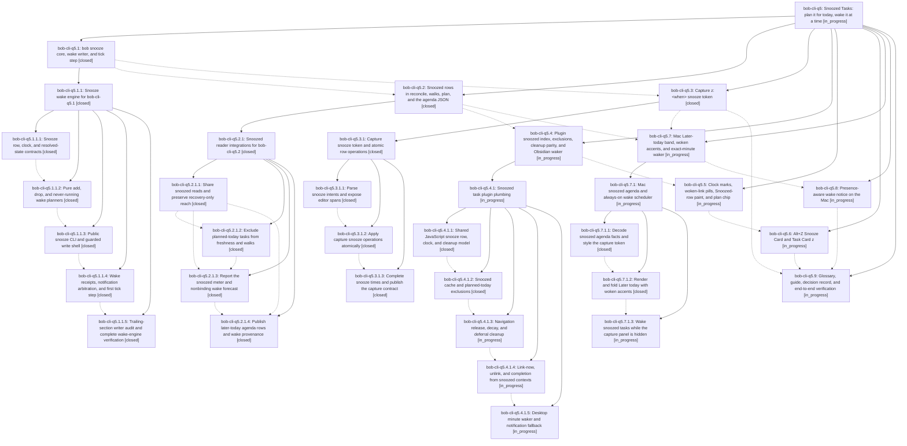

# Bead: bob-cli-q5 — Snoozed Tasks: plan it for today, wake it at a time

[Bead Pages](../README.md) / bob-cli-q5

**Status:** ◐ in_progress · **Type:** ▸ plan · **Tier:** epic
**Owner:** `bryanbugyi34@gmail.com` · **Created by:** [bbugyi200.athena.1fx](https://github.com/bobs-org/bob-cli--agents/blob/main/sessions/bbugyi200.athena.1fx.md) · **Assignee:** `bob-cli-q5.land`
**Created:** 2026-11-25 10:22:52 EST
**Plan:** [202611/snoozed\_tasks.md](https://github.com/bobs-org/bob-cli--plans/blob/main/202611/snoozed_tasks.md)

<!-- sase:links:start -->

## Links

| Relation | Artifact | Why |
| --- | --- | --- |
| implemented-by | [plan:202611/snoozed_tasks.md][1] | derived from the plan's `bead_id:` frontmatter field |

_Plus 1 automatic references — see [Referenced By](#referenced-by)._

[1]: https://github.com/bobs-org/bob-cli--plans/blob/main/202611/snoozed_tasks.md

<!-- sase:links:end -->

## Description

Bryan can snooze any open, non-Event task to a clock time today from its Task Link, its definition, capture, or the CLI. While asleep the task is clearly marked with a clock and its time, stays out of Today, the walks, and plan.max_links. At its time, bob wakes it into an untimed open Pomodoro, the woken Task Link shows its wake time, and one hard-to-miss notice announces it and then goes away on its own.

## Notes

[2026-11-26T10:46:28Z · bob-cli-q5.3.1.land] DISCOVERED ISSUE: Shared relative-time wording/rounding needs an outer-epic resolution before final docs/vector rollout. Proposed by bob-cli-q5.3.1.2 note #2; this lander reviewed snooze/when.rs and docs/snooze.md. parse_relative_delta rounds the duration (ceil(delta/5)*5), then resolve_relative adds it to unrounded now: 12:03 +45m -> 12:48, +1h -> 13:03. docs/snooze.md says relative times round upward to a five-minute boundary. q5.1 note #2 already flags the same interpretation (13:02 +45m -> 13:47). Capture correctly shares the core parser and pins that result; do not introduce capture-only time semantics. Clarify the wording or change the shared rule/vectors and every consumer consistently under this outer epic. No standalone task: q5 owns the originating parser/docs.

[2026-11-26T12:30:36Z · bob-cli-ph.land] DISCOVERED ISSUE (from bob-cli-ph.land, triaging bob-cli-ph.10 PROPOSED FOLLOW-UP #4): snooze grammar commit 1b386638 (bob-cli-q5.3.1.1) set GRAMMAR_REVISION to 33 (src/native/capture_language/mod.rs:80), but current-revision prose still advertises 32 on master 4110c073: docs/capture.md:7632 ('capture-parse and capture-complete report grammar revision 32') and docs/reference/compatibility.md:71 ('report the additive top-level grammar: 32 revision'). docs/reference/json-outputs.md:50 already says grammar: 33. Neither page has a Grammar 33 history sentence for snooze z:<when>. Grammar 32 stays the correct historical drawer-cutover revision; only the current-version claim and a 33 entry need adding. just docs-check passes, so no gate catches it. No standalone task filed; owned by this snooze epic.

## Phases

| Bead | Title | Status | Size | Created | Agents | Commits |
|---|---|---|---|---|---:|---:|
| [bob-cli-q5.1](bob-cli-q5.1.md) | bob snooze core, wake writer, and tick step | ✓ closed | large | 2026-11-25 | 1 | 0 |
| [bob-cli-q5.2](bob-cli-q5.2.md) | Snoozed rows in reconcile, walks, plan, and the agenda JSON | ✓ closed | large | 2026-11-25 | 1 | 0 |
| [bob-cli-q5.3](bob-cli-q5.3.md) | Capture z:\<when\> snooze token | ✓ closed | large | 2026-11-25 | 1 | 0 |
| [bob-cli-q5.4](bob-cli-q5.4.md) | Plugin snoozed index, exclusions, cleanup parity, and Obsidian waker | ◐ in_progress | large | 2026-11-25 | 1 | 0 |
| [bob-cli-q5.5](bob-cli-q5.5.md) | Clock marks, woken-link pills, Snoozed-row paint, and plan chip | ◐ in_progress | large | 2026-11-25 | 1 | 0 |
| [bob-cli-q5.6](bob-cli-q5.6.md) | Alt+Z Snooze Card and Task Card z | ◐ in_progress | large | 2026-11-25 | 1 | 0 |
| [bob-cli-q5.7](bob-cli-q5.7.md) | Mac Later-today band, woken accents, and exact-minute waker | ◐ in_progress | large | 2026-11-25 | 1 | 0 |
| [bob-cli-q5.8](bob-cli-q5.8.md) | Presence-aware wake notice on the Mac | ◐ in_progress | large | 2026-11-25 | 1 | 0 |
| [bob-cli-q5.9](bob-cli-q5.9.md) | Glossary, guide, decision record, and end-to-end verification | ◐ in_progress | medium | 2026-11-25 | 1 | 0 |

## Lineage

## Agents

| Agent | Bead | Commits |
|---|---|---:|
| [bbugyi200.athena.bob-cli-q5.1](https://github.com/bobs-org/bob-cli--agents/blob/main/sessions/bbugyi200.athena.bob-cli-q5.1.md) | [bob-cli-q5.1](bob-cli-q5.1.md) | 0 |
| [bbugyi200.athena.bob-cli-q5.1.1.1](https://github.com/bobs-org/bob-cli--agents/blob/main/agents/bbugyi200.athena.bob-cli-q5.1.1.1/README.md) | [bob-cli-q5.1.1.1](bob-cli-q5.1.1.1.md) | 1 |
| [bbugyi200.athena.bob-cli-q5.1.1.2](https://github.com/bobs-org/bob-cli--agents/blob/main/agents/bbugyi200.athena.bob-cli-q5.1.1.2/README.md) | [bob-cli-q5.1.1.2](bob-cli-q5.1.1.2.md) | 1 |
| [bbugyi200.athena.bob-cli-q5.1.1.3](https://github.com/bobs-org/bob-cli--agents/blob/main/sessions/bbugyi200.athena.bob-cli-q5.1.1.3.md) | [bob-cli-q5.1.1.3](bob-cli-q5.1.1.3.md) | 1 |
| [bbugyi200.athena.bob-cli-q5.1.1.4](https://github.com/bobs-org/bob-cli--agents/blob/main/agents/bbugyi200.athena.bob-cli-q5.1.1.4/README.md) | [bob-cli-q5.1.1.4](bob-cli-q5.1.1.4.md) | 1 |
| [bbugyi200.athena.bob-cli-q5.1.1.5](https://github.com/bobs-org/bob-cli--agents/blob/main/agents/bbugyi200.athena.bob-cli-q5.1.1.5/README.md) | [bob-cli-q5.1.1.5](bob-cli-q5.1.1.5.md) | 1 |
| [bbugyi200.athena.bob-cli-q5.1.1.land](https://github.com/bobs-org/bob-cli--agents/blob/main/sessions/bbugyi200.athena.bob-cli-q5.1.1.land.md) | [bob-cli-q5.1.1](bob-cli-q5.1.1.md) | 3 |
| [bbugyi200.athena.bob-cli-q5.2](https://github.com/bobs-org/bob-cli--agents/blob/main/sessions/bbugyi200.athena.bob-cli-q5.2.md) | [bob-cli-q5.2](bob-cli-q5.2.md) | 0 |
| [bbugyi200.athena.bob-cli-q5.2.1.1](https://github.com/bobs-org/bob-cli--agents/blob/main/sessions/bbugyi200.athena.bob-cli-q5.2.1.1.md) | [bob-cli-q5.2.1.1](bob-cli-q5.2.1.1.md) | 0 |
| [bbugyi200.athena.bob-cli-q5.2.1.2](https://github.com/bobs-org/bob-cli--agents/blob/main/sessions/bbugyi200.athena.bob-cli-q5.2.1.2.md) | [bob-cli-q5.2.1.2](bob-cli-q5.2.1.2.md) | 2 |
| [bbugyi200.athena.bob-cli-q5.2.1.3](https://github.com/bobs-org/bob-cli--agents/blob/main/agents/bbugyi200.athena.bob-cli-q5.2.1.3/README.md) | [bob-cli-q5.2.1.3](bob-cli-q5.2.1.3.md) | 1 |
| [bbugyi200.athena.bob-cli-q5.2.1.4](https://github.com/bobs-org/bob-cli--agents/blob/main/agents/bbugyi200.athena.bob-cli-q5.2.1.4/README.md) | [bob-cli-q5.2.1.4](bob-cli-q5.2.1.4.md) | 1 |
| [bbugyi200.athena.bob-cli-q5.2.1.land](https://github.com/bobs-org/bob-cli--agents/blob/main/sessions/bbugyi200.athena.bob-cli-q5.2.1.land.md) | [bob-cli-q5.2.1](bob-cli-q5.2.1.md) | 2 |
| [bbugyi200.athena.bob-cli-q5.3](https://github.com/bobs-org/bob-cli--agents/blob/main/sessions/bbugyi200.athena.bob-cli-q5.3.md) | [bob-cli-q5.3](bob-cli-q5.3.md) | 0 |
| [bbugyi200.athena.bob-cli-q5.3.1.1](https://github.com/bobs-org/bob-cli--agents/blob/main/agents/bbugyi200.athena.bob-cli-q5.3.1.1/README.md) | [bob-cli-q5.3.1.1](bob-cli-q5.3.1.1.md) | 1 |
| [bbugyi200.athena.bob-cli-q5.3.1.2](https://github.com/bobs-org/bob-cli--agents/blob/main/agents/bbugyi200.athena.bob-cli-q5.3.1.2/README.md) | [bob-cli-q5.3.1.2](bob-cli-q5.3.1.2.md) | 1 |
| [bbugyi200.athena.bob-cli-q5.3.1.3](https://github.com/bobs-org/bob-cli--agents/blob/main/sessions/bbugyi200.athena.bob-cli-q5.3.1.3.md) | [bob-cli-q5.3.1.3](bob-cli-q5.3.1.3.md) | 1 |
| [bbugyi200.athena.bob-cli-q5.3.1.land](https://github.com/bobs-org/bob-cli--agents/blob/main/sessions/bbugyi200.athena.bob-cli-q5.3.1.land.md) | [bob-cli-q5.3.1](bob-cli-q5.3.1.md) | 2 |
| [bbugyi200.athena.bob-cli-q5.4](https://github.com/bobs-org/bob-cli--agents/blob/main/sessions/bbugyi200.athena.bob-cli-q5.4.md) | [bob-cli-q5.4](bob-cli-q5.4.md) | 0 |
| [bbugyi200.athena.bob-cli-q5.4.1.1](https://github.com/bobs-org/bob-cli--agents/blob/main/sessions/bbugyi200.athena.bob-cli-q5.4.1.1.md) | [bob-cli-q5.4.1.1](bob-cli-q5.4.1.1.md) | 0 |
| [bbugyi200.athena.bob-cli-q5.4.1.2](https://github.com/bobs-org/bob-cli--agents/blob/main/agents/bbugyi200.athena.bob-cli-q5.4.1.2/README.md) | [bob-cli-q5.4.1.2](bob-cli-q5.4.1.2.md) | 0 |
| [bbugyi200.athena.bob-cli-q5.4.1.3](https://github.com/bobs-org/bob-cli--agents/blob/main/agents/bbugyi200.athena.bob-cli-q5.4.1.3/README.md) | [bob-cli-q5.4.1.3](bob-cli-q5.4.1.3.md) | 0 |
| [bbugyi200.athena.bob-cli-q5.4.1.4](https://github.com/bobs-org/bob-cli--agents/blob/main/agents/bbugyi200.athena.bob-cli-q5.4.1.4/README.md) | [bob-cli-q5.4.1.4](bob-cli-q5.4.1.4.md) | 0 |
| [bbugyi200.athena.bob-cli-q5.4.1.5](https://github.com/bobs-org/bob-cli--agents/blob/main/agents/bbugyi200.athena.bob-cli-q5.4.1.5/README.md) | [bob-cli-q5.4.1.5](bob-cli-q5.4.1.5.md) | 0 |
| [bbugyi200.athena.bob-cli-q5.4.1.land](https://github.com/bobs-org/bob-cli--agents/blob/main/agents/bbugyi200.athena.bob-cli-q5.4.1.land/README.md) | [bob-cli-q5.4.1](bob-cli-q5.4.1.md) | 0 |
| [bbugyi200.athena.bob-cli-q5.5](https://github.com/bobs-org/bob-cli--agents/blob/main/agents/bbugyi200.athena.bob-cli-q5.5/README.md) | [bob-cli-q5.5](bob-cli-q5.5.md) | 0 |
| [bbugyi200.athena.bob-cli-q5.6](https://github.com/bobs-org/bob-cli--agents/blob/main/agents/bbugyi200.athena.bob-cli-q5.6/README.md) | [bob-cli-q5.6](bob-cli-q5.6.md) | 0 |
| [bbugyi200.athena.bob-cli-q5.7](https://github.com/bobs-org/bob-cli--agents/blob/main/sessions/bbugyi200.athena.bob-cli-q5.7.md) | [bob-cli-q5.7](bob-cli-q5.7.md) | 0 |
| [bbugyi200.athena.bob-cli-q5.7.1.1](https://github.com/bobs-org/bob-cli--agents/blob/main/agents/bbugyi200.athena.bob-cli-q5.7.1.1/README.md) | [bob-cli-q5.7.1.1](bob-cli-q5.7.1.1.md) | 1 |
| [bbugyi200.athena.bob-cli-q5.7.1.2](https://github.com/bobs-org/bob-cli--agents/blob/main/sessions/bbugyi200.athena.bob-cli-q5.7.1.2.md) | [bob-cli-q5.7.1.2](bob-cli-q5.7.1.2.md) | 2 |
| [bbugyi200.athena.bob-cli-q5.7.1.3](https://github.com/bobs-org/bob-cli--agents/blob/main/agents/bbugyi200.athena.bob-cli-q5.7.1.3/README.md) | [bob-cli-q5.7.1.3](bob-cli-q5.7.1.3.md) | 0 |
| [bbugyi200.athena.bob-cli-q5.7.1.land](https://github.com/bobs-org/bob-cli--agents/blob/main/agents/bbugyi200.athena.bob-cli-q5.7.1.land/README.md) | [bob-cli-q5.7.1](bob-cli-q5.7.1.md) | 0 |
| [bbugyi200.athena.bob-cli-q5.8](https://github.com/bobs-org/bob-cli--agents/blob/main/agents/bbugyi200.athena.bob-cli-q5.8/README.md) | [bob-cli-q5.8](bob-cli-q5.8.md) | 0 |
| [bbugyi200.athena.bob-cli-q5.9](https://github.com/bobs-org/bob-cli--agents/blob/main/agents/bbugyi200.athena.bob-cli-q5.9/README.md) | [bob-cli-q5.9](bob-cli-q5.9.md) | 0 |
| [bbugyi200.athena.bob-cli-q5.land](https://github.com/bobs-org/bob-cli--agents/blob/main/agents/bbugyi200.athena.bob-cli-q5.land/README.md) | [bob-cli-q5](README.md) | 0 |

## Commits

| Repo | Commit | Subject | Bead | Committed |
|---|---|---|---|---|
| bob-cli | [`cd59455`](https://github.com/bobs-org/bob-cli/commit/cd594550547b07285f54a181896b69c3233a29a3) | feat(snooze): add later-today row-model contracts, vectors, and docs | [bob-cli-q5.1.1.1](bob-cli-q5.1.1.1.md) | 2026-11-25 12:15:51 EST |
| bob-cli | [`e6eb52a`](https://github.com/bobs-org/bob-cli/commit/e6eb52a103656add99a1a49f2f0b3d791536abc4) | feat(snooze): add pure add, drop, and never-running wake planners | [bob-cli-q5.1.1.2](bob-cli-q5.1.1.2.md) | 2026-11-25 13:38:56 EST |
| bob-cli | [`68dee6e`](https://github.com/bobs-org/bob-cli/commit/68dee6e1f280f235971d55ee915ce46e82902b29) | feat(snooze): add public CLI and guarded write shell | [bob-cli-q5.1.1.3](bob-cli-q5.1.1.3.md) | 2026-11-25 16:17:12 EST |
| bob-cli | [`9dd67c6`](https://github.com/bobs-org/bob-cli/commit/9dd67c6253060c6492a19a591971f67b25b476c7) | feat(snooze): deliver wake receipts, notices, and first tick step | [bob-cli-q5.1.1.4](bob-cli-q5.1.1.4.md) | 2026-11-25 17:23:07 EST |
| bob-cli | [`6a3e5df`](https://github.com/bobs-org/bob-cli/commit/6a3e5df6a6613b57bf08b00880a6a8d1fcfa2ffb) | feat(snooze): audit trailing-section writers and complete verification | [bob-cli-q5.1.1.5](bob-cli-q5.1.1.5.md) | 2026-11-25 18:26:55 EST |
| bob-cli | [`03ca3f7`](https://github.com/bobs-org/bob-cli/commit/03ca3f7e38f5708651c5351f305c586875466319) | feat(snooze): settle notes on add and retire unwired re-export allowances | [bob-cli-q5.1.1](bob-cli-q5.1.1.md) | 2026-11-25 19:09:08 EST |
| bob-cli | [`19e7fe5`](https://github.com/bobs-org/bob-cli/commit/19e7fe54e2a638c0856d3ded57e57b2947045fb9) | fix(snooze): refuse unplaceable wake destinations without writing | [bob-cli-q5.1.1](bob-cli-q5.1.1.md) | 2026-11-25 19:27:45 EST |
| bob-cli--plans | [`bob-cli--plans@9ce9939`](https://github.com/bobs-org/bob-cli--plans/commit/9ce99398218d55ce419c52105973d45f382ab95f) | chore(plans): mark snooze wake engine plan done | [bob-cli-q5.1.1](bob-cli-q5.1.1.md) | 2026-11-25 19:28:34 EST |
| bob-cli | [`1b38663`](https://github.com/bobs-org/bob-cli/commit/1b386638ff031506bb1058853af17b9cab398281) | feat(capture): add snooze z:\<when\> grammar with drop claims | [bob-cli-q5.3.1.1](bob-cli-q5.3.1.1.md) | 2026-11-25 22:59:52 EST |
| bob-cli | [`b867865`](https://github.com/bobs-org/bob-cli/commit/b8678657640747b58ab418ef2206c86786b240db) | feat(freshness): exclude planned-today tasks from review and walks | [bob-cli-q5.2.1.2](bob-cli-q5.2.1.2.md) | 2026-11-26 03:38:14 EST |
| bob-cli | [`bbcae8e`](https://github.com/bobs-org/bob-cli/commit/bbcae8e03383b33cae1efc21856c00488fe68e16) | test(walks): distinguish ignored snooze states from reasons | [bob-cli-q5.2.1.2](bob-cli-q5.2.1.2.md) | 2026-11-26 04:01:22 EST |
| bob-cli | [`ae78dbb`](https://github.com/bobs-org/bob-cli/commit/ae78dbb2dbcd61ce5b8cc9a0dd4db904d93ea745) | feat(capture): apply snooze operations atomically | [bob-cli-q5.3.1.2](bob-cli-q5.3.1.2.md) | 2026-11-26 04:15:50 EST |
| bob-cli | [`4a81217`](https://github.com/bobs-org/bob-cli/commit/4a8121734d0b16b54d377c81708c7671a2d8ee76) | feat(plan): add snoozed forecast enrichment and cap lint | [bob-cli-q5.2.1.3](bob-cli-q5.2.1.3.md) | 2026-11-26 05:01:32 EST |
| bob-cli | [`712d69d`](https://github.com/bobs-org/bob-cli/commit/712d69d9583cf80896879b501b0a9c886bdde2a4) | feat(capture): add snooze completion token | [bob-cli-q5.3.1.3](bob-cli-q5.3.1.3.md) | 2026-11-26 05:38:58 EST |
| bob-cli | [`f32e774`](https://github.com/bobs-org/bob-cli/commit/f32e774c92ec7ae564c5f6926563bd2a8adef772) | feat(agenda): publish snoozed rows and wake provenance | [bob-cli-q5.2.1.4](bob-cli-q5.2.1.4.md) | 2026-11-26 05:59:33 EST |
| bob-cli | [`7048c5c`](https://github.com/bobs-org/bob-cli/commit/7048c5c489ebadcb577ad1281a4c3fb85c2190de) | feat(capture): finish snooze drop preview parity and completion alias merge | [bob-cli-q5.3.1](bob-cli-q5.3.1.md) | 2026-11-26 06:35:24 EST |
| bob-cli--plans | [`bob-cli--plans@4e1ba6a`](https://github.com/bobs-org/bob-cli--plans/commit/4e1ba6af01afcfed3456b0fd196e3bc12e6f45c1) | docs(plans): close capture snooze token and closeout tales | [bob-cli-q5.3.1](bob-cli-q5.3.1.md) | 2026-11-26 06:36:19 EST |
| bob-cli | [`9778a94`](https://github.com/bobs-org/bob-cli/commit/9778a94d38d986ecb4562816d99d11aa0d3d7073) | feat(snooze): integrate recovery rows into today planning | [bob-cli-q5.2.1](bob-cli-q5.2.1.md) | 2026-11-26 07:44:10 EST |
| bob-cli--plans | [`bob-cli--plans@bf9641d`](https://github.com/bobs-org/bob-cli--plans/commit/bf9641dd4ff16d757c4b67e1cd34e614c3b19c4d) | docs(plan): mark snoozed reader implementation complete | [bob-cli-q5.2.1](bob-cli-q5.2.1.md) | 2026-11-26 07:45:01 EST |
| bob-mac-capture | [`bob-mac-capture@c4a3059`](https://github.com/bobs-org/bob-mac-capture/commit/c4a305917c12436fb7a0f44a062f48e592f53215) | feat(agenda): add snoozed-models block with wake provenance | [bob-cli-q5.7.1.1](bob-cli-q5.7.1.1.md) | 2026-11-26 08:19:02 EST |
| bob-mac-capture | [`bob-mac-capture@e387187`](https://github.com/bobs-org/bob-mac-capture/commit/e387187f4c2904ec6732db88d8e53dd9987c3234) | feat(agenda): render and fold Later today with woken accents | [bob-cli-q5.7.1.2](bob-cli-q5.7.1.2.md) | 2026-11-26 08:52:36 EST |
| bob-mac-capture | [`bob-mac-capture@e4a97f5`](https://github.com/bobs-org/bob-mac-capture/commit/e4a97f52bc84d3f6027bf0d505aa9d4598c87456) | fix(agenda): count snoozed gap and stabilize countdown for UTC | [bob-cli-q5.7.1.2](bob-cli-q5.7.1.2.md) | 2026-11-26 09:27:39 EST |

<!-- sase:referenced-by:start -->

## Referenced By

| Relation | Artifact | Why | Uses |
| --- | --- | --- | ---: |
| read-by | [agent:bob-cli-ph.land][1] | Check whether the snooze epic already tracks grammar-33 doc drift | 1 |

[1]: https://github.com/bobs-org/bob-cli--agents/blob/main/agents/bbugyi200.athena.bob-cli-ph.land/README.md

<!-- sase:referenced-by:end -->
