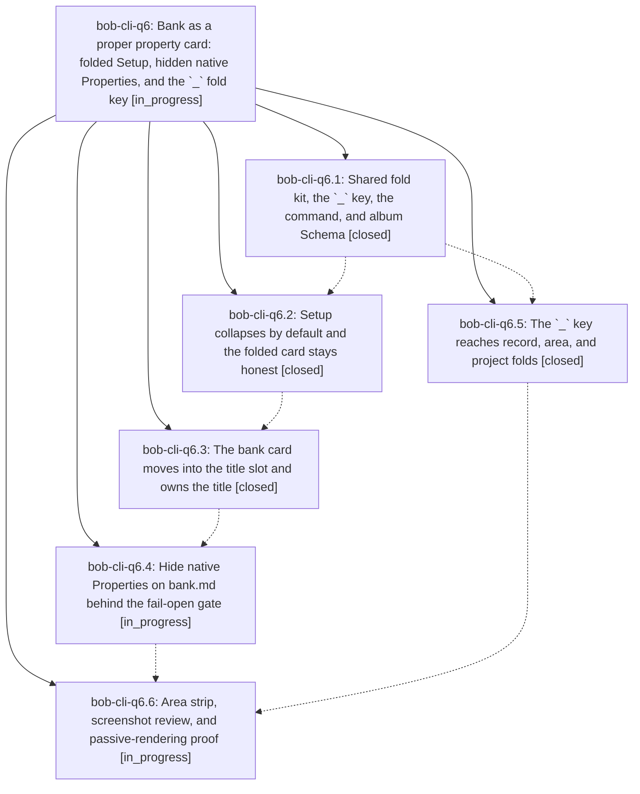

# Bead: bob-cli-q6 — Bank as a proper property card: folded Setup, hidden native Properties, and the \`\_\` fold key

[Bead Pages](../README.md) / bob-cli-q6

**Status:** ◐ in_progress · **Type:** ▸ plan · **Tier:** epic
**Owner:** `bryanbugyi34@gmail.com` · **Created by:** [bbugyi200.athena.1g2](https://github.com/bobs-org/bob-cli--agents/blob/main/sessions/bbugyi200.athena.1g2.md) · **Assignee:** `bob-cli-q6.land`
**Created:** 2026-11-25 12:49:31 EST
**Plan:** [202611/bank\_property\_card\_fold.md](https://github.com/bobs-org/bob-cli--plans/blob/main/202611/bank_property_card_fold.md)

<!-- sase:links:start -->

## Links

| Relation | Artifact | Why |
| --- | --- | --- |
| implemented-by | [plan:202611/bank_property_card_fold.md][1] | derived from the plan's `bead_id:` frontmatter field |

[1]: https://github.com/bobs-org/bob-cli--plans/blob/main/202611/bank_property_card_fold.md

<!-- sase:links:end -->

## Description

The bank card on bank.md owns the note top as a title-slot property card whose Setup folds by default (problems stay visible), native Obsidian Properties hide behind the fail-open coordinator, and a guarded bare `_` folds the card's own section on bank, album, record, area, and project cards.

## Phases

| Bead | Title | Status | Size | Created | Agents | Commits |
|---|---|---|---|---|---:|---:|
| [bob-cli-q6.1](bob-cli-q6.1.md) | Shared fold kit, the \`\_\` key, the command, and album Schema | ✓ closed | medium | 2026-11-25 | 1 | 2 |
| [bob-cli-q6.2](bob-cli-q6.2.md) | Setup collapses by default and the folded card stays honest | ✓ closed | medium | 2026-11-25 | 1 | 1 |
| [bob-cli-q6.3](bob-cli-q6.3.md) | The bank card moves into the title slot and owns the title | ✓ closed | medium | 2026-11-25 | 1 | 1 |
| [bob-cli-q6.4](bob-cli-q6.4.md) | Hide native Properties on bank.md behind the fail-open gate | ◐ in_progress | medium | 2026-11-25 | 1 | 5 |
| [bob-cli-q6.5](bob-cli-q6.5.md) | The \`\_\` key reaches record, area, and project folds | ✓ closed | medium | 2026-11-25 | 1 | 1 |
| [bob-cli-q6.6](bob-cli-q6.6.md) | Area strip, screenshot review, and passive-rendering proof | ◐ in_progress | small | 2026-11-25 | 1 | 0 |

## Lineage

## Agents

| Agent | Bead | Commits |
|---|---|---:|
| [bbugyi200.athena.bob-cli-q6.1](https://github.com/bobs-org/bob-cli--agents/blob/main/sessions/bbugyi200.athena.bob-cli-q6.1.md) | [bob-cli-q6.1](bob-cli-q6.1.md) | 2 |
| [bbugyi200.athena.bob-cli-q6.2](https://github.com/bobs-org/bob-cli--agents/blob/main/agents/bbugyi200.athena.bob-cli-q6.2/README.md) | [bob-cli-q6.2](bob-cli-q6.2.md) | 1 |
| [bbugyi200.athena.bob-cli-q6.3](https://github.com/bobs-org/bob-cli--agents/blob/main/agents/bbugyi200.athena.bob-cli-q6.3/README.md) | [bob-cli-q6.3](bob-cli-q6.3.md) | 1 |
| [bbugyi200.athena.bob-cli-q6.4](https://github.com/bobs-org/bob-cli--agents/blob/main/sessions/bbugyi200.athena.bob-cli-q6.4.md) | [bob-cli-q6.4](bob-cli-q6.4.md) | 5 |
| [bbugyi200.athena.bob-cli-q6.5](https://github.com/bobs-org/bob-cli--agents/blob/main/agents/bbugyi200.athena.bob-cli-q6.5/README.md) | [bob-cli-q6.5](bob-cli-q6.5.md) | 1 |
| [bbugyi200.athena.bob-cli-q6.6](https://github.com/bobs-org/bob-cli--agents/blob/main/agents/bbugyi200.athena.bob-cli-q6.6/README.md) | [bob-cli-q6.6](bob-cli-q6.6.md) | 0 |
| [bbugyi200.athena.bob-cli-q6.land](https://github.com/bobs-org/bob-cli--agents/blob/main/agents/bbugyi200.athena.bob-cli-q6.land/README.md) | [bob-cli-q6](README.md) | 0 |

## Commits

| Repo | Commit | Subject | Bead | Committed |
|---|---|---|---|---|
| bob-plugins | [`bob-plugins@1ff10aa`](https://github.com/bobs-org/bob-plugins/commit/1ff10aa40e7f0b5a1c290bbdfb1897466168fcd3) | feat(bob-ledger-tools): add shared property-card folding | [bob-cli-q6.1](bob-cli-q6.1.md) | 2026-11-25 13:59:27 EST |
| bob-plugins | [`bob-plugins@bdb85e3`](https://github.com/bobs-org/bob-plugins/commit/bdb85e34dca948c36e547937d45df3caabb5d50a) | fix(plugins): refine album schema and rebuild bundles | [bob-cli-q6.1](bob-cli-q6.1.md) | 2026-11-25 16:05:52 EST |
| bob-plugins | [`bob-plugins@fbe5fd8`](https://github.com/bobs-org/bob-plugins/commit/fbe5fd864f9c2c5c78ed32fcf2a912661a75d06b) | feat(bob-ledger-tools): fold bank Setup by default with honest attention | [bob-cli-q6.2](bob-cli-q6.2.md) | 2026-11-25 16:27:05 EST |
| bob-plugins | [`bob-plugins@a71a59d`](https://github.com/bobs-org/bob-plugins/commit/a71a59dba5f13bb4831af19bb336a60b77c7654f) | feat(bob-ledger-tools): fold record, area, and project details with \_ | [bob-cli-q6.5](bob-cli-q6.5.md) | 2026-11-25 16:40:42 EST |
| bob-plugins | [`bob-plugins@7d53d18`](https://github.com/bobs-org/bob-plugins/commit/7d53d18912f386472f9d87f00d32c6d38111ab93) | feat(bank): bank card owns note top with kit title block | [bob-cli-q6.3](bob-cli-q6.3.md) | 2026-11-25 17:15:17 EST |
| bob-cli | [`1ca74ec`](https://github.com/bobs-org/bob-cli/commit/1ca74ece68165cc6fc07af59fe4e2bedf7519f4f) | docs(bank): document evidence-gated Properties | [bob-cli-q6.4](bob-cli-q6.4.md) | 2026-11-25 18:24:50 EST |
| bob-plugins | [`bob-plugins@b2e6ea1`](https://github.com/bobs-org/bob-plugins/commit/b2e6ea1f02e1510df1c8dece7e034c32adf2101e) | feat(property-card): gate Properties takeover on evidence | [bob-cli-q6.4](bob-cli-q6.4.md) | 2026-11-25 18:29:15 EST |
| bob-plugins | [`bob-plugins@4c32842`](https://github.com/bobs-org/bob-plugins/commit/4c328428bcfbcde8943088347c04100cec78860b) | test(frontmatter): correct bank takeover matrix expectations | [bob-cli-q6.4](bob-cli-q6.4.md) | 2026-11-25 18:55:00 EST |
| bob-plugins | [`bob-plugins@13b936e`](https://github.com/bobs-org/bob-plugins/commit/13b936ea96fd36fd01735243754aefe082867a57) | fix(e2e): use active note path in bank gate probe | [bob-cli-q6.4](bob-cli-q6.4.md) | 2026-11-25 19:29:09 EST |
| bob-plugins | [`bob-plugins@996c718`](https://github.com/bobs-org/bob-plugins/commit/996c718f534801371e3601bac110a80917d3e268) | fix(bob-ledger-tools): restore bank ownership after eligibility changes | [bob-cli-q6.4](bob-cli-q6.4.md) | 2026-11-25 20:16:02 EST |
