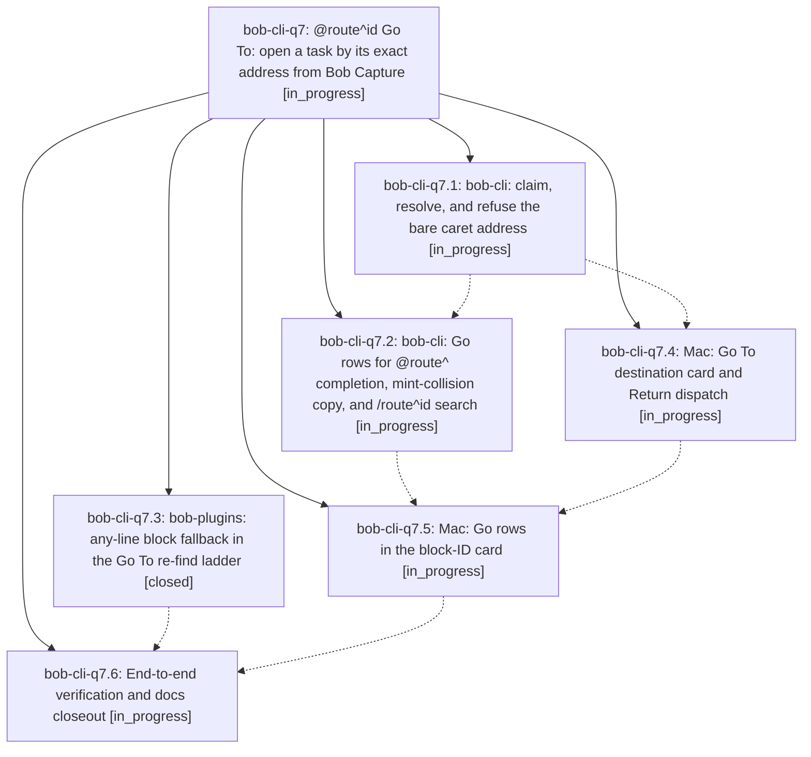

# Bead: bob-cli-q7 — @route^id Go To: open a task by its exact address from Bob Capture

[Bead Pages](../README.md) / bob-cli-q7

**Status:** ◐ in_progress · **Type:** ▸ plan · **Tier:** epic
**Owner:** `bryanbugyi34@gmail.com` · **Created by:** [bbugyi200.athena.1g6](https://github.com/bobs-org/bob-cli--agents/blob/main/sessions/bbugyi200.athena.1g6.md) · **Assignee:** `bob-cli-q7.land`
**Created:** 2026-11-25 15:25:24 EST
**Plan:** [202611/caret\_address\_goto\_capture.md](https://github.com/bobs-org/bob-cli--plans/blob/main/202611/caret_address_goto_capture.md)

<!-- sase:links:start -->

## Links

| Relation | Artifact | Why |
| --- | --- | --- |
| implemented-by | [plan:202611/caret_address_goto_capture.md][1] | derived from the plan's `bead_id:` frontmatter field |

_Plus 1 automatic references — see [Referenced By](#referenced-by)._

[1]: https://github.com/bobs-org/bob-cli--plans/blob/main/202611/caret_address_goto_capture.md

<!-- sase:links:end -->

## Description

A capture draft that is exactly one bare `@route^block-id` token resolves read-only to that block's line and, on Return, opens it in Obsidian through the same `obsidian://bob-goto-task` landing the `/` picker uses. The panel shows the destination before Return, typing `@route^` browses that note's IDs as Go rows, misses are calm did-you-mean states, nothing is ever written, and every other caret form keeps today's meaning byte for byte.

## Phases

| Bead | Title | Status | Size | Created | Agents | Commits |
|---|---|---|---|---|---:|---:|
| [bob-cli-q7.1](bob-cli-q7.1.md) | bob-cli: claim, resolve, and refuse the bare caret address | ◐ in_progress | medium | 2026-11-25 | 1 | 1 |
| [bob-cli-q7.2](bob-cli-q7.2.md) | bob-cli: Go rows for @route^ completion, mint-collision copy, and /route^id search | ◐ in_progress | medium | 2026-11-25 | 1 | 0 |
| [bob-cli-q7.3](bob-cli-q7.3.md) | bob-plugins: any-line block fallback in the Go To re-find ladder | ✓ closed | small | 2026-11-25 | 1 | 0 |
| [bob-cli-q7.4](bob-cli-q7.4.md) | Mac: Go To destination card and Return dispatch | ◐ in_progress | medium | 2026-11-25 | 1 | 0 |
| [bob-cli-q7.5](bob-cli-q7.5.md) | Mac: Go rows in the block-ID card | ◐ in_progress | medium | 2026-11-25 | 1 | 0 |
| [bob-cli-q7.6](bob-cli-q7.6.md) | End-to-end verification and docs closeout | ◐ in_progress | small | 2026-11-25 | 1 | 0 |

## Lineage

## Agents

| Agent | Bead | Commits |
|---|---|---:|
| [bbugyi200.athena.bob-cli-q7.1](https://github.com/bobs-org/bob-cli--agents/blob/main/sessions/bbugyi200.athena.bob-cli-q7.1.md) | [bob-cli-q7.1](bob-cli-q7.1.md) | 1 |
| [bbugyi200.athena.bob-cli-q7.2](https://github.com/bobs-org/bob-cli--agents/blob/main/agents/bbugyi200.athena.bob-cli-q7.2/README.md) | [bob-cli-q7.2](bob-cli-q7.2.md) | 0 |
| [bbugyi200.athena.bob-cli-q7.3](https://github.com/bobs-org/bob-cli--agents/blob/main/agents/bbugyi200.athena.bob-cli-q7.3/README.md) | [bob-cli-q7.3](bob-cli-q7.3.md) | 0 |
| [bbugyi200.athena.bob-cli-q7.4](https://github.com/bobs-org/bob-cli--agents/blob/main/agents/bbugyi200.athena.bob-cli-q7.4/README.md) | [bob-cli-q7.4](bob-cli-q7.4.md) | 0 |
| [bbugyi200.athena.bob-cli-q7.5](https://github.com/bobs-org/bob-cli--agents/blob/main/agents/bbugyi200.athena.bob-cli-q7.5/README.md) | [bob-cli-q7.5](bob-cli-q7.5.md) | 0 |
| [bbugyi200.athena.bob-cli-q7.6](https://github.com/bobs-org/bob-cli--agents/blob/main/agents/bbugyi200.athena.bob-cli-q7.6/README.md) | [bob-cli-q7.6](bob-cli-q7.6.md) | 0 |
| [bbugyi200.athena.bob-cli-q7.land](https://github.com/bobs-org/bob-cli--agents/blob/main/agents/bbugyi200.athena.bob-cli-q7.land/README.md) | [bob-cli-q7](README.md) | 0 |

## Commits

| Repo | Commit | Subject | Bead | Committed |
|---|---|---|---|---|
| bob-cli | [`4d93012`](https://github.com/bobs-org/bob-cli/commit/4d93012907c8d8048e2a6498450f4a803763c66a) | feat(capture): treat whole-draft @route^id as read-only Go To | [bob-cli-q7.1](bob-cli-q7.1.md) | 2026-11-25 17:10:47 EST |

<!-- sase:referenced-by:start -->

## Referenced By

| Relation | Artifact | Why | Uses |
| --- | --- | --- | ---: |
| read-by | [agent:bob-cli-q7.3][1] | Need parent epic DECISIONS and phase notes | 1 |

[1]: https://github.com/bobs-org/bob-cli--agents/blob/main/agents/bbugyi200.athena.bob-cli-q7.3/README.md

<!-- sase:referenced-by:end -->
